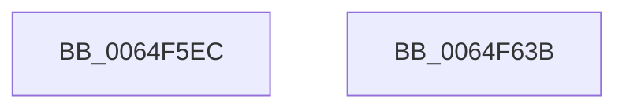

# EtwTraceCpuCacheFlush

- RVA: `0x0064F5EC`–`0x0064F63C` (길이 `80` bytes)
- VA: `0x000000014064F5EC`
- 실행 섹션: `.text`
- PDB 이름 있음: `예`; PDB Function 태그: `아니요`
- unwind 정보 RVA: `0x0005CC98`
- 디코드: `20`개 명령, `80/80` bytes 표시
- 미해석 바이트: `0` (있으면 어셈블리에 `.byte`로 보존)

> 이 문서는 커널 이미지의 기계어와 PDB 기호를 분석해 생성했습니다. 4번과 5번은 함수 원형과 자료형을 바이너리 사용 방식에서 추정한 C 해석이며 원본 소스 복구 결과는 아닙니다.

## 1. Dependencies

- 직접 호출 지점: **1**; 고유 호출 대상: **1**
- 직접 호출자로 확인된 함수: **1**
- RIP 상대 이미지 참조: **0**

### Outgoing calls
- `0x0064F631` → [EtwTraceTimedEvent](../3A/EtwTraceTimedEvent_function_003A3430.md) (function, `0x003A3430`)

### Direct callers
- [sub_006E9A0A](../6E/Unknown_function_006E9A0A.md) at `0x006E9ACB`

### Static image references
- 디코드된 RIP-relative 메모리 참조가 없습니다.

## 2. Other-region calls and transfers

- 다른 실행 섹션으로 향하는 call: **0**
- 별도 외부 분기/꼬리 이동을 확인하지 못했습니다.

## 3. Assembly (complete function range)

```asm
0064F5EC  4C 8B DC                        mov r11, rsp
0064F5EF  48 83 EC 58                     sub rsp, 0x58
0064F5F3  49 89 53 D8                     mov qword ptr [r11 - 0x28], rdx
0064F5F7  48 8B C1                        mov rax, rcx
0064F5FA  33 C9                           xor ecx, ecx
0064F5FC  4D 89 43 E0                     mov qword ptr [r11 - 0x20], r8
0064F600  45 88 4B E8                     mov byte ptr [r11 - 0x18], r9b
0064F604  4D 8D 43 D8                     lea r8, [r11 - 0x28]
0064F608  66 89 4C 24 41                  mov word ptr [rsp + 0x41], cx
0064F60D  41 B9 18 00 00 00               mov r9d, 0x18
0064F613  88 4C 24 43                     mov byte ptr [rsp + 0x43], cl
0064F617  BA 00 00 00 84                  mov edx, 0x84000000
0064F61C  89 4C 24 44                     mov dword ptr [rsp + 0x44], ecx
0064F620  B9 63 0F 00 00                  mov ecx, 0xf63
0064F625  49 89 43 D0                     mov qword ptr [r11 - 0x30], rax
0064F629  C7 44 24 20 02 1A 60 01         mov dword ptr [rsp + 0x20], 0x1601a02
0064F631  E8 FA 3D D5 FF                  call 0x1403a3430
0064F636  48 83 C4 58                     add rsp, 0x58
0064F63A  C3                              ret
0064F63B  CC                              int3
```

## 4. C-style interpretation (structured pseudocode)

```c
__int64 __fastcall EtwTraceCpuCacheFlush(__int64 a1, __int64 a2, __int64 a3, unsigned __int8 a4)
{
    __int64 result;
    __int64 v_rsp;
    unsigned int v_stack_m14;
    unsigned __int8 v_stack_m15;
    unsigned __int16 v_stack_m17;
    unsigned int v_stack_m38;

    v_rsp = (v_rsp) - (88);
    *(unsigned __int64 *)(v_rsp - 40) = a2;
    a1 = 0;
    *(unsigned __int64 *)(v_rsp - 32) = a3;
    *(unsigned __int8 *)(v_rsp - 24) = a4;
    v_stack_m17 = 0;
    v_stack_m15 = 0;
    v_stack_m14 = 0;
    *(unsigned __int64 *)(v_rsp - 48) = 0;
    v_stack_m38 = 0x1601A02ULL;
    result = EtwTraceTimedEvent((unsigned int)(0xF63ULL), (unsigned int)(0x84000000ULL), v_rsp - 40, 24);
    v_rsp = (v_rsp) + (88);
    return result;
}
```

## 5. (Beta) C Style

```c
int64_t EtwTraceCpuCacheFlush(int64_t Arg1, int64_t Arg2, int64_t Arg3, uint8_t Arg4)
{
    int64_t result;
    int64_t local_rsp;
    uint32_t v_stack_m14;
    uint8_t v_stack_m15;
    uint16_t v_stack_m17;
    uint32_t v_stack_m38;

    local_rsp = (local_rsp) - (88);
    *(uint64_t *)(local_rsp - 0x28) = Arg2;
    Arg1 = 0;
    *(uint64_t *)(local_rsp - 0x20) = Arg3;
    *(uint8_t *)(local_rsp - 0x18) = Arg4;
    v_stack_m17 = 0;
    v_stack_m15 = 0;
    v_stack_m14 = 0;
    *(uint64_t *)(local_rsp - 0x30) = 0;
    v_stack_m38 = 0x1601A02ULL;
    result = EtwTraceTimedEvent((uint32_t)(0xF63ULL), (uint32_t)(0x84000000ULL), local_rsp - 40, 24);
    local_rsp = (local_rsp) + (88);
    return result;
}
```

## 6. Execution-region graph

[열기: 2D/3D 그래프와 함수 탐색 컨트롤 패널](../../../control-panel.html?section=text&rva=0x0064F5EC&view=graph)

- 2D 그래프는 위에서 아래로 흐르고, 3D 그래프는 빈 공간을 드래그해 회전합니다. Shift+드래그는 이동, 휠은 확대·축소, 함수 노드 선택은 대상 보고서 이동입니다.

### Static fallback


