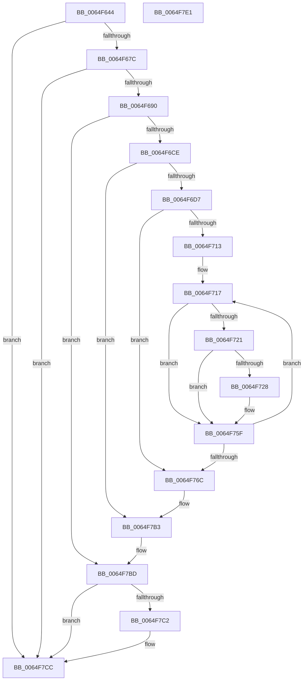

# EtwTraceCpuPartitionAffinityViolation

- RVA: `0x0064F644`–`0x0064F7E2` (길이 `414` bytes)
- VA: `0x000000014064F644`
- 실행 섹션: `.text`
- PDB 이름 있음: `예`; PDB Function 태그: `아니요`
- unwind 정보 RVA: `0x000D389C`
- 디코드: `103`개 명령, `414/414` bytes 표시
- 미해석 바이트: `0` (있으면 어셈블리에 `.byte`로 보존)

> 이 문서는 커널 이미지의 기계어와 PDB 기호를 분석해 생성했습니다. 4번과 5번은 함수 원형과 자료형을 바이너리 사용 방식에서 추정한 C 해석이며 원본 소스 복구 결과는 아닙니다.

## 1. Dependencies

- 직접 호출 지점: **6**; 고유 호출 대상: **4**
- 직접 호출자로 확인된 함수: **1**
- RIP 상대 이미지 참조: **2**

### Outgoing calls
- `0x0064F683` → [EtwEventEnabled](../39/EtwEventEnabled_function_00392450.md) (function, `0x00392450`)
- `0x0064F6A7` → [ExAllocatePool2](../../poolcode/B8/ExAllocatePool2_function_00B820F0.md) (function, `0x00B820F0`)
- `0x0064F6BD` → [ExAllocatePool2](../../poolcode/B8/ExAllocatePool2_function_00B820F0.md) (function, `0x00B820F0`)
- `0x0064F7AE` → [EtwWriteEx](../25/EtwWriteEx_function_0025F0D0.md) (function, `0x0025F0D0`)
- `0x0064F7B8` → [ExFreePoolWithTag](../../poolcode/B8/ExFreePoolWithTag_function_00B82870.md) (function, `0x00B82870`)
- `0x0064F7C7` → [ExFreePoolWithTag](../../poolcode/B8/ExFreePoolWithTag_function_00B82870.md) (function, `0x00B82870`)

### Direct callers
- [KiCpuPartitionCheckAffinitization](../5C/KiCpuPartitionCheckAffinitization_function_005C1420.md) at `0x005C1559`

### Static image references
- `0x0064F65A` → RVA `0x00EFF858` (`.data`; read)
- `0x0064F67C` → RVA `0x00021260` (`.rdata`; read)

## 2. Other-region calls and transfers

- 다른 실행 섹션으로 향하는 call: **4**
  - `0x0064F6A7` → [ExAllocatePool2](../../poolcode/B8/ExAllocatePool2_function_00B820F0.md) (`.text` → `POOLCODE`)
  - `0x0064F6BD` → [ExAllocatePool2](../../poolcode/B8/ExAllocatePool2_function_00B820F0.md) (`.text` → `POOLCODE`)
  - `0x0064F7B8` → [ExFreePoolWithTag](../../poolcode/B8/ExFreePoolWithTag_function_00B82870.md) (`.text` → `POOLCODE`)
  - `0x0064F7C7` → [ExFreePoolWithTag](../../poolcode/B8/ExFreePoolWithTag_function_00B82870.md) (`.text` → `POOLCODE`)
- 별도 외부 분기/꼬리 이동을 확인하지 못했습니다.

## 3. Assembly (complete function range)

```asm
0064F644  48 8B C4                        mov rax, rsp
0064F647  48 89 58 10                     mov qword ptr [rax + 0x10], rbx
0064F64B  48 89 68 18                     mov qword ptr [rax + 0x18], rbp
0064F64F  89 48 08                        mov dword ptr [rax + 8], ecx
0064F652  56                              push rsi
0064F653  57                              push rdi
0064F654  41 57                           push r15
0064F656  48 83 EC 50                     sub rsp, 0x50
0064F65A  48 8B 0D F7 01 8B 00            mov rcx, qword ptr [rip + 0x8b01f7]
0064F661  45 33 FF                        xor r15d, r15d
0064F664  66 44 89 78 20                  mov word ptr [rax + 0x20], r15w
0064F669  49 8B F0                        mov rsi, r8
0064F66C  44 89 78 D8                     mov dword ptr [rax - 0x28], r15d
0064F670  48 8B EA                        mov rbp, rdx
0064F673  48 85 C9                        test rcx, rcx
0064F676  0F 84 50 01 00 00               je 0x14064f7cc
0064F67C  48 8D 15 DD 1B 9D FF            lea rdx, [rip - 0x62e423]
0064F683  E8 C8 2D D4 FF                  call 0x140392450
0064F688  84 C0                           test al, al
0064F68A  0F 84 3C 01 00 00               je 0x14064f7cc
0064F690  0F B7 16                        movzx edx, word ptr [rsi]
0064F693  41 8D 7F 40                     lea edi, [r15 + 0x40]
0064F697  48 C1 E2 05                     shl rdx, 5
0064F69B  41 B8 45 74 77 74               mov r8d, 0x74777445
0064F6A1  48 83 C2 30                     add rdx, 0x30
0064F6A5  8B CF                           mov ecx, edi
0064F6A7  E8 44 2A 53 00                  call 0x140b820f0
0064F6AC  0F B7 16                        movzx edx, word ptr [rsi]
0064F6AF  41 B8 45 74 77 74               mov r8d, 0x74777445
0064F6B5  48 03 D2                        add rdx, rdx
0064F6B8  8B CF                           mov ecx, edi
0064F6BA  48 8B D8                        mov rbx, rax
0064F6BD  E8 2E 2A 53 00                  call 0x140b820f0
0064F6C2  48 8B F8                        mov rdi, rax
0064F6C5  48 85 DB                        test rbx, rbx
0064F6C8  0F 84 EF 00 00 00               je 0x14064f7bd
0064F6CE  48 85 C0                        test rax, rax
0064F6D1  0F 84 DC 00 00 00               je 0x14064f7b3
0064F6D7  48 C7 43 08 04 00 00 00         mov qword ptr [rbx + 8], 4
0064F6DF  48 8D 44 24 70                  lea rax, [rsp + 0x70]
0064F6E4  48 89 03                        mov qword ptr [rbx], rax
0064F6E7  45 0F B7 C7                     movzx r8d, r15w
0064F6EB  8B 8D 10 05 00 00               mov ecx, dword ptr [rbp + 0x510]
0064F6F1  48 8D 44 24 40                  lea rax, [rsp + 0x40]
0064F6F6  89 4C 24 40                     mov dword ptr [rsp + 0x40], ecx
0064F6FA  48 8D 4B 30                     lea rcx, [rbx + 0x30]
0064F6FE  48 89 43 10                     mov qword ptr [rbx + 0x10], rax
0064F702  48 C7 43 18 04 00 00 00         mov qword ptr [rbx + 0x18], 4
0064F70A  0F B7 06                        movzx eax, word ptr [rsi]
0064F70D  66 44 3B F8                     cmp r15w, ax
0064F711  73 59                           jae 0x14064f76c
0064F713  48 8D 51 1C                     lea rdx, [rcx + 0x1c]
0064F717  45 0F B7 C8                     movzx r9d, r8w
0064F71B  66 44 3B C0                     cmp r8w, ax
0064F71F  73 3E                           jae 0x14064f75f
0064F721  4E 39 7C CE 08                  cmp qword ptr [rsi + r9*8 + 8], r15
0064F726  74 37                           je 0x14064f75f
0064F728  4A 8D 04 4F                     lea rax, [rdi + r9*2]
0064F72C  66 44 89 00                     mov word ptr [rax], r8w
0064F730  48 89 01                        mov qword ptr [rcx], rax
0064F733  48 8D 46 08                     lea rax, [rsi + 8]
0064F737  48 C7 42 EC 02 00 00 00         mov qword ptr [rdx - 0x14], 2
0064F73F  4A 8D 04 C8                     lea rax, [rax + r9*8]
0064F743  48 89 42 F4                     mov qword ptr [rdx - 0xc], rax
0064F747  48 83 C1 20                     add rcx, 0x20
0064F74B  48 C7 42 FC 08 00 00 00         mov qword ptr [rdx - 4], 8
0064F753  48 83 C2 20                     add rdx, 0x20
0064F757  66 FF 84 24 88 00 00 00         inc word ptr [rsp + 0x88]
0064F75F  0F B7 06                        movzx eax, word ptr [rsi]
0064F762  66 41 FF C0                     inc r8w
0064F766  66 44 3B C0                     cmp r8w, ax
0064F76A  72 AB                           jb 0x14064f717
0064F76C  48 2B CB                        sub rcx, rbx
0064F76F  48 89 5C 24 38                  mov qword ptr [rsp + 0x38], rbx
0064F774  48 C1 F9 04                     sar rcx, 4
0064F778  48 8D 84 24 88 00 00 00         lea rax, [rsp + 0x88]
0064F780  89 4C 24 30                     mov dword ptr [rsp + 0x30], ecx
0064F784  48 8D 15 D5 1A 9D FF            lea rdx, [rip - 0x62e52b]
0064F78B  48 89 43 20                     mov qword ptr [rbx + 0x20], rax
0064F78F  45 33 C9                        xor r9d, r9d
0064F792  48 C7 43 28 02 00 00 00         mov qword ptr [rbx + 0x28], 2
0064F79A  45 33 C0                        xor r8d, r8d
0064F79D  48 8B 0D B4 00 8B 00            mov rcx, qword ptr [rip + 0x8b00b4]
0064F7A4  4C 89 7C 24 28                  mov qword ptr [rsp + 0x28], r15
0064F7A9  4C 89 7C 24 20                  mov qword ptr [rsp + 0x20], r15
0064F7AE  E8 1D F9 C0 FF                  call 0x14025f0d0
0064F7B3  33 D2                           xor edx, edx
0064F7B5  48 8B CB                        mov rcx, rbx
0064F7B8  E8 B3 30 53 00                  call 0x140b82870
0064F7BD  48 85 FF                        test rdi, rdi
0064F7C0  74 0A                           je 0x14064f7cc
0064F7C2  33 D2                           xor edx, edx
0064F7C4  48 8B CF                        mov rcx, rdi
0064F7C7  E8 A4 30 53 00                  call 0x140b82870
0064F7CC  4C 8D 5C 24 50                  lea r11, [rsp + 0x50]
0064F7D1  49 8B 5B 28                     mov rbx, qword ptr [r11 + 0x28]
0064F7D5  49 8B 6B 30                     mov rbp, qword ptr [r11 + 0x30]
0064F7D9  49 8B E3                        mov rsp, r11
0064F7DC  41 5F                           pop r15
0064F7DE  5F                              pop rdi
0064F7DF  5E                              pop rsi
0064F7E0  C3                              ret
0064F7E1  CC                              int3
```

## 4. C-style interpretation (structured pseudocode)

```c
__int64 __fastcall EtwTraceCpuPartitionAffinityViolation(int a1, __int64 a2, __int64 a3)
{
    __int64 result;
    __int64 v_r15;
    __int64 v_rsp;
    unsigned __int64 v_stack_m18;
    unsigned __int64 v_stack_m28;
    unsigned __int64 v_stack_m30;
    unsigned int v_stack_m38;
    unsigned __int64 v_stack_m40;
    unsigned __int64 v_stack_m48;
    unsigned __int16 v_stack_p20;
    unsigned __int64 v_stack_p8;

    *(unsigned __int64 *)(v_rsp + 16) = v_rbx;
    *(unsigned __int64 *)(v_rsp + 24) = v_rbp;
    *(unsigned int *)(v_rsp + 8) = a1;
    v_rsp = (v_rsp) - (80);
    v_r15 = 0;
    *(unsigned __int16 *)(v_rsp + 32) = 0;
    *(unsigned int *)(v_rsp - 40) = 0;
    if (*(unsigned __int64 *)(v_rip + 9110007) == 0) goto loc_0064F7CC;
    result = EtwEventEnabled(*(unsigned __int64 *)(v_rip + 9110007), v_rip - 6480931, a3, a4);
    if ((unsigned __int8)(result) == 0) goto loc_0064F7CC;
    a2 = (*(unsigned __int16 *)(a3)) << (5);
    a2 = (a2) + (48);
    result = ExAllocatePool2((unsigned int)((unsigned int)(v_r15 + 64)), a2, (unsigned int)(0x74777445ULL), a4);
    a2 = (*(unsigned __int16 *)(a3)) + (*(unsigned __int16 *)(a3));
    result = ExAllocatePool2((unsigned int)((unsigned int)(v_r15 + 64)), a2, (unsigned int)(0x74777445ULL), a4);
    if (result == 0) goto loc_0064F7BD;
    if (result == 0) goto loc_0064F7B3;
    *(unsigned __int64 *)(result + 8) = 4;
    *(unsigned __int64 *)(result) = v_stack_p8;
    v_stack_m28 = (unsigned int)((unsigned int)(*(unsigned int *)(a2 + 1296)));
    *(unsigned __int64 *)(result + 16) = v_stack_m28;
    *(unsigned __int64 *)(result + 24) = 4;
    if (0 >= ((unsigned __int16)(*(unsigned __int16 *)(a3)))) goto loc_0064F76C;
loc_0064F717:
    if (0 >= ((unsigned __int16)(*(unsigned __int16 *)(a3)))) goto loc_0064F75F;
    result = *(unsigned __int16 *)(a3);
    if ((*(unsigned __int64 *)(a3 + 0 * 8 + 8)) != 0) {
        result = result + 0 * 2;
        *(unsigned __int16 *)(result) = 0;
        *(unsigned __int64 *)(result + 48) = result;
        result = a3 + 8;
        *(unsigned __int64 *)(result + 48 + 28 - 20) = 2;
        result = result + 0 * 8;
        *(unsigned __int64 *)(result + 48 + 28 - 12) = result;
        a1 = (result + 48) + (32);
        *(unsigned __int64 *)(result + 48 + 28 - 4) = 8;
        a2 = (result + 48 + 28) + (32);
    }
    a3 = (unsigned __int16)((0) + 1);
    if (((unsigned __int16)(a3)) < ((unsigned __int16)(*(unsigned __int16 *)(a3)))) goto loc_0064F717;
loc_0064F76C:
    a1 = (a1) - (result);
    v_stack_m30 = result;
    a1 = (a1) >> (4);
    v_stack_m38 = a1;
    *(unsigned __int64 *)(result + 32) = v_stack_p20;
    a4 = 0;
    *(unsigned __int64 *)(result + 40) = 2;
    a3 = 0;
    v_stack_m40 = 0;
    v_stack_m48 = 0;
    result = EtwWriteEx(*(unsigned __int64 *)(v_rip + 9109684), v_rip - 6481195, a3, a4);
loc_0064F7B3:
    a2 = 0;
    result = ExFreePoolWithTag(result, a2, a3, a4);
loc_0064F7BD:
    if (result != 0) {
        a2 = 0;
        a1 = result;
        result = ExFreePoolWithTag(a1, a2, a3, a4);
    }
    return result;
}
```

## 5. (Beta) C Style

```c
int64_t EtwTraceCpuPartitionAffinityViolation(int32_t Arg1, void *Arg2, void *Arg3)
{
    uint8_t *arg2 = (uint8_t *)Arg2;
    uint8_t *arg3 = (uint8_t *)Arg3;

    int64_t result;
    int64_t local_r15;
    int64_t local_rsp;
    uint64_t v_stack_m18;
    uint64_t v_stack_m28;
    uint64_t v_stack_m30;
    uint32_t v_stack_m38;
    uint64_t v_stack_m40;
    uint64_t v_stack_m48;
    uint16_t v_stack_p20;
    uint64_t v_stack_p8;

    *(uint64_t *)(local_rsp + 0x10) = local_rbx;
    *(uint64_t *)(local_rsp + 0x18) = local_rbp;
    *(uint32_t *)(local_rsp + 0x8) = Arg1;
    local_rsp = (local_rsp) - (80);
    local_r15 = 0;
    *(uint16_t *)(local_rsp + 0x20) = 0;
    *(uint32_t *)(local_rsp - 0x28) = 0;
    if (*(uint64_t *)(v_rip + 0x8B01F7) == 0) goto loc_0064F7CC;
    result = EtwEventEnabled(*(uint64_t *)(v_rip + 0x8B01F7), v_rip - 6480931, Arg3, a4);
    if ((uint8_t)(result) == 0) goto loc_0064F7CC;
    Arg2 = (*(uint16_t *)(arg3)) << (5);
    Arg2 = (Arg2) + (48);
    result = ExAllocatePool2((uint32_t)((uint32_t)(local_r15 + 64)), Arg2, (uint32_t)(0x74777445ULL), a4);
    Arg2 = (*(uint16_t *)(arg3)) + (*(uint16_t *)(arg3));
    result = ExAllocatePool2((uint32_t)((uint32_t)(local_r15 + 64)), Arg2, (uint32_t)(0x74777445ULL), a4);
    if (result == 0) goto loc_0064F7BD;
    if (result == 0) goto loc_0064F7B3;
    *(uint64_t *)(result + 0x8) = 4;
    *(uint64_t *)(result) = v_stack_p8;
    v_stack_m28 = (uint32_t)((uint32_t)(*(uint32_t *)(arg2 + 0x510)));
    *(uint64_t *)(result + 0x10) = v_stack_m28;
    *(uint64_t *)(result + 0x18) = 4;
    if (0 >= ((uint16_t)(*(uint16_t *)(arg3)))) goto loc_0064F76C;
loc_0064F717:
    if (0 >= ((uint16_t)(*(uint16_t *)(arg3)))) goto loc_0064F75F;
    result = *(uint16_t *)(arg3);
    if ((*(uint64_t *)(arg3 + 0x0 * 8 + 0x8)) != 0) {
        result = result + 0 * 2;
        *(uint16_t *)(result) = 0;
        *(uint64_t *)(result + 0x30) = result;
        result = Arg3 + 8;
        *(uint64_t *)(result + 0x30 + 0x1C - 0x14) = 2;
        result = result + 0 * 8;
        *(uint64_t *)(result + 0x30 + 0x1C - 0xC) = result;
        Arg1 = (result + 48) + (32);
        *(uint64_t *)(result + 0x30 + 0x1C - 0x4) = 8;
        Arg2 = (result + 48 + 28) + (32);
    }
    Arg3 = (uint16_t)((0) + 1);
    if (((uint16_t)(Arg3)) < ((uint16_t)(*(uint16_t *)(arg3)))) goto loc_0064F717;
loc_0064F76C:
    Arg1 = (Arg1) - (result);
    v_stack_m30 = result;
    Arg1 = (Arg1) >> (4);
    v_stack_m38 = Arg1;
    *(uint64_t *)(result + 0x20) = v_stack_p20;
    a4 = 0;
    *(uint64_t *)(result + 0x28) = 2;
    Arg3 = 0;
    v_stack_m40 = 0;
    v_stack_m48 = 0;
    result = EtwWriteEx(*(uint64_t *)(v_rip + 0x8B00B4), v_rip - 6481195, Arg3, a4);
loc_0064F7B3:
    Arg2 = 0;
    result = ExFreePoolWithTag(result, Arg2, Arg3, a4);
loc_0064F7BD:
    if (result != 0) {
        Arg2 = 0;
        Arg1 = result;
        result = ExFreePoolWithTag(Arg1, Arg2, Arg3, a4);
    }
    return result;
}
```

### 관측된 메모리 오프셋

구조체 형식이 확인되지 않은 접근은 인자 기준의 오프셋으로만 기록했습니다.

| 기준 인자 | 오프셋 표현 | 폭 (bit) | 접근 |
|---|---:|---:|---|
| `Arg2` | `+ 0x510` | `32` | `R` |
| `Arg3` | `+ 0x0` | `16` | `R` |
| `Arg3` | `+ 0x0 + r9*8` | `64` | `R` |
| `Arg3` | `+ 0x8` | `64` | `R` |
| `Arg3` | `+ 0x8 + r9*8` | `64` | `R` |

## 6. Execution-region graph

[열기: 2D/3D 그래프와 함수 탐색 컨트롤 패널](../../../control-panel.html?section=text&rva=0x0064F644&view=graph)

- 2D 그래프는 위에서 아래로 흐르고, 3D 그래프는 빈 공간을 드래그해 회전합니다. Shift+드래그는 이동, 휠은 확대·축소, 함수 노드 선택은 대상 보고서 이동입니다.

### Static fallback


