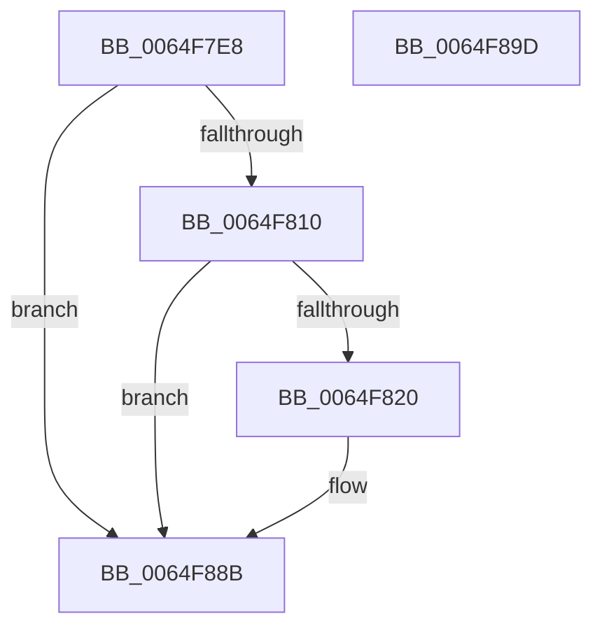

# EtwTraceCpuPartitionDpcSchedulingViolation

- RVA: `0x0064F7E8`–`0x0064F89E` (길이 `182` bytes)
- VA: `0x000000014064F7E8`
- 실행 섹션: `.text`
- PDB 이름 있음: `예`; PDB Function 태그: `아니요`
- unwind 정보 RVA: `0x000AEDFC`
- 디코드: `37`개 명령, `182/182` bytes 표시
- 미해석 바이트: `0` (있으면 어셈블리에 `.byte`로 보존)

> 이 문서는 커널 이미지의 기계어와 PDB 기호를 분석해 생성했습니다. 4번과 5번은 함수 원형과 자료형을 바이너리 사용 방식에서 추정한 C 해석이며 원본 소스 복구 결과는 아닙니다.

## 1. Dependencies

- 직접 호출 지점: **3**; 고유 호출 대상: **3**
- 직접 호출자로 확인된 함수: **1**
- RIP 상대 이미지 참조: **3**

### Outgoing calls
- `0x0064F817` → [EtwEventEnabled](../39/EtwEventEnabled_function_00392450.md) (function, `0x00392450`)
- `0x0064F886` → [EtwWriteEx](../25/EtwWriteEx_function_0025F0D0.md) (function, `0x0025F0D0`)
- `0x0064F893` → [_security_check_cookie](../6A/_security_check_cookie_function_006AC640.md) (function, `0x006AC640`)

### Direct callers
- [KiCpuPartitionCheckDpcEnqueue](../4F/KiCpuPartitionCheckDpcEnqueue_function_004FCB88.md) at `0x004FCBD9`

### Static image references
- `0x0064F7F5` → RVA `0x00E0A740` (`.data`; read)
- `0x0064F804` → RVA `0x00EFF858` (`.data`; read)
- `0x0064F810` → RVA `0x00023068` (`.rdata`; read)

## 2. Other-region calls and transfers

- 다른 실행 섹션으로 향하는 call: **0**
- 별도 외부 분기/꼬리 이동을 확인하지 못했습니다.

## 3. Assembly (complete function range)

```asm
0064F7E8  89 54 24 10                     mov dword ptr [rsp + 0x10], edx
0064F7EC  48 89 4C 24 08                  mov qword ptr [rsp + 8], rcx
0064F7F1  48 83 EC 78                     sub rsp, 0x78
0064F7F5  48 8B 05 44 AF 7B 00            mov rax, qword ptr [rip + 0x7baf44]
0064F7FC  48 33 C4                        xor rax, rsp
0064F7FF  48 89 44 24 60                  mov qword ptr [rsp + 0x60], rax
0064F804  48 8B 0D 4D 00 8B 00            mov rcx, qword ptr [rip + 0x8b004d]
0064F80B  48 85 C9                        test rcx, rcx
0064F80E  74 7B                           je 0x14064f88b
0064F810  48 8D 15 51 38 9D FF            lea rdx, [rip - 0x62c7af]
0064F817  E8 34 2C D4 FF                  call 0x140392450
0064F81C  84 C0                           test al, al
0064F81E  74 6B                           je 0x14064f88b
0064F820  83 64 24 4C 00                  and dword ptr [rsp + 0x4c], 0
0064F825  48 8D 84 24 80 00 00 00         lea rax, [rsp + 0x80]
0064F82D  83 64 24 5C 00                  and dword ptr [rsp + 0x5c], 0
0064F832  48 8D 15 2F 38 9D FF            lea rdx, [rip - 0x62c7d1]
0064F839  48 8B 0D 18 00 8B 00            mov rcx, qword ptr [rip + 0x8b0018]
0064F840  45 33 C9                        xor r9d, r9d
0064F843  48 89 44 24 40                  mov qword ptr [rsp + 0x40], rax
0064F848  45 33 C0                        xor r8d, r8d
0064F84B  48 8D 84 24 88 00 00 00         lea rax, [rsp + 0x88]
0064F853  C7 44 24 48 08 00 00 00         mov dword ptr [rsp + 0x48], 8
0064F85B  48 89 44 24 50                  mov qword ptr [rsp + 0x50], rax
0064F860  48 8D 44 24 40                  lea rax, [rsp + 0x40]
0064F865  48 89 44 24 38                  mov qword ptr [rsp + 0x38], rax
0064F86A  C7 44 24 30 02 00 00 00         mov dword ptr [rsp + 0x30], 2
0064F872  48 83 64 24 28 00               and qword ptr [rsp + 0x28], 0
0064F878  48 83 64 24 20 00               and qword ptr [rsp + 0x20], 0
0064F87E  C7 44 24 58 04 00 00 00         mov dword ptr [rsp + 0x58], 4
0064F886  E8 45 F8 C0 FF                  call 0x14025f0d0
0064F88B  48 8B 4C 24 60                  mov rcx, qword ptr [rsp + 0x60]
0064F890  48 33 CC                        xor rcx, rsp
0064F893  E8 A8 CD 05 00                  call 0x1406ac640
0064F898  48 83 C4 78                     add rsp, 0x78
0064F89C  C3                              ret
0064F89D  CC                              int3
```

## 4. C-style interpretation (structured pseudocode)

```c
__int64 __fastcall EtwTraceCpuPartitionDpcSchedulingViolation(__int64 a1, int a2, int a3, int a4)
{
    __int64 result;
    __int64 v_rsp;
    unsigned __int64 v_stack_m18;
    unsigned int v_stack_m1C;
    unsigned int v_stack_m20;
    unsigned __int64 v_stack_m28;
    unsigned int v_stack_m2C;
    unsigned int v_stack_m30;
    unsigned __int64 v_stack_m38;
    unsigned __int64 v_stack_m40;
    unsigned int v_stack_m48;
    unsigned __int64 v_stack_m50;
    unsigned __int64 v_stack_m58;
    unsigned int v_stack_p10;
    unsigned __int64 v_stack_p8;

    v_stack_p10 = a2;
    v_stack_p8 = a1;
    v_rsp = (v_rsp) - (120);
    result = (*(unsigned __int64 *)(v_rip + 8105796)) ^ (v_rsp);
    v_stack_m18 = result;
    if (*(unsigned __int64 *)(v_rip + 9109581) == 0) goto loc_0064F88B;
    result = EtwEventEnabled(*(unsigned __int64 *)(v_rip + 9109581), v_rip - 6473647, a3, a4);
    if ((unsigned __int8)(result) != 0) {
        result = v_stack_p8;
        a2 = v_rip - 6473681;
        a1 = *(unsigned __int64 *)(v_rip + 9109528);
        a4 = 0;
        v_stack_m38 = result;
        a3 = 0;
        result = v_stack_p10;
        v_stack_m30 = 8;
        v_stack_m28 = result;
        result = v_stack_m38;
        v_stack_m40 = result;
        v_stack_m48 = 2;
        v_stack_m20 = 4;
        result = EtwWriteEx(a1, a2, a3, a4);
    }
    a1 = (v_stack_m18) ^ (v_rsp);
    result = _security_check_cookie(a1, a2, a3, a4);
    v_rsp = (v_rsp) + (120);
    return result;
}
```

## 5. (Beta) C Style

```c
int64_t EtwTraceCpuPartitionDpcSchedulingViolation(int64_t Arg1, int32_t Arg2, int32_t Arg3, int32_t Arg4)
{
    int64_t result;
    int64_t local_rsp;
    uint64_t v_stack_m18;
    uint32_t v_stack_m1C;
    uint32_t v_stack_m20;
    uint64_t v_stack_m28;
    uint32_t v_stack_m2C;
    uint32_t v_stack_m30;
    uint64_t v_stack_m38;
    uint64_t v_stack_m40;
    uint32_t v_stack_m48;
    uint64_t v_stack_m50;
    uint64_t v_stack_m58;
    uint32_t v_stack_p10;
    uint64_t v_stack_p8;

    v_stack_p10 = Arg2;
    v_stack_p8 = Arg1;
    local_rsp = (local_rsp) - (120);
    result = (*(uint64_t *)(v_rip + 0x7BAF44)) ^ (local_rsp);
    v_stack_m18 = result;
    if (*(uint64_t *)(v_rip + 0x8B004D) == 0) goto loc_0064F88B;
    result = EtwEventEnabled(*(uint64_t *)(v_rip + 0x8B004D), v_rip - 6473647, Arg3, Arg4);
    if ((uint8_t)(result) != 0) {
        result = v_stack_p8;
        Arg2 = v_rip - 6473681;
        Arg1 = *(uint64_t *)(v_rip + 0x8B0018);
        Arg4 = 0;
        v_stack_m38 = result;
        Arg3 = 0;
        result = v_stack_p10;
        v_stack_m30 = 8;
        v_stack_m28 = result;
        result = v_stack_m38;
        v_stack_m40 = result;
        v_stack_m48 = 2;
        v_stack_m20 = 4;
        result = EtwWriteEx(Arg1, Arg2, Arg3, Arg4);
    }
    Arg1 = (v_stack_m18) ^ (local_rsp);
    result = _security_check_cookie(Arg1, Arg2, Arg3, Arg4);
    local_rsp = (local_rsp) + (120);
    return result;
}
```

## 6. Execution-region graph

[열기: 2D/3D 그래프와 함수 탐색 컨트롤 패널](../../../control-panel.html?section=text&rva=0x0064F7E8&view=graph)

- 2D 그래프는 위에서 아래로 흐르고, 3D 그래프는 빈 공간을 드래그해 회전합니다. Shift+드래그는 이동, 휠은 확대·축소, 함수 노드 선택은 대상 보고서 이동입니다.

### Static fallback


