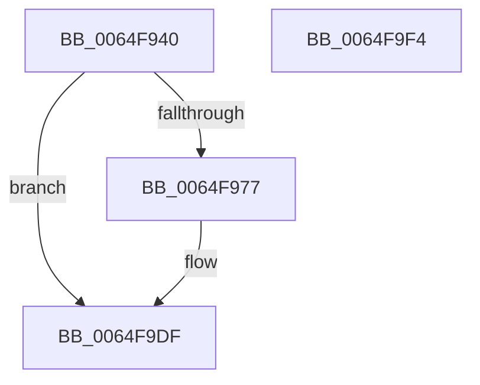

# EtwTraceCumulativeDpcSoftTimeout

- RVA: `0x0064F940`–`0x0064F9F5` (길이 `181` bytes)
- VA: `0x000000014064F940`
- 실행 섹션: `.text`
- PDB 이름 있음: `예`; PDB Function 태그: `아니요`
- unwind 정보 RVA: `0x000D1FD8`
- 디코드: `46`개 명령, `181/181` bytes 표시
- 미해석 바이트: `0` (있으면 어셈블리에 `.byte`로 보존)

> 이 문서는 커널 이미지의 기계어와 PDB 기호를 분석해 생성했습니다. 4번과 5번은 함수 원형과 자료형을 바이너리 사용 방식에서 추정한 C 해석이며 원본 소스 복구 결과는 아닙니다.

## 1. Dependencies

- 직접 호출 지점: **2**; 고유 호출 대상: **2**
- 직접 호출자로 확인된 함수: **1**
- RIP 상대 이미지 참조: **3**

### Outgoing calls
- `0x0064F9DA` → [EtwWriteEx](../25/EtwWriteEx_function_0025F0D0.md) (function, `0x0025F0D0`)
- `0x0064F9E6` → [_security_check_cookie](../6A/_security_check_cookie_function_006AC640.md) (function, `0x006AC640`)

### Direct callers
- [KiDpcWatchdogCounterReset](../39/KiDpcWatchdogCounterReset_function_0039D6A0.md) at `0x0039D71C`

### Static image references
- `0x0064F957` → RVA `0x00E0A740` (`.data`; read)
- `0x0064F96B` → RVA `0x00EFF830` (`.data`; read)
- `0x0064F9CA` → RVA `0x00020F08` (`.rdata`; read)

## 2. Other-region calls and transfers

- 다른 실행 섹션으로 향하는 call: **0**
- 별도 외부 분기/꼬리 이동을 확인하지 못했습니다.

## 3. Assembly (complete function range)

```asm
0064F940  4C 8B DC                        mov r11, rsp
0064F943  45 89 4B 20                     mov dword ptr [r11 + 0x20], r9d
0064F947  45 89 43 18                     mov dword ptr [r11 + 0x18], r8d
0064F94B  55                              push rbp
0064F94C  49 8D 6B A1                     lea rbp, [r11 - 0x5f]
0064F950  48 81 EC A0 00 00 00            sub rsp, 0xa0
0064F957  48 8B 05 E2 AD 7B 00            mov rax, qword ptr [rip + 0x7bade2]
0064F95E  48 33 C4                        xor rax, rsp
0064F961  48 89 45 47                     mov qword ptr [rbp + 0x47], rax
0064F965  4C 8B C1                        mov r8, rcx
0064F968  45 33 C9                        xor r9d, r9d
0064F96B  48 8B 0D BE FE 8A 00            mov rcx, qword ptr [rip + 0x8afebe]
0064F972  48 85 C9                        test rcx, rcx
0064F975  74 68                           je 0x14064f9df
0064F977  8B 42 24                        mov eax, dword ptr [rdx + 0x24]
0064F97A  41 8D 51 04                     lea edx, [r9 + 4]
0064F97E  89 45 FB                        mov dword ptr [rbp - 5], eax
0064F981  41 8B 80 10 05 00 00            mov eax, dword ptr [r8 + 0x510]
0064F988  45 33 C0                        xor r8d, r8d
0064F98B  89 45 F7                        mov dword ptr [rbp - 9], eax
0064F98E  48 8D 45 F7                     lea rax, [rbp - 9]
0064F992  48 89 45 07                     mov qword ptr [rbp + 7], rax
0064F996  48 8D 45 FB                     lea rax, [rbp - 5]
0064F99A  48 89 45 17                     mov qword ptr [rbp + 0x17], rax
0064F99E  48 8D 45 77                     lea rax, [rbp + 0x77]
0064F9A2  48 89 45 27                     mov qword ptr [rbp + 0x27], rax
0064F9A6  48 8D 45 7F                     lea rax, [rbp + 0x7f]
0064F9AA  48 89 45 37                     mov qword ptr [rbp + 0x37], rax
0064F9AE  48 8D 45 07                     lea rax, [rbp + 7]
0064F9B2  49 89 43 90                     mov qword ptr [r11 - 0x70], rax
0064F9B6  89 54 24 30                     mov dword ptr [rsp + 0x30], edx
0064F9BA  48 89 55 0F                     mov qword ptr [rbp + 0xf], rdx
0064F9BE  48 89 55 1F                     mov qword ptr [rbp + 0x1f], rdx
0064F9C2  48 89 55 2F                     mov qword ptr [rbp + 0x2f], rdx
0064F9C6  48 89 55 3F                     mov qword ptr [rbp + 0x3f], rdx
0064F9CA  48 8D 15 37 15 9D FF            lea rdx, [rip - 0x62eac9]
0064F9D1  4D 89 4B 80                     mov qword ptr [r11 - 0x80], r9
0064F9D5  4C 89 4C 24 20                  mov qword ptr [rsp + 0x20], r9
0064F9DA  E8 F1 F6 C0 FF                  call 0x14025f0d0
0064F9DF  48 8B 4D 47                     mov rcx, qword ptr [rbp + 0x47]
0064F9E3  48 33 CC                        xor rcx, rsp
0064F9E6  E8 55 CC 05 00                  call 0x1406ac640
0064F9EB  48 81 C4 A0 00 00 00            add rsp, 0xa0
0064F9F2  5D                              pop rbp
0064F9F3  C3                              ret
0064F9F4  CC                              int3
```

## 4. C-style interpretation (structured pseudocode)

```c
__int64 __fastcall EtwTraceCumulativeDpcSoftTimeout(__int64 a1, __int64 a2, int a3, int a4)
{
    __int64 result;
    __int64 v_rsp;
    unsigned int v_stack_m78;
    unsigned __int64 v_stack_m88;

    *(unsigned int *)(v_rsp + 32) = a4;
    *(unsigned int *)(v_rsp + 24) = a3;
    v_rsp = (v_rsp) - (160);
    result = (*(unsigned __int64 *)(v_rip + 8105442)) ^ (v_rsp);
    *(unsigned __int64 *)(v_rsp - 95 + 71) = result;
    a4 = 0;
    if (*(unsigned __int64 *)(v_rip + 9109182) != 0) {
        result = *(unsigned int *)(a2 + 36);
        a2 = a4 + 4;
        *(unsigned int *)(v_rsp - 95 - 5) = (unsigned int)(result);
        result = *(unsigned int *)(a1 + 1296);
        a3 = 0;
        *(unsigned int *)(v_rsp - 95 - 9) = (unsigned int)(result);
        result = v_rsp - 95 - 9;
        *(unsigned __int64 *)(v_rsp - 95 + 7) = result;
        result = v_rsp - 95 - 5;
        *(unsigned __int64 *)(v_rsp - 95 + 23) = result;
        result = v_rsp - 95 + 119;
        *(unsigned __int64 *)(v_rsp - 95 + 39) = result;
        result = v_rsp - 95 + 127;
        *(unsigned __int64 *)(v_rsp - 95 + 55) = result;
        result = v_rsp - 95 + 7;
        *(unsigned __int64 *)(v_rsp - 112) = result;
        v_stack_m78 = (unsigned int)(a2);
        *(unsigned __int64 *)(v_rsp - 95 + 15) = a2;
        *(unsigned __int64 *)(v_rsp - 95 + 31) = a2;
        *(unsigned __int64 *)(v_rsp - 95 + 47) = a2;
        *(unsigned __int64 *)(v_rsp - 95 + 63) = a2;
        a2 = v_rip - 6482633;
        *(unsigned __int64 *)(v_rsp - 128) = 0;
        v_stack_m88 = 0;
        result = EtwWriteEx(*(unsigned __int64 *)(v_rip + 9109182), a2, a3, a4);
    }
    a1 = (*(unsigned __int64 *)(v_rsp - 95 + 71)) ^ (v_rsp);
    result = _security_check_cookie(a1, a2, a3, a4);
    v_rsp = (v_rsp) + (160);
    return result;
}
```

## 5. (Beta) C Style

```c
int64_t EtwTraceCumulativeDpcSoftTimeout(void *Arg1, void *Arg2, int32_t Arg3, int32_t Arg4)
{
    uint8_t *arg1 = (uint8_t *)Arg1;
    uint8_t *arg2 = (uint8_t *)Arg2;

    int64_t result;
    int64_t local_rsp;
    uint32_t v_stack_m78;
    uint64_t v_stack_m88;

    *(uint32_t *)(local_rsp + 0x20) = Arg4;
    *(uint32_t *)(local_rsp + 0x18) = Arg3;
    local_rsp = (local_rsp) - (160);
    result = (*(uint64_t *)(v_rip + 0x7BADE2)) ^ (local_rsp);
    *(uint64_t *)(local_rsp - 0x5F + 0x47) = result;
    Arg4 = 0;
    if (*(uint64_t *)(v_rip + 0x8AFEBE) != 0) {
        result = *(uint32_t *)(arg2 + 0x24);
        Arg2 = Arg4 + 4;
        *(uint32_t *)(local_rsp - 0x5F - 0x5) = (uint32_t)(result);
        result = *(uint32_t *)(arg1 + 0x510);
        Arg3 = 0;
        *(uint32_t *)(local_rsp - 0x5F - 0x9) = (uint32_t)(result);
        result = local_rsp - 95 - 9;
        *(uint64_t *)(local_rsp - 0x5F + 0x7) = result;
        result = local_rsp - 95 - 5;
        *(uint64_t *)(local_rsp - 0x5F + 0x17) = result;
        result = local_rsp - 95 + 119;
        *(uint64_t *)(local_rsp - 0x5F + 0x27) = result;
        result = local_rsp - 95 + 127;
        *(uint64_t *)(local_rsp - 0x5F + 0x37) = result;
        result = local_rsp - 95 + 7;
        *(uint64_t *)(local_rsp - 0x70) = result;
        v_stack_m78 = (uint32_t)(Arg2);
        *(void **)(local_rsp - 0x5F + 0xF) = Arg2;
        *(void **)(local_rsp - 0x5F + 0x1F) = Arg2;
        *(void **)(local_rsp - 0x5F + 0x2F) = Arg2;
        *(void **)(local_rsp - 0x5F + 0x3F) = Arg2;
        Arg2 = v_rip - 6482633;
        *(uint64_t *)(local_rsp - 0x80) = 0;
        v_stack_m88 = 0;
        result = EtwWriteEx(*(uint64_t *)(v_rip + 0x8AFEBE), Arg2, Arg3, Arg4);
    }
    Arg1 = (*(uint64_t *)(local_rsp - 0x5F + 0x47)) ^ (local_rsp);
    result = _security_check_cookie(Arg1, Arg2, Arg3, Arg4);
    local_rsp = (local_rsp) + (160);
    return result;
}
```

### 관측된 메모리 오프셋

구조체 형식이 확인되지 않은 접근은 인자 기준의 오프셋으로만 기록했습니다.

| 기준 인자 | 오프셋 표현 | 폭 (bit) | 접근 |
|---|---:|---:|---|
| `Arg1` | `+ 0x510` | `32` | `R` |
| `Arg2` | `+ 0x24` | `32` | `R` |

## 6. Execution-region graph

[열기: 2D/3D 그래프와 함수 탐색 컨트롤 패널](../../../control-panel.html?section=text&rva=0x0064F940&view=graph)

- 2D 그래프는 위에서 아래로 흐르고, 3D 그래프는 빈 공간을 드래그해 회전합니다. Shift+드래그는 이동, 휠은 확대·축소, 함수 노드 선택은 대상 보고서 이동입니다.

### Static fallback


