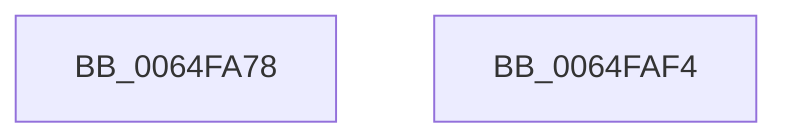

# EtwTraceInswapProcess

- RVA: `0x0064FA78`–`0x0064FAF5` (길이 `125` bytes)
- VA: `0x000000014064FA78`
- 실행 섹션: `.text`
- PDB 이름 있음: `예`; PDB Function 태그: `아니요`
- unwind 정보 RVA: `0x00065FB8`
- 디코드: `27`개 명령, `125/125` bytes 표시
- 미해석 바이트: `0` (있으면 어셈블리에 `.byte`로 보존)

> 이 문서는 커널 이미지의 기계어와 PDB 기호를 분석해 생성했습니다. 4번과 5번은 함수 원형과 자료형을 바이너리 사용 방식에서 추정한 C 해석이며 원본 소스 복구 결과는 아닙니다.

## 1. Dependencies

- 직접 호출 지점: **2**; 고유 호출 대상: **2**
- 직접 호출자로 확인된 함수: **1**
- RIP 상대 이미지 참조: **1**

### Outgoing calls
- `0x0064FADD` → [EtwTraceKernelEvent](../23/EtwTraceKernelEvent_function_00235350.md) (function, `0x00235350`)
- `0x0064FAEA` → [_security_check_cookie](../6A/_security_check_cookie_function_006AC640.md) (function, `0x006AC640`)

### Direct callers
- [sub_006F28BE](../6F/Unknown_function_006F28BE.md) at `0x006F2A33`

### Static image references
- `0x0064FA7F` → RVA `0x00E0A740` (`.data`; read)

## 2. Other-region calls and transfers

- 다른 실행 섹션으로 향하는 call: **0**
- 별도 외부 분기/꼬리 이동을 확인하지 못했습니다.

## 3. Assembly (complete function range)

```asm
0064FA78  4C 8B DC                        mov r11, rsp
0064FA7B  48 83 EC 68                     sub rsp, 0x68
0064FA7F  48 8B 05 BA AC 7B 00            mov rax, qword ptr [rip + 0x7bacba]
0064FA86  48 33 C4                        xor rax, rsp
0064FA89  48 89 44 24 50                  mov qword ptr [rsp + 0x50], rax
0064FA8E  8B 81 D0 01 00 00               mov eax, dword ptr [rcx + 0x1d0]
0064FA94  41 B9 23 03 00 00               mov r9d, 0x323
0064FA9A  83 64 24 3C 00                  and dword ptr [rsp + 0x3c], 0
0064FA9F  BA 01 00 00 00                  mov edx, 1
0064FAA4  89 44 24 38                     mov dword ptr [rsp + 0x38], eax
0064FAA8  41 B8 00 08 00 20               mov r8d, 0x20000800
0064FAAE  48 8B 41 28                     mov rax, qword ptr [rcx + 0x28]
0064FAB2  49 8D 4B D8                     lea rcx, [r11 - 0x28]
0064FAB6  48 25 00 F0 FF FF               and rax, 0xfffffffffffff000
0064FABC  C7 44 24 20 02 19 60 00         mov dword ptr [rsp + 0x20], 0x601902
0064FAC4  49 89 43 C8                     mov qword ptr [r11 - 0x38], rax
0064FAC8  49 8D 43 C8                     lea rax, [r11 - 0x38]
0064FACC  49 89 43 D8                     mov qword ptr [r11 - 0x28], rax
0064FAD0  83 64 24 4C 00                  and dword ptr [rsp + 0x4c], 0
0064FAD5  C7 44 24 48 0C 00 00 00         mov dword ptr [rsp + 0x48], 0xc
0064FADD  E8 6E 58 BE FF                  call 0x140235350
0064FAE2  48 8B 4C 24 50                  mov rcx, qword ptr [rsp + 0x50]
0064FAE7  48 33 CC                        xor rcx, rsp
0064FAEA  E8 51 CB 05 00                  call 0x1406ac640
0064FAEF  48 83 C4 68                     add rsp, 0x68
0064FAF3  C3                              ret
0064FAF4  CC                              int3
```

## 4. C-style interpretation (structured pseudocode)

```c
__int64 __fastcall EtwTraceInswapProcess(__int64 a1)
{
    __int64 result;
    __int64 v_rsp;
    unsigned __int64 v_stack_m18;
    unsigned int v_stack_m1C;
    unsigned int v_stack_m20;
    unsigned int v_stack_m2C;
    unsigned int v_stack_m30;
    unsigned int v_stack_m48;

    v_rsp = (v_rsp) - (104);
    result = (*(unsigned __int64 *)(v_rip + 8105146)) ^ (v_rsp);
    v_stack_m18 = result;
    v_stack_m30 = (unsigned int)((unsigned int)(*(unsigned int *)(a1 + 464)));
    result = (*(unsigned __int64 *)(a1 + 40)) & (0xFFFFFFFFFFFFF000ULL);
    v_stack_m48 = 0x601902ULL;
    *(unsigned __int64 *)(v_rsp - 56) = result;
    *(unsigned __int64 *)(v_rsp - 40) = v_rsp - 56;
    v_stack_m20 = 12;
    result = EtwTraceKernelEvent(v_rsp - 40, 1, (unsigned int)(0x20000800ULL), 803);
    a1 = (v_stack_m18) ^ (v_rsp);
    result = _security_check_cookie(a1, 1, (unsigned int)(0x20000800ULL), 803);
    v_rsp = (v_rsp) + (104);
    return result;
}
```

## 5. (Beta) C Style

```c
int64_t EtwTraceInswapProcess(void *Arg1)
{
    uint8_t *arg1 = (uint8_t *)Arg1;

    int64_t result;
    int64_t local_rsp;
    uint64_t v_stack_m18;
    uint32_t v_stack_m1C;
    uint32_t v_stack_m20;
    uint32_t v_stack_m2C;
    uint32_t v_stack_m30;
    uint32_t v_stack_m48;

    local_rsp = (local_rsp) - (104);
    result = (*(uint64_t *)(v_rip + 0x7BACBA)) ^ (local_rsp);
    v_stack_m18 = result;
    v_stack_m30 = (uint32_t)((uint32_t)(*(uint32_t *)(arg1 + 0x1D0)));
    result = (*(uint64_t *)(arg1 + 0x28)) & (0xFFFFFFFFFFFFF000ULL);
    v_stack_m48 = 0x601902ULL;
    *(uint64_t *)(local_rsp - 0x38) = result;
    *(uint64_t *)(local_rsp - 0x28) = local_rsp - 56;
    v_stack_m20 = 12;
    result = EtwTraceKernelEvent(local_rsp - 40, 1, (uint32_t)(0x20000800ULL), 803);
    Arg1 = (v_stack_m18) ^ (local_rsp);
    result = _security_check_cookie(Arg1, 1, (uint32_t)(0x20000800ULL), 803);
    local_rsp = (local_rsp) + (104);
    return result;
}
```

### 관측된 메모리 오프셋

구조체 형식이 확인되지 않은 접근은 인자 기준의 오프셋으로만 기록했습니다.

| 기준 인자 | 오프셋 표현 | 폭 (bit) | 접근 |
|---|---:|---:|---|
| `Arg1` | `+ 0x28` | `64` | `R` |
| `Arg1` | `+ 0x1D0` | `32` | `R` |

## 6. Execution-region graph

[열기: 2D/3D 그래프와 함수 탐색 컨트롤 패널](../../../control-panel.html?section=text&rva=0x0064FA78&view=graph)

- 2D 그래프는 위에서 아래로 흐르고, 3D 그래프는 빈 공간을 드래그해 회전합니다. Shift+드래그는 이동, 휠은 확대·축소, 함수 노드 선택은 대상 보고서 이동입니다.

### Static fallback


