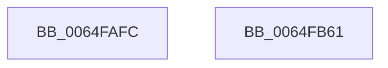

# EtwTraceIoTimerEvent

- RVA: `0x0064FAFC`–`0x0064FB62` (길이 `102` bytes)
- VA: `0x000000014064FAFC`
- 실행 섹션: `.text`
- PDB 이름 있음: `예`; PDB Function 태그: `아니요`
- unwind 정보 RVA: `0x00065FB8`
- 디코드: `23`개 명령, `102/102` bytes 표시
- 미해석 바이트: `0` (있으면 어셈블리에 `.byte`로 보존)

> 이 문서는 커널 이미지의 기계어와 PDB 기호를 분석해 생성했습니다. 4번과 5번은 함수 원형과 자료형을 바이너리 사용 방식에서 추정한 C 해석이며 원본 소스 복구 결과는 아닙니다.

## 1. Dependencies

- 직접 호출 지점: **2**; 고유 호출 대상: **2**
- 직접 호출자로 확인된 함수: **2**
- RIP 상대 이미지 참조: **1**

### Outgoing calls
- `0x0064FB4A` → [EtwTraceKernelEvent](../23/EtwTraceKernelEvent_function_00235350.md) (function, `0x00235350`)
- `0x0064FB57` → [_security_check_cookie](../6A/_security_check_cookie_function_006AC640.md) (function, `0x006AC640`)

### Direct callers
- [IopDisableTimer](../59/IopDisableTimer_function_00597000.md) at `0x00597060`
- [IopEnableTimer](../59/IopEnableTimer_function_00597240.md) at `0x005972CE`

### Static image references
- `0x0064FB03` → RVA `0x00E0A740` (`.data`; read)

## 2. Other-region calls and transfers

- 다른 실행 섹션으로 향하는 call: **0**
- 별도 외부 분기/꼬리 이동을 확인하지 못했습니다.

## 3. Assembly (complete function range)

```asm
0064FAFC  4C 8B DC                        mov r11, rsp
0064FAFF  48 83 EC 68                     sub rsp, 0x68
0064FB03  48 8B 05 36 AC 7B 00            mov rax, qword ptr [rip + 0x7bac36]
0064FB0A  48 33 C4                        xor rax, rsp
0064FB0D  48 89 44 24 50                  mov qword ptr [rsp + 0x50], rax
0064FB12  49 8D 43 C8                     lea rax, [r11 - 0x38]
0064FB16  4D 89 43 D0                     mov qword ptr [r11 - 0x30], r8
0064FB1A  49 89 43 D8                     mov qword ptr [r11 - 0x28], rax
0064FB1E  44 0F B7 C9                     movzx r9d, cx
0064FB22  83 64 24 4C 00                  and dword ptr [rsp + 0x4c], 0
0064FB27  49 8D 4B D8                     lea rcx, [r11 - 0x28]
0064FB2B  49 89 53 C8                     mov qword ptr [r11 - 0x38], rdx
0064FB2F  41 B8 00 00 80 40               mov r8d, 0x40800000
0064FB35  BA 01 00 00 00                  mov edx, 1
0064FB3A  C7 44 24 48 10 00 00 00         mov dword ptr [rsp + 0x48], 0x10
0064FB42  C7 44 24 20 02 18 60 00         mov dword ptr [rsp + 0x20], 0x601802
0064FB4A  E8 01 58 BE FF                  call 0x140235350
0064FB4F  48 8B 4C 24 50                  mov rcx, qword ptr [rsp + 0x50]
0064FB54  48 33 CC                        xor rcx, rsp
0064FB57  E8 E4 CA 05 00                  call 0x1406ac640
0064FB5C  48 83 C4 68                     add rsp, 0x68
0064FB60  C3                              ret
0064FB61  CC                              int3
```

## 4. C-style interpretation (structured pseudocode)

```c
__int64 __fastcall EtwTraceIoTimerEvent(unsigned __int16 a1, __int64 a2, __int64 a3)
{
    __int64 result;
    __int64 v_rsp;
    unsigned __int64 v_stack_m18;
    unsigned int v_stack_m1C;
    unsigned int v_stack_m20;
    unsigned int v_stack_m48;

    v_rsp = (v_rsp) - (104);
    result = (*(unsigned __int64 *)(v_rip + 8105014)) ^ (v_rsp);
    v_stack_m18 = result;
    *(unsigned __int64 *)(v_rsp - 48) = a3;
    *(unsigned __int64 *)(v_rsp - 40) = v_rsp - 56;
    *(unsigned __int64 *)(v_rsp - 56) = a2;
    v_stack_m20 = 16;
    v_stack_m48 = 0x601802ULL;
    result = EtwTraceKernelEvent(v_rsp - 40, 1, (unsigned int)(0x40800000ULL), a1);
    a1 = (v_stack_m18) ^ (v_rsp);
    result = _security_check_cookie(a1, 1, (unsigned int)(0x40800000ULL), a1);
    v_rsp = (v_rsp) + (104);
    return result;
}
```

## 5. (Beta) C Style

```c
int64_t EtwTraceIoTimerEvent(uint16_t Arg1, int64_t Arg2, int64_t Arg3)
{
    int64_t result;
    int64_t local_rsp;
    uint64_t v_stack_m18;
    uint32_t v_stack_m1C;
    uint32_t v_stack_m20;
    uint32_t v_stack_m48;

    local_rsp = (local_rsp) - (104);
    result = (*(uint64_t *)(v_rip + 0x7BAC36)) ^ (local_rsp);
    v_stack_m18 = result;
    *(uint64_t *)(local_rsp - 0x30) = Arg3;
    *(uint64_t *)(local_rsp - 0x28) = local_rsp - 56;
    *(uint64_t *)(local_rsp - 0x38) = Arg2;
    v_stack_m20 = 16;
    v_stack_m48 = 0x601802ULL;
    result = EtwTraceKernelEvent(local_rsp - 40, 1, (uint32_t)(0x40800000ULL), Arg1);
    Arg1 = (v_stack_m18) ^ (local_rsp);
    result = _security_check_cookie(Arg1, 1, (uint32_t)(0x40800000ULL), Arg1);
    local_rsp = (local_rsp) + (104);
    return result;
}
```

## 6. Execution-region graph

[열기: 2D/3D 그래프와 함수 탐색 컨트롤 패널](../../../control-panel.html?section=text&rva=0x0064FAFC&view=graph)

- 2D 그래프는 위에서 아래로 흐르고, 3D 그래프는 빈 공간을 드래그해 회전합니다. Shift+드래그는 이동, 휠은 확대·축소, 함수 노드 선택은 대상 보고서 이동입니다.

### Static fallback


