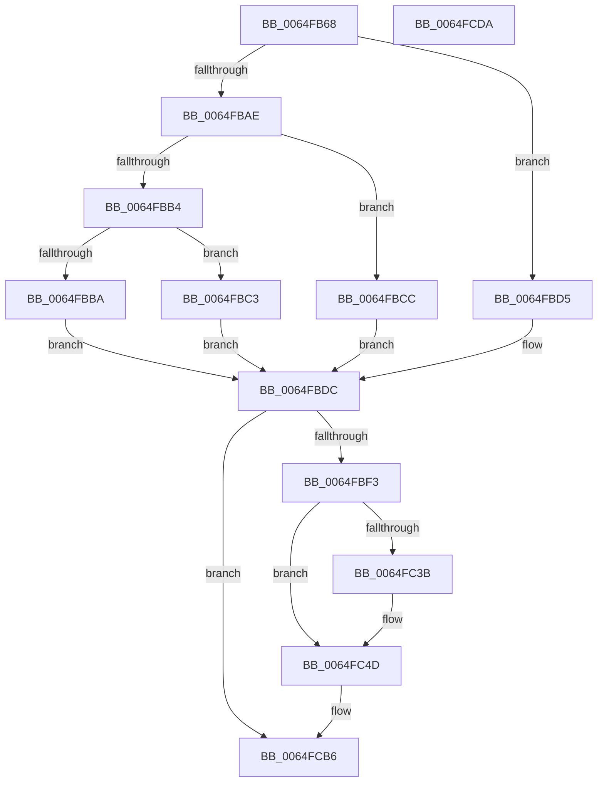

# EtwTraceJobServerSiloMonitorCallback

- RVA: `0x0064FB68`–`0x0064FCDB` (길이 `371` bytes)
- VA: `0x000000014064FB68`
- 실행 섹션: `.text`
- PDB 이름 있음: `예`; PDB Function 태그: `아니요`
- unwind 정보 RVA: `0x000D383C`
- 디코드: `97`개 명령, `371/371` bytes 표시
- 미해석 바이트: `0` (있으면 어셈블리에 `.byte`로 보존)

> 이 문서는 커널 이미지의 기계어와 PDB 기호를 분석해 생성했습니다. 4번과 5번은 함수 원형과 자료형을 바이너리 사용 방식에서 추정한 C 해석이며 원본 소스 복구 결과는 아닙니다.

## 1. Dependencies

- 직접 호출 지점: **5**; 고유 호출 대상: **5**
- 직접 호출자로 확인된 함수: **2**
- RIP 상대 이미지 참조: **7**

### Outgoing calls
- `0x0064FBE6` → [EtwEventEnabled](../39/EtwEventEnabled_function_00392450.md) (function, `0x00392450`)
- `0x0064FBFA` → [EtwpCopyJobGuidSafe](../../page/A8/EtwpCopyJobGuidSafe_function_00A831CC.md) (function, `0x00A831CC`)
- `0x0064FC16` → [EtwpCopyJobIdSafe](../../page/A7/EtwpCopyJobIdSafe_function_00A7EA50.md) (function, `0x00A7EA50`)
- `0x0064FCB1` → [EtwWriteEx](../25/EtwWriteEx_function_0025F0D0.md) (function, `0x0025F0D0`)
- `0x0064FCBD` → [_security_check_cookie](../6A/_security_check_cookie_function_006AC640.md) (function, `0x006AC640`)

### Direct callers
- [PspInvokeCreateCallback](../../page/78/PspInvokeCreateCallback_function_00786B94.md) at `0x00786BB8`
- [PspInvokeCreateCallback](../../page/78/PspInvokeCreateCallback_function_00786B94.md) at `0x00786BD9`
- [PspInvokeTerminateCallback](../../page/78/PspInvokeTerminateCallback_function_00786BF8.md) at `0x00786C1B`
- [PspInvokeTerminateCallback](../../page/78/PspInvokeTerminateCallback_function_00786BF8.md) at `0x00786C3A`

### Static image references
- `0x0064FB86` → RVA `0x00E0A740` (`.data`; read)
- `0x0064FBBA` → RVA `0x00021858` (`.rdata`; read)
- `0x0064FBC3` → RVA `0x00023000` (`.rdata`; read)
- `0x0064FBCC` → RVA `0x00022430` (`.rdata`; read)
- `0x0064FBD5` → RVA `0x00021350` (`.rdata`; read)
- `0x0064FBDC` → RVA `0x00EFF9E8` (`.data`; read)
- `0x0064FC6D` → RVA `0x000105E0` (`.rdata`; read)

## 2. Other-region calls and transfers

- 다른 실행 섹션으로 향하는 call: **2**
  - `0x0064FBFA` → [EtwpCopyJobGuidSafe](../../page/A8/EtwpCopyJobGuidSafe_function_00A831CC.md) (`.text` → `PAGE`)
  - `0x0064FC16` → [EtwpCopyJobIdSafe](../../page/A7/EtwpCopyJobIdSafe_function_00A7EA50.md) (`.text` → `PAGE`)
- 별도 외부 분기/꼬리 이동을 확인하지 못했습니다.

## 3. Assembly (complete function range)

```asm
0064FB68  48 8B C4                        mov rax, rsp
0064FB6B  48 89 58 08                     mov qword ptr [rax + 8], rbx
0064FB6F  48 89 70 10                     mov qword ptr [rax + 0x10], rsi
0064FB73  44 89 48 20                     mov dword ptr [rax + 0x20], r9d
0064FB77  55                              push rbp
0064FB78  57                              push rdi
0064FB79  41 56                           push r14
0064FB7B  48 8D 68 A1                     lea rbp, [rax - 0x5f]
0064FB7F  48 81 EC C0 00 00 00            sub rsp, 0xc0
0064FB86  48 8B 05 B3 AB 7B 00            mov rax, qword ptr [rip + 0x7babb3]
0064FB8D  48 33 C4                        xor rax, rsp
0064FB90  48 89 45 37                     mov qword ptr [rbp + 0x37], rax
0064FB94  83 65 C7 00                     and dword ptr [rbp - 0x39], 0
0064FB98  0F 57 C0                        xorps xmm0, xmm0
0064FB9B  4D 8B F0                        mov r14, r8
0064FB9E  48 8B F2                        mov rsi, rdx
0064FBA1  8B F9                           mov edi, ecx
0064FBA3  44 8B C9                        mov r9d, ecx
0064FBA6  0F 11 45 CF                     movups xmmword ptr [rbp - 0x31], xmm0
0064FBAA  85 C9                           test ecx, ecx
0064FBAC  74 27                           je 0x14064fbd5
0064FBAE  41 83 E9 01                     sub r9d, 1
0064FBB2  74 18                           je 0x14064fbcc
0064FBB4  41 83 F9 01                     cmp r9d, 1
0064FBB8  74 09                           je 0x14064fbc3
0064FBBA  48 8D 1D 97 1C 9D FF            lea rbx, [rip - 0x62e369]
0064FBC1  EB 19                           jmp 0x14064fbdc
0064FBC3  48 8D 1D 36 34 9D FF            lea rbx, [rip - 0x62cbca]
0064FBCA  EB 10                           jmp 0x14064fbdc
0064FBCC  48 8D 1D 5D 28 9D FF            lea rbx, [rip - 0x62d7a3]
0064FBD3  EB 07                           jmp 0x14064fbdc
0064FBD5  48 8D 1D 74 17 9D FF            lea rbx, [rip - 0x62e88c]
0064FBDC  48 8B 0D 05 FE 8A 00            mov rcx, qword ptr [rip + 0x8afe05]
0064FBE3  48 8B D3                        mov rdx, rbx
0064FBE6  E8 65 28 D4 FF                  call 0x140392450
0064FBEB  84 C0                           test al, al
0064FBED  0F 84 C3 00 00 00               je 0x14064fcb6
0064FBF3  48 8B D6                        mov rdx, rsi
0064FBF6  48 8D 4D CF                     lea rcx, [rbp - 0x31]
0064FBFA  E8 CD 35 43 00                  call 0x140a831cc
0064FBFF  83 65 F3 00                     and dword ptr [rbp - 0xd], 0
0064FC03  48 8D 45 CF                     lea rax, [rbp - 0x31]
0064FC07  48 8D 4D C7                     lea rcx, [rbp - 0x39]
0064FC0B  48 89 45 E7                     mov qword ptr [rbp - 0x19], rax
0064FC0F  C7 45 EF 10 00 00 00            mov dword ptr [rbp - 0x11], 0x10
0064FC16  E8 35 EE 42 00                  call 0x140a7ea50
0064FC1B  83 65 03 00                     and dword ptr [rbp + 3], 0
0064FC1F  48 8D 4D C7                     lea rcx, [rbp - 0x39]
0064FC23  48 89 4D F7                     mov qword ptr [rbp - 9], rcx
0064FC27  B9 04 00 00 00                  mov ecx, 4
0064FC2C  89 4D FF                        mov dword ptr [rbp - 1], ecx
0064FC2F  44 8D 41 FE                     lea r8d, [rcx - 2]
0064FC33  41 8B D0                        mov edx, r8d
0064FC36  83 FF 01                        cmp edi, 1
0064FC39  75 12                           jne 0x14064fc4d
0064FC3B  83 65 13 00                     and dword ptr [rbp + 0x13], 0
0064FC3F  48 8D 45 7F                     lea rax, [rbp + 0x7f]
0064FC43  48 89 45 07                     mov qword ptr [rbp + 7], rax
0064FC47  8D 51 FF                        lea edx, [rcx - 1]
0064FC4A  89 4D 0F                        mov dword ptr [rbp + 0xf], ecx
0064FC4D  49 8B 46 08                     mov rax, qword ptr [r14 + 8]
0064FC51  45 33 C9                        xor r9d, r9d
0064FC54  8B CA                           mov ecx, edx
0064FC56  FF C2                           inc edx
0064FC58  48 03 C9                        add rcx, rcx
0064FC5B  83 64 CD F3 00                  and dword ptr [rbp + rcx*8 - 0xd], 0
0064FC60  48 89 44 CD E7                  mov qword ptr [rbp + rcx*8 - 0x19], rax
0064FC65  41 0F B7 06                     movzx eax, word ptr [r14]
0064FC69  89 44 CD EF                     mov dword ptr [rbp + rcx*8 - 0x11], eax
0064FC6D  48 8D 0D 6C 09 9C FF            lea rcx, [rip - 0x63f694]
0064FC74  8B C2                           mov eax, edx
0064FC76  48 03 C0                        add rax, rax
0064FC79  83 64 C5 F3 00                  and dword ptr [rbp + rax*8 - 0xd], 0
0064FC7E  48 89 4C C5 E7                  mov qword ptr [rbp + rax*8 - 0x19], rcx
0064FC83  48 8D 4D E7                     lea rcx, [rbp - 0x19]
0064FC87  48 89 4C 24 38                  mov qword ptr [rsp + 0x38], rcx
0064FC8C  48 8B 0D 55 FD 8A 00            mov rcx, qword ptr [rip + 0x8afd55]
0064FC93  44 89 44 C5 EF                  mov dword ptr [rbp + rax*8 - 0x11], r8d
0064FC98  8D 42 01                        lea eax, [rdx + 1]
0064FC9B  89 44 24 30                     mov dword ptr [rsp + 0x30], eax
0064FC9F  45 33 C0                        xor r8d, r8d
0064FCA2  48 83 64 24 28 00               and qword ptr [rsp + 0x28], 0
0064FCA8  48 8B D3                        mov rdx, rbx
0064FCAB  48 83 64 24 20 00               and qword ptr [rsp + 0x20], 0
0064FCB1  E8 1A F4 C0 FF                  call 0x14025f0d0
0064FCB6  48 8B 4D 37                     mov rcx, qword ptr [rbp + 0x37]
0064FCBA  48 33 CC                        xor rcx, rsp
0064FCBD  E8 7E C9 05 00                  call 0x1406ac640
0064FCC2  4C 8D 9C 24 C0 00 00 00         lea r11, [rsp + 0xc0]
0064FCCA  49 8B 5B 20                     mov rbx, qword ptr [r11 + 0x20]
0064FCCE  49 8B 73 28                     mov rsi, qword ptr [r11 + 0x28]
0064FCD2  49 8B E3                        mov rsp, r11
0064FCD5  41 5E                           pop r14
0064FCD7  5F                              pop rdi
0064FCD8  5D                              pop rbp
0064FCD9  C3                              ret
0064FCDA  CC                              int3
```

## 4. C-style interpretation (structured pseudocode)

```c
__int64 __fastcall EtwTraceJobServerSiloMonitorCallback(int a1, __int64 a2, __int64 a3, int a4)
{
    __int64 result;
    __int64 v_rsp;
    unsigned __int64 v_stack_m18;
    unsigned __int64 v_stack_mA0;
    unsigned int v_stack_mA8;
    unsigned __int64 v_stack_mB0;
    unsigned __int64 v_stack_mB8;

    *(unsigned __int64 *)(v_rsp + 8) = v_rbx;
    *(unsigned __int64 *)(v_rsp + 16) = v_rsi;
    *(unsigned int *)(v_rsp + 32) = a4;
    v_rsp = (v_rsp) - (192);
    result = (*(unsigned __int64 *)(v_rip + 8104883)) ^ (v_rsp);
    *(unsigned __int64 *)(v_rsp - 95 + 55) = result;
    *(unsigned __int64 *)(v_rsp - 95 - 49) = v_xmm0;
    if (a1 == 0) goto loc_0064FBD5;
    a4 = (unsigned int)(((unsigned int)(a1)) - (1));
    if (condition_is_equal) goto loc_0064FBCC;
    if (a4 == 1) goto loc_0064FBC3;
    goto loc_0064FBDC;
loc_0064FBC3:
    goto loc_0064FBDC;
loc_0064FBCC:
    goto loc_0064FBDC;
loc_0064FBD5:
loc_0064FBDC:
    result = EtwEventEnabled(*(unsigned __int64 *)(v_rip + 9108997), v_rip - 6482060, a3, a4);
    if ((unsigned __int8)(result) == 0) goto loc_0064FCB6;
    result = EtwpCopyJobGuidSafe(v_rsp - 95 - 49, a2, a3, a4);
    *(unsigned __int64 *)(v_rsp - 95 - 25) = v_rsp - 95 - 49;
    *(unsigned int *)(v_rsp - 95 - 17) = 16;
    result = EtwpCopyJobIdSafe(v_rsp - 95 - 57, a2, a3, a4);
    *(unsigned __int64 *)(v_rsp - 95 - 9) = v_rsp - 95 - 57;
    *(unsigned int *)(v_rsp - 95 - 1) = 4;
    if (((unsigned int)((unsigned int)(a1))) == 1) {
        result = v_rsp - 95 + 127;
        *(unsigned __int64 *)(v_rsp - 95 + 7) = result;
        a2 = 4 - 1;
        *(unsigned int *)(v_rsp - 95 + 15) = 4;
    }
    a4 = 0;
    a2 = (unsigned int)((a2) + 1);
    a1 = ((unsigned int)((unsigned int)(a2))) + ((unsigned int)((unsigned int)(a2)));
    *(unsigned __int64 *)(v_rsp - 95 + a1 * 8 - 25) = *(unsigned __int64 *)(a3 + 8);
    *(unsigned int *)(v_rsp - 95 + a1 * 8 - 17) = (unsigned int)(*(unsigned __int16 *)(a3));
    result = ((unsigned int)((unsigned int)(a2))) + ((unsigned int)((unsigned int)(a2)));
    *(unsigned __int64 *)(v_rsp - 95 + result * 8 - 25) = v_rip - 6551188;
    v_stack_mA0 = v_rsp - 95 - 25;
    *(unsigned int *)(v_rsp - 95 + result * 8 - 17) = (unsigned int)(4 - 2);
    v_stack_mA8 = (unsigned int)(a2 + 1);
    a3 = 0;
    result = EtwWriteEx(*(unsigned __int64 *)(v_rip + 9108821), v_rip - 6482060, a3, a4);
loc_0064FCB6:
    a1 = (*(unsigned __int64 *)(v_rsp - 95 + 55)) ^ (v_rsp);
    result = _security_check_cookie(a1, v_rip - 6482060, a3, a4);
    return result;
}
```

## 5. (Beta) C Style

```c
int64_t EtwTraceJobServerSiloMonitorCallback(int32_t Arg1, int64_t Arg2, void *Arg3, int32_t Arg4)
{
    uint8_t *arg3 = (uint8_t *)Arg3;

    int64_t result;
    int64_t local_rsp;
    uint64_t v_stack_m18;
    uint64_t v_stack_mA0;
    uint32_t v_stack_mA8;
    uint64_t v_stack_mB0;
    uint64_t v_stack_mB8;

    *(uint64_t *)(local_rsp + 0x8) = local_rbx;
    *(uint64_t *)(local_rsp + 0x10) = local_rsi;
    *(uint32_t *)(local_rsp + 0x20) = Arg4;
    local_rsp = (local_rsp) - (192);
    result = (*(uint64_t *)(v_rip + 0x7BABB3)) ^ (local_rsp);
    *(uint64_t *)(local_rsp - 0x5F + 0x37) = result;
    *(uint64_t *)(local_rsp - 0x5F - 0x31) = v_xmm0;
    if (Arg1 == 0) goto loc_0064FBD5;
    Arg4 = (uint32_t)(((uint32_t)(Arg1)) - (1));
    if (condition_is_equal) goto loc_0064FBCC;
    if (Arg4 == 1) goto loc_0064FBC3;
    goto loc_0064FBDC;
loc_0064FBC3:
    goto loc_0064FBDC;
loc_0064FBCC:
    goto loc_0064FBDC;
loc_0064FBD5:
loc_0064FBDC:
    result = EtwEventEnabled(*(uint64_t *)(v_rip + 0x8AFE05), v_rip - 6482060, Arg3, Arg4);
    if ((uint8_t)(result) == 0) goto loc_0064FCB6;
    result = EtwpCopyJobGuidSafe(local_rsp - 95 - 49, Arg2, Arg3, Arg4);
    *(uint64_t *)(local_rsp - 0x5F - 0x19) = local_rsp - 95 - 49;
    *(uint32_t *)(local_rsp - 0x5F - 0x11) = 16;
    result = EtwpCopyJobIdSafe(local_rsp - 95 - 57, Arg2, Arg3, Arg4);
    *(uint64_t *)(local_rsp - 0x5F - 0x9) = local_rsp - 95 - 57;
    *(uint32_t *)(local_rsp - 0x5F - 0x1) = 4;
    if (((uint32_t)((uint32_t)(Arg1))) == 1) {
        result = local_rsp - 95 + 127;
        *(uint64_t *)(local_rsp - 0x5F + 0x7) = result;
        Arg2 = 4 - 1;
        *(uint32_t *)(local_rsp - 0x5F + 0xF) = 4;
    }
    Arg4 = 0;
    Arg2 = (uint32_t)((Arg2) + 1);
    Arg1 = ((uint32_t)((uint32_t)(Arg2))) + ((uint32_t)((uint32_t)(Arg2)));
    *(uint64_t *)(local_rsp - 0x5F + Arg1 * 8 - 0x19) = *(uint64_t *)(arg3 + 0x8);
    *(uint32_t *)(local_rsp - 0x5F + Arg1 * 8 - 0x11) = (uint32_t)(*(uint16_t *)(arg3));
    result = ((uint32_t)((uint32_t)(Arg2))) + ((uint32_t)((uint32_t)(Arg2)));
    *(uint64_t *)(local_rsp - 0x5F + result * 8 - 0x19) = v_rip - 6551188;
    v_stack_mA0 = local_rsp - 95 - 25;
    *(uint32_t *)(local_rsp - 0x5F + result * 8 - 0x11) = (uint32_t)(4 - 2);
    v_stack_mA8 = (uint32_t)(Arg2 + 1);
    Arg3 = 0;
    result = EtwWriteEx(*(uint64_t *)(v_rip + 0x8AFD55), v_rip - 6482060, Arg3, Arg4);
loc_0064FCB6:
    Arg1 = (*(uint64_t *)(local_rsp - 0x5F + 0x37)) ^ (local_rsp);
    result = _security_check_cookie(Arg1, v_rip - 6482060, Arg3, Arg4);
    return result;
}
```

### 관측된 메모리 오프셋

구조체 형식이 확인되지 않은 접근은 인자 기준의 오프셋으로만 기록했습니다.

| 기준 인자 | 오프셋 표현 | 폭 (bit) | 접근 |
|---|---:|---:|---|
| `Arg3` | `+ 0x0` | `16` | `R` |
| `Arg3` | `+ 0x8` | `64` | `R` |

## 6. Execution-region graph

[열기: 2D/3D 그래프와 함수 탐색 컨트롤 패널](../../../control-panel.html?section=text&rva=0x0064FB68&view=graph)

- 2D 그래프는 위에서 아래로 흐르고, 3D 그래프는 빈 공간을 드래그해 회전합니다. Shift+드래그는 이동, 휠은 확대·축소, 함수 노드 선택은 대상 보고서 이동입니다.

### Static fallback


