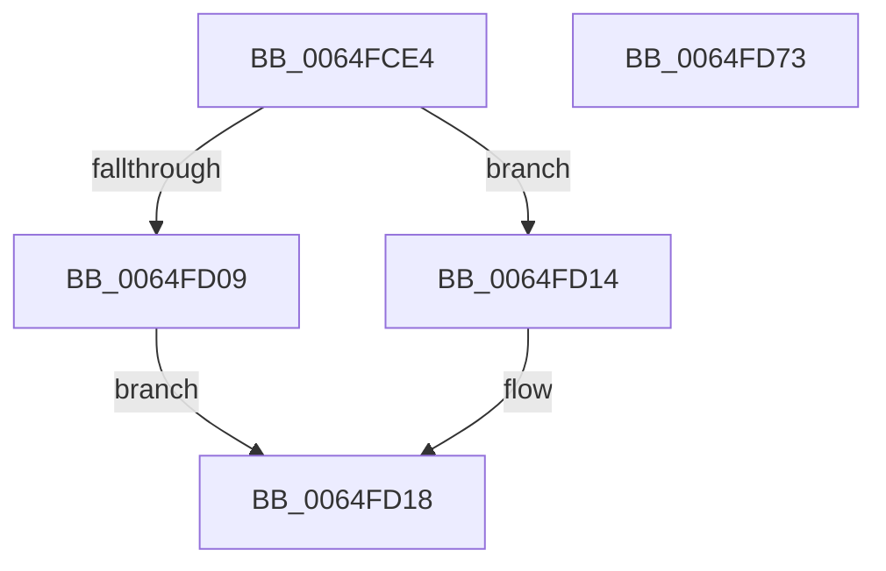

# EtwTraceLongDpcMitigationEvent

- RVA: `0x0064FCE4`–`0x0064FD74` (길이 `144` bytes)
- VA: `0x000000014064FCE4`
- 실행 섹션: `.text`
- PDB 이름 있음: `예`; PDB Function 태그: `아니요`
- unwind 정보 RVA: `0x000BDE20`
- 디코드: `37`개 명령, `144/144` bytes 표시
- 미해석 바이트: `0` (있으면 어셈블리에 `.byte`로 보존)

> 이 문서는 커널 이미지의 기계어와 PDB 기호를 분석해 생성했습니다. 4번과 5번은 함수 원형과 자료형을 바이너리 사용 방식에서 추정한 C 해석이며 원본 소스 복구 결과는 아닙니다.

## 1. Dependencies

- 직접 호출 지점: **2**; 고유 호출 대상: **2**
- 직접 호출자로 확인된 함수: **1**
- RIP 상대 이미지 참조: **1**

### Outgoing calls
- `0x0064FD5C` → [EtwTraceKernelEvent](../23/EtwTraceKernelEvent_function_00235350.md) (function, `0x00235350`)
- `0x0064FD68` → [_security_check_cookie](../6A/_security_check_cookie_function_006AC640.md) (function, `0x006AC640`)

### Direct callers
- [KiEnterLongDpcProcessing](../30/KiEnterLongDpcProcessing_function_0030BE54.md) at `0x0030C282`

### Static image references
- `0x0064FCED` → RVA `0x00E0A740` (`.data`; read)

## 2. Other-region calls and transfers

- 다른 실행 섹션으로 향하는 call: **0**
- 별도 외부 분기/꼬리 이동을 확인하지 못했습니다.

## 3. Assembly (complete function range)

```asm
0064FCE4  40 55                           push rbp
0064FCE6  48 8B EC                        mov rbp, rsp
0064FCE9  48 83 EC 60                     sub rsp, 0x60
0064FCED  48 8B 05 4C AA 7B 00            mov rax, qword ptr [rip + 0x7baa4c]
0064FCF4  48 33 C4                        xor rax, rsp
0064FCF7  48 89 45 F0                     mov qword ptr [rbp - 0x10], rax
0064FCFB  8B 81 10 05 00 00               mov eax, dword ptr [rcx + 0x510]
0064FD01  89 45 D0                        mov dword ptr [rbp - 0x30], eax
0064FD04  48 85 D2                        test rdx, rdx
0064FD07  74 0B                           je 0x14064fd14
0064FD09  8B 82 10 05 00 00               mov eax, dword ptr [rdx + 0x510]
0064FD0F  89 45 D4                        mov dword ptr [rbp - 0x2c], eax
0064FD12  EB 04                           jmp 0x14064fd18
0064FD14  83 4D D4 FF                     or dword ptr [rbp - 0x2c], 0xffffffff
0064FD18  8A 45 30                        mov al, byte ptr [rbp + 0x30]
0064FD1B  48 8D 4D E0                     lea rcx, [rbp - 0x20]
0064FD1F  83 65 EC 00                     and dword ptr [rbp - 0x14], 0
0064FD23  BA 01 00 00 00                  mov edx, 1
0064FD28  88 45 DA                        mov byte ptr [rbp - 0x26], al
0064FD2B  8A 45 38                        mov al, byte ptr [rbp + 0x38]
0064FD2E  88 45 DB                        mov byte ptr [rbp - 0x25], al
0064FD31  48 8D 45 D0                     lea rax, [rbp - 0x30]
0064FD35  44 88 45 D8                     mov byte ptr [rbp - 0x28], r8b
0064FD39  41 B8 00 00 04 20               mov r8d, 0x20040000
0064FD3F  44 88 4D D9                     mov byte ptr [rbp - 0x27], r9b
0064FD43  41 B9 77 0F 00 00               mov r9d, 0xf77
0064FD49  48 89 45 E0                     mov qword ptr [rbp - 0x20], rax
0064FD4D  C7 45 E8 0C 00 00 00            mov dword ptr [rbp - 0x18], 0xc
0064FD54  C7 44 24 20 02 0A 50 00         mov dword ptr [rsp + 0x20], 0x500a02
0064FD5C  E8 EF 55 BE FF                  call 0x140235350
0064FD61  48 8B 4D F0                     mov rcx, qword ptr [rbp - 0x10]
0064FD65  48 33 CC                        xor rcx, rsp
0064FD68  E8 D3 C8 05 00                  call 0x1406ac640
0064FD6D  48 83 C4 60                     add rsp, 0x60
0064FD71  5D                              pop rbp
0064FD72  C3                              ret
0064FD73  CC                              int3
```

## 4. C-style interpretation (structured pseudocode)

```c
__int64 __fastcall EtwTraceLongDpcMitigationEvent(__int64 a1, __int64 a2, unsigned __int8 a3, unsigned __int8 a4, unsigned __int8 a5, unsigned __int8 a6)
{
    __int64 result;
    __int64 v_rsp;
    unsigned __int64 v_stack_m18;
    unsigned int v_stack_m1C;
    unsigned int v_stack_m20;
    unsigned __int64 v_stack_m28;
    unsigned __int8 v_stack_m2D;
    unsigned __int8 v_stack_m2E;
    unsigned __int8 v_stack_m2F;
    unsigned __int8 v_stack_m30;
    unsigned int v_stack_m34;
    unsigned int v_stack_m38;
    unsigned int v_stack_m48;

    v_rsp = (v_rsp) - (96);
    result = (*(unsigned __int64 *)(v_rip + 8104524)) ^ (v_rsp);
    v_stack_m18 = result;
    v_stack_m38 = (unsigned int)((unsigned int)(*(unsigned int *)(a1 + 1296)));
    if (a2 == 0) goto loc_0064FD14;
    v_stack_m34 = (unsigned int)((unsigned int)(*(unsigned int *)(a2 + 1296)));
    goto loc_0064FD18;
loc_0064FD14:
loc_0064FD18:
    v_stack_m2E = a5;
    v_stack_m2D = a6;
    v_stack_m30 = a3;
    v_stack_m2F = a4;
    v_stack_m28 = v_stack_m38;
    v_stack_m20 = 12;
    v_stack_m48 = 0x500A02ULL;
    result = EtwTraceKernelEvent(v_stack_m28, 1, (unsigned int)(0x20040000ULL), (unsigned int)(0xF77ULL));
    a1 = (v_stack_m18) ^ (v_rsp);
    result = _security_check_cookie(a1, 1, (unsigned int)(0x20040000ULL), (unsigned int)(0xF77ULL));
    v_rsp = (v_rsp) + (96);
    return result;
}
```

## 5. (Beta) C Style

```c
int64_t EtwTraceLongDpcMitigationEvent(void *Arg1, int64_t Arg2, uint8_t Arg3, uint8_t Arg4, uint8_t Arg5, uint8_t Arg6)
{
    uint8_t *arg1 = (uint8_t *)Arg1;

    int64_t result;
    int64_t local_rsp;
    uint64_t v_stack_m18;
    uint32_t v_stack_m1C;
    uint32_t v_stack_m20;
    uint64_t v_stack_m28;
    uint8_t v_stack_m2D;
    uint8_t v_stack_m2E;
    uint8_t v_stack_m2F;
    uint8_t v_stack_m30;
    uint32_t v_stack_m34;
    uint32_t v_stack_m38;
    uint32_t v_stack_m48;

    local_rsp = (local_rsp) - (96);
    result = (*(uint64_t *)(v_rip + 0x7BAA4C)) ^ (local_rsp);
    v_stack_m18 = result;
    v_stack_m38 = (uint32_t)((uint32_t)(*(uint32_t *)(arg1 + 0x510)));
    if (Arg2 == 0) goto loc_0064FD14;
    v_stack_m34 = (uint32_t)((uint32_t)(*(uint32_t *)(Arg2 + 0x510)));
    goto loc_0064FD18;
loc_0064FD14:
loc_0064FD18:
    v_stack_m2E = Arg5;
    v_stack_m2D = Arg6;
    v_stack_m30 = Arg3;
    v_stack_m2F = Arg4;
    v_stack_m28 = v_stack_m38;
    v_stack_m20 = 12;
    v_stack_m48 = 0x500A02ULL;
    result = EtwTraceKernelEvent(v_stack_m28, 1, (uint32_t)(0x20040000ULL), (uint32_t)(0xF77ULL));
    Arg1 = (v_stack_m18) ^ (local_rsp);
    result = _security_check_cookie(Arg1, 1, (uint32_t)(0x20040000ULL), (uint32_t)(0xF77ULL));
    local_rsp = (local_rsp) + (96);
    return result;
}
```

### 관측된 메모리 오프셋

구조체 형식이 확인되지 않은 접근은 인자 기준의 오프셋으로만 기록했습니다.

| 기준 인자 | 오프셋 표현 | 폭 (bit) | 접근 |
|---|---:|---:|---|
| `Arg1` | `+ 0x510` | `32` | `R` |

## 6. Execution-region graph

[열기: 2D/3D 그래프와 함수 탐색 컨트롤 패널](../../../control-panel.html?section=text&rva=0x0064FCE4&view=graph)

- 2D 그래프는 위에서 아래로 흐르고, 3D 그래프는 빈 공간을 드래그해 회전합니다. Shift+드래그는 이동, 휠은 확대·축소, 함수 노드 선택은 대상 보고서 이동입니다.

### Static fallback


