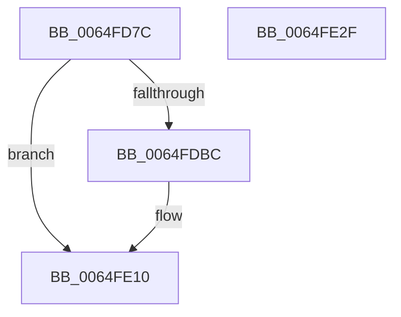

# EtwTraceMdlFreeEvent

- RVA: `0x0064FD7C`–`0x0064FE30` (길이 `180` bytes)
- VA: `0x000000014064FD7C`
- 실행 섹션: `.text`
- PDB 이름 있음: `예`; PDB Function 태그: `아니요`
- unwind 정보 RVA: `0x000D37BC`
- 디코드: `42`개 명령, `180/180` bytes 표시
- 미해석 바이트: `0` (있으면 어셈블리에 `.byte`로 보존)

> 이 문서는 커널 이미지의 기계어와 PDB 기호를 분석해 생성했습니다. 4번과 5번은 함수 원형과 자료형을 바이너리 사용 방식에서 추정한 C 해석이며 원본 소스 복구 결과는 아닙니다.

## 1. Dependencies

- 직접 호출 지점: **3**; 고유 호출 대상: **3**
- 직접 호출자로 확인된 함수: **1**
- RIP 상대 이미지 참조: **3**

### Outgoing calls
- `0x0064FDB1` → [EtwEventEnabled](../39/EtwEventEnabled_function_00392450.md) (function, `0x00392450`)
- `0x0064FE0B` → [EtwWriteEx](../25/EtwWriteEx_function_0025F0D0.md) (function, `0x0025F0D0`)
- `0x0064FE18` → [_security_check_cookie](../6A/_security_check_cookie_function_006AC640.md) (function, `0x006AC640`)

### Direct callers
- [MiFreePagesFromMdl](../3F/MiFreePagesFromMdl_function_003F8300.md) at `0x003F841E`

### Static image references
- `0x0064FD8B` → RVA `0x00E0A740` (`.data`; read)
- `0x0064FDA0` → RVA `0x00EFF848` (`.data`; read)
- `0x0064FDA7` → RVA `0x00022B98` (`.rdata`; read)

## 2. Other-region calls and transfers

- 다른 실행 섹션으로 향하는 call: **0**
- 별도 외부 분기/꼬리 이동을 확인하지 못했습니다.

## 3. Assembly (complete function range)

```asm
0064FD7C  48 89 5C 24 08                  mov qword ptr [rsp + 8], rbx
0064FD81  48 89 74 24 10                  mov qword ptr [rsp + 0x10], rsi
0064FD86  57                              push rdi
0064FD87  48 83 EC 70                     sub rsp, 0x70
0064FD8B  48 8B 05 AE A9 7B 00            mov rax, qword ptr [rip + 0x7ba9ae]
0064FD92  48 33 C4                        xor rax, rsp
0064FD95  48 89 44 24 68                  mov qword ptr [rsp + 0x68], rax
0064FD9A  48 8B FA                        mov rdi, rdx
0064FD9D  48 8B F1                        mov rsi, rcx
0064FDA0  48 8B 0D A1 FA 8A 00            mov rcx, qword ptr [rip + 0x8afaa1]
0064FDA7  48 8D 15 EA 2D 9D FF            lea rdx, [rip - 0x62d216]
0064FDAE  41 8B D8                        mov ebx, r8d
0064FDB1  E8 9A 26 D4 FF                  call 0x140392450
0064FDB6  33 C9                           xor ecx, ecx
0064FDB8  84 C0                           test al, al
0064FDBA  74 54                           je 0x14064fe10
0064FDBC  44 8D 49 01                     lea r9d, [rcx + 1]
0064FDC0  48 89 74 24 40                  mov qword ptr [rsp + 0x40], rsi
0064FDC5  48 8D 44 24 40                  lea rax, [rsp + 0x40]
0064FDCA  48 89 7C 24 48                  mov qword ptr [rsp + 0x48], rdi
0064FDCF  48 89 44 24 58                  mov qword ptr [rsp + 0x58], rax
0064FDD4  48 8D 15 BD 2D 9D FF            lea rdx, [rip - 0x62d243]
0064FDDB  48 8D 44 24 58                  lea rax, [rsp + 0x58]
0064FDE0  89 5C 24 50                     mov dword ptr [rsp + 0x50], ebx
0064FDE4  48 89 44 24 38                  mov qword ptr [rsp + 0x38], rax
0064FDE9  45 33 C0                        xor r8d, r8d
0064FDEC  44 89 4C 24 30                  mov dword ptr [rsp + 0x30], r9d
0064FDF1  48 89 4C 24 28                  mov qword ptr [rsp + 0x28], rcx
0064FDF6  48 89 4C 24 20                  mov qword ptr [rsp + 0x20], rcx
0064FDFB  48 8B 0D 46 FA 8A 00            mov rcx, qword ptr [rip + 0x8afa46]
0064FE02  48 C7 44 24 60 14 00 00 00      mov qword ptr [rsp + 0x60], 0x14
0064FE0B  E8 C0 F2 C0 FF                  call 0x14025f0d0
0064FE10  48 8B 4C 24 68                  mov rcx, qword ptr [rsp + 0x68]
0064FE15  48 33 CC                        xor rcx, rsp
0064FE18  E8 23 C8 05 00                  call 0x1406ac640
0064FE1D  4C 8D 5C 24 70                  lea r11, [rsp + 0x70]
0064FE22  49 8B 5B 10                     mov rbx, qword ptr [r11 + 0x10]
0064FE26  49 8B 73 18                     mov rsi, qword ptr [r11 + 0x18]
0064FE2A  49 8B E3                        mov rsp, r11
0064FE2D  5F                              pop rdi
0064FE2E  C3                              ret
0064FE2F  CC                              int3
```

## 4. C-style interpretation (structured pseudocode)

```c
__int64 __fastcall EtwTraceMdlFreeEvent(__int64 a1, __int64 a2, int a3)
{
    __int64 result;
    __int64 v_rsp;
    unsigned __int64 v_stack_m10;
    unsigned __int64 v_stack_m18;
    unsigned __int64 v_stack_m20;
    unsigned int v_stack_m28;
    unsigned __int64 v_stack_m30;
    unsigned __int64 v_stack_m38;
    unsigned __int64 v_stack_m40;
    unsigned int v_stack_m48;
    unsigned __int64 v_stack_m50;
    unsigned __int64 v_stack_m58;
    unsigned __int64 v_stack_m8;
    unsigned __int64 v_stack_p10;
    unsigned __int64 v_stack_p8;

    v_stack_p8 = v_rbx;
    v_stack_p10 = v_rsi;
    v_rsp = (v_rsp) - (112);
    result = (*(unsigned __int64 *)(v_rip + 8104366)) ^ (v_rsp);
    v_stack_m10 = result;
    result = EtwEventEnabled(*(unsigned __int64 *)(v_rip + 9108129), v_rip - 6476310, a3, a4);
    a1 = 0;
    if ((unsigned __int8)(result) != 0) {
        a4 = a1 + 1;
        v_stack_m38 = 0;
        result = v_stack_m38;
        v_stack_m30 = a2;
        v_stack_m20 = result;
        a2 = v_rip - 6476355;
        result = v_stack_m20;
        v_stack_m28 = (unsigned int)((unsigned int)(a3));
        v_stack_m40 = result;
        a3 = 0;
        v_stack_m48 = (unsigned int)(a4);
        v_stack_m50 = 0;
        v_stack_m58 = 0;
        a1 = *(unsigned __int64 *)(v_rip + 9108038);
        v_stack_m18 = 20;
        result = EtwWriteEx(a1, a2, a3, a4);
    }
    a1 = (v_stack_m10) ^ (v_rsp);
    result = _security_check_cookie(a1, a2, a3, a4);
    return result;
}
```

## 5. (Beta) C Style

```c
int64_t EtwTraceMdlFreeEvent(int64_t Arg1, int64_t Arg2, int32_t Arg3)
{
    int64_t result;
    int64_t local_rsp;
    uint64_t v_stack_m10;
    uint64_t v_stack_m18;
    uint64_t v_stack_m20;
    uint32_t v_stack_m28;
    uint64_t v_stack_m30;
    uint64_t v_stack_m38;
    uint64_t v_stack_m40;
    uint32_t v_stack_m48;
    uint64_t v_stack_m50;
    uint64_t v_stack_m58;
    uint64_t v_stack_m8;
    uint64_t v_stack_p10;
    uint64_t v_stack_p8;

    v_stack_p8 = local_rbx;
    v_stack_p10 = local_rsi;
    local_rsp = (local_rsp) - (112);
    result = (*(uint64_t *)(v_rip + 0x7BA9AE)) ^ (local_rsp);
    v_stack_m10 = result;
    result = EtwEventEnabled(*(uint64_t *)(v_rip + 0x8AFAA1), v_rip - 6476310, Arg3, a4);
    Arg1 = 0;
    if ((uint8_t)(result) != 0) {
        a4 = Arg1 + 1;
        v_stack_m38 = 0;
        result = v_stack_m38;
        v_stack_m30 = Arg2;
        v_stack_m20 = result;
        Arg2 = v_rip - 6476355;
        result = v_stack_m20;
        v_stack_m28 = (uint32_t)((uint32_t)(Arg3));
        v_stack_m40 = result;
        Arg3 = 0;
        v_stack_m48 = (uint32_t)(a4);
        v_stack_m50 = 0;
        v_stack_m58 = 0;
        Arg1 = *(uint64_t *)(v_rip + 0x8AFA46);
        v_stack_m18 = 20;
        result = EtwWriteEx(Arg1, Arg2, Arg3, a4);
    }
    Arg1 = (v_stack_m10) ^ (local_rsp);
    result = _security_check_cookie(Arg1, Arg2, Arg3, a4);
    return result;
}
```

## 6. Execution-region graph

[열기: 2D/3D 그래프와 함수 탐색 컨트롤 패널](../../../control-panel.html?section=text&rva=0x0064FD7C&view=graph)

- 2D 그래프는 위에서 아래로 흐르고, 3D 그래프는 빈 공간을 드래그해 회전합니다. Shift+드래그는 이동, 휠은 확대·축소, 함수 노드 선택은 대상 보고서 이동입니다.

### Static fallback


