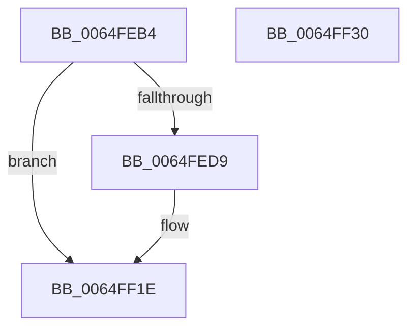

# EtwTracePriQEnqueueFailed

- RVA: `0x0064FEB4`–`0x0064FF31` (길이 `125` bytes)
- VA: `0x000000014064FEB4`
- 실행 섹션: `.text`
- PDB 이름 있음: `예`; PDB Function 태그: `아니요`
- unwind 정보 RVA: `0x00065FB8`
- 디코드: `28`개 명령, `125/125` bytes 표시
- 미해석 바이트: `0` (있으면 어셈블리에 `.byte`로 보존)

> 이 문서는 커널 이미지의 기계어와 PDB 기호를 분석해 생성했습니다. 4번과 5번은 함수 원형과 자료형을 바이너리 사용 방식에서 추정한 C 해석이며 원본 소스 복구 결과는 아닙니다.

## 1. Dependencies

- 직접 호출 지점: **2**; 고유 호출 대상: **2**
- 직접 호출자로 확인된 함수: **1**
- RIP 상대 이미지 참조: **2**

### Outgoing calls
- `0x0064FF19` → [EtwTraceKernelEvent](../23/EtwTraceKernelEvent_function_00235350.md) (function, `0x00235350`)
- `0x0064FF26` → [_security_check_cookie](../6A/_security_check_cookie_function_006AC640.md) (function, `0x006AC640`)

### Direct callers
- [KeInsertPriQueue](../21/KeInsertPriQueue_function_0021EDD0.md) at `0x0021EFAC`

### Static image references
- `0x0064FEBB` → RVA `0x00E0A740` (`.data`; read)
- `0x0064FECF` → RVA `0x00FC6B1C` (`ALMOSTRO`; read)

## 2. Other-region calls and transfers

- 다른 실행 섹션으로 향하는 call: **0**
- 별도 외부 분기/꼬리 이동을 확인하지 못했습니다.

## 3. Assembly (complete function range)

```asm
0064FEB4  4C 8B DC                        mov r11, rsp
0064FEB7  48 83 EC 68                     sub rsp, 0x68
0064FEBB  48 8B 05 7E A8 7B 00            mov rax, qword ptr [rip + 0x7ba87e]
0064FEC2  48 33 C4                        xor rax, rsp
0064FEC5  48 89 44 24 50                  mov qword ptr [rsp + 0x50], rax
0064FECA  83 64 24 3C 00                  and dword ptr [rsp + 0x3c], 0
0064FECF  8B 05 47 6C 97 00               mov eax, dword ptr [rip + 0x976c47]
0064FED5  A8 08                           test al, 8
0064FED7  75 45                           jne 0x14064ff1e
0064FED9  8B 81 10 05 00 00               mov eax, dword ptr [rcx + 0x510]
0064FEDF  41 B9 50 05 00 00               mov r9d, 0x550
0064FEE5  49 89 53 C8                     mov qword ptr [r11 - 0x38], rdx
0064FEE9  49 8D 4B D8                     lea rcx, [r11 - 0x28]
0064FEED  89 44 24 38                     mov dword ptr [rsp + 0x38], eax
0064FEF1  BA 01 00 00 00                  mov edx, 1
0064FEF6  49 8D 43 C8                     lea rax, [r11 - 0x38]
0064FEFA  C7 44 24 20 02 06 60 00         mov dword ptr [rsp + 0x20], 0x600602
0064FF02  49 89 43 D8                     mov qword ptr [r11 - 0x28], rax
0064FF06  41 B8 00 00 00 21               mov r8d, 0x21000000
0064FF0C  83 64 24 4C 00                  and dword ptr [rsp + 0x4c], 0
0064FF11  C7 44 24 48 0C 00 00 00         mov dword ptr [rsp + 0x48], 0xc
0064FF19  E8 32 54 BE FF                  call 0x140235350
0064FF1E  48 8B 4C 24 50                  mov rcx, qword ptr [rsp + 0x50]
0064FF23  48 33 CC                        xor rcx, rsp
0064FF26  E8 15 C7 05 00                  call 0x1406ac640
0064FF2B  48 83 C4 68                     add rsp, 0x68
0064FF2F  C3                              ret
0064FF30  CC                              int3
```

## 4. C-style interpretation (structured pseudocode)

```c
__int64 __fastcall EtwTracePriQEnqueueFailed(__int64 a1, __int64 a2)
{
    __int64 result;
    __int64 v_rsp;
    unsigned __int64 v_stack_m18;
    unsigned int v_stack_m1C;
    unsigned int v_stack_m20;
    unsigned int v_stack_m2C;
    unsigned int v_stack_m30;
    unsigned int v_stack_m48;

    v_rsp = (v_rsp) - (104);
    result = (*(unsigned __int64 *)(v_rip + 8104062)) ^ (v_rsp);
    v_stack_m18 = result;
    result = (unsigned int)(*(unsigned int *)(v_rip + 9923655));
    if ((((unsigned __int8)((unsigned int)(*(unsigned int *)(v_rip + 9923655)))) & (8)) == 0) {
        result = *(unsigned int *)(a1 + 1296);
        a4 = 0x550ULL;
        *(unsigned __int64 *)(v_rsp - 56) = a2;
        a1 = v_rsp - 40;
        v_stack_m30 = (unsigned int)(result);
        a2 = 1;
        result = v_rsp - 56;
        v_stack_m48 = 0x600602ULL;
        *(unsigned __int64 *)(v_rsp - 40) = result;
        a3 = 0x21000000ULL;
        v_stack_m20 = 12;
        result = EtwTraceKernelEvent(a1, a2, a3, a4);
    }
    a1 = (v_stack_m18) ^ (v_rsp);
    result = _security_check_cookie(a1, a2, a3, a4);
    v_rsp = (v_rsp) + (104);
    return result;
}
```

## 5. (Beta) C Style

```c
int64_t EtwTracePriQEnqueueFailed(void *Arg1, int64_t Arg2)
{
    uint8_t *arg1 = (uint8_t *)Arg1;

    int64_t result;
    int64_t local_rsp;
    uint64_t v_stack_m18;
    uint32_t v_stack_m1C;
    uint32_t v_stack_m20;
    uint32_t v_stack_m2C;
    uint32_t v_stack_m30;
    uint32_t v_stack_m48;

    local_rsp = (local_rsp) - (104);
    result = (*(uint64_t *)(v_rip + 0x7BA87E)) ^ (local_rsp);
    v_stack_m18 = result;
    result = (uint32_t)(*(uint32_t *)(v_rip + 0x976C47));
    if ((((uint8_t)((uint32_t)(*(uint32_t *)(v_rip + 0x976C47)))) & (8)) == 0) {
        result = *(uint32_t *)(arg1 + 0x510);
        a4 = 0x550ULL;
        *(uint64_t *)(local_rsp - 0x38) = Arg2;
        Arg1 = local_rsp - 40;
        v_stack_m30 = (uint32_t)(result);
        Arg2 = 1;
        result = local_rsp - 56;
        v_stack_m48 = 0x600602ULL;
        *(uint64_t *)(local_rsp - 0x28) = result;
        a3 = 0x21000000ULL;
        v_stack_m20 = 12;
        result = EtwTraceKernelEvent(Arg1, Arg2, a3, a4);
    }
    Arg1 = (v_stack_m18) ^ (local_rsp);
    result = _security_check_cookie(Arg1, Arg2, a3, a4);
    local_rsp = (local_rsp) + (104);
    return result;
}
```

### 관측된 메모리 오프셋

구조체 형식이 확인되지 않은 접근은 인자 기준의 오프셋으로만 기록했습니다.

| 기준 인자 | 오프셋 표현 | 폭 (bit) | 접근 |
|---|---:|---:|---|
| `Arg1` | `+ 0x510` | `32` | `R` |

## 6. Execution-region graph

[열기: 2D/3D 그래프와 함수 탐색 컨트롤 패널](../../../control-panel.html?section=text&rva=0x0064FEB4&view=graph)

- 2D 그래프는 위에서 아래로 흐르고, 3D 그래프는 빈 공간을 드래그해 회전합니다. Shift+드래그는 이동, 휠은 확대·축소, 함수 노드 선택은 대상 보고서 이동입니다.

### Static fallback


