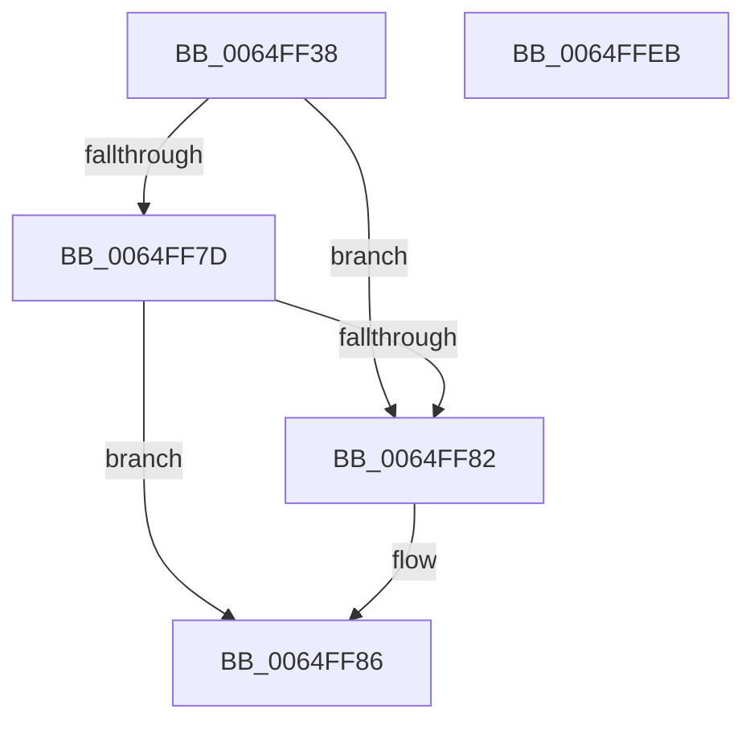

# EtwTraceProcessSetInPrivateMode

- RVA: `0x0064FF38`–`0x0064FFEC` (길이 `180` bytes)
- VA: `0x000000014064FF38`
- 실행 섹션: `.text`
- PDB 이름 있음: `예`; PDB Function 태그: `아니요`
- unwind 정보 RVA: `0x000CBCE8`
- 디코드: `44`개 명령, `180/180` bytes 표시
- 미해석 바이트: `0` (있으면 어셈블리에 `.byte`로 보존)

> 이 문서는 커널 이미지의 기계어와 PDB 기호를 분석해 생성했습니다. 4번과 5번은 함수 원형과 자료형을 바이너리 사용 방식에서 추정한 C 해석이며 원본 소스 복구 결과는 아닙니다.

## 1. Dependencies

- 직접 호출 지점: **2**; 고유 호출 대상: **2**
- 직접 호출자로 확인된 함수: **1**
- RIP 상대 이미지 참조: **4**

### Outgoing calls
- `0x0064FFD4` → [EtwWriteEx](../25/EtwWriteEx_function_0025F0D0.md) (function, `0x0025F0D0`)
- `0x0064FFE0` → [_security_check_cookie](../6A/_security_check_cookie_function_006AC640.md) (function, `0x006AC640`)

### Direct callers
- [NtSetInformationProcess](../../page/AE/NtSetInformationProcess_function_00AE5370.md) at `0x00AE910C`

### Static image references
- `0x0064FF41` → RVA `0x00E0A740` (`.data`; read)
- `0x0064FF4F` → RVA `0x006C8EC0` (` ?? ::FNODOBFM::`string'`; read)
- `0x0064FFBB` → RVA `0x00EFF9E8` (`.data`; read)
- `0x0064FFC5` → RVA `0x00021B18` (`.rdata`; read)

## 2. Other-region calls and transfers

- 다른 실행 섹션으로 향하는 call: **0**
- 별도 외부 분기/꼬리 이동을 확인하지 못했습니다.

## 3. Assembly (complete function range)

```asm
0064FF38  40 55                           push rbp
0064FF3A  48 8B EC                        mov rbp, rsp
0064FF3D  48 83 EC 70                     sub rsp, 0x70
0064FF41  48 8B 05 F8 A7 7B 00            mov rax, qword ptr [rip + 0x7ba7f8]
0064FF48  48 33 C4                        xor rax, rsp
0064FF4B  48 89 45 F8                     mov qword ptr [rbp - 8], rax
0064FF4F  48 8D 05 6A 8F 07 00            lea rax, [rip + 0x78f6a]
0064FF56  48 C7 45 D8 00 00 02 00         mov qword ptr [rbp - 0x28], 0x20000
0064FF5E  48 89 45 E0                     mov qword ptr [rbp - 0x20], rax
0064FF62  33 D2                           xor edx, edx
0064FF64  8B 81 D0 01 00 00               mov eax, dword ptr [rcx + 0x1d0]
0064FF6A  89 45 D0                        mov dword ptr [rbp - 0x30], eax
0064FF6D  48 8B 81 50 03 00 00            mov rax, qword ptr [rcx + 0x350]
0064FF74  44 8D 42 02                     lea r8d, [rdx + 2]
0064FF78  48 85 C0                        test rax, rax
0064FF7B  74 05                           je 0x14064ff82
0064FF7D  66 3B 10                        cmp dx, word ptr [rax]
0064FF80  75 04                           jne 0x14064ff86
0064FF82  48 8D 45 D8                     lea rax, [rbp - 0x28]
0064FF86  0F B7 48 02                     movzx ecx, word ptr [rax + 2]
0064FF8A  45 33 C9                        xor r9d, r9d
0064FF8D  48 8B 40 08                     mov rax, qword ptr [rax + 8]
0064FF91  48 89 45 D8                     mov qword ptr [rbp - 0x28], rax
0064FF95  48 8D 45 D0                     lea rax, [rbp - 0x30]
0064FF99  48 89 45 E8                     mov qword ptr [rbp - 0x18], rax
0064FF9D  48 8D 45 D8                     lea rax, [rbp - 0x28]
0064FFA1  48 89 44 24 38                  mov qword ptr [rsp + 0x38], rax
0064FFA6  44 89 44 24 30                  mov dword ptr [rsp + 0x30], r8d
0064FFAB  45 33 C0                        xor r8d, r8d
0064FFAE  48 89 54 24 28                  mov qword ptr [rsp + 0x28], rdx
0064FFB3  48 89 54 24 20                  mov qword ptr [rsp + 0x20], rdx
0064FFB8  89 4D E0                        mov dword ptr [rbp - 0x20], ecx
0064FFBB  48 8B 0D 26 FA 8A 00            mov rcx, qword ptr [rip + 0x8afa26]
0064FFC2  89 55 E4                        mov dword ptr [rbp - 0x1c], edx
0064FFC5  48 8D 15 4C 1B 9D FF            lea rdx, [rip - 0x62e4b4]
0064FFCC  48 C7 45 F0 04 00 00 00         mov qword ptr [rbp - 0x10], 4
0064FFD4  E8 F7 F0 C0 FF                  call 0x14025f0d0
0064FFD9  48 8B 4D F8                     mov rcx, qword ptr [rbp - 8]
0064FFDD  48 33 CC                        xor rcx, rsp
0064FFE0  E8 5B C6 05 00                  call 0x1406ac640
0064FFE5  48 83 C4 70                     add rsp, 0x70
0064FFE9  5D                              pop rbp
0064FFEA  C3                              ret
0064FFEB  CC                              int3
```

## 4. C-style interpretation (structured pseudocode)

```c
__int64 __fastcall EtwTraceProcessSetInPrivateMode(__int64 a1, int a2, __int64 a3, int a4)
{
    __int64 result;
    __int64 v_rsp;
    unsigned __int64 v_stack_m10;
    unsigned __int64 v_stack_m18;
    unsigned __int64 v_stack_m20;
    unsigned int v_stack_m24;
    unsigned __int64 v_stack_m28;
    unsigned __int64 v_stack_m30;
    unsigned int v_stack_m38;
    unsigned __int64 v_stack_m40;
    unsigned int v_stack_m48;
    unsigned __int64 v_stack_m50;
    unsigned __int64 v_stack_m58;

    v_rsp = (v_rsp) - (112);
    result = (*(unsigned __int64 *)(v_rip + 8103928)) ^ (v_rsp);
    v_stack_m10 = result;
    v_stack_m30 = 0x20000ULL;
    v_stack_m28 = v_rip + 495466;
    a2 = 0;
    v_stack_m38 = (unsigned int)((unsigned int)(*(unsigned int *)(a1 + 464)));
    if (*(unsigned __int64 *)(a1 + 848) == 0) goto loc_0064FF82;
    result = *(unsigned __int64 *)(a1 + 848);
    if (0 == (*(unsigned __int16 *)(*(unsigned __int64 *)(a1 + 848)))) {
        result = v_stack_m30;
    }
    a4 = 0;
    v_stack_m30 = *(unsigned __int64 *)(result + 8);
    v_stack_m20 = v_stack_m38;
    v_stack_m40 = v_stack_m30;
    v_stack_m48 = (unsigned int)(a2 + 2);
    a3 = 0;
    v_stack_m50 = 0;
    v_stack_m58 = 0;
    v_stack_m28 = (unsigned int)(*(unsigned __int16 *)(result + 2));
    v_stack_m24 = 0;
    v_stack_m18 = 4;
    result = EtwWriteEx(*(unsigned __int64 *)(v_rip + 9108006), v_rip - 6481076, a3, a4);
    a1 = (v_stack_m10) ^ (v_rsp);
    result = _security_check_cookie(a1, v_rip - 6481076, a3, a4);
    v_rsp = (v_rsp) + (112);
    return result;
}
```

## 5. (Beta) C Style

```c
int64_t EtwTraceProcessSetInPrivateMode(void *Arg1, int32_t Arg2, int64_t Arg3, int32_t Arg4)
{
    uint8_t *arg1 = (uint8_t *)Arg1;

    int64_t result;
    int64_t local_rsp;
    uint64_t v_stack_m10;
    uint64_t v_stack_m18;
    uint64_t v_stack_m20;
    uint32_t v_stack_m24;
    uint64_t v_stack_m28;
    uint64_t v_stack_m30;
    uint32_t v_stack_m38;
    uint64_t v_stack_m40;
    uint32_t v_stack_m48;
    uint64_t v_stack_m50;
    uint64_t v_stack_m58;

    local_rsp = (local_rsp) - (112);
    result = (*(uint64_t *)(v_rip + 0x7BA7F8)) ^ (local_rsp);
    v_stack_m10 = result;
    v_stack_m30 = 0x20000ULL;
    v_stack_m28 = v_rip + 495466;
    Arg2 = 0;
    v_stack_m38 = (uint32_t)((uint32_t)(*(uint32_t *)(arg1 + 0x1D0)));
    if (*(uint64_t *)(arg1 + 0x350) == 0) goto loc_0064FF82;
    result = *(uint64_t *)(arg1 + 0x350);
    if (0 == (*(uint16_t *)(*(uint64_t *)(arg1 + 0x350)))) {
        result = v_stack_m30;
    }
    Arg4 = 0;
    v_stack_m30 = *(uint64_t *)(result + 0x8);
    v_stack_m20 = v_stack_m38;
    v_stack_m40 = v_stack_m30;
    v_stack_m48 = (uint32_t)(Arg2 + 2);
    Arg3 = 0;
    v_stack_m50 = 0;
    v_stack_m58 = 0;
    v_stack_m28 = (uint32_t)(*(uint16_t *)(result + 0x2));
    v_stack_m24 = 0;
    v_stack_m18 = 4;
    result = EtwWriteEx(*(uint64_t *)(v_rip + 0x8AFA26), v_rip - 6481076, Arg3, Arg4);
    Arg1 = (v_stack_m10) ^ (local_rsp);
    result = _security_check_cookie(Arg1, v_rip - 6481076, Arg3, Arg4);
    local_rsp = (local_rsp) + (112);
    return result;
}
```

### 관측된 메모리 오프셋

구조체 형식이 확인되지 않은 접근은 인자 기준의 오프셋으로만 기록했습니다.

| 기준 인자 | 오프셋 표현 | 폭 (bit) | 접근 |
|---|---:|---:|---|
| `Arg1` | `+ 0x1D0` | `32` | `R` |
| `Arg1` | `+ 0x350` | `64` | `R` |

## 6. Execution-region graph

[열기: 2D/3D 그래프와 함수 탐색 컨트롤 패널](../../../control-panel.html?section=text&rva=0x0064FF38&view=graph)

- 2D 그래프는 위에서 아래로 흐르고, 3D 그래프는 빈 공간을 드래그해 회전합니다. Shift+드래그는 이동, 휠은 확대·축소, 함수 노드 선택은 대상 보고서 이동입니다.

### Static fallback


