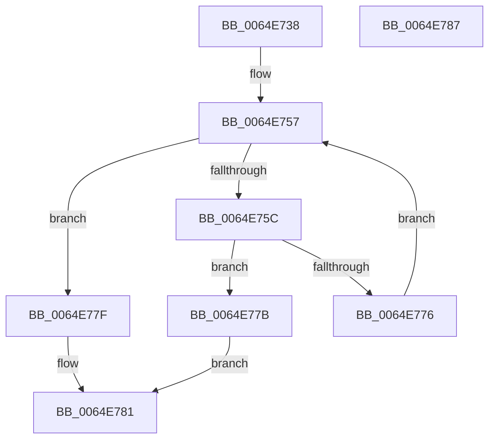

# EtwpCheckPoolTagFilters

- RVA: `0x0064E738`–`0x0064E788` (길이 `80` bytes)
- VA: `0x000000014064E738`
- 실행 섹션: `.text`
- PDB 이름 있음: `예`; PDB Function 태그: `아니요`
- unwind 정보 RVA: `0x0005CF00`
- 디코드: `27`개 명령, `80/80` bytes 표시
- 미해석 바이트: `0` (있으면 어셈블리에 `.byte`로 보존)

> 이 문서는 커널 이미지의 기계어와 PDB 기호를 분석해 생성했습니다. 4번과 5번은 함수 원형과 자료형을 바이너리 사용 방식에서 추정한 C 해석이며 원본 소스 복구 결과는 아닙니다.

## 1. Dependencies

- 직접 호출 지점: **1**; 고유 호출 대상: **1**
- 직접 호출자로 확인된 함수: **1**
- RIP 상대 이미지 참조: **1**

### Outgoing calls
- `0x0064E76D` → [ExCheckSingleFilter](../40/ExCheckSingleFilter_function_0040014C.md) (function, `0x0040014C`)

### Direct callers
- [EtwTracePool](../2E/EtwTracePool_function_002ECEEC.md) at `0x002ED09B`

### Static image references
- `0x0064E741` → RVA `0x00EFF940` (`.data`; read)

## 2. Other-region calls and transfers

- 다른 실행 섹션으로 향하는 call: **0**
- 별도 외부 분기/꼬리 이동을 확인하지 못했습니다.

## 3. Assembly (complete function range)

```asm
0064E738  40 53                           push rbx
0064E73A  48 83 EC 20                     sub rsp, 0x20
0064E73E  44 8B C9                        mov r9d, ecx
0064E741  48 8D 1D F8 11 8B 00            lea rbx, [rip + 0x8b11f8]
0064E748  44 8B DA                        mov r11d, edx
0064E74B  45 33 C0                        xor r8d, r8d
0064E74E  4B 8D 04 89                     lea rax, [r9 + r9*4]
0064E752  44 0F B7 14 83                  movzx r10d, word ptr [rbx + rax*4]
0064E757  45 3B C2                        cmp r8d, r10d
0064E75A  73 23                           jae 0x14064e77f
0064E75C  41 8B C0                        mov eax, r8d
0064E75F  4B 8D 14 89                     lea rdx, [r9 + r9*4]
0064E763  48 03 D0                        add rdx, rax
0064E766  41 8B CB                        mov ecx, r11d
0064E769  8B 54 93 04                     mov edx, dword ptr [rbx + rdx*4 + 4]
0064E76D  E8 DA 19 DB FF                  call 0x14040014c
0064E772  85 C0                           test eax, eax
0064E774  75 05                           jne 0x14064e77b
0064E776  41 FF C0                        inc r8d
0064E779  EB DC                           jmp 0x14064e757
0064E77B  B0 01                           mov al, 1
0064E77D  EB 02                           jmp 0x14064e781
0064E77F  32 C0                           xor al, al
0064E781  48 83 C4 20                     add rsp, 0x20
0064E785  5B                              pop rbx
0064E786  C3                              ret
0064E787  CC                              int3
```

## 4. C-style interpretation (structured pseudocode)

```c
__int64 __fastcall EtwpCheckPoolTagFilters(int a1, int a2, int a3)
{
    __int64 result;
    __int64 v_rsp;

    v_rsp = (v_rsp) - (32);
    a3 = 0;
loc_0064E757:
    if (0 >= ((unsigned int)(*(unsigned __int16 *)(v_rip + 9114104 + (unsigned int)(a1) + (unsigned int)(a1) * 4 * 4)))) goto loc_0064E77F;
    a2 = ((unsigned int)(a1) + (unsigned int)(a1) * 4) + (0);
    result = ExCheckSingleFilter((unsigned int)((unsigned int)((unsigned int)(a2))), (unsigned int)(*(unsigned int *)(v_rip + 9114104 + a2 * 4 + 4)), a3, (unsigned int)(a1));
    if ((unsigned int)(result) != 0) goto loc_0064E77B;
    a3 = (unsigned int)((a3) + 1);
    goto loc_0064E757;
loc_0064E77B:
    goto loc_0064E781;
loc_0064E77F:
    result = 0;
loc_0064E781:
    v_rsp = (v_rsp) + (32);
    return result;
}
```

## 5. (Beta) C Style

```c
int64_t EtwpCheckPoolTagFilters(void *Arg1, int32_t Arg2, int32_t Arg3)
{
    uint8_t *arg1 = (uint8_t *)Arg1;

    int64_t result;
    int64_t local_rsp;

    local_rsp = (local_rsp) - (32);
    Arg3 = 0;
loc_0064E757:
    if (0 >= ((uint32_t)(*(uint16_t *)(v_rip + 0x8B11F8 + (uint32_t)(arg1) + (uint32_t)(arg1) * 4 * 4)))) goto loc_0064E77F;
    Arg2 = ((uint32_t)(Arg1) + (uint32_t)(Arg1) * 4) + (0);
    result = ExCheckSingleFilter((uint32_t)((uint32_t)((uint32_t)(Arg2))), (uint32_t)(*(uint32_t *)(v_rip + 0x8B11F8 + Arg2 * 4 + 0x4)), Arg3, (uint32_t)(Arg1));
    if ((uint32_t)(result) != 0) goto loc_0064E77B;
    Arg3 = (uint32_t)((Arg3) + 1);
    goto loc_0064E757;
loc_0064E77B:
    goto loc_0064E781;
loc_0064E77F:
    result = 0;
loc_0064E781:
    local_rsp = (local_rsp) + (32);
    return result;
}
```

### 관측된 메모리 오프셋

구조체 형식이 확인되지 않은 접근은 인자 기준의 오프셋으로만 기록했습니다.

| 기준 인자 | 오프셋 표현 | 폭 (bit) | 접근 |
|---|---:|---:|---|
| `Arg1` | `+ 0x0 + r9*4` | `64` | `R` |

## 6. Execution-region graph

[열기: 2D/3D 그래프와 함수 탐색 컨트롤 패널](../../../control-panel.html?section=text&rva=0x0064E738&view=graph)

- 2D 그래프는 위에서 아래로 흐르고, 3D 그래프는 빈 공간을 드래그해 회전합니다. Shift+드래그는 이동, 휠은 확대·축소, 함수 노드 선택은 대상 보고서 이동입니다.

### Static fallback


