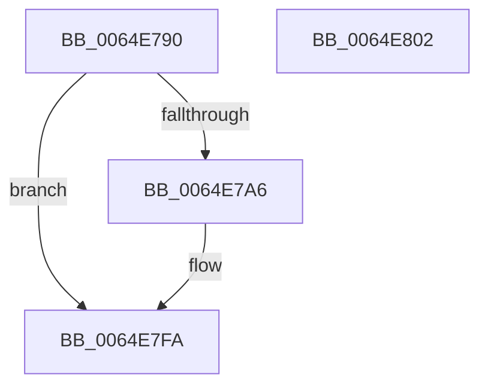

# EtwpContainerStateWnfCallback

- RVA: `0x0064E790`–`0x0064E803` (길이 `115` bytes)
- VA: `0x000000014064E790`
- 실행 섹션: `.text`
- PDB 이름 있음: `예`; PDB Function 태그: `아니요`
- unwind 정보 RVA: `0x00064C80`
- 디코드: `23`개 명령, `115/115` bytes 표시
- 미해석 바이트: `0` (있으면 어셈블리에 `.byte`로 보존)

> 이 문서는 커널 이미지의 기계어와 PDB 기호를 분석해 생성했습니다. 4번과 5번은 함수 원형과 자료형을 바이너리 사용 방식에서 추정한 C 해석이며 원본 소스 복구 결과는 아닙니다.

## 1. Dependencies

- 직접 호출 지점: **2**; 고유 호출 대상: **2**
- 직접 호출자로 확인된 함수: **0**
- RIP 상대 이미지 참조: **1**

### Outgoing calls
- `0x0064E7DA` → [EtwpQueryPartitionRegistryInformation](EtwpQueryPartitionRegistryInformation_function_0064ECCC.md) (function, `0x0064ECCC`)
- `0x0064E7EB` → [ExQueueWorkItem](../2F/ExQueueWorkItem_function_002F9520.md) (function, `0x002F9520`)

### Direct callers
- 이 함수 시작 RVA로 연결되는 직접 call은 확인되지 않았습니다. 간접 호출은 완전히 역산할 수 없습니다.

### Static image references
- `0x0064E796` → RVA `0x00FC6AA8` (`ALMOSTRO`; read)

## 2. Other-region calls and transfers

- 다른 실행 섹션으로 향하는 call: **0**
- 별도 외부 분기/꼬리 이동을 확인하지 못했습니다.

## 3. Assembly (complete function range)

```asm
0064E790  40 53                           push rbx
0064E792  48 83 EC 30                     sub rsp, 0x30
0064E796  48 8B 1D 0B 83 97 00            mov rbx, qword ptr [rip + 0x97830b]
0064E79D  83 BB 50 11 00 00 00            cmp dword ptr [rbx + 0x1150], 0
0064E7A4  75 54                           jne 0x14064e7fa
0064E7A6  48 8D 83 70 11 00 00            lea rax, [rbx + 0x1170]
0064E7AD  4C 8D 93 80 11 00 00            lea r10, [rbx + 0x1180]
0064E7B4  48 89 44 24 28                  mov qword ptr [rsp + 0x28], rax
0064E7B9  4C 8D 8B 94 11 00 00            lea r9, [rbx + 0x1194]
0064E7C0  4C 89 54 24 20                  mov qword ptr [rsp + 0x20], r10
0064E7C5  4C 8D 83 90 11 00 00            lea r8, [rbx + 0x1190]
0064E7CC  48 8D 93 88 11 00 00            lea rdx, [rbx + 0x1188]
0064E7D3  48 8D 8B 60 11 00 00            lea rcx, [rbx + 0x1160]
0064E7DA  E8 ED 04 00 00                  call 0x14064eccc
0064E7DF  48 8B 8B 58 11 00 00            mov rcx, qword ptr [rbx + 0x1158]
0064E7E6  BA 03 00 00 00                  mov edx, 3
0064E7EB  E8 30 AD CA FF                  call 0x1402f9520
0064E7F0  C7 83 50 11 00 00 01 00 00 00   mov dword ptr [rbx + 0x1150], 1
0064E7FA  33 C0                           xor eax, eax
0064E7FC  48 83 C4 30                     add rsp, 0x30
0064E800  5B                              pop rbx
0064E801  C3                              ret
0064E802  CC                              int3
```

## 4. C-style interpretation (structured pseudocode)

```c
__int64 __fastcall EtwpContainerStateWnfCallback(void)
{
    __int64 result;
    __int64 v_r10;
    __int64 v_rsp;
    unsigned __int64 v_stack_m10;
    unsigned __int64 v_stack_m18;

    v_rsp = (v_rsp) - (48);
    if ((*(unsigned int *)(*(unsigned __int64 *)(v_rip + 9929483) + 4432)) == 0) {
        result = *(unsigned __int64 *)(v_rip + 9929483) + 4464;
        v_r10 = *(unsigned __int64 *)(v_rip + 9929483) + 4480;
        v_stack_m10 = result;
        a4 = *(unsigned __int64 *)(v_rip + 9929483) + 4500;
        v_stack_m18 = v_r10;
        a3 = *(unsigned __int64 *)(v_rip + 9929483) + 4496;
        a2 = *(unsigned __int64 *)(v_rip + 9929483) + 4488;
        a1 = *(unsigned __int64 *)(v_rip + 9929483) + 4448;
        result = EtwpQueryPartitionRegistryInformation(a1, a2, a3, a4);
        a1 = *(unsigned __int64 *)(*(unsigned __int64 *)(v_rip + 9929483) + 4440);
        a2 = 3;
        result = ExQueueWorkItem(a1, a2, a3, a4);
        *(unsigned int *)(*(unsigned __int64 *)(v_rip + 9929483) + 4432) = 1;
    }
    result = 0;
    v_rsp = (v_rsp) + (48);
    return result;
}
```

## 5. (Beta) C Style

```c
void EtwpContainerStateWnfCallback(void)
{
    int64_t result;
    int64_t local_r10;
    int64_t local_rsp;
    uint64_t v_stack_m10;
    uint64_t v_stack_m18;

    local_rsp = (local_rsp) - (48);
    if ((*(uint32_t *)(*(uint64_t *)(v_rip + 0x97830B) + 0x1150)) == 0) {
        result = *(uint64_t *)(v_rip + 0x97830B) + 4464;
        local_r10 = *(uint64_t *)(v_rip + 0x97830B) + 4480;
        v_stack_m10 = result;
        a4 = *(uint64_t *)(v_rip + 0x97830B) + 4500;
        v_stack_m18 = local_r10;
        a3 = *(uint64_t *)(v_rip + 0x97830B) + 4496;
        a2 = *(uint64_t *)(v_rip + 0x97830B) + 4488;
        a1 = *(uint64_t *)(v_rip + 0x97830B) + 4448;
        result = EtwpQueryPartitionRegistryInformation(a1, a2, a3, a4);
        a1 = *(uint64_t *)(*(uint64_t *)(v_rip + 0x97830B) + 0x1158);
        a2 = 3;
        result = ExQueueWorkItem(a1, a2, a3, a4);
        *(uint32_t *)(*(uint64_t *)(v_rip + 0x97830B) + 0x1150) = 1;
    }
    result = 0;
    local_rsp = (local_rsp) + (48);
    return result;
}
```

## 6. Execution-region graph

[열기: 2D/3D 그래프와 함수 탐색 컨트롤 패널](../../../control-panel.html?section=text&rva=0x0064E790&view=graph)

- 2D 그래프는 위에서 아래로 흐르고, 3D 그래프는 빈 공간을 드래그해 회전합니다. Shift+드래그는 이동, 휠은 확대·축소, 함수 노드 선택은 대상 보고서 이동입니다.

### Static fallback


