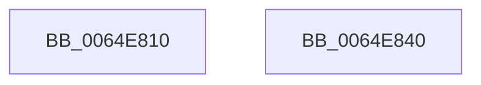

# EtwpContextRegisterTracingApc

- RVA: `0x0064E810`–`0x0064E841` (길이 `49` bytes)
- VA: `0x000000014064E810`
- 실행 섹션: `.text`
- PDB 이름 있음: `예`; PDB Function 태그: `아니요`
- unwind 정보 RVA: `0x0005C788`
- 디코드: `13`개 명령, `49/49` bytes 표시
- 미해석 바이트: `0` (있으면 어셈블리에 `.byte`로 보존)

> 이 문서는 커널 이미지의 기계어와 PDB 기호를 분석해 생성했습니다. 4번과 5번은 함수 원형과 자료형을 바이너리 사용 방식에서 추정한 C 해석이며 원본 소스 복구 결과는 아닙니다.

## 1. Dependencies

- 직접 호출 지점: **1**; 고유 호출 대상: **1**
- 직접 호출자로 확인된 함수: **0**
- RIP 상대 이미지 참조: **0**

### Outgoing calls
- `0x0064E836` → [EtwpTraceContextRegisters](EtwpTraceContextRegisters_function_0064F108.md) (function, `0x0064F108`)

### Direct callers
- 이 함수 시작 RVA로 연결되는 직접 call은 확인되지 않았습니다. 간접 호출은 완전히 역산할 수 없습니다.

### Static image references
- 디코드된 RIP-relative 메모리 참조가 없습니다.

## 2. Other-region calls and transfers

- 다른 실행 섹션으로 향하는 call: **0**
- 별도 외부 분기/꼬리 이동을 확인하지 못했습니다.

## 3. Assembly (complete function range)

```asm
0064E810  48 83 EC 28                     sub rsp, 0x28
0064E814  41 8B 00                        mov eax, dword ptr [r8]
0064E817  48 8D 54 24 30                  lea rdx, [rsp + 0x30]
0064E81C  65 4C 8B 04 25 88 01 00 00      mov r8, qword ptr gs:[0x188]
0064E825  48 8B 09                        mov rcx, qword ptr [rcx]
0064E828  89 44 24 34                     mov dword ptr [rsp + 0x34], eax
0064E82C  41 8B 01                        mov eax, dword ptr [r9]
0064E82F  45 33 C9                        xor r9d, r9d
0064E832  89 44 24 30                     mov dword ptr [rsp + 0x30], eax
0064E836  E8 CD 08 00 00                  call 0x14064f108
0064E83B  48 83 C4 28                     add rsp, 0x28
0064E83F  C3                              ret
0064E840  CC                              int3
```

## 4. C-style interpretation (structured pseudocode)

```c
__int64 __fastcall EtwpContextRegisterTracingApc(__int64 a1, __int64 a2, __int64 a3, __int64 a4)
{
    __int64 result;
    __int64 v_rsp;
    unsigned __int64 v_stack_p8;
    unsigned int v_stack_pC;

    v_rsp = (v_rsp) - (40);
    v_stack_pC = (unsigned int)((unsigned int)(*(unsigned int *)(a3)));
    a4 = 0;
    v_stack_p8 = (unsigned int)((unsigned int)(*(unsigned int *)(a4)));
    result = EtwpTraceContextRegisters(*(unsigned __int64 *)(a1), v_stack_p8, *(unsigned __int64 *)(gs_base + (0 + 392)), a4);
    v_rsp = (v_rsp) + (40);
    return result;
}
```

## 5. (Beta) C Style

```c
int64_t EtwpContextRegisterTracingApc(void *Arg1, int64_t Arg2, void *Arg3, void *Arg4)
{
    uint8_t *arg1 = (uint8_t *)Arg1;
    uint8_t *arg3 = (uint8_t *)Arg3;
    uint8_t *arg4 = (uint8_t *)Arg4;

    int64_t result;
    int64_t local_rsp;
    uint64_t v_stack_p8;
    uint32_t v_stack_pC;

    local_rsp = (local_rsp) - (40);
    v_stack_pC = (uint32_t)((uint32_t)(*(uint32_t *)(arg3)));
    Arg4 = 0;
    v_stack_p8 = (uint32_t)((uint32_t)(*(uint32_t *)(arg4)));
    result = EtwpTraceContextRegisters(*(uint64_t *)(arg1), v_stack_p8, *(uint64_t *)(gs_base + (0 + 0x188)), Arg4);
    local_rsp = (local_rsp) + (40);
    return result;
}
```

### 관측된 메모리 오프셋

구조체 형식이 확인되지 않은 접근은 인자 기준의 오프셋으로만 기록했습니다.

| 기준 인자 | 오프셋 표현 | 폭 (bit) | 접근 |
|---|---:|---:|---|
| `Arg1` | `+ 0x0` | `64` | `R` |
| `Arg3` | `+ 0x0` | `32` | `R` |
| `Arg4` | `+ 0x0` | `32` | `R` |

## 6. Execution-region graph

[열기: 2D/3D 그래프와 함수 탐색 컨트롤 패널](../../../control-panel.html?section=text&rva=0x0064E810&view=graph)

- 2D 그래프는 위에서 아래로 흐르고, 3D 그래프는 빈 공간을 드래그해 회전합니다. Shift+드래그는 이동, 휠은 확대·축소, 함수 노드 선택은 대상 보고서 이동입니다.

### Static fallback


