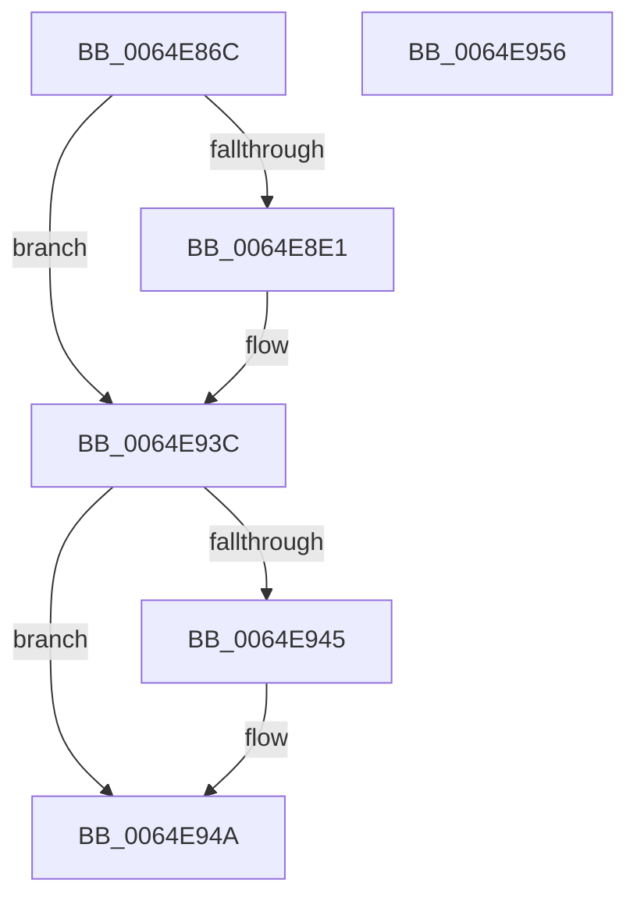

# EtwpGetCurrentSiloMaxLoggers

- RVA: `0x0064E86C`–`0x0064E957` (길이 `235` bytes)
- VA: `0x000000014064E86C`
- 실행 섹션: `.text`
- PDB 이름 있음: `예`; PDB Function 태그: `아니요`
- unwind 정보 RVA: `0x000D36A4`
- 디코드: `57`개 명령, `235/235` bytes 표시
- 미해석 바이트: `0` (있으면 어셈블리에 `.byte`로 보존)

> 이 문서는 커널 이미지의 기계어와 PDB 기호를 분석해 생성했습니다. 4번과 5번은 함수 원형과 자료형을 바이너리 사용 방식에서 추정한 C 해석이며 원본 소스 복구 결과는 아닙니다.

## 1. Dependencies

- 직접 호출 지점: **5**; 고유 호출 대상: **5**
- 직접 호출자로 확인된 함수: **3**
- RIP 상대 이미지 참조: **3**

### Outgoing calls
- `0x0064E8A3` → [RtlInitUnicodeString](../42/RtlInitUnicodeString_function_0042A780.md) (function, `0x0042A780`)
- `0x0064E8D8` → [ZwOpenKey](../6A/ZwOpenKey_function_006AD310.md) (function, `0x006AD310`)
- `0x0064E8EB` → [memset](../6C/memset_function_006C6C40.md) (function, `0x006C6C40`)
- `0x0064E937` → [RtlQueryRegistryValuesEx](../../page/8C/RtlQueryRegistryValuesEx_function_008C8FF0.md) (function, `0x008C8FF0`)
- `0x0064E945` → [ZwClose](../6A/ZwClose_function_006AD2B0.md) (function, `0x006AD2B0`)

### Direct callers
- [EtwpGetPmcSessions](EtwpGetPmcSessions_function_0064EB08.md) at `0x0064EB29`
- [PspInitializeServerSiloDeferred](../../page/77/PspInitializeServerSiloDeferred_function_0077FEE0.md) at `0x00780085`
- [EtwpInitialize](../../init/C4/EtwpInitialize_function_00C4DBCC.md) at `0x00C4DC6B`

### Static image references
- `0x0064E87F` → RVA `0x006CFD70` (` ?? ::FNODOBFM::`string'`; read)
- `0x0064E8F6` → RVA `0x007BEA40` (`EtwpQueryRegistryCallback`; read)
- `0x0064E919` → RVA `0x006CFE70` (` ?? ::FNODOBFM::`string'`; read)

## 2. Other-region calls and transfers

- 다른 실행 섹션으로 향하는 call: **1**
  - `0x0064E937` → [RtlQueryRegistryValuesEx](../../page/8C/RtlQueryRegistryValuesEx_function_008C8FF0.md) (`.text` → `PAGE`)
- 별도 외부 분기/꼬리 이동을 확인하지 못했습니다.

## 3. Assembly (complete function range)

```asm
0064E86C  40 55                           push rbp
0064E86E  48 8D 6C 24 A9                  lea rbp, [rsp - 0x57]
0064E873  48 81 EC 00 01 00 00            sub rsp, 0x100
0064E87A  48 83 65 6F 00                  and qword ptr [rbp + 0x6f], 0
0064E87F  48 8D 15 EA 14 08 00            lea rdx, [rip + 0x814ea]
0064E886  33 C0                           xor eax, eax
0064E888  C7 45 67 80 00 00 00            mov dword ptr [rbp + 0x67], 0x80
0064E88F  21 45 B3                        and dword ptr [rbp - 0x4d], eax
0064E892  48 8D 4D 87                     lea rcx, [rbp - 0x79]
0064E896  0F 57 C0                        xorps xmm0, xmm0
0064E899  89 45 9B                        mov dword ptr [rbp - 0x65], eax
0064E89C  21 45 9B                        and dword ptr [rbp - 0x65], eax
0064E89F  0F 11 45 87                     movups xmmword ptr [rbp - 0x79], xmm0
0064E8A3  E8 D8 BE DD FF                  call 0x14042a780
0064E8A8  48 83 65 9F 00                  and qword ptr [rbp - 0x61], 0
0064E8AD  48 8D 45 87                     lea rax, [rbp - 0x79]
0064E8B1  0F 57 C0                        xorps xmm0, xmm0
0064E8B4  48 89 45 A7                     mov qword ptr [rbp - 0x59], rax
0064E8B8  4C 8D 45 97                     lea r8, [rbp - 0x69]
0064E8BC  C7 45 97 30 00 00 00            mov dword ptr [rbp - 0x69], 0x30
0064E8C3  BA 19 00 02 00                  mov edx, 0x20019
0064E8C8  C7 45 AF 40 02 00 00            mov dword ptr [rbp - 0x51], 0x240
0064E8CF  48 8D 4D 6F                     lea rcx, [rbp + 0x6f]
0064E8D3  F3 0F 7F 45 B7                  movdqu xmmword ptr [rbp - 0x49], xmm0
0064E8D8  E8 33 EA 05 00                  call 0x1406ad310
0064E8DD  85 C0                           test eax, eax
0064E8DF  78 5B                           js 0x14064e93c
0064E8E1  33 D2                           xor edx, edx
0064E8E3  48 8D 4D E7                     lea rcx, [rbp - 0x19]
0064E8E7  44 8D 42 70                     lea r8d, [rdx + 0x70]
0064E8EB  E8 50 83 07 00                  call 0x1406c6c40
0064E8F0  48 83 64 24 20 00               and qword ptr [rsp + 0x20], 0
0064E8F6  48 8D 05 43 01 17 00            lea rax, [rip + 0x170143]
0064E8FD  48 8B 55 6F                     mov rdx, qword ptr [rbp + 0x6f]
0064E901  4C 8D 45 E7                     lea r8, [rbp - 0x19]
0064E905  48 89 45 E7                     mov qword ptr [rbp - 0x19], rax
0064E909  45 33 C9                        xor r9d, r9d
0064E90C  48 8D 45 C7                     lea rax, [rbp - 0x39]
0064E910  B9 00 00 00 40                  mov ecx, 0x40000000
0064E915  48 89 45 FF                     mov qword ptr [rbp - 1], rax
0064E919  48 8D 05 50 15 08 00            lea rax, [rip + 0x81550]
0064E920  48 89 45 F7                     mov qword ptr [rbp - 9], rax
0064E924  B8 04 00 00 00                  mov eax, 4
0064E929  89 45 07                        mov dword ptr [rbp + 7], eax
0064E92C  89 45 C7                        mov dword ptr [rbp - 0x39], eax
0064E92F  48 8D 45 67                     lea rax, [rbp + 0x67]
0064E933  48 89 45 CF                     mov qword ptr [rbp - 0x31], rax
0064E937  E8 B4 A6 27 00                  call 0x1408c8ff0
0064E93C  48 8B 4D 6F                     mov rcx, qword ptr [rbp + 0x6f]
0064E940  48 85 C9                        test rcx, rcx
0064E943  74 05                           je 0x14064e94a
0064E945  E8 66 E9 05 00                  call 0x1406ad2b0
0064E94A  8B 45 67                        mov eax, dword ptr [rbp + 0x67]
0064E94D  48 81 C4 00 01 00 00            add rsp, 0x100
0064E954  5D                              pop rbp
0064E955  C3                              ret
0064E956  CC                              int3
```

## 4. C-style interpretation (structured pseudocode)

```c
__int64 __fastcall EtwpGetCurrentSiloMaxLoggers(__int64 a1, __int64 a2, __int64 a3, int a4)
{
    __int64 result;
    __int64 v_rsp;
    unsigned int v_stack_m58;
    unsigned __int64 v_stack_m5F;
    unsigned __int64 v_stack_m60;
    unsigned __int64 v_stack_m68;
    unsigned __int64 v_stack_m78;
    unsigned __int64 v_stack_m90;
    unsigned __int64 v_stack_m98;
    unsigned __int64 v_stack_mA8;
    unsigned int v_stack_mAC;
    unsigned int v_stack_mB0;
    unsigned __int64 v_stack_mB8;
    unsigned __int64 v_stack_mC0;
    unsigned int v_stack_mC4;
    unsigned __int64 v_stack_mC8;
    unsigned __int64 v_stack_mD8;
    unsigned __int64 v_stack_mE8;
    unsigned __int64 v_stack_p10;
    unsigned int v_stack_p8;

    v_rsp = (v_rsp) - (256);
    result = 0;
    v_stack_p8 = 128;
    v_stack_mC4 = 0;
    v_stack_mD8 = v_xmm0;
    result = RtlInitUnicodeString(v_stack_mD8, v_rip + 529642, a3, a4);
    v_stack_mB8 = v_stack_mD8;
    v_stack_mC8 = 48;
    v_stack_mB0 = 576;
    v_stack_mA8 = v_xmm0;
    result = ZwOpenKey(v_stack_p10, (unsigned int)(0x20019ULL), v_stack_mC8, a4);
    if (!(sign_flag)) {
        a2 = 0;
        a1 = v_stack_m78;
        a3 = a2 + 112;
        result = memset(a1, a2, a3, a4);
        result = v_rip + 1507651;
        a2 = v_stack_p10;
        a3 = v_stack_m78;
        v_stack_m78 = result;
        a4 = 0;
        result = v_stack_m98;
        a1 = 0x40000000ULL;
        v_stack_m60 = result;
        result = v_rip + 529744;
        v_stack_m68 = result;
        result = 4;
        v_stack_m58 = (unsigned int)(result);
        v_stack_m98 = (unsigned int)(result);
        result = v_stack_p8;
        v_stack_m90 = result;
        result = RtlQueryRegistryValuesEx(a1, a2, a3, a4);
    }
    if (v_stack_p10 != 0) {
        result = ZwClose(v_stack_p10, a2, a3, a4);
    }
    v_rsp = (v_rsp) + (256);
    return (unsigned int)(v_stack_p8);
}
```

## 5. (Beta) C Style

```c
int64_t EtwpGetCurrentSiloMaxLoggers(int64_t Arg1, int64_t Arg2, int64_t Arg3, int32_t Arg4)
{
    int64_t result;
    int64_t local_rsp;
    uint32_t v_stack_m58;
    uint64_t v_stack_m5F;
    uint64_t v_stack_m60;
    uint64_t v_stack_m68;
    uint64_t v_stack_m78;
    uint64_t v_stack_m90;
    uint64_t v_stack_m98;
    uint64_t v_stack_mA8;
    uint32_t v_stack_mAC;
    uint32_t v_stack_mB0;
    uint64_t v_stack_mB8;
    uint64_t v_stack_mC0;
    uint32_t v_stack_mC4;
    uint64_t v_stack_mC8;
    uint64_t v_stack_mD8;
    uint64_t v_stack_mE8;
    uint64_t v_stack_p10;
    uint32_t v_stack_p8;

    local_rsp = (local_rsp) - (256);
    result = 0;
    v_stack_p8 = 128;
    v_stack_mC4 = 0;
    v_stack_mD8 = v_xmm0;
    result = RtlInitUnicodeString(v_stack_mD8, v_rip + 529642, Arg3, Arg4);
    v_stack_mB8 = v_stack_mD8;
    v_stack_mC8 = 48;
    v_stack_mB0 = 576;
    v_stack_mA8 = v_xmm0;
    result = ZwOpenKey(v_stack_p10, (uint32_t)(0x20019ULL), v_stack_mC8, Arg4);
    if (!(sign_flag)) {
        Arg2 = 0;
        Arg1 = v_stack_m78;
        Arg3 = Arg2 + 112;
        result = memset(Arg1, Arg2, Arg3, Arg4);
        result = v_rip + 1507651;
        Arg2 = v_stack_p10;
        Arg3 = v_stack_m78;
        v_stack_m78 = result;
        Arg4 = 0;
        result = v_stack_m98;
        Arg1 = 0x40000000ULL;
        v_stack_m60 = result;
        result = v_rip + 529744;
        v_stack_m68 = result;
        result = 4;
        v_stack_m58 = (uint32_t)(result);
        v_stack_m98 = (uint32_t)(result);
        result = v_stack_p8;
        v_stack_m90 = result;
        result = RtlQueryRegistryValuesEx(Arg1, Arg2, Arg3, Arg4);
    }
    if (v_stack_p10 != 0) {
        result = ZwClose(v_stack_p10, Arg2, Arg3, Arg4);
    }
    local_rsp = (local_rsp) + (256);
    return (uint32_t)(v_stack_p8);
}
```

## 6. Execution-region graph

[열기: 2D/3D 그래프와 함수 탐색 컨트롤 패널](../../../control-panel.html?section=text&rva=0x0064E86C&view=graph)

- 2D 그래프는 위에서 아래로 흐르고, 3D 그래프는 빈 공간을 드래그해 회전합니다. Shift+드래그는 이동, 휠은 확대·축소, 함수 노드 선택은 대상 보고서 이동입니다.

### Static fallback


