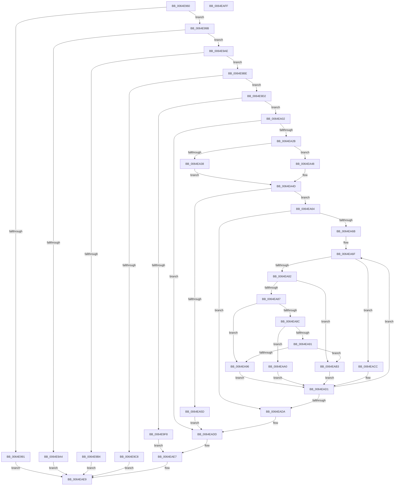

# EtwpGetPmcOwnership

- RVA: `0x0064E960`–`0x0064EB00` (길이 `416` bytes)
- VA: `0x000000014064E960`
- 실행 섹션: `.text`
- PDB 이름 있음: `예`; PDB Function 태그: `아니요`
- unwind 정보 RVA: `0x000D34BC`
- 디코드: `115`개 명령, `416/416` bytes 표시
- 미해석 바이트: `0` (있으면 어셈블리에 `.byte`로 보존)

> 이 문서는 커널 이미지의 기계어와 PDB 기호를 분석해 생성했습니다. 4번과 5번은 함수 원형과 자료형을 바이너리 사용 방식에서 추정한 C 해석이며 원본 소스 복구 결과는 아닙니다.

## 1. Dependencies

- 직접 호출 지점: **5**; 고유 호출 대상: **5**
- 직접 호출자로 확인된 함수: **1**
- RIP 상대 이미지 참조: **4**

### Outgoing calls
- `0x0064E988` → [SeSinglePrivilegeCheck](../../page/87/SeSinglePrivilegeCheck_function_00871E20.md) (function, `0x00871E20`)
- `0x0064E99B` → [PsIsCurrentThreadInServerSilo](../43/PsIsCurrentThreadInServerSilo_function_004362E0.md) (function, `0x004362E0`)
- `0x0064E9EB` → [ExAllocatePool2](../../poolcode/B8/ExAllocatePool2_function_00B820F0.md) (function, `0x00B820F0`)
- `0x0064EA1C` → [guard_dispatch_icall](../6B/guard_dispatch_icall_function_006BAAD0.md) (function, `0x006BAAD0`)
- `0x0064EAE2` → [ExFreePoolWithTag](../../poolcode/B8/ExFreePoolWithTag_function_00B82870.md) (function, `0x00B82870`)

### Direct callers
- [NtTraceControl](../../page/A9/NtTraceControl_function_00A9ED40.md) at `0x00A9F80C`

### Static image references
- `0x0064E981` → RVA `0x00FD9B48` (`PAGEDATA`; read)
- `0x0064E9BE` → RVA `0x00FC6A80` (`ALMOSTRO`; read)
- `0x0064E9D2` → RVA `0x00E0EB1C` (`.data`; read)
- `0x0064EA0E` → RVA `0x00E00638` (`.data`; read)

## 2. Other-region calls and transfers

- 다른 실행 섹션으로 향하는 call: **3**
  - `0x0064E988` → [SeSinglePrivilegeCheck](../../page/87/SeSinglePrivilegeCheck_function_00871E20.md) (`.text` → `PAGE`)
  - `0x0064E9EB` → [ExAllocatePool2](../../poolcode/B8/ExAllocatePool2_function_00B820F0.md) (`.text` → `POOLCODE`)
  - `0x0064EAE2` → [ExFreePoolWithTag](../../poolcode/B8/ExFreePoolWithTag_function_00B82870.md) (`.text` → `POOLCODE`)
- 별도 외부 분기/꼬리 이동을 확인하지 못했습니다.

## 3. Assembly (complete function range)

```asm
0064E960  48 8B C4                        mov rax, rsp
0064E963  48 89 58 08                     mov qword ptr [rax + 8], rbx
0064E967  48 89 70 10                     mov qword ptr [rax + 0x10], rsi
0064E96B  48 89 78 20                     mov qword ptr [rax + 0x20], rdi
0064E96F  41 56                           push r14
0064E971  48 83 EC 30                     sub rsp, 0x30
0064E975  83 60 18 00                     and dword ptr [rax + 0x18], 0
0064E979  4C 8B F2                        mov r14, rdx
0064E97C  48 8B D9                        mov rbx, rcx
0064E97F  B2 01                           mov dl, 1
0064E981  48 8B 0D C0 B1 98 00            mov rcx, qword ptr [rip + 0x98b1c0]
0064E988  E8 93 34 22 00                  call 0x140871e20
0064E98D  84 C0                           test al, al
0064E98F  75 0A                           jne 0x14064e99b
0064E991  B8 61 00 00 C0                  mov eax, 0xc0000061
0064E996  E9 4E 01 00 00                  jmp 0x14064eae9
0064E99B  E8 40 79 DE FF                  call 0x1404362e0
0064E9A0  84 C0                           test al, al
0064E9A2  74 0A                           je 0x14064e9ae
0064E9A4  B8 22 00 00 C0                  mov eax, 0xc0000022
0064E9A9  E9 3B 01 00 00                  jmp 0x14064eae9
0064E9AE  41 83 3E 08                     cmp dword ptr [r14], 8
0064E9B2  73 0A                           jae 0x14064e9be
0064E9B4  B8 23 00 00 C0                  mov eax, 0xc0000023
0064E9B9  E9 2B 01 00 00                  jmp 0x14064eae9
0064E9BE  8B 05 BC 80 97 00               mov eax, dword ptr [rip + 0x9780bc]
0064E9C4  39 03                           cmp dword ptr [rbx], eax
0064E9C6  76 0A                           jbe 0x14064e9d2
0064E9C8  B8 0D 00 00 C0                  mov eax, 0xc000000d
0064E9CD  E9 17 01 00 00                  jmp 0x14064eae9
0064E9D2  8B 3D 44 01 7C 00               mov edi, dword ptr [rip + 0x7c0144]
0064E9D8  B9 40 00 00 00                  mov ecx, 0x40
0064E9DD  C1 E7 04                        shl edi, 4
0064E9E0  41 B8 45 74 77 74               mov r8d, 0x74777445
0064E9E6  83 C7 08                        add edi, 8
0064E9E9  8B D7                           mov edx, edi
0064E9EB  E8 00 37 53 00                  call 0x140b820f0
0064E9F0  48 8B F0                        mov rsi, rax
0064E9F3  48 85 C0                        test rax, rax
0064E9F6  75 0A                           jne 0x14064ea02
0064E9F8  BF 17 00 00 C0                  mov edi, 0xc0000017
0064E9FD  E9 E5 00 00 00                  jmp 0x14064eae7
0064EA02  8B 03                           mov eax, dword ptr [rbx]
0064EA04  4C 8D 4C 24 50                  lea r9, [rsp + 0x50]
0064EA09  89 06                           mov dword ptr [rsi], eax
0064EA0B  4C 8B C6                        mov r8, rsi
0064EA0E  48 8B 05 23 1C 7B 00            mov rax, qword ptr [rip + 0x7b1c23]
0064EA15  8B D7                           mov edx, edi
0064EA17  B9 35 00 00 00                  mov ecx, 0x35
0064EA1C  E8 AF C0 06 00                  call 0x1406baad0
0064EA21  8B F8                           mov edi, eax
0064EA23  85 C0                           test eax, eax
0064EA25  0F 88 B2 00 00 00               js 0x14064eadd
0064EA2B  8B 4E 04                        mov ecx, dword ptr [rsi + 4]
0064EA2E  8B 05 E8 00 7C 00               mov eax, dword ptr [rip + 0x7c00e8]
0064EA34  3B C8                           cmp ecx, eax
0064EA36  76 10                           jbe 0x14064ea48
0064EA38  89 43 04                        mov dword ptr [rbx + 4], eax
0064EA3B  BF 05 00 00 80                  mov edi, 0x80000005
0064EA40  8B 0D D6 00 7C 00               mov ecx, dword ptr [rip + 0x7c00d6]
0064EA46  EB 05                           jmp 0x14064ea4d
0064EA48  33 FF                           xor edi, edi
0064EA4A  89 4B 04                        mov dword ptr [rbx + 4], ecx
0064EA4D  8D 04 49                        lea eax, [rcx + rcx*2]
0064EA50  44 8D 14 85 08 00 00 00         lea r10d, [rax*4 + 8]
0064EA58  45 39 16                        cmp dword ptr [r14], r10d
0064EA5B  73 07                           jae 0x14064ea64
0064EA5D  BF 23 00 00 C0                  mov edi, 0xc0000023
0064EA62  EB 79                           jmp 0x14064eadd
0064EA64  45 33 C9                        xor r9d, r9d
0064EA67  85 C9                           test ecx, ecx
0064EA69  74 6F                           je 0x14064eada
0064EA6B  45 8D 59 03                     lea r11d, [r9 + 3]
0064EA6F  45 8B C1                        mov r8d, r9d
0064EA72  4B 8D 0C 49                     lea rcx, [r9 + r9*2]
0064EA76  4D 03 C0                        add r8, r8
0064EA79  42 8B 54 C6 08                  mov edx, dword ptr [rsi + r8*8 + 8]
0064EA7E  85 D2                           test edx, edx
0064EA80  74 4A                           je 0x14064eacc
0064EA82  83 EA 01                        sub edx, 1
0064EA85  74 2C                           je 0x14064eab3
0064EA87  83 EA 01                        sub edx, 1
0064EA8A  74 0A                           je 0x14064ea96
0064EA8C  83 EA 01                        sub edx, 1
0064EA8F  74 0F                           je 0x14064eaa0
0064EA91  83 FA 01                        cmp edx, 1
0064EA94  74 1D                           je 0x14064eab3
0064EA96  C7 44 8B 08 01 00 00 00         mov dword ptr [rbx + rcx*4 + 8], 1
0064EA9E  EB 31                           jmp 0x14064ead1
0064EAA0  C7 44 8B 08 02 00 00 00         mov dword ptr [rbx + rcx*4 + 8], 2
0064EAA8  42 8B 44 C6 10                  mov eax, dword ptr [rsi + r8*8 + 0x10]
0064EAAD  89 44 8B 10                     mov dword ptr [rbx + rcx*4 + 0x10], eax
0064EAB1  EB 1E                           jmp 0x14064ead1
0064EAB3  44 89 5C 8B 08                  mov dword ptr [rbx + rcx*4 + 8], r11d
0064EAB8  42 8B 44 C6 14                  mov eax, dword ptr [rsi + r8*8 + 0x14]
0064EABD  89 44 8B 10                     mov dword ptr [rbx + rcx*4 + 0x10], eax
0064EAC1  42 8B 44 C6 10                  mov eax, dword ptr [rsi + r8*8 + 0x10]
0064EAC6  89 44 8B 0C                     mov dword ptr [rbx + rcx*4 + 0xc], eax
0064EACA  EB 05                           jmp 0x14064ead1
0064EACC  83 64 8B 08 00                  and dword ptr [rbx + rcx*4 + 8], 0
0064EAD1  41 FF C1                        inc r9d
0064EAD4  44 3B 4B 04                     cmp r9d, dword ptr [rbx + 4]
0064EAD8  72 95                           jb 0x14064ea6f
0064EADA  45 89 16                        mov dword ptr [r14], r10d
0064EADD  33 D2                           xor edx, edx
0064EADF  48 8B CE                        mov rcx, rsi
0064EAE2  E8 89 3D 53 00                  call 0x140b82870
0064EAE7  8B C7                           mov eax, edi
0064EAE9  48 8B 5C 24 40                  mov rbx, qword ptr [rsp + 0x40]
0064EAEE  48 8B 74 24 48                  mov rsi, qword ptr [rsp + 0x48]
0064EAF3  48 8B 7C 24 58                  mov rdi, qword ptr [rsp + 0x58]
0064EAF8  48 83 C4 30                     add rsp, 0x30
0064EAFC  41 5E                           pop r14
0064EAFE  C3                              ret
0064EAFF  CC                              int3
```

## 4. C-style interpretation (structured pseudocode)

```c
__int64 __fastcall EtwpGetPmcOwnership(__int64 a1, __int64 a2)
{
    __int64 result;
    __int64 v_rdi;
    __int64 v_rsp;
    unsigned __int64 v_stack_p10;
    unsigned __int64 v_stack_p18;
    unsigned __int64 v_stack_p20;
    unsigned __int64 v_stack_p8;

    *(unsigned __int64 *)(v_rsp + 8) = v_rbx;
    *(unsigned __int64 *)(v_rsp + 16) = v_rsi;
    *(unsigned __int64 *)(v_rsp + 32) = v_rdi;
    v_rsp = (v_rsp) - (48);
    result = SeSinglePrivilegeCheck(*(unsigned __int64 *)(v_rip + 10006976), 1, a3, a4);
    if ((unsigned __int8)(result) != 0) goto loc_0064E99B;
    goto loc_0064EAE9;
loc_0064E99B:
    result = PsIsCurrentThreadInServerSilo(*(unsigned __int64 *)(v_rip + 10006976), 1, a3, a4);
    if ((unsigned __int8)(result) == 0) goto loc_0064E9AE;
    goto loc_0064EAE9;
loc_0064E9AE:
    if ((*(unsigned int *)(a2)) >= 8) goto loc_0064E9BE;
    goto loc_0064EAE9;
loc_0064E9BE:
    if ((*(unsigned int *)(a1)) <= ((unsigned int)((unsigned int)(*(unsigned int *)(v_rip + 9928892))))) goto loc_0064E9D2;
    goto loc_0064EAE9;
loc_0064E9D2:
    v_rdi = (unsigned int)(((unsigned int)(*(unsigned int *)(v_rip + 8126788))) << (4));
    v_rdi = (unsigned int)((v_rdi) + (8));
    result = ExAllocatePool2(64, (unsigned int)((unsigned int)(v_rdi)), (unsigned int)(0x74777445ULL), a4);
    if (result != 0) goto loc_0064EA02;
    goto loc_0064EAE7;
loc_0064EA02:
    *(unsigned int *)(result) = (unsigned int)((unsigned int)(*(unsigned int *)(a1)));
    result = guard_dispatch_icall(53, (unsigned int)((unsigned int)((unsigned int)(0xC0000017ULL))), result, v_stack_p18);
    if (sign_flag) goto loc_0064EADD;
    if (((unsigned int)((unsigned int)(*(unsigned int *)(result + 4)))) <= ((unsigned int)((unsigned int)(*(unsigned int *)(v_rip + 8126696))))) goto loc_0064EA48;
    *(unsigned int *)(a1 + 4) = (unsigned int)((unsigned int)(*(unsigned int *)(v_rip + 8126696)));
    goto loc_0064EA4D;
loc_0064EA48:
    v_rdi = 0;
    *(unsigned int *)(a1 + 4) = (unsigned int)((unsigned int)(*(unsigned int *)(v_rip + 8126678)));
loc_0064EA4D:
    if ((*(unsigned int *)(a2)) >= ((unsigned int)((unsigned int)(*(unsigned int *)(v_rip + 8126678)) + (unsigned int)(*(unsigned int *)(v_rip + 8126678)) * 2 * 4 + 8))) goto loc_0064EA64;
    goto loc_0064EADD;
loc_0064EA64:
    a4 = 0;
    if ((unsigned int)((unsigned int)(*(unsigned int *)(v_rip + 8126678))) == 0) goto loc_0064EADA;
loc_0064EA6F:
    a3 = (0) + (0);
    if ((unsigned int)((unsigned int)(*(unsigned int *)(result + a3 * 8 + 8))) == 0) goto loc_0064EACC;
    a2 = (unsigned int)(((unsigned int)(*(unsigned int *)(result + a3 * 8 + 8))) - (1));
    if (condition_is_equal) goto loc_0064EAB3;
    a2 = (unsigned int)((a2) - (1));
    if (condition_is_equal) goto loc_0064EA96;
    a2 = (unsigned int)((a2) - (1));
    if (condition_is_equal) goto loc_0064EAA0;
    if (((unsigned int)(a2)) == 1) goto loc_0064EAB3;
loc_0064EA96:
    *(unsigned int *)(a1 + a4 + a4 * 2 * 4 + 8) = 1;
    goto loc_0064EAD1;
loc_0064EAA0:
    *(unsigned int *)(a1 + a4 + a4 * 2 * 4 + 8) = 2;
    *(unsigned int *)(a1 + a4 + a4 * 2 * 4 + 16) = (unsigned int)((unsigned int)(*(unsigned int *)(result + a3 * 8 + 16)));
    goto loc_0064EAD1;
loc_0064EAB3:
    *(unsigned int *)(a1 + a4 + a4 * 2 * 4 + 8) = (unsigned int)(a4 + 3);
    *(unsigned int *)(a1 + a4 + a4 * 2 * 4 + 16) = (unsigned int)((unsigned int)(*(unsigned int *)(result + a3 * 8 + 20)));
    *(unsigned int *)(a1 + a4 + a4 * 2 * 4 + 12) = (unsigned int)((unsigned int)(*(unsigned int *)(result + a3 * 8 + 16)));
    goto loc_0064EAD1;
loc_0064EACC:
loc_0064EAD1:
    a4 = (unsigned int)((a4) + 1);
    if (((unsigned int)(a4)) < (*(unsigned int *)(a1 + 4))) goto loc_0064EA6F;
loc_0064EADA:
    *(unsigned int *)(a2) = (unsigned int)((unsigned int)(*(unsigned int *)(v_rip + 8126678)) + (unsigned int)(*(unsigned int *)(v_rip + 8126678)) * 2 * 4 + 8);
loc_0064EADD:
    a2 = 0;
    result = ExFreePoolWithTag(result, a2, a3, a4);
loc_0064EAE7:
loc_0064EAE9:
    v_rsp = (v_rsp) + (48);
    return (unsigned int)((unsigned int)((unsigned int)(0xC0000023ULL)));
}
```

## 5. (Beta) C Style

```c
int64_t EtwpGetPmcOwnership(void *Arg1, void *Arg2)
{
    uint8_t *arg1 = (uint8_t *)Arg1;
    uint8_t *arg2 = (uint8_t *)Arg2;

    int64_t result;
    int64_t local_rdi;
    int64_t local_rsp;
    uint64_t v_stack_p10;
    uint64_t v_stack_p18;
    uint64_t v_stack_p20;
    uint64_t v_stack_p8;

    *(uint64_t *)(local_rsp + 0x8) = local_rbx;
    *(uint64_t *)(local_rsp + 0x10) = local_rsi;
    *(uint64_t *)(local_rsp + 0x20) = local_rdi;
    local_rsp = (local_rsp) - (48);
    result = SeSinglePrivilegeCheck(*(uint64_t *)(v_rip + 0x98B1C0), 1, a3, a4);
    if ((uint8_t)(result) != 0) goto loc_0064E99B;
    goto loc_0064EAE9;
loc_0064E99B:
    result = PsIsCurrentThreadInServerSilo(*(uint64_t *)(v_rip + 0x98B1C0), 1, a3, a4);
    if ((uint8_t)(result) == 0) goto loc_0064E9AE;
    goto loc_0064EAE9;
loc_0064E9AE:
    if ((*(uint32_t *)(arg2)) >= 8) goto loc_0064E9BE;
    goto loc_0064EAE9;
loc_0064E9BE:
    if ((*(uint32_t *)(arg1)) <= ((uint32_t)((uint32_t)(*(uint32_t *)(v_rip + 0x9780BC))))) goto loc_0064E9D2;
    goto loc_0064EAE9;
loc_0064E9D2:
    local_rdi = (uint32_t)(((uint32_t)(*(uint32_t *)(v_rip + 0x7C0144))) << (4));
    local_rdi = (uint32_t)((local_rdi) + (8));
    result = ExAllocatePool2(64, (uint32_t)((uint32_t)(local_rdi)), (uint32_t)(0x74777445ULL), a4);
    if (result != 0) goto loc_0064EA02;
    goto loc_0064EAE7;
loc_0064EA02:
    *(uint32_t *)(result) = (uint32_t)((uint32_t)(*(uint32_t *)(arg1)));
    result = guard_dispatch_icall(53, (uint32_t)((uint32_t)((uint32_t)(0xC0000017ULL))), result, v_stack_p18);
    if (sign_flag) goto loc_0064EADD;
    if (((uint32_t)((uint32_t)(*(uint32_t *)(result + 0x4)))) <= ((uint32_t)((uint32_t)(*(uint32_t *)(v_rip + 0x7C00E8))))) goto loc_0064EA48;
    *(uint32_t *)(arg1 + 0x4) = (uint32_t)((uint32_t)(*(uint32_t *)(v_rip + 0x7C00E8)));
    goto loc_0064EA4D;
loc_0064EA48:
    local_rdi = 0;
    *(uint32_t *)(arg1 + 0x4) = (uint32_t)((uint32_t)(*(uint32_t *)(v_rip + 0x7C00D6)));
loc_0064EA4D:
    if ((*(uint32_t *)(arg2)) >= ((uint32_t)((uint32_t)(*(uint32_t *)(v_rip + 0x7C00D6)) + (uint32_t)(*(uint32_t *)(v_rip + 0x7C00D6)) * 2 * 4 + 8))) goto loc_0064EA64;
    goto loc_0064EADD;
loc_0064EA64:
    a4 = 0;
    if ((uint32_t)((uint32_t)(*(uint32_t *)(v_rip + 0x7C00D6))) == 0) goto loc_0064EADA;
loc_0064EA6F:
    a3 = (0) + (0);
    if ((uint32_t)((uint32_t)(*(uint32_t *)(result + a3 * 8 + 0x8))) == 0) goto loc_0064EACC;
    Arg2 = (uint32_t)(((uint32_t)(*(uint32_t *)(result + a3 * 8 + 0x8))) - (1));
    if (condition_is_equal) goto loc_0064EAB3;
    Arg2 = (uint32_t)((Arg2) - (1));
    if (condition_is_equal) goto loc_0064EA96;
    Arg2 = (uint32_t)((Arg2) - (1));
    if (condition_is_equal) goto loc_0064EAA0;
    if (((uint32_t)(Arg2)) == 1) goto loc_0064EAB3;
loc_0064EA96:
    *(uint32_t *)(arg1 + a4 + a4 * 2 * 4 + 0x8) = 1;
    goto loc_0064EAD1;
loc_0064EAA0:
    *(uint32_t *)(arg1 + a4 + a4 * 2 * 4 + 0x8) = 2;
    *(uint32_t *)(arg1 + a4 + a4 * 2 * 4 + 0x10) = (uint32_t)((uint32_t)(*(uint32_t *)(result + a3 * 8 + 0x10)));
    goto loc_0064EAD1;
loc_0064EAB3:
    *(uint32_t *)(arg1 + a4 + a4 * 2 * 4 + 0x8) = (uint32_t)(a4 + 3);
    *(uint32_t *)(arg1 + a4 + a4 * 2 * 4 + 0x10) = (uint32_t)((uint32_t)(*(uint32_t *)(result + a3 * 8 + 0x14)));
    *(uint32_t *)(arg1 + a4 + a4 * 2 * 4 + 0xC) = (uint32_t)((uint32_t)(*(uint32_t *)(result + a3 * 8 + 0x10)));
    goto loc_0064EAD1;
loc_0064EACC:
loc_0064EAD1:
    a4 = (uint32_t)((a4) + 1);
    if (((uint32_t)(a4)) < (*(uint32_t *)(arg1 + 0x4))) goto loc_0064EA6F;
loc_0064EADA:
    *(uint32_t *)(arg2) = (uint32_t)((uint32_t)(*(uint32_t *)(v_rip + 0x7C00D6)) + (uint32_t)(*(uint32_t *)(v_rip + 0x7C00D6)) * 2 * 4 + 8);
loc_0064EADD:
    Arg2 = 0;
    result = ExFreePoolWithTag(result, Arg2, a3, a4);
loc_0064EAE7:
loc_0064EAE9:
    local_rsp = (local_rsp) + (48);
    return (uint32_t)((uint32_t)((uint32_t)(0xC0000023ULL)));
}
```

### 관측된 메모리 오프셋

구조체 형식이 확인되지 않은 접근은 인자 기준의 오프셋으로만 기록했습니다.

| 기준 인자 | 오프셋 표현 | 폭 (bit) | 접근 |
|---|---:|---:|---|
| `Arg1` | `+ 0x0` | `32` | `R` |
| `Arg1` | `+ 0x4` | `32` | `R` |
| `Arg1` | `+ 0x4` | `32` | `W` |
| `Arg1` | `+ 0x8 + rcx*4` | `32` | `R/W` |
| `Arg1` | `+ 0x8 + rcx*4` | `32` | `W` |
| `Arg1` | `+ 0xC + rcx*4` | `32` | `W` |
| `Arg1` | `+ 0x10 + rcx*4` | `32` | `W` |
| `Arg2` | `+ 0x0` | `32` | `R` |
| `Arg2` | `+ 0x0` | `32` | `W` |

## 6. Execution-region graph

[열기: 2D/3D 그래프와 함수 탐색 컨트롤 패널](../../../control-panel.html?section=text&rva=0x0064E960&view=graph)

- 2D 그래프는 위에서 아래로 흐르고, 3D 그래프는 빈 공간을 드래그해 회전합니다. Shift+드래그는 이동, 휠은 확대·축소, 함수 노드 선택은 대상 보고서 이동입니다.

### Static fallback


