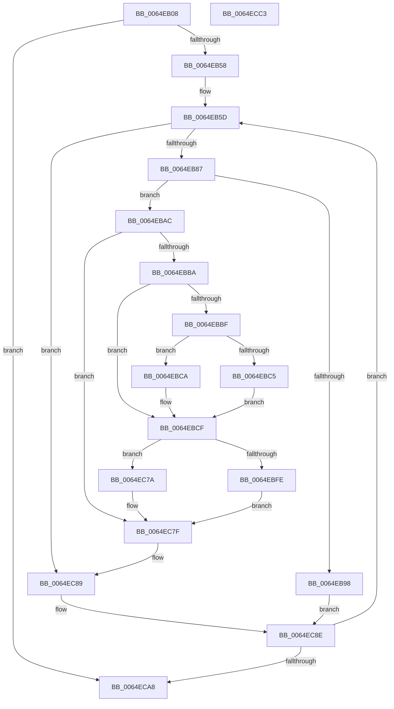

# EtwpGetPmcSessions

- RVA: `0x0064EB08`–`0x0064ECC4` (길이 `444` bytes)
- VA: `0x000000014064EB08`
- 실행 섹션: `.text`
- PDB 이름 있음: `예`; PDB Function 태그: `아니요`
- unwind 정보 RVA: `0x000A9680`
- 디코드: `118`개 명령, `444/444` bytes 표시
- 미해석 바이트: `0` (있으면 어셈블리에 `.byte`로 보존)

> 이 문서는 커널 이미지의 기계어와 PDB 기호를 분석해 생성했습니다. 4번과 5번은 함수 원형과 자료형을 바이너리 사용 방식에서 추정한 C 해석이며 원본 소스 복구 결과는 아닙니다.

## 1. Dependencies

- 직접 호출 지점: **10**; 고유 호출 대상: **7**
- 직접 호출자로 확인된 함수: **1**
- RIP 상대 이미지 참조: **0**

### Outgoing calls
- `0x0064EB29` → [EtwpGetCurrentSiloMaxLoggers](EtwpGetCurrentSiloMaxLoggers_function_0064E86C.md) (function, `0x0064E86C`)
- `0x0064EB37` → [PsGetCurrentServerSiloGlobals](../2F/PsGetCurrentServerSiloGlobals_function_002FE1F0.md) (function, `0x002FE1F0`)
- `0x0064EB76` → [EtwpAcquireLoggerContextByLoggerId](../../page/93/EtwpAcquireLoggerContextByLoggerId_function_00932920.md) (function, `0x00932920`)
- `0x0064EB8F` → [EtwpCheckLoggerControlAccess](../../page/8C/EtwpCheckLoggerControlAccess_function_008C0AE0.md) (function, `0x008C0AE0`)
- `0x0064EB98` → [KeLeaveCriticalRegion](../25/KeLeaveCriticalRegion_function_0025D8B0.md) (function, `0x0025D8B0`)
- `0x0064EBA2` → [EtwpReleaseLoggerContext](../../page/A0/EtwpReleaseLoggerContext_function_00A04160.md) (function, `0x00A04160`)
- `0x0064EC43` → [memcpy](../6C/memcpy_function_006C6840.md) (function, `0x006C6840`)
- `0x0064EC6F` → [memcpy](../6C/memcpy_function_006C6840.md) (function, `0x006C6840`)
- `0x0064EC84` → [EtwpReleaseLoggerContext](../../page/A0/EtwpReleaseLoggerContext_function_00A04160.md) (function, `0x00A04160`)
- `0x0064EC89` → [KeLeaveCriticalRegion](../25/KeLeaveCriticalRegion_function_0025D8B0.md) (function, `0x0025D8B0`)

### Direct callers
- [NtTraceControl](../../page/A9/NtTraceControl_function_00A9ED40.md) at `0x00A9F7F5`

### Static image references
- 디코드된 RIP-relative 메모리 참조가 없습니다.

## 2. Other-region calls and transfers

- 다른 실행 섹션으로 향하는 call: **4**
  - `0x0064EB76` → [EtwpAcquireLoggerContextByLoggerId](../../page/93/EtwpAcquireLoggerContextByLoggerId_function_00932920.md) (`.text` → `PAGE`)
  - `0x0064EB8F` → [EtwpCheckLoggerControlAccess](../../page/8C/EtwpCheckLoggerControlAccess_function_008C0AE0.md) (`.text` → `PAGE`)
  - `0x0064EBA2` → [EtwpReleaseLoggerContext](../../page/A0/EtwpReleaseLoggerContext_function_00A04160.md) (`.text` → `PAGE`)
  - `0x0064EC84` → [EtwpReleaseLoggerContext](../../page/A0/EtwpReleaseLoggerContext_function_00A04160.md) (`.text` → `PAGE`)
- 별도 외부 분기/꼬리 이동을 확인하지 못했습니다.

## 3. Assembly (complete function range)

```asm
0064EB08  48 89 5C 24 20                  mov qword ptr [rsp + 0x20], rbx
0064EB0D  48 89 4C 24 08                  mov qword ptr [rsp + 8], rcx
0064EB12  55                              push rbp
0064EB13  56                              push rsi
0064EB14  57                              push rdi
0064EB15  41 54                           push r12
0064EB17  41 55                           push r13
0064EB19  41 56                           push r14
0064EB1B  41 57                           push r15
0064EB1D  48 83 EC 20                     sub rsp, 0x20
0064EB21  33 FF                           xor edi, edi
0064EB23  4C 8B E2                        mov r12, rdx
0064EB26  44 8B EF                        mov r13d, edi
0064EB29  E8 3E FD FF FF                  call 0x14064e86c
0064EB2E  8B D8                           mov ebx, eax
0064EB30  89 44 24 68                     mov dword ptr [rsp + 0x68], eax
0064EB34  44 8B F7                        mov r14d, edi
0064EB37  E8 B4 F6 CA FF                  call 0x1402fe1f0
0064EB3C  8B EF                           mov ebp, edi
0064EB3E  8B F7                           mov esi, edi
0064EB40  44 0F B7 FF                     movzx r15d, di
0064EB44  4C 8B 88 40 03 00 00            mov r9, qword ptr [rax + 0x340]
0064EB4B  4C 89 4C 24 70                  mov qword ptr [rsp + 0x70], r9
0064EB50  85 DB                           test ebx, ebx
0064EB52  0F 84 50 01 00 00               je 0x14064eca8
0064EB58  8B CF                           mov ecx, edi
0064EB5A  8D 57 01                        lea edx, [rdi + 1]
0064EB5D  65 48 8B 04 25 88 01 00 00      mov rax, qword ptr gs:[0x188]
0064EB66  44 8A C2                        mov r8b, dl
0064EB69  8B D1                           mov edx, ecx
0064EB6B  49 8B C9                        mov rcx, r9
0064EB6E  66 FF 88 E4 01 00 00            dec word ptr [rax + 0x1e4]
0064EB75  90                              nop
0064EB76  E8 A5 3D 2E 00                  call 0x140932920
0064EB7B  48 8B F8                        mov rdi, rax
0064EB7E  48 85 C0                        test rax, rax
0064EB81  0F 84 02 01 00 00               je 0x14064ec89
0064EB87  48 8B D0                        mov rdx, rax
0064EB8A  B9 01 00 00 00                  mov ecx, 1
0064EB8F  E8 4C 1F 27 00                  call 0x1408c0ae0
0064EB94  85 C0                           test eax, eax
0064EB96  79 14                           jns 0x14064ebac
0064EB98  E8 13 ED C0 FF                  call 0x14025d8b0
0064EB9D  B2 01                           mov dl, 1
0064EB9F  48 8B CF                        mov rcx, rdi
0064EBA2  E8 B9 55 3B 00                  call 0x140a04160
0064EBA7  E9 E2 00 00 00                  jmp 0x14064ec8e
0064EBAC  48 83 BF 28 04 00 00 00         cmp qword ptr [rdi + 0x428], 0
0064EBB4  0F 84 C5 00 00 00               je 0x14064ec7f
0064EBBA  4D 85 F6                        test r14, r14
0064EBBD  74 10                           je 0x14064ebcf
0064EBBF  41 3B 34 24                     cmp esi, dword ptr [r12]
0064EBC3  77 05                           ja 0x14064ebca
0064EBC5  45 89 2E                        mov dword ptr [r14], r13d
0064EBC8  EB 05                           jmp 0x14064ebcf
0064EBCA  BD 23 00 00 C0                  mov ebp, 0xc0000023
0064EBCF  48 8B 87 28 04 00 00            mov rax, qword ptr [rdi + 0x428]
0064EBD6  44 8B F6                        mov r14d, esi
0064EBD9  4C 03 74 24 60                  add r14, qword ptr [rsp + 0x60]
0064EBDE  8B 50 14                        mov edx, dword ptr [rax + 0x14]
0064EBE1  48 8B 87 28 04 00 00            mov rax, qword ptr [rdi + 0x428]
0064EBE8  8B 48 08                        mov ecx, dword ptr [rax + 8]
0064EBEB  03 D1                           add edx, ecx
0064EBED  44 8D 2C 95 10 00 00 00         lea r13d, [rdx*4 + 0x10]
0064EBF5  41 03 F5                        add esi, r13d
0064EBF8  41 3B 34 24                     cmp esi, dword ptr [r12]
0064EBFC  77 7C                           ja 0x14064ec7a
0064EBFE  41 83 26 00                     and dword ptr [r14], 0
0064EC02  49 8D 5E 10                     lea rbx, [r14 + 0x10]
0064EC06  66 45 89 7E 04                  mov word ptr [r14 + 4], r15w
0064EC0B  48 8B 87 28 04 00 00            mov rax, qword ptr [rdi + 0x428]
0064EC12  8B 48 14                        mov ecx, dword ptr [rax + 0x14]
0064EC15  41 89 4E 08                     mov dword ptr [r14 + 8], ecx
0064EC19  48 8B 87 28 04 00 00            mov rax, qword ptr [rdi + 0x428]
0064EC20  8B 48 08                        mov ecx, dword ptr [rax + 8]
0064EC23  41 89 4E 0C                     mov dword ptr [r14 + 0xc], ecx
0064EC27  48 8B CB                        mov rcx, rbx
0064EC2A  48 8B 87 28 04 00 00            mov rax, qword ptr [rdi + 0x428]
0064EC31  44 8B 40 14                     mov r8d, dword ptr [rax + 0x14]
0064EC35  48 8B 97 28 04 00 00            mov rdx, qword ptr [rdi + 0x428]
0064EC3C  49 C1 E0 02                     shl r8, 2
0064EC40  48 8B 12                        mov rdx, qword ptr [rdx]
0064EC43  E8 F8 7B 07 00                  call 0x1406c6840
0064EC48  48 8B 87 28 04 00 00            mov rax, qword ptr [rdi + 0x428]
0064EC4F  8B 48 14                        mov ecx, dword ptr [rax + 0x14]
0064EC52  48 8B 87 28 04 00 00            mov rax, qword ptr [rdi + 0x428]
0064EC59  48 8D 0C 8B                     lea rcx, [rbx + rcx*4]
0064EC5D  44 8B 40 08                     mov r8d, dword ptr [rax + 8]
0064EC61  48 8B 97 28 04 00 00            mov rdx, qword ptr [rdi + 0x428]
0064EC68  4D 03 C0                        add r8, r8
0064EC6B  48 83 C2 0C                     add rdx, 0xc
0064EC6F  E8 CC 7B 07 00                  call 0x1406c6840
0064EC74  8B 5C 24 68                     mov ebx, dword ptr [rsp + 0x68]
0064EC78  EB 05                           jmp 0x14064ec7f
0064EC7A  BD 23 00 00 C0                  mov ebp, 0xc0000023
0064EC7F  B2 01                           mov dl, 1
0064EC81  48 8B CF                        mov rcx, rdi
0064EC84  E8 D7 54 3B 00                  call 0x140a04160
0064EC89  E8 22 EC C0 FF                  call 0x14025d8b0
0064EC8E  4C 8B 4C 24 70                  mov r9, qword ptr [rsp + 0x70]
0064EC93  BA 01 00 00 00                  mov edx, 1
0064EC98  66 44 03 FA                     add r15w, dx
0064EC9C  41 0F B7 CF                     movzx ecx, r15w
0064ECA0  3B CB                           cmp ecx, ebx
0064ECA2  0F 82 B5 FE FF FF               jb 0x14064eb5d
0064ECA8  48 8B 5C 24 78                  mov rbx, qword ptr [rsp + 0x78]
0064ECAD  8B C5                           mov eax, ebp
0064ECAF  41 89 34 24                     mov dword ptr [r12], esi
0064ECB3  48 83 C4 20                     add rsp, 0x20
0064ECB7  41 5F                           pop r15
0064ECB9  41 5E                           pop r14
0064ECBB  41 5D                           pop r13
0064ECBD  41 5C                           pop r12
0064ECBF  5F                              pop rdi
0064ECC0  5E                              pop rsi
0064ECC1  5D                              pop rbp
0064ECC2  C3                              ret
0064ECC3  CC                              int3
```

## 4. C-style interpretation (structured pseudocode)

```c
__int64 __fastcall EtwpGetPmcSessions(__int64 a1, __int64 a2)
{
    __int64 result;
    __int64 v_r14;
    __int64 v_r15;
    __int64 v_rdi;
    __int64 v_rsi;
    __int64 v_rsp;
    unsigned int v_stack_p10;
    unsigned __int64 v_stack_p18;
    unsigned __int64 v_stack_p20;
    unsigned __int64 v_stack_p8;

    v_stack_p20 = v_rbx;
    v_stack_p8 = a1;
    v_rsp = (v_rsp) - (32);
    v_rdi = 0;
    result = EtwpGetCurrentSiloMaxLoggers(a1, a2, a3, a4);
    v_stack_p10 = (unsigned int)(result);
    result = PsGetCurrentServerSiloGlobals(a1, a2, a3, a4);
    v_stack_p18 = *(unsigned __int64 *)(result + 832);
    if ((unsigned int)((unsigned int)((unsigned int)(result))) == 0) goto loc_0064ECA8;
loc_0064EB5D:
    result = EtwpAcquireLoggerContextByLoggerId(*(unsigned __int64 *)(result + 832), 0, (unsigned __int8)(v_rdi + 1), *(unsigned __int64 *)(result + 832));
    if (result == 0) goto loc_0064EC89;
    result = EtwpCheckLoggerControlAccess(1, result, (unsigned __int8)(v_rdi + 1), *(unsigned __int64 *)(result + 832));
    if (!sign_flag) goto loc_0064EBAC;
    result = KeLeaveCriticalRegion(1, result, (unsigned __int8)(v_rdi + 1), *(unsigned __int64 *)(result + 832));
    result = EtwpReleaseLoggerContext(result, 1, (unsigned __int8)(v_rdi + 1), *(unsigned __int64 *)(result + 832));
    goto loc_0064EC8E;
loc_0064EBAC:
    if ((*(unsigned __int64 *)(result + 1064)) == 0) goto loc_0064EC7F;
    if (0 == 0) goto loc_0064EBCF;
    if (0 > (*(unsigned int *)(a2))) goto loc_0064EBCA;
    *(unsigned int *)(0) = 0;
    goto loc_0064EBCF;
loc_0064EBCA:
loc_0064EBCF:
    v_r14 = (0) + (v_stack_p8);
    a2 = (unsigned int)(((unsigned int)(*(unsigned int *)(*(unsigned __int64 *)(result + 1064) + 20))) + ((unsigned int)((unsigned int)(*(unsigned int *)(*(unsigned __int64 *)(result + 1064) + 8)))));
    v_rsi = (unsigned int)((0) + ((unsigned int)(a2 * 4 + 16)));
    if (((unsigned int)(v_rsi)) > (*(unsigned int *)(a2))) goto loc_0064EC7A;
    *(unsigned __int16 *)(v_r14 + 4) = 0;
    *(unsigned int *)(v_r14 + 8) = (unsigned int)((unsigned int)(*(unsigned int *)(*(unsigned __int64 *)(result + 1064) + 20)));
    *(unsigned int *)(v_r14 + 12) = (unsigned int)((unsigned int)(*(unsigned int *)(*(unsigned __int64 *)(result + 1064) + 8)));
    a3 = ((unsigned int)(*(unsigned int *)(*(unsigned __int64 *)(result + 1064) + 20))) << (2);
    result = memcpy(v_r14 + 16, *(unsigned __int64 *)(*(unsigned __int64 *)(result + 1064)), a3, *(unsigned __int64 *)(result + 832));
    a3 = ((unsigned int)(*(unsigned int *)(*(unsigned __int64 *)(result + 1064) + 8))) + ((unsigned int)(*(unsigned int *)(*(unsigned __int64 *)(result + 1064) + 8)));
    a2 = (*(unsigned __int64 *)(result + 1064)) + (12);
    result = memcpy(v_r14 + 16 + (unsigned int)(*(unsigned int *)(*(unsigned __int64 *)(result + 1064) + 20)) * 4, a2, a3, *(unsigned __int64 *)(result + 832));
    goto loc_0064EC7F;
loc_0064EC7A:
loc_0064EC7F:
    result = EtwpReleaseLoggerContext(result, 1, a3, *(unsigned __int64 *)(result + 832));
loc_0064EC89:
    result = KeLeaveCriticalRegion(result, 1, a3, *(unsigned __int64 *)(result + 832));
loc_0064EC8E:
    v_r15 = (unsigned __int16)((0) + (1));
    if (((unsigned int)((unsigned __int16)(v_r15))) < ((unsigned int)((unsigned int)(v_stack_p10)))) goto loc_0064EB5D;
loc_0064ECA8:
    *(unsigned int *)(a2) = (unsigned int)(v_rsi);
    v_rsp = (v_rsp) + (32);
    return (unsigned int)((unsigned int)((unsigned int)(0xC0000023ULL)));
}
```

## 5. (Beta) C Style

```c
int64_t EtwpGetPmcSessions(int64_t Arg1, void *Arg2)
{
    uint8_t *arg2 = (uint8_t *)Arg2;

    int64_t result;
    int64_t local_r14;
    int64_t local_r15;
    int64_t local_rdi;
    int64_t local_rsi;
    int64_t local_rsp;
    uint32_t v_stack_p10;
    uint64_t v_stack_p18;
    uint64_t v_stack_p20;
    uint64_t v_stack_p8;

    v_stack_p20 = local_rbx;
    v_stack_p8 = Arg1;
    local_rsp = (local_rsp) - (32);
    local_rdi = 0;
    result = EtwpGetCurrentSiloMaxLoggers(Arg1, Arg2, a3, a4);
    v_stack_p10 = (uint32_t)(result);
    result = PsGetCurrentServerSiloGlobals(Arg1, Arg2, a3, a4);
    v_stack_p18 = *(uint64_t *)(result + 0x340);
    if ((uint32_t)((uint32_t)((uint32_t)(result))) == 0) goto loc_0064ECA8;
loc_0064EB5D:
    result = EtwpAcquireLoggerContextByLoggerId(*(uint64_t *)(result + 0x340), 0, (uint8_t)(local_rdi + 1), *(uint64_t *)(result + 0x340));
    if (result == 0) goto loc_0064EC89;
    result = EtwpCheckLoggerControlAccess(1, result, (uint8_t)(local_rdi + 1), *(uint64_t *)(result + 0x340));
    if (!sign_flag) goto loc_0064EBAC;
    result = KeLeaveCriticalRegion(1, result, (uint8_t)(local_rdi + 1), *(uint64_t *)(result + 0x340));
    result = EtwpReleaseLoggerContext(result, 1, (uint8_t)(local_rdi + 1), *(uint64_t *)(result + 0x340));
    goto loc_0064EC8E;
loc_0064EBAC:
    if ((*(uint64_t *)(result + 0x428)) == 0) goto loc_0064EC7F;
    if (0 == 0) goto loc_0064EBCF;
    if (0 > (*(uint32_t *)(arg2))) goto loc_0064EBCA;
    *(uint32_t *)(0) = 0;
    goto loc_0064EBCF;
loc_0064EBCA:
loc_0064EBCF:
    local_r14 = (0) + (v_stack_p8);
    Arg2 = (uint32_t)(((uint32_t)(*(uint32_t *)(*(uint64_t *)(result + 0x428) + 0x14))) + ((uint32_t)((uint32_t)(*(uint32_t *)(*(uint64_t *)(result + 0x428) + 0x8)))));
    local_rsi = (uint32_t)((0) + ((uint32_t)(Arg2 * 4 + 16)));
    if (((uint32_t)(local_rsi)) > (*(uint32_t *)(arg2))) goto loc_0064EC7A;
    *(uint16_t *)(local_r14 + 0x4) = 0;
    *(uint32_t *)(local_r14 + 0x8) = (uint32_t)((uint32_t)(*(uint32_t *)(*(uint64_t *)(result + 0x428) + 0x14)));
    *(uint32_t *)(local_r14 + 0xC) = (uint32_t)((uint32_t)(*(uint32_t *)(*(uint64_t *)(result + 0x428) + 0x8)));
    a3 = ((uint32_t)(*(uint32_t *)(*(uint64_t *)(result + 0x428) + 0x14))) << (2);
    result = memcpy(local_r14 + 16, *(uint64_t *)(*(uint64_t *)(result + 0x428)), a3, *(uint64_t *)(result + 0x340));
    a3 = ((uint32_t)(*(uint32_t *)(*(uint64_t *)(result + 0x428) + 0x8))) + ((uint32_t)(*(uint32_t *)(*(uint64_t *)(result + 0x428) + 0x8)));
    Arg2 = (*(uint64_t *)(result + 0x428)) + (12);
    result = memcpy(local_r14 + 16 + (uint32_t)(*(uint32_t *)(*(uint64_t *)(result + 0x428) + 0x14)) * 4, Arg2, a3, *(uint64_t *)(result + 0x340));
    goto loc_0064EC7F;
loc_0064EC7A:
loc_0064EC7F:
    result = EtwpReleaseLoggerContext(result, 1, a3, *(uint64_t *)(result + 0x340));
loc_0064EC89:
    result = KeLeaveCriticalRegion(result, 1, a3, *(uint64_t *)(result + 0x340));
loc_0064EC8E:
    local_r15 = (uint16_t)((0) + (1));
    if (((uint32_t)((uint16_t)(local_r15))) < ((uint32_t)((uint32_t)(v_stack_p10)))) goto loc_0064EB5D;
loc_0064ECA8:
    *(uint32_t *)(arg2) = (uint32_t)(local_rsi);
    local_rsp = (local_rsp) + (32);
    return (uint32_t)((uint32_t)((uint32_t)(0xC0000023ULL)));
}
```

### 관측된 메모리 오프셋

구조체 형식이 확인되지 않은 접근은 인자 기준의 오프셋으로만 기록했습니다.

| 기준 인자 | 오프셋 표현 | 폭 (bit) | 접근 |
|---|---:|---:|---|
| `Arg2` | `+ 0x0` | `32` | `R` |
| `Arg2` | `+ 0x0` | `32` | `W` |

## 6. Execution-region graph

[열기: 2D/3D 그래프와 함수 탐색 컨트롤 패널](../../../control-panel.html?section=text&rva=0x0064EB08&view=graph)

- 2D 그래프는 위에서 아래로 흐르고, 3D 그래프는 빈 공간을 드래그해 회전합니다. Shift+드래그는 이동, 휠은 확대·축소, 함수 노드 선택은 대상 보고서 이동입니다.

### Static fallback


