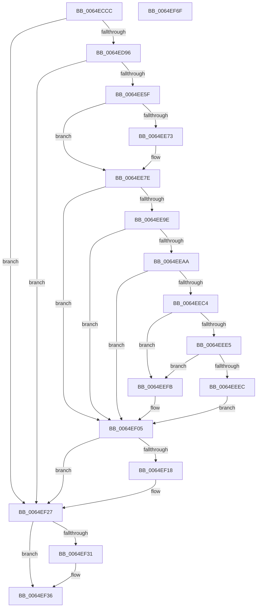

# EtwpQueryPartitionRegistryInformation

- RVA: `0x0064ECCC`–`0x0064EF70` (길이 `676` bytes)
- VA: `0x000000014064ECCC`
- 실행 섹션: `.text`
- PDB 이름 있음: `예`; PDB Function 태그: `아니요`
- unwind 정보 RVA: `0x000D3500`
- 디코드: `173`개 명령, `676/676` bytes 표시
- 미해석 바이트: `0` (있으면 어셈블리에 `.byte`로 보존)

> 이 문서는 커널 이미지의 기계어와 PDB 기호를 분석해 생성했습니다. 4번과 5번은 함수 원형과 자료형을 바이너리 사용 방식에서 추정한 C 해석이며 원본 소스 복구 결과는 아닙니다.

## 1. Dependencies

- 직접 호출 지점: **14**; 고유 호출 대상: **11**
- 직접 호출자로 확인된 함수: **2**
- RIP 상대 이미지 참조: **7**

### Outgoing calls
- `0x0064ED4E` → [RtlInitUnicodeString](../42/RtlInitUnicodeString_function_0042A780.md) (function, `0x0042A780`)
- `0x0064ED87` → [ZwOpenKey](../6A/ZwOpenKey_function_006AD310.md) (function, `0x006AD310`)
- `0x0064EDA2` → [memset](../6C/memset_function_006C6C40.md) (function, `0x006C6C40`)
- `0x0064EE50` → [RtlQueryRegistryValuesEx](../../page/8C/RtlQueryRegistryValuesEx_function_008C8FF0.md) (function, `0x008C8FF0`)
- `0x0064EE6A` → [StringToGuidNoBrackets](StringToGuidNoBrackets_function_0064F440.md) (function, `0x0064F440`)
- `0x0064EE95` → [RtlUnicodeToUTF8N](../../page/90/RtlUnicodeToUTF8N_function_0090DBF0.md) (function, `0x0090DBF0`)
- `0x0064EEB7` → [ExAllocatePool2](../../poolcode/B8/ExAllocatePool2_function_00B820F0.md) (function, `0x00B820F0`)
- `0x0064EEDC` → [RtlUnicodeToUTF8N](../../page/90/RtlUnicodeToUTF8N_function_0090DBF0.md) (function, `0x0090DBF0`)
- `0x0064EEF1` → [ExFreePoolWithTag](../../poolcode/B8/ExFreePoolWithTag_function_00B82870.md) (function, `0x00B82870`)
- `0x0064EF0D` → [StringToGuidNoBrackets](StringToGuidNoBrackets_function_0064F440.md) (function, `0x0064F440`)
- `0x0064EF31` → [ZwClose](../6A/ZwClose_function_006AD2B0.md) (function, `0x006AD2B0`)
- `0x0064EF3B` → [RtlFreeAnsiString](../../page/9C/RtlFreeAnsiString_function_009C0800.md) (function, `0x009C0800`)
- `0x0064EF45` → [RtlFreeAnsiString](../../page/9C/RtlFreeAnsiString_function_009C0800.md) (function, `0x009C0800`)
- `0x0064EF56` → [_security_check_cookie](../6A/_security_check_cookie_function_006AC640.md) (function, `0x006AC640`)

### Direct callers
- [EtwpContainerStateWnfCallback](EtwpContainerStateWnfCallback_function_0064E790.md) at `0x0064E7DA`
- [EtwpInitializeSiloState](../../page/7B/EtwpInitializeSiloState_function_007B6A3C.md) at `0x007B6BC5`

### Static image references
- `0x0064ECE8` → RVA `0x00E0A740` (`.data`; read)
- `0x0064ED21` → RVA `0x006CFEB0` (` ?? ::FNODOBFM::`string'`; read)
- `0x0064EDB0` → RVA `0x007BEA40` (`EtwpQueryRegistryCallback`; read)
- `0x0064EDCA` → RVA `0x006CFE90` (` ?? ::FNODOBFM::`string'`; read)
- `0x0064EDF5` → RVA `0x006CFE30` (` ?? ::FNODOBFM::`string'`; read)
- `0x0064EE1A` → RVA `0x006CFE00` (` ?? ::FNODOBFM::`string'`; read)
- `0x0064EE73` → RVA `0x000112D0` (`.rdata`; read)

## 2. Other-region calls and transfers

- 다른 실행 섹션으로 향하는 call: **7**
  - `0x0064EE50` → [RtlQueryRegistryValuesEx](../../page/8C/RtlQueryRegistryValuesEx_function_008C8FF0.md) (`.text` → `PAGE`)
  - `0x0064EE95` → [RtlUnicodeToUTF8N](../../page/90/RtlUnicodeToUTF8N_function_0090DBF0.md) (`.text` → `PAGE`)
  - `0x0064EEB7` → [ExAllocatePool2](../../poolcode/B8/ExAllocatePool2_function_00B820F0.md) (`.text` → `POOLCODE`)
  - `0x0064EEDC` → [RtlUnicodeToUTF8N](../../page/90/RtlUnicodeToUTF8N_function_0090DBF0.md) (`.text` → `PAGE`)
  - `0x0064EEF1` → [ExFreePoolWithTag](../../poolcode/B8/ExFreePoolWithTag_function_00B82870.md) (`.text` → `POOLCODE`)
  - `0x0064EF3B` → [RtlFreeAnsiString](../../page/9C/RtlFreeAnsiString_function_009C0800.md) (`.text` → `PAGE`)
  - `0x0064EF45` → [RtlFreeAnsiString](../../page/9C/RtlFreeAnsiString_function_009C0800.md) (`.text` → `PAGE`)
- 별도 외부 분기/꼬리 이동을 확인하지 못했습니다.

## 3. Assembly (complete function range)

```asm
0064ECCC  40 55                           push rbp
0064ECCE  53                              push rbx
0064ECCF  56                              push rsi
0064ECD0  57                              push rdi
0064ECD1  41 54                           push r12
0064ECD3  41 55                           push r13
0064ECD5  41 56                           push r14
0064ECD7  41 57                           push r15
0064ECD9  48 8D AC 24 28 FF FF FF         lea rbp, [rsp - 0xd8]
0064ECE1  48 81 EC D8 01 00 00            sub rsp, 0x1d8
0064ECE8  48 8B 05 51 BA 7B 00            mov rax, qword ptr [rip + 0x7bba51]
0064ECEF  48 33 C4                        xor rax, rsp
0064ECF2  48 89 85 C0 00 00 00            mov qword ptr [rbp + 0xc0], rax
0064ECF9  4C 8B BD 40 01 00 00            mov r15, qword ptr [rbp + 0x140]
0064ED00  33 DB                           xor ebx, ebx
0064ED02  4C 8B B5 48 01 00 00            mov r14, qword ptr [rbp + 0x148]
0064ED09  0F 57 C0                        xorps xmm0, xmm0
0064ED0C  48 8B FA                        mov rdi, rdx
0064ED0F  48 89 5C 24 38                  mov qword ptr [rsp + 0x38], rbx
0064ED14  48 8B F1                        mov rsi, rcx
0064ED17  89 5C 24 74                     mov dword ptr [rsp + 0x74], ebx
0064ED1B  0F 57 C9                        xorps xmm1, xmm1
0064ED1E  89 5D 8C                        mov dword ptr [rbp - 0x74], ebx
0064ED21  48 8D 15 88 11 08 00            lea rdx, [rip + 0x81188]
0064ED28  89 5C 24 34                     mov dword ptr [rsp + 0x34], ebx
0064ED2C  48 8D 4C 24 60                  lea rcx, [rsp + 0x60]
0064ED31  66 89 5C 24 30                  mov word ptr [rsp + 0x30], bx
0064ED36  0F 11 44 24 60                  movups xmmword ptr [rsp + 0x60], xmm0
0064ED3B  41 89 19                        mov dword ptr [r9], ebx
0064ED3E  4D 8B E9                        mov r13, r9
0064ED41  0F 11 44 24 40                  movups xmmword ptr [rsp + 0x40], xmm0
0064ED46  4D 8B E0                        mov r12, r8
0064ED49  0F 11 4C 24 50                  movups xmmword ptr [rsp + 0x50], xmm1
0064ED4E  E8 2D BA DD FF                  call 0x14042a780
0064ED53  48 8D 44 24 60                  lea rax, [rsp + 0x60]
0064ED58  C7 44 24 70 30 00 00 00         mov dword ptr [rsp + 0x70], 0x30
0064ED60  0F 57 C0                        xorps xmm0, xmm0
0064ED63  48 89 45 80                     mov qword ptr [rbp - 0x80], rax
0064ED67  4C 8D 44 24 70                  lea r8, [rsp + 0x70]
0064ED6C  48 89 5C 24 78                  mov qword ptr [rsp + 0x78], rbx
0064ED71  BA 19 00 02 00                  mov edx, 0x20019
0064ED76  C7 45 88 40 02 00 00            mov dword ptr [rbp - 0x78], 0x240
0064ED7D  48 8D 4C 24 38                  lea rcx, [rsp + 0x38]
0064ED82  F3 0F 7F 45 90                  movdqu xmmword ptr [rbp - 0x70], xmm0
0064ED87  E8 84 E5 05 00                  call 0x1406ad310
0064ED8C  8B D8                           mov ebx, eax
0064ED8E  85 C0                           test eax, eax
0064ED90  0F 88 91 01 00 00               js 0x14064ef27
0064ED96  33 D2                           xor edx, edx
0064ED98  48 8D 4D E0                     lea rcx, [rbp - 0x20]
0064ED9C  41 B8 E0 00 00 00               mov r8d, 0xe0
0064EDA2  E8 99 7E 07 00                  call 0x1406c6c40
0064EDA7  B9 01 00 00 00                  mov ecx, 1
0064EDAC  4C 89 6D A8                     mov qword ptr [rbp - 0x58], r13
0064EDB0  48 8D 15 89 FC 16 00            lea rdx, [rip + 0x16fc89]
0064EDB7  89 4D 38                        mov dword ptr [rbp + 0x38], ecx
0064EDBA  48 8D 45 A0                     lea rax, [rbp - 0x60]
0064EDBE  48 89 55 E0                     mov qword ptr [rbp - 0x20], rdx
0064EDC2  48 89 45 F8                     mov qword ptr [rbp - 8], rax
0064EDC6  4C 8D 45 E0                     lea r8, [rbp - 0x20]
0064EDCA  48 8D 05 BF 10 08 00            lea rax, [rip + 0x810bf]
0064EDD1  48 89 55 18                     mov qword ptr [rbp + 0x18], rdx
0064EDD5  48 89 45 F0                     mov qword ptr [rbp - 0x10], rax
0064EDD9  45 33 ED                        xor r13d, r13d
0064EDDC  B8 04 00 00 00                  mov eax, 4
0064EDE1  89 4D B0                        mov dword ptr [rbp - 0x50], ecx
0064EDE4  89 45 00                        mov dword ptr [rbp], eax
0064EDE7  45 33 C9                        xor r9d, r9d
0064EDEA  89 45 A0                        mov dword ptr [rbp - 0x60], eax
0064EDED  48 8D 45 B0                     lea rax, [rbp - 0x50]
0064EDF1  48 89 45 30                     mov qword ptr [rbp + 0x30], rax
0064EDF5  48 8D 05 34 10 08 00            lea rax, [rip + 0x81034]
0064EDFC  48 89 45 28                     mov qword ptr [rbp + 0x28], rax
0064EE00  48 8D 44 24 30                  lea rax, [rsp + 0x30]
0064EE05  48 89 45 40                     mov qword ptr [rbp + 0x40], rax
0064EE09  48 8D 44 24 40                  lea rax, [rsp + 0x40]
0064EE0E  48 89 45 B8                     mov qword ptr [rbp - 0x48], rax
0064EE12  48 8D 45 C0                     lea rax, [rbp - 0x40]
0064EE16  48 89 45 68                     mov qword ptr [rbp + 0x68], rax
0064EE1A  48 8D 05 DF 0F 08 00            lea rax, [rip + 0x80fdf]
0064EE21  48 89 45 60                     mov qword ptr [rbp + 0x60], rax
0064EE25  48 8D 44 24 30                  lea rax, [rsp + 0x30]
0064EE2A  48 89 45 78                     mov qword ptr [rbp + 0x78], rax
0064EE2E  48 8D 44 24 50                  lea rax, [rsp + 0x50]
0064EE33  48 89 55 50                     mov qword ptr [rbp + 0x50], rdx
0064EE37  48 8B 54 24 38                  mov rdx, qword ptr [rsp + 0x38]
0064EE3C  89 4D 70                        mov dword ptr [rbp + 0x70], ecx
0064EE3F  89 4D C0                        mov dword ptr [rbp - 0x40], ecx
0064EE42  B9 00 00 00 40                  mov ecx, 0x40000000
0064EE47  48 89 45 C8                     mov qword ptr [rbp - 0x38], rax
0064EE4B  4C 89 6C 24 20                  mov qword ptr [rsp + 0x20], r13
0064EE50  E8 9B A1 27 00                  call 0x1408c8ff0
0064EE55  8B D8                           mov ebx, eax
0064EE57  85 C0                           test eax, eax
0064EE59  0F 88 C8 00 00 00               js 0x14064ef27
0064EE5F  48 8B D6                        mov rdx, rsi
0064EE62  4D 89 2F                        mov qword ptr [r15], r13
0064EE65  48 8D 4C 24 40                  lea rcx, [rsp + 0x40]
0064EE6A  E8 D1 05 00 00                  call 0x14064f440
0064EE6F  85 C0                           test eax, eax
0064EE71  74 0B                           je 0x14064ee7e
0064EE73  0F 10 05 56 24 9C FF            movups xmm0, xmmword ptr [rip - 0x63dbaa]
0064EE7A  F3 0F 7F 06                     movdqu xmmword ptr [rsi], xmm0
0064EE7E  0F B7 44 24 40                  movzx eax, word ptr [rsp + 0x40]
0064EE83  4C 8D 44 24 34                  lea r8, [rsp + 0x34]
0064EE88  4C 8B 4C 24 48                  mov r9, qword ptr [rsp + 0x48]
0064EE8D  33 D2                           xor edx, edx
0064EE8F  33 C9                           xor ecx, ecx
0064EE91  89 44 24 20                     mov dword ptr [rsp + 0x20], eax
0064EE95  E8 56 ED 2B 00                  call 0x14090dbf0
0064EE9A  85 C0                           test eax, eax
0064EE9C  75 67                           jne 0x14064ef05
0064EE9E  8B 5C 24 34                     mov ebx, dword ptr [rsp + 0x34]
0064EEA2  81 FB FF FF 00 00               cmp ebx, 0xffff
0064EEA8  73 5B                           jae 0x14064ef05
0064EEAA  BE 45 74 77 61                  mov esi, 0x61777445
0064EEAF  8D 48 48                        lea ecx, [rax + 0x48]
0064EEB2  44 8B C6                        mov r8d, esi
0064EEB5  8B D3                           mov edx, ebx
0064EEB7  E8 34 32 53 00                  call 0x140b820f0
0064EEBC  48 89 07                        mov qword ptr [rdi], rax
0064EEBF  48 85 C0                        test rax, rax
0064EEC2  74 41                           je 0x14064ef05
0064EEC4  0F B7 4C 24 40                  movzx ecx, word ptr [rsp + 0x40]
0064EEC9  4C 8D 44 24 34                  lea r8, [rsp + 0x34]
0064EECE  4C 8B 4C 24 48                  mov r9, qword ptr [rsp + 0x48]
0064EED3  8B D3                           mov edx, ebx
0064EED5  89 4C 24 20                     mov dword ptr [rsp + 0x20], ecx
0064EED9  48 8B C8                        mov rcx, rax
0064EEDC  E8 0F ED 2B 00                  call 0x14090dbf0
0064EEE1  85 C0                           test eax, eax
0064EEE3  74 16                           je 0x14064eefb
0064EEE5  3D 07 01 00 00                  cmp eax, 0x107
0064EEEA  74 0F                           je 0x14064eefb
0064EEEC  48 8B 0F                        mov rcx, qword ptr [rdi]
0064EEEF  8B D6                           mov edx, esi
0064EEF1  E8 7A 39 53 00                  call 0x140b82870
0064EEF6  4C 89 2F                        mov qword ptr [rdi], r13
0064EEF9  EB 0A                           jmp 0x14064ef05
0064EEFB  0F B7 44 24 34                  movzx eax, word ptr [rsp + 0x34]
0064EF00  66 41 89 04 24                  mov word ptr [r12], ax
0064EF05  49 8B D6                        mov rdx, r14
0064EF08  48 8D 4C 24 50                  lea rcx, [rsp + 0x50]
0064EF0D  E8 2E 05 00 00                  call 0x14064f440
0064EF12  8B D8                           mov ebx, eax
0064EF14  85 C0                           test eax, eax
0064EF16  74 0F                           je 0x14064ef27
0064EF18  0F 10 05 B1 23 9C FF            movups xmm0, xmmword ptr [rip - 0x63dc4f]
0064EF1F  41 8B DD                        mov ebx, r13d
0064EF22  F3 41 0F 7F 06                  movdqu xmmword ptr [r14], xmm0
0064EF27  48 8B 4C 24 38                  mov rcx, qword ptr [rsp + 0x38]
0064EF2C  48 85 C9                        test rcx, rcx
0064EF2F  74 05                           je 0x14064ef36
0064EF31  E8 7A E3 05 00                  call 0x1406ad2b0
0064EF36  48 8D 4C 24 40                  lea rcx, [rsp + 0x40]
0064EF3B  E8 C0 18 37 00                  call 0x1409c0800
0064EF40  48 8D 4C 24 50                  lea rcx, [rsp + 0x50]
0064EF45  E8 B6 18 37 00                  call 0x1409c0800
0064EF4A  8B C3                           mov eax, ebx
0064EF4C  48 8B 8D C0 00 00 00            mov rcx, qword ptr [rbp + 0xc0]
0064EF53  48 33 CC                        xor rcx, rsp
0064EF56  E8 E5 D6 05 00                  call 0x1406ac640
0064EF5B  48 81 C4 D8 01 00 00            add rsp, 0x1d8
0064EF62  41 5F                           pop r15
0064EF64  41 5E                           pop r14
0064EF66  41 5D                           pop r13
0064EF68  41 5C                           pop r12
0064EF6A  5F                              pop rdi
0064EF6B  5E                              pop rsi
0064EF6C  5B                              pop rbx
0064EF6D  5D                              pop rbp
0064EF6E  C3                              ret
0064EF6F  CC                              int3
```

## 4. C-style interpretation (structured pseudocode)

```c
__int64 __fastcall EtwpQueryPartitionRegistryInformation(__int64 a1, __int64 a2, __int64 a3, __int64 a4, __int64 a5, __int64 a6)
{
    __int64 result;
    __int64 v_r13;
    __int64 v_rbx;
    __int64 v_rsp;
    unsigned __int64 v_stack_m100;
    unsigned __int64 v_stack_m118;
    unsigned __int64 v_stack_m120;
    unsigned __int64 v_stack_m128;
    unsigned __int64 v_stack_m138;
    unsigned __int64 v_stack_m150;
    unsigned __int64 v_stack_m158;
    unsigned __int64 v_stack_m160;
    unsigned int v_stack_m168;
    unsigned __int64 v_stack_m170;
    unsigned __int64 v_stack_m178;
    unsigned __int64 v_stack_m188;
    unsigned int v_stack_m18C;
    unsigned int v_stack_m190;
    unsigned __int64 v_stack_m198;
    unsigned __int64 v_stack_m1A0;
    unsigned int v_stack_m1A4;
    unsigned int v_stack_m1A8;
    unsigned __int64 v_stack_m1B8;
    unsigned __int64 v_stack_m1C8;
    unsigned __int64 v_stack_m1D0;
    unsigned __int64 v_stack_m1D8;
    unsigned __int64 v_stack_m1E0;
    unsigned int v_stack_m1E4;
    unsigned __int16 v_stack_m1E8;
    unsigned __int64 v_stack_m1F8;
    unsigned __int64 v_stack_m58;
    unsigned __int64 v_stack_mA0;
    unsigned int v_stack_mA8;
    unsigned __int64 v_stack_mB0;
    unsigned __int64 v_stack_mB8;
    unsigned __int64 v_stack_mC8;
    unsigned __int64 v_stack_mD8;
    unsigned int v_stack_mE0;
    unsigned __int64 v_stack_mE8;
    unsigned __int64 v_stack_mF0;

    v_rsp = (v_rsp) - (472);
    result = (*(unsigned __int64 *)(v_rip + 8108625)) ^ (v_rsp);
    v_stack_m58 = result;
    v_rbx = 0;
    v_stack_m1E0 = 0;
    v_stack_m1A4 = 0;
    v_stack_m18C = 0;
    v_stack_m1E4 = 0;
    v_stack_m1E8 = 0;
    v_stack_m1B8 = v_xmm0;
    *(unsigned int *)(a4) = 0;
    v_stack_m1D8 = v_xmm0;
    v_stack_m1C8 = v_xmm1;
    result = RtlInitUnicodeString(v_stack_m1B8, v_rip + 528776, a3, a4);
    v_stack_m1A8 = 48;
    v_stack_m198 = v_stack_m1B8;
    v_stack_m1A0 = 0;
    v_stack_m190 = 576;
    v_stack_m188 = v_xmm0;
    result = ZwOpenKey(v_stack_m1E0, (unsigned int)(0x20019ULL), v_stack_m1A8, a4);
    if (sign_flag) goto loc_0064EF27;
    a2 = 0;
    result = memset(v_stack_m138, a2, 224, a4);
    v_stack_m170 = a4;
    v_stack_mE0 = 1;
    v_stack_m138 = v_rip + 1506441;
    v_stack_m120 = v_stack_m178;
    v_stack_m100 = v_rip + 1506441;
    v_stack_m128 = v_rip + 528575;
    v_r13 = 0;
    v_stack_m168 = 1;
    v_stack_m118 = 4;
    a4 = 0;
    v_stack_m178 = 4;
    v_stack_mE8 = v_stack_m168;
    v_stack_mF0 = v_rip + 528436;
    v_stack_mD8 = v_stack_m1E8;
    v_stack_m160 = v_stack_m1D8;
    v_stack_mB0 = v_stack_m158;
    v_stack_mB8 = v_rip + 528351;
    v_stack_mA0 = v_stack_m1E8;
    v_stack_mC8 = v_rip + 1506441;
    v_stack_mA8 = 1;
    v_stack_m158 = 1;
    v_stack_m150 = v_stack_m1C8;
    v_stack_m1F8 = 0;
    result = RtlQueryRegistryValuesEx((unsigned int)(0x40000000ULL), v_stack_m1E0, v_stack_m138, a4);
    if (sign_flag) goto loc_0064EF27;
    *(unsigned __int64 *)(a5) = 0;
    result = StringToGuidNoBrackets(v_stack_m1D8, a1, v_stack_m138, a4);
    if ((unsigned int)(result) != 0) {
        *(unsigned __int64 *)(a1) = v_xmm0;
    }
    a2 = 0;
    a1 = 0;
    v_stack_m1F8 = (unsigned int)(v_stack_m1D8);
    result = RtlUnicodeToUTF8N(a1, a2, v_stack_m1E4, v_stack_m1D0);
    if ((unsigned int)(result) != 0) goto loc_0064EF05;
    if (((unsigned int)((unsigned int)(v_stack_m1E4))) >= 0xFFFFULL) goto loc_0064EF05;
    result = ExAllocatePool2(result + 72, (unsigned int)((unsigned int)((unsigned int)(v_stack_m1E4))), (unsigned int)((unsigned int)((unsigned int)(0x61777445ULL))), v_stack_m1D0);
    *(unsigned __int64 *)(a2) = result;
    if (result == 0) goto loc_0064EF05;
    v_stack_m1F8 = (unsigned int)(v_stack_m1D8);
    result = RtlUnicodeToUTF8N(result, (unsigned int)((unsigned int)((unsigned int)(v_stack_m1E4))), v_stack_m1E4, v_stack_m1D0);
    if ((unsigned int)(result) == 0) goto loc_0064EEFB;
    if (((unsigned int)(result)) == 263) goto loc_0064EEFB;
    result = ExFreePoolWithTag(*(unsigned __int64 *)(a2), (unsigned int)((unsigned int)((unsigned int)(0x61777445ULL))), v_stack_m1E4, v_stack_m1D0);
    *(unsigned __int64 *)(a2) = 0;
    goto loc_0064EF05;
loc_0064EEFB:
    *(unsigned __int16 *)(a3) = (unsigned __int16)(v_stack_m1E4);
loc_0064EF05:
    result = StringToGuidNoBrackets(v_stack_m1C8, a6, v_stack_m1E4, v_stack_m1D0);
    v_rbx = (unsigned int)((unsigned int)(result));
    if ((unsigned int)(result) != 0) {
        v_rbx = 0;
        *(unsigned __int64 *)(a6) = v_xmm0;
    }
    if (v_stack_m1E0 != 0) {
        result = ZwClose(v_stack_m1E0, a6, v_stack_m1E4, v_stack_m1D0);
    }
    result = RtlFreeAnsiString(v_stack_m1D8, a6, v_stack_m1E4, v_stack_m1D0);
    result = RtlFreeAnsiString(v_stack_m1C8, a6, v_stack_m1E4, v_stack_m1D0);
    a1 = (v_stack_m58) ^ (v_rsp);
    result = _security_check_cookie(a1, a6, v_stack_m1E4, v_stack_m1D0);
    v_rsp = (v_rsp) + (472);
    return result;
}
```

## 5. (Beta) C Style

```c
int64_t EtwpQueryPartitionRegistryInformation(void *Arg1, void *Arg2, void *Arg3, void *Arg4, void *Arg5, void *Arg6)
{
    uint8_t *arg1 = (uint8_t *)Arg1;
    uint8_t *arg2 = (uint8_t *)Arg2;
    uint8_t *arg3 = (uint8_t *)Arg3;
    uint8_t *arg4 = (uint8_t *)Arg4;
    uint8_t *arg5 = (uint8_t *)Arg5;
    uint8_t *arg6 = (uint8_t *)Arg6;

    int64_t result;
    int64_t local_r13;
    int64_t local_rbx;
    int64_t local_rsp;
    uint64_t v_stack_m100;
    uint64_t v_stack_m118;
    uint64_t v_stack_m120;
    uint64_t v_stack_m128;
    uint64_t v_stack_m138;
    uint64_t v_stack_m150;
    uint64_t v_stack_m158;
    uint64_t v_stack_m160;
    uint32_t v_stack_m168;
    uint64_t v_stack_m170;
    uint64_t v_stack_m178;
    uint64_t v_stack_m188;
    uint32_t v_stack_m18C;
    uint32_t v_stack_m190;
    uint64_t v_stack_m198;
    uint64_t v_stack_m1A0;
    uint32_t v_stack_m1A4;
    uint32_t v_stack_m1A8;
    uint64_t v_stack_m1B8;
    uint64_t v_stack_m1C8;
    uint64_t v_stack_m1D0;
    uint64_t v_stack_m1D8;
    uint64_t v_stack_m1E0;
    uint32_t v_stack_m1E4;
    uint16_t v_stack_m1E8;
    uint64_t v_stack_m1F8;
    uint64_t v_stack_m58;
    uint64_t v_stack_mA0;
    uint32_t v_stack_mA8;
    uint64_t v_stack_mB0;
    uint64_t v_stack_mB8;
    uint64_t v_stack_mC8;
    uint64_t v_stack_mD8;
    uint32_t v_stack_mE0;
    uint64_t v_stack_mE8;
    uint64_t v_stack_mF0;

    local_rsp = (local_rsp) - (472);
    result = (*(uint64_t *)(v_rip + 0x7BBA51)) ^ (local_rsp);
    v_stack_m58 = result;
    local_rbx = 0;
    v_stack_m1E0 = 0;
    v_stack_m1A4 = 0;
    v_stack_m18C = 0;
    v_stack_m1E4 = 0;
    v_stack_m1E8 = 0;
    v_stack_m1B8 = v_xmm0;
    *(uint32_t *)(arg4) = 0;
    v_stack_m1D8 = v_xmm0;
    v_stack_m1C8 = v_xmm1;
    result = RtlInitUnicodeString(v_stack_m1B8, v_rip + 528776, Arg3, Arg4);
    v_stack_m1A8 = 48;
    v_stack_m198 = v_stack_m1B8;
    v_stack_m1A0 = 0;
    v_stack_m190 = 576;
    v_stack_m188 = v_xmm0;
    result = ZwOpenKey(v_stack_m1E0, (uint32_t)(0x20019ULL), v_stack_m1A8, Arg4);
    if (sign_flag) goto loc_0064EF27;
    Arg2 = 0;
    result = memset(v_stack_m138, Arg2, 224, Arg4);
    v_stack_m170 = Arg4;
    v_stack_mE0 = 1;
    v_stack_m138 = v_rip + 1506441;
    v_stack_m120 = v_stack_m178;
    v_stack_m100 = v_rip + 1506441;
    v_stack_m128 = v_rip + 528575;
    local_r13 = 0;
    v_stack_m168 = 1;
    v_stack_m118 = 4;
    Arg4 = 0;
    v_stack_m178 = 4;
    v_stack_mE8 = v_stack_m168;
    v_stack_mF0 = v_rip + 528436;
    v_stack_mD8 = v_stack_m1E8;
    v_stack_m160 = v_stack_m1D8;
    v_stack_mB0 = v_stack_m158;
    v_stack_mB8 = v_rip + 528351;
    v_stack_mA0 = v_stack_m1E8;
    v_stack_mC8 = v_rip + 1506441;
    v_stack_mA8 = 1;
    v_stack_m158 = 1;
    v_stack_m150 = v_stack_m1C8;
    v_stack_m1F8 = 0;
    result = RtlQueryRegistryValuesEx((uint32_t)(0x40000000ULL), v_stack_m1E0, v_stack_m138, Arg4);
    if (sign_flag) goto loc_0064EF27;
    *(uint64_t *)(arg5) = 0;
    result = StringToGuidNoBrackets(v_stack_m1D8, Arg1, v_stack_m138, Arg4);
    if ((uint32_t)(result) != 0) {
        *(uint64_t *)(arg1) = v_xmm0;
    }
    Arg2 = 0;
    Arg1 = 0;
    v_stack_m1F8 = (uint32_t)(v_stack_m1D8);
    result = RtlUnicodeToUTF8N(Arg1, Arg2, v_stack_m1E4, v_stack_m1D0);
    if ((uint32_t)(result) != 0) goto loc_0064EF05;
    if (((uint32_t)((uint32_t)(v_stack_m1E4))) >= 0xFFFFULL) goto loc_0064EF05;
    result = ExAllocatePool2(result + 72, (uint32_t)((uint32_t)((uint32_t)(v_stack_m1E4))), (uint32_t)((uint32_t)((uint32_t)(0x61777445ULL))), v_stack_m1D0);
    *(uint64_t *)(arg2) = result;
    if (result == 0) goto loc_0064EF05;
    v_stack_m1F8 = (uint32_t)(v_stack_m1D8);
    result = RtlUnicodeToUTF8N(result, (uint32_t)((uint32_t)((uint32_t)(v_stack_m1E4))), v_stack_m1E4, v_stack_m1D0);
    if ((uint32_t)(result) == 0) goto loc_0064EEFB;
    if (((uint32_t)(result)) == 263) goto loc_0064EEFB;
    result = ExFreePoolWithTag(*(uint64_t *)(arg2), (uint32_t)((uint32_t)((uint32_t)(0x61777445ULL))), v_stack_m1E4, v_stack_m1D0);
    *(uint64_t *)(arg2) = 0;
    goto loc_0064EF05;
loc_0064EEFB:
    *(uint16_t *)(arg3) = (uint16_t)(v_stack_m1E4);
loc_0064EF05:
    result = StringToGuidNoBrackets(v_stack_m1C8, Arg6, v_stack_m1E4, v_stack_m1D0);
    local_rbx = (uint32_t)((uint32_t)(result));
    if ((uint32_t)(result) != 0) {
        local_rbx = 0;
        *(uint64_t *)(arg6) = v_xmm0;
    }
    if (v_stack_m1E0 != 0) {
        result = ZwClose(v_stack_m1E0, Arg6, v_stack_m1E4, v_stack_m1D0);
    }
    result = RtlFreeAnsiString(v_stack_m1D8, Arg6, v_stack_m1E4, v_stack_m1D0);
    result = RtlFreeAnsiString(v_stack_m1C8, Arg6, v_stack_m1E4, v_stack_m1D0);
    Arg1 = (v_stack_m58) ^ (local_rsp);
    result = _security_check_cookie(Arg1, Arg6, v_stack_m1E4, v_stack_m1D0);
    local_rsp = (local_rsp) + (472);
    return result;
}
```

### 관측된 메모리 오프셋

구조체 형식이 확인되지 않은 접근은 인자 기준의 오프셋으로만 기록했습니다.

| 기준 인자 | 오프셋 표현 | 폭 (bit) | 접근 |
|---|---:|---:|---|
| `Arg1` | `+ 0x0` | `128` | `W` |
| `Arg2` | `+ 0x0` | `64` | `R` |
| `Arg2` | `+ 0x0` | `64` | `W` |
| `Arg3` | `+ 0x0` | `16` | `W` |
| `Arg4` | `+ 0x0` | `32` | `W` |
| `Arg5` | `+ 0x0` | `64` | `W` |
| `Arg6` | `+ 0x0` | `128` | `W` |

## 6. Execution-region graph

[열기: 2D/3D 그래프와 함수 탐색 컨트롤 패널](../../../control-panel.html?section=text&rva=0x0064ECCC&view=graph)

- 2D 그래프는 위에서 아래로 흐르고, 3D 그래프는 빈 공간을 드래그해 회전합니다. Shift+드래그는 이동, 휠은 확대·축소, 함수 노드 선택은 대상 보고서 이동입니다.

### Static fallback


