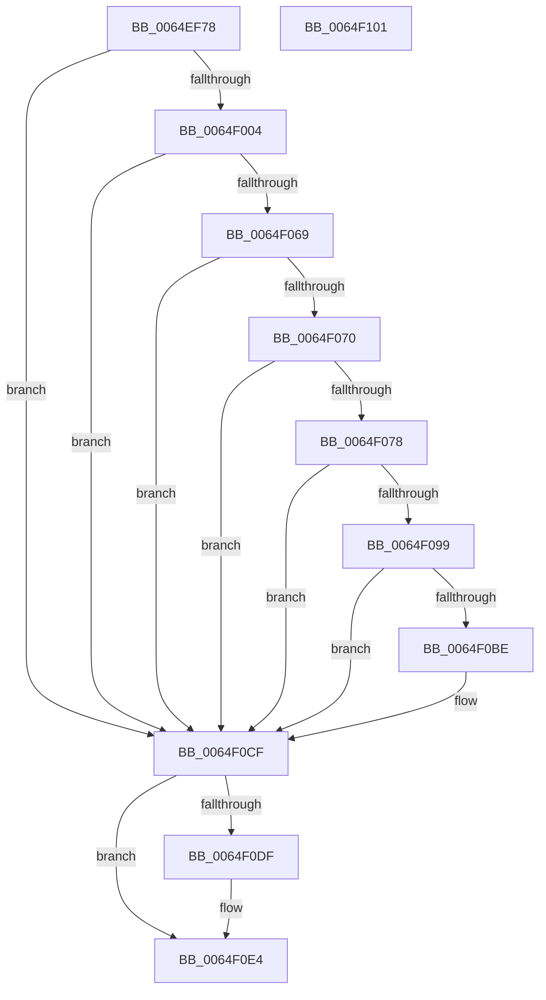

# EtwpQuerySiloRegistrySettings

- RVA: `0x0064EF78`–`0x0064F102` (길이 `394` bytes)
- VA: `0x000000014064EF78`
- 실행 섹션: `.text`
- PDB 이름 있음: `예`; PDB Function 태그: `아니요`
- unwind 정보 RVA: `0x000D3524`
- 디코드: `96`개 명령, `394/394` bytes 표시
- 미해석 바이트: `0` (있으면 어셈블리에 `.byte`로 보존)

> 이 문서는 커널 이미지의 기계어와 PDB 기호를 분석해 생성했습니다. 4번과 5번은 함수 원형과 자료형을 바이너리 사용 방식에서 추정한 C 해석이며 원본 소스 복구 결과는 아닙니다.

## 1. Dependencies

- 직접 호출 지점: **8**; 고유 호출 대상: **8**
- 직접 호출자로 확인된 함수: **1**
- RIP 상대 이미지 참조: **3**

### Outgoing calls
- `0x0064EFBC` → [RtlInitUnicodeString](../42/RtlInitUnicodeString_function_0042A780.md) (function, `0x0042A780`)
- `0x0064EFF7` → [ZwOpenKey](../6A/ZwOpenKey_function_006AD310.md) (function, `0x006AD310`)
- `0x0064F00E` → [memset](../6C/memset_function_006C6C40.md) (function, `0x006C6C40`)
- `0x0064F060` → [RtlQueryRegistryValuesEx](../../page/8C/RtlQueryRegistryValuesEx_function_008C8FF0.md) (function, `0x008C8FF0`)
- `0x0064F08C` → [ExAllocatePool2](../../poolcode/B8/ExAllocatePool2_function_00B820F0.md) (function, `0x00B820F0`)
- `0x0064F0A7` → [memcpy](../6C/memcpy_function_006C6840.md) (function, `0x006C6840`)
- `0x0064F0DF` → [ZwClose](../6A/ZwClose_function_006AD2B0.md) (function, `0x006AD2B0`)
- `0x0064F0E9` → [RtlFreeAnsiString](../../page/9C/RtlFreeAnsiString_function_009C0800.md) (function, `0x009C0800`)

### Direct callers
- [EtwpInitializeSiloState](../../page/7B/EtwpInitializeSiloState_function_007B6A3C.md) at `0x007B6B8C`

### Static image references
- `0x0064EF8E` → RVA `0x006CFD70` (` ?? ::FNODOBFM::`string'`; read)
- `0x0064F01A` → RVA `0x007BEA40` (`EtwpQueryRegistryCallback`; read)
- `0x0064F03A` → RVA `0x006CFE50` (` ?? ::FNODOBFM::`string'`; read)

## 2. Other-region calls and transfers

- 다른 실행 섹션으로 향하는 call: **3**
  - `0x0064F060` → [RtlQueryRegistryValuesEx](../../page/8C/RtlQueryRegistryValuesEx_function_008C8FF0.md) (`.text` → `PAGE`)
  - `0x0064F08C` → [ExAllocatePool2](../../poolcode/B8/ExAllocatePool2_function_00B820F0.md) (`.text` → `POOLCODE`)
  - `0x0064F0E9` → [RtlFreeAnsiString](../../page/9C/RtlFreeAnsiString_function_009C0800.md) (`.text` → `PAGE`)
- 별도 외부 분기/꼬리 이동을 확인하지 못했습니다.

## 3. Assembly (complete function range)

```asm
0064EF78  48 89 5C 24 18                  mov qword ptr [rsp + 0x18], rbx
0064EF7D  55                              push rbp
0064EF7E  56                              push rsi
0064EF7F  57                              push rdi
0064EF80  48 8D 6C 24 F0                  lea rbp, [rsp - 0x10]
0064EF85  48 81 EC 10 01 00 00            sub rsp, 0x110
0064EF8C  33 F6                           xor esi, esi
0064EF8E  48 8D 15 DB 0D 08 00            lea rdx, [rip + 0x80ddb]
0064EF95  0F 57 C0                        xorps xmm0, xmm0
0064EF98  48 89 75 38                     mov qword ptr [rbp + 0x38], rsi
0064EF9C  48 8B F9                        mov rdi, rcx
0064EF9F  89 74 24 54                     mov dword ptr [rsp + 0x54], esi
0064EFA3  48 8D 4C 24 40                  lea rcx, [rsp + 0x40]
0064EFA8  89 74 24 6C                     mov dword ptr [rsp + 0x6c], esi
0064EFAC  0F 11 44 24 40                  movups xmmword ptr [rsp + 0x40], xmm0
0064EFB1  66 89 75 30                     mov word ptr [rbp + 0x30], si
0064EFB5  8B DE                           mov ebx, esi
0064EFB7  0F 11 44 24 30                  movups xmmword ptr [rsp + 0x30], xmm0
0064EFBC  E8 BF B7 DD FF                  call 0x14042a780
0064EFC1  48 8D 44 24 40                  lea rax, [rsp + 0x40]
0064EFC6  C7 44 24 50 30 00 00 00         mov dword ptr [rsp + 0x50], 0x30
0064EFCE  0F 57 C0                        xorps xmm0, xmm0
0064EFD1  48 89 44 24 60                  mov qword ptr [rsp + 0x60], rax
0064EFD6  4C 8D 44 24 50                  lea r8, [rsp + 0x50]
0064EFDB  48 89 74 24 58                  mov qword ptr [rsp + 0x58], rsi
0064EFE0  BA 19 00 02 00                  mov edx, 0x20019
0064EFE5  C7 44 24 68 40 02 00 00         mov dword ptr [rsp + 0x68], 0x240
0064EFED  48 8D 4D 38                     lea rcx, [rbp + 0x38]
0064EFF1  F3 0F 7F 44 24 70               movdqu xmmword ptr [rsp + 0x70], xmm0
0064EFF7  E8 14 E3 05 00                  call 0x1406ad310
0064EFFC  85 C0                           test eax, eax
0064EFFE  0F 88 CB 00 00 00               js 0x14064f0cf
0064F004  33 D2                           xor edx, edx
0064F006  44 8D 46 70                     lea r8d, [rsi + 0x70]
0064F00A  48 8D 4D A0                     lea rcx, [rbp - 0x60]
0064F00E  E8 2D 7C 07 00                  call 0x1406c6c40
0064F013  48 8B 55 38                     mov rdx, qword ptr [rbp + 0x38]
0064F017  8D 4E 01                        lea ecx, [rsi + 1]
0064F01A  48 8D 05 1F FA 16 00            lea rax, [rip + 0x16fa1f]
0064F021  89 4D C0                        mov dword ptr [rbp - 0x40], ecx
0064F024  48 89 45 A0                     mov qword ptr [rbp - 0x60], rax
0064F028  4C 8D 45 A0                     lea r8, [rbp - 0x60]
0064F02C  48 8D 45 80                     lea rax, [rbp - 0x80]
0064F030  89 4D 80                        mov dword ptr [rbp - 0x80], ecx
0064F033  48 89 45 B8                     mov qword ptr [rbp - 0x48], rax
0064F037  45 33 C9                        xor r9d, r9d
0064F03A  48 8D 05 0F 0E 08 00            lea rax, [rip + 0x80e0f]
0064F041  48 89 74 24 20                  mov qword ptr [rsp + 0x20], rsi
0064F046  48 89 45 B0                     mov qword ptr [rbp - 0x50], rax
0064F04A  B9 00 00 00 40                  mov ecx, 0x40000000
0064F04F  48 8D 45 30                     lea rax, [rbp + 0x30]
0064F053  48 89 45 C8                     mov qword ptr [rbp - 0x38], rax
0064F057  48 8D 44 24 30                  lea rax, [rsp + 0x30]
0064F05C  48 89 45 88                     mov qword ptr [rbp - 0x78], rax
0064F060  E8 8B 9F 27 00                  call 0x1408c8ff0
0064F065  85 C0                           test eax, eax
0064F067  78 66                           js 0x14064f0cf
0064F069  48 39 74 24 38                  cmp qword ptr [rsp + 0x38], rsi
0064F06E  74 5F                           je 0x14064f0cf
0064F070  66 83 7C 24 30 04               cmp word ptr [rsp + 0x30], 4
0064F076  72 57                           jb 0x14064f0cf
0064F078  0F B7 54 24 32                  movzx edx, word ptr [rsp + 0x32]
0064F07D  B9 00 01 00 00                  mov ecx, 0x100
0064F082  48 83 C2 02                     add rdx, 2
0064F086  41 B8 45 74 77 50               mov r8d, 0x50777445
0064F08C  E8 5F 30 53 00                  call 0x140b820f0
0064F091  48 8B D8                        mov rbx, rax
0064F094  48 85 C0                        test rax, rax
0064F097  74 36                           je 0x14064f0cf
0064F099  44 0F B7 44 24 32               movzx r8d, word ptr [rsp + 0x32]
0064F09F  48 8B C8                        mov rcx, rax
0064F0A2  48 8B 54 24 38                  mov rdx, qword ptr [rsp + 0x38]
0064F0A7  E8 94 77 07 00                  call 0x1406c6840
0064F0AC  0F B7 44 24 30                  movzx eax, word ptr [rsp + 0x30]
0064F0B1  8D 4E 5C                        lea ecx, [rsi + 0x5c]
0064F0B4  48 D1 E8                        shr rax, 1
0064F0B7  66 39 4C 43 FE                  cmp word ptr [rbx + rax*2 - 2], cx
0064F0BC  74 11                           je 0x14064f0cf
0064F0BE  66 89 0C 43                     mov word ptr [rbx + rax*2], cx
0064F0C2  0F B7 44 24 30                  movzx eax, word ptr [rsp + 0x30]
0064F0C7  48 D1 E8                        shr rax, 1
0064F0CA  66 89 74 43 02                  mov word ptr [rbx + rax*2 + 2], si
0064F0CF  48 8B 4D 38                     mov rcx, qword ptr [rbp + 0x38]
0064F0D3  48 89 9F 20 11 00 00            mov qword ptr [rdi + 0x1120], rbx
0064F0DA  48 85 C9                        test rcx, rcx
0064F0DD  74 05                           je 0x14064f0e4
0064F0DF  E8 CC E1 05 00                  call 0x1406ad2b0
0064F0E4  48 8D 4C 24 30                  lea rcx, [rsp + 0x30]
0064F0E9  E8 12 17 37 00                  call 0x1409c0800
0064F0EE  48 8B 9C 24 40 01 00 00         mov rbx, qword ptr [rsp + 0x140]
0064F0F6  48 81 C4 10 01 00 00            add rsp, 0x110
0064F0FD  5F                              pop rdi
0064F0FE  5E                              pop rsi
0064F0FF  5D                              pop rbp
0064F100  C3                              ret
0064F101  CC                              int3
```

## 4. C-style interpretation (structured pseudocode)

```c
__int64 __fastcall EtwpQuerySiloRegistrySettings(__int64 a1, __int64 a2, __int64 a3, int a4)
{
    __int64 result;
    __int64 v_rsi;
    __int64 v_rsp;
    unsigned __int64 v_stack_m108;
    unsigned __int64 v_stack_m28;
    unsigned __int64 v_stack_m60;
    unsigned int v_stack_m68;
    unsigned __int64 v_stack_m70;
    unsigned __int64 v_stack_m78;
    unsigned __int64 v_stack_m88;
    unsigned __int64 v_stack_mA0;
    unsigned __int64 v_stack_mA8;
    unsigned __int64 v_stack_mB8;
    unsigned int v_stack_mBC;
    unsigned int v_stack_mC0;
    unsigned __int64 v_stack_mC8;
    unsigned __int64 v_stack_mD0;
    unsigned int v_stack_mD4;
    unsigned int v_stack_mD8;
    unsigned __int64 v_stack_mE8;
    unsigned __int64 v_stack_mF0;
    unsigned __int16 v_stack_mF6;
    unsigned __int64 v_stack_mF8;
    unsigned __int64 v_stack_p10;
    unsigned __int64 v_stack_p18;
    unsigned __int16 v_stack_p8;

    v_stack_p18 = v_rbx;
    v_rsp = (v_rsp) - (272);
    v_rsi = 0;
    v_stack_p10 = 0;
    v_stack_mD4 = 0;
    v_stack_mBC = 0;
    v_stack_mE8 = v_xmm0;
    v_stack_p8 = 0;
    v_stack_mF8 = v_xmm0;
    result = RtlInitUnicodeString(v_stack_mE8, v_rip + 527835, a3, a4);
    v_stack_mD8 = 48;
    v_stack_mC8 = v_stack_mE8;
    v_stack_mD0 = 0;
    v_stack_mC0 = 576;
    v_stack_mB8 = v_xmm0;
    result = ZwOpenKey(v_stack_p10, (unsigned int)(0x20019ULL), v_stack_mD8, a4);
    if (sign_flag) goto loc_0064F0CF;
    a2 = 0;
    result = memset(v_stack_m88, a2, v_rsi + 112, a4);
    v_stack_m68 = (unsigned int)(v_rsi + 1);
    v_stack_m88 = v_rip + 1505823;
    v_stack_mA8 = (unsigned int)(v_rsi + 1);
    v_stack_m70 = v_stack_mA8;
    a4 = 0;
    v_stack_m108 = 0;
    v_stack_m78 = v_rip + 527887;
    v_stack_m60 = v_stack_p8;
    v_stack_mA0 = v_stack_mF8;
    result = RtlQueryRegistryValuesEx((unsigned int)(0x40000000ULL), v_stack_p10, v_stack_m88, a4);
    if (sign_flag) goto loc_0064F0CF;
    if (v_stack_mF0 == 0) goto loc_0064F0CF;
    if (v_stack_mF8 < 4) goto loc_0064F0CF;
    a2 = (v_stack_mF6) + (2);
    result = ExAllocatePool2(256, a2, (unsigned int)(0x50777445ULL), a4);
    if (result == 0) goto loc_0064F0CF;
    result = memcpy(result, v_stack_mF0, v_stack_mF6, a4);
    result = (v_stack_mF8) >> (1);
    if ((*(unsigned __int16 *)(result + result * 2 - 2)) != ((unsigned __int16)(v_rsi + 92))) {
        *(unsigned __int16 *)(result + result * 2) = (unsigned __int16)(v_rsi + 92);
        result = v_stack_mF8;
        result = (result) >> (1);
        *(unsigned __int16 *)(result + result * 2 + 2) = 0;
    }
    *(unsigned __int64 *)(a1 + 4384) = result;
    if (v_stack_p10 != 0) {
        result = ZwClose(v_stack_p10, v_stack_mF0, v_stack_mF6, a4);
    }
    result = RtlFreeAnsiString(v_stack_mF8, v_stack_mF0, v_stack_mF6, a4);
    v_rsp = (v_rsp) + (272);
    return result;
}
```

## 5. (Beta) C Style

```c
int64_t EtwpQuerySiloRegistrySettings(void *Arg1, int64_t Arg2, int64_t Arg3, int32_t Arg4)
{
    uint8_t *arg1 = (uint8_t *)Arg1;

    int64_t result;
    int64_t local_rsi;
    int64_t local_rsp;
    uint64_t v_stack_m108;
    uint64_t v_stack_m28;
    uint64_t v_stack_m60;
    uint32_t v_stack_m68;
    uint64_t v_stack_m70;
    uint64_t v_stack_m78;
    uint64_t v_stack_m88;
    uint64_t v_stack_mA0;
    uint64_t v_stack_mA8;
    uint64_t v_stack_mB8;
    uint32_t v_stack_mBC;
    uint32_t v_stack_mC0;
    uint64_t v_stack_mC8;
    uint64_t v_stack_mD0;
    uint32_t v_stack_mD4;
    uint32_t v_stack_mD8;
    uint64_t v_stack_mE8;
    uint64_t v_stack_mF0;
    uint16_t v_stack_mF6;
    uint64_t v_stack_mF8;
    uint64_t v_stack_p10;
    uint64_t v_stack_p18;
    uint16_t v_stack_p8;

    v_stack_p18 = local_rbx;
    local_rsp = (local_rsp) - (272);
    local_rsi = 0;
    v_stack_p10 = 0;
    v_stack_mD4 = 0;
    v_stack_mBC = 0;
    v_stack_mE8 = v_xmm0;
    v_stack_p8 = 0;
    v_stack_mF8 = v_xmm0;
    result = RtlInitUnicodeString(v_stack_mE8, v_rip + 527835, Arg3, Arg4);
    v_stack_mD8 = 48;
    v_stack_mC8 = v_stack_mE8;
    v_stack_mD0 = 0;
    v_stack_mC0 = 576;
    v_stack_mB8 = v_xmm0;
    result = ZwOpenKey(v_stack_p10, (uint32_t)(0x20019ULL), v_stack_mD8, Arg4);
    if (sign_flag) goto loc_0064F0CF;
    Arg2 = 0;
    result = memset(v_stack_m88, Arg2, local_rsi + 112, Arg4);
    v_stack_m68 = (uint32_t)(local_rsi + 1);
    v_stack_m88 = v_rip + 1505823;
    v_stack_mA8 = (uint32_t)(local_rsi + 1);
    v_stack_m70 = v_stack_mA8;
    Arg4 = 0;
    v_stack_m108 = 0;
    v_stack_m78 = v_rip + 527887;
    v_stack_m60 = v_stack_p8;
    v_stack_mA0 = v_stack_mF8;
    result = RtlQueryRegistryValuesEx((uint32_t)(0x40000000ULL), v_stack_p10, v_stack_m88, Arg4);
    if (sign_flag) goto loc_0064F0CF;
    if (v_stack_mF0 == 0) goto loc_0064F0CF;
    if (v_stack_mF8 < 4) goto loc_0064F0CF;
    Arg2 = (v_stack_mF6) + (2);
    result = ExAllocatePool2(256, Arg2, (uint32_t)(0x50777445ULL), Arg4);
    if (result == 0) goto loc_0064F0CF;
    result = memcpy(result, v_stack_mF0, v_stack_mF6, Arg4);
    result = (v_stack_mF8) >> (1);
    if ((*(uint16_t *)(result + result * 2 - 0x2)) != ((uint16_t)(local_rsi + 92))) {
        *(uint16_t *)(result + result * 2) = (uint16_t)(local_rsi + 92);
        result = v_stack_mF8;
        result = (result) >> (1);
        *(uint16_t *)(result + result * 2 + 0x2) = 0;
    }
    *(uint64_t *)(arg1 + 0x1120) = result;
    if (v_stack_p10 != 0) {
        result = ZwClose(v_stack_p10, v_stack_mF0, v_stack_mF6, Arg4);
    }
    result = RtlFreeAnsiString(v_stack_mF8, v_stack_mF0, v_stack_mF6, Arg4);
    local_rsp = (local_rsp) + (272);
    return result;
}
```

### 관측된 메모리 오프셋

구조체 형식이 확인되지 않은 접근은 인자 기준의 오프셋으로만 기록했습니다.

| 기준 인자 | 오프셋 표현 | 폭 (bit) | 접근 |
|---|---:|---:|---|
| `Arg1` | `+ 0x1120` | `64` | `W` |

## 6. Execution-region graph

[열기: 2D/3D 그래프와 함수 탐색 컨트롤 패널](../../../control-panel.html?section=text&rva=0x0064EF78&view=graph)

- 2D 그래프는 위에서 아래로 흐르고, 3D 그래프는 빈 공간을 드래그해 회전합니다. Shift+드래그는 이동, 휠은 확대·축소, 함수 노드 선택은 대상 보고서 이동입니다.

### Static fallback


