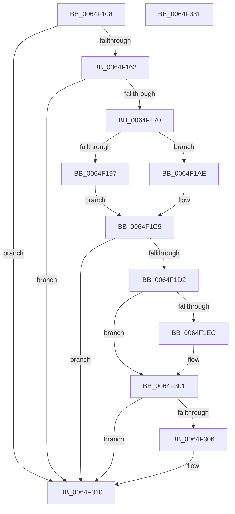

# EtwpTraceContextRegisters

- RVA: `0x0064F108`–`0x0064F332` (길이 `554` bytes)
- VA: `0x000000014064F108`
- 실행 섹션: `.text`
- PDB 이름 있음: `예`; PDB Function 태그: `아니요`
- unwind 정보 RVA: `0x000D333C`
- 디코드: `125`개 명령, `554/554` bytes 표시
- 미해석 바이트: `0` (있으면 어셈블리에 `.byte`로 보존)

> 이 문서는 커널 이미지의 기계어와 PDB 기호를 분석해 생성했습니다. 4번과 5번은 함수 원형과 자료형을 바이너리 사용 방식에서 추정한 C 해석이며 원본 소스 복구 결과는 아닙니다.

## 1. Dependencies

- 직접 호출 지점: **7**; 고유 호출 대상: **7**
- 직접 호출자로 확인된 함수: **2**
- RIP 상대 이미지 참조: **1**

### Outgoing calls
- `0x0064F14F` → [memset](../6C/memset_function_006C6C40.md) (function, `0x006C6C40`)
- `0x0064F182` → [IoGetStackLimits](../41/IoGetStackLimits_function_0041FD70.md) (function, `0x0041FD70`)
- `0x0064F1C1` → [ExAllocatePool2](../../poolcode/B8/ExAllocatePool2_function_00B820F0.md) (function, `0x00B820F0`)
- `0x0064F1DF` → [PsGetUserContextThread](../../page/8D/PsGetUserContextThread_function_008D43FC.md) (function, `0x008D43FC`)
- `0x0064F2FC` → [EtwpLogKernelEvent](../25/EtwpLogKernelEvent_function_0025CC00.md) (function, `0x0025CC00`)
- `0x0064F30B` → [ExFreePoolWithTag](../../poolcode/B8/ExFreePoolWithTag_function_00B82870.md) (function, `0x00B82870`)
- `0x0064F31A` → [_security_check_cookie](../6A/_security_check_cookie_function_006AC640.md) (function, `0x006AC640`)

### Direct callers
- [EtwpContextRegisterTracingDispatcher](../4D/EtwpContextRegisterTracingDispatcher_function_004D83F4.md) at `0x004D847D`
- [EtwpContextRegisterTracingApc](EtwpContextRegisterTracingApc_function_0064E810.md) at `0x0064E836`

### Static image references
- `0x0064F11F` → RVA `0x00E0A740` (`.data`; read)

## 2. Other-region calls and transfers

- 다른 실행 섹션으로 향하는 call: **3**
  - `0x0064F1C1` → [ExAllocatePool2](../../poolcode/B8/ExAllocatePool2_function_00B820F0.md) (`.text` → `POOLCODE`)
  - `0x0064F1DF` → [PsGetUserContextThread](../../page/8D/PsGetUserContextThread_function_008D43FC.md) (`.text` → `PAGE`)
  - `0x0064F30B` → [ExFreePoolWithTag](../../poolcode/B8/ExFreePoolWithTag_function_00B82870.md) (`.text` → `POOLCODE`)
- 별도 외부 분기/꼬리 이동을 확인하지 못했습니다.

## 3. Assembly (complete function range)

```asm
0064F108  40 55                           push rbp
0064F10A  53                              push rbx
0064F10B  56                              push rsi
0064F10C  57                              push rdi
0064F10D  41 54                           push r12
0064F10F  41 56                           push r14
0064F111  41 57                           push r15
0064F113  48 81 EC F0 00 00 00            sub rsp, 0xf0
0064F11A  48 8D 6C 24 30                  lea rbp, [rsp + 0x30]
0064F11F  48 8B 05 1A B6 7B 00            mov rax, qword ptr [rip + 0x7bb61a]
0064F126  48 33 C5                        xor rax, rbp
0064F129  48 89 85 B0 00 00 00            mov qword ptr [rbp + 0xb0], rax
0064F130  4D 8B F0                        mov r14, r8
0064F133  4C 8B E2                        mov r12, rdx
0064F136  48 8B F1                        mov rsi, rcx
0064F139  0F 57 C0                        xorps xmm0, xmm0
0064F13C  33 D2                           xor edx, edx
0064F13E  48 8D 4D 20                     lea rcx, [rbp + 0x20]
0064F142  41 B8 90 00 00 00               mov r8d, 0x90
0064F148  45 8B F9                        mov r15d, r9d
0064F14B  0F 11 45 10                     movups xmmword ptr [rbp + 0x10], xmm0
0064F14F  E8 EC 7A 07 00                  call 0x1406c6c40
0064F154  8B 86 00 05 00 00               mov eax, dword ptr [rsi + 0x500]
0064F15A  A8 01                           test al, 1
0064F15C  0F 84 AE 01 00 00               je 0x14064f310
0064F162  8B 86 00 05 00 00               mov eax, dword ptr [rsi + 0x500]
0064F168  A8 02                           test al, 2
0064F16A  0F 84 A0 01 00 00               je 0x14064f310
0064F170  48 83 65 00 00                  and qword ptr [rbp], 0
0064F175  48 8D 55 00                     lea rdx, [rbp]
0064F179  48 83 65 08 00                  and qword ptr [rbp + 8], 0
0064F17E  48 8D 4D 08                     lea rcx, [rbp + 8]
0064F182  E8 E9 0B DD FF                  call 0x14041fd70
0064F187  48 8D 45 00                     lea rax, [rbp]
0064F18B  48 2B 45 08                     sub rax, qword ptr [rbp + 8]
0064F18F  48 3D A0 09 00 00               cmp rax, 0x9a0
0064F195  76 17                           jbe 0x14064f1ae
0064F197  8B 04 24                        mov eax, dword ptr [rsp]
0064F19A  40 32 FF                        xor dil, dil
0064F19D  B8 D0 04 00 00                  mov eax, 0x4d0
0064F1A2  48 2B E0                        sub rsp, rax
0064F1A5  48 8D 5C 24 30                  lea rbx, [rsp + 0x30]
0064F1AA  8B 03                           mov eax, dword ptr [rbx]
0064F1AC  EB 1B                           jmp 0x14064f1c9
0064F1AE  BA D0 04 00 00                  mov edx, 0x4d0
0064F1B3  B9 00 01 00 00                  mov ecx, 0x100
0064F1B8  41 B8 45 74 77 50               mov r8d, 0x50777445
0064F1BE  40 B7 01                        mov dil, 1
0064F1C1  E8 2A 2F 53 00                  call 0x140b820f0
0064F1C6  48 8B D8                        mov rbx, rax
0064F1C9  48 85 DB                        test rbx, rbx
0064F1CC  0F 84 3E 01 00 00               je 0x14064f310
0064F1D2  48 8B D3                        mov rdx, rbx
0064F1D5  C7 43 30 03 00 10 00            mov dword ptr [rbx + 0x30], 0x100003
0064F1DC  49 8B CE                        mov rcx, r14
0064F1DF  E8 18 52 28 00                  call 0x1408d43fc
0064F1E4  85 C0                           test eax, eax
0064F1E6  0F 88 15 01 00 00               js 0x14064f301
0064F1EC  49 8B 0C 24                     mov rcx, qword ptr [r12]
0064F1F0  41 81 E7 02 E6 FF FF            and r15d, 0xffffe602
0064F1F7  44 8B 06                        mov r8d, dword ptr [rsi]
0064F1FA  41 83 CF 02                     or r15d, 2
0064F1FE  48 8B 96 50 05 00 00            mov rdx, qword ptr [rsi + 0x550]
0064F205  41 B9 01 00 00 00               mov r9d, 1
0064F20B  48 89 4D 20                     mov qword ptr [rbp + 0x20], rcx
0064F20F  48 8D 4D 10                     lea rcx, [rbp + 0x10]
0064F213  48 8B 83 F8 00 00 00            mov rax, qword ptr [rbx + 0xf8]
0064F21A  48 89 45 28                     mov qword ptr [rbp + 0x28], rax
0064F21E  48 8B 43 78                     mov rax, qword ptr [rbx + 0x78]
0064F222  48 89 45 30                     mov qword ptr [rbp + 0x30], rax
0064F226  48 8B 83 80 00 00 00            mov rax, qword ptr [rbx + 0x80]
0064F22D  48 89 45 38                     mov qword ptr [rbp + 0x38], rax
0064F231  48 8B 83 88 00 00 00            mov rax, qword ptr [rbx + 0x88]
0064F238  48 89 45 40                     mov qword ptr [rbp + 0x40], rax
0064F23C  48 8B 83 90 00 00 00            mov rax, qword ptr [rbx + 0x90]
0064F243  48 89 45 48                     mov qword ptr [rbp + 0x48], rax
0064F247  48 8B 83 98 00 00 00            mov rax, qword ptr [rbx + 0x98]
0064F24E  48 89 45 50                     mov qword ptr [rbp + 0x50], rax
0064F252  48 8B 83 A0 00 00 00            mov rax, qword ptr [rbx + 0xa0]
0064F259  48 89 45 58                     mov qword ptr [rbp + 0x58], rax
0064F25D  48 8B 83 A8 00 00 00            mov rax, qword ptr [rbx + 0xa8]
0064F264  48 89 45 60                     mov qword ptr [rbp + 0x60], rax
0064F268  48 8B 83 B0 00 00 00            mov rax, qword ptr [rbx + 0xb0]
0064F26F  48 89 45 68                     mov qword ptr [rbp + 0x68], rax
0064F273  48 8B 83 B8 00 00 00            mov rax, qword ptr [rbx + 0xb8]
0064F27A  48 89 45 70                     mov qword ptr [rbp + 0x70], rax
0064F27E  48 8B 83 C0 00 00 00            mov rax, qword ptr [rbx + 0xc0]
0064F285  48 89 45 78                     mov qword ptr [rbp + 0x78], rax
0064F289  48 8B 83 C8 00 00 00            mov rax, qword ptr [rbx + 0xc8]
0064F290  48 89 85 80 00 00 00            mov qword ptr [rbp + 0x80], rax
0064F297  48 8B 83 D0 00 00 00            mov rax, qword ptr [rbx + 0xd0]
0064F29E  48 89 85 88 00 00 00            mov qword ptr [rbp + 0x88], rax
0064F2A5  48 8B 83 D8 00 00 00            mov rax, qword ptr [rbx + 0xd8]
0064F2AC  48 89 85 90 00 00 00            mov qword ptr [rbp + 0x90], rax
0064F2B3  48 8B 83 E0 00 00 00            mov rax, qword ptr [rbx + 0xe0]
0064F2BA  48 89 85 98 00 00 00            mov qword ptr [rbp + 0x98], rax
0064F2C1  48 8B 83 E8 00 00 00            mov rax, qword ptr [rbx + 0xe8]
0064F2C8  48 89 85 A0 00 00 00            mov qword ptr [rbp + 0xa0], rax
0064F2CF  48 8B 83 F0 00 00 00            mov rax, qword ptr [rbx + 0xf0]
0064F2D6  83 65 1C 00                     and dword ptr [rbp + 0x1c], 0
0064F2DA  48 89 85 A8 00 00 00            mov qword ptr [rbp + 0xa8], rax
0064F2E1  48 8D 45 20                     lea rax, [rbp + 0x20]
0064F2E5  44 89 7C 24 28                  mov dword ptr [rsp + 0x28], r15d
0064F2EA  48 89 45 10                     mov qword ptr [rbp + 0x10], rax
0064F2EE  C7 45 18 90 00 00 00            mov dword ptr [rbp + 0x18], 0x90
0064F2F5  66 C7 44 24 20 7A 0F            mov word ptr [rsp + 0x20], 0xf7a
0064F2FC  E8 FF D8 C0 FF                  call 0x14025cc00
0064F301  40 84 FF                        test dil, dil
0064F304  74 0A                           je 0x14064f310
0064F306  33 D2                           xor edx, edx
0064F308  48 8B CB                        mov rcx, rbx
0064F30B  E8 60 35 53 00                  call 0x140b82870
0064F310  48 8B 8D B0 00 00 00            mov rcx, qword ptr [rbp + 0xb0]
0064F317  48 33 CD                        xor rcx, rbp
0064F31A  E8 21 D3 05 00                  call 0x1406ac640
0064F31F  48 8D A5 C0 00 00 00            lea rsp, [rbp + 0xc0]
0064F326  41 5F                           pop r15
0064F328  41 5E                           pop r14
0064F32A  41 5C                           pop r12
0064F32C  5F                              pop rdi
0064F32D  5E                              pop rsi
0064F32E  5B                              pop rbx
0064F32F  5D                              pop rbp
0064F330  C3                              ret
0064F331  CC                              int3
```

## 4. C-style interpretation (structured pseudocode)

```c
__int64 __fastcall EtwpTraceContextRegisters(__int64 a1, __int64 a2, __int64 a3, int a4)
{
    __int64 result;
    __int64 v_r15;
    __int64 v_rdi;
    __int64 v_rsp;
    unsigned int v_stack_m100;
    unsigned __int16 v_stack_m108;
    unsigned int v_stack_m128;
    unsigned __int64 v_stack_m38;
    unsigned __int64 v_stack_m48;
    unsigned __int64 v_stack_m50;
    unsigned __int64 v_stack_m58;
    unsigned __int64 v_stack_m60;
    unsigned __int64 v_stack_m68;
    unsigned __int64 v_stack_m70;
    unsigned __int64 v_stack_m78;
    unsigned __int64 v_stack_m80;
    unsigned __int64 v_stack_m88;
    unsigned __int64 v_stack_m90;
    unsigned __int64 v_stack_m98;
    unsigned __int64 v_stack_mA0;
    unsigned __int64 v_stack_mA8;
    unsigned __int64 v_stack_mB0;
    unsigned __int64 v_stack_mB8;
    unsigned __int64 v_stack_mC0;
    unsigned __int64 v_stack_mC8;
    unsigned __int64 v_stack_mD0;
    unsigned __int64 v_stack_mD8;
    unsigned int v_stack_mDC;
    unsigned int v_stack_mE0;
    unsigned __int64 v_stack_mE8;
    unsigned __int64 v_stack_mF0;
    unsigned __int64 v_stack_mF8;

    v_rsp = (v_rsp) - (240);
    result = (*(unsigned __int64 *)(v_rip + 8107546)) ^ (v_stack_mF8);
    v_stack_m48 = result;
    a2 = 0;
    v_stack_mE8 = v_xmm0;
    result = memset(v_stack_mD8, a2, 144, a4);
    if ((((unsigned __int8)((unsigned int)(*(unsigned int *)(a1 + 1280)))) & (1)) == 0) goto loc_0064F310;
    if ((((unsigned __int8)((unsigned int)(*(unsigned int *)(a1 + 1280)))) & (2)) == 0) goto loc_0064F310;
    result = IoGetStackLimits(v_stack_mF0, v_stack_mF8, 144, a4);
    result = (v_stack_mF8) - (v_stack_mF0);
    if (result <= 0x9A0ULL) goto loc_0064F1AE;
    v_rdi = 0;
    v_rsp = (v_rsp) - ((unsigned int)(0x4D0ULL));
    goto loc_0064F1C9;
loc_0064F1AE:
    result = ExAllocatePool2(256, (unsigned int)(0x4D0ULL), (unsigned int)(0x50777445ULL), a4);
loc_0064F1C9:
    if (result == 0) goto loc_0064F310;
    *(unsigned int *)(result + 48) = 0x100003ULL;
    result = PsGetUserContextThread(a3, result, (unsigned int)(0x50777445ULL), a4);
    v_r15 = (unsigned int)(a4);
    if (!(sign_flag)) {
        a1 = *(unsigned __int64 *)(a2);
        v_r15 = (unsigned int)(((unsigned int)(a4)) & (0xFFFFE602ULL));
        a3 = *(unsigned int *)(a1);
        v_r15 = (unsigned int)((v_r15) | (2));
        a2 = *(unsigned __int64 *)(a1 + 1360);
        a4 = 1;
        v_stack_mD8 = a1;
        a1 = v_stack_mE8;
        result = *(unsigned __int64 *)(result + 248);
        v_stack_mD0 = result;
        result = *(unsigned __int64 *)(result + 120);
        v_stack_mC8 = result;
        result = *(unsigned __int64 *)(result + 128);
        v_stack_mC0 = result;
        result = *(unsigned __int64 *)(result + 136);
        v_stack_mB8 = result;
        result = *(unsigned __int64 *)(result + 144);
        v_stack_mB0 = result;
        result = *(unsigned __int64 *)(result + 152);
        v_stack_mA8 = result;
        result = *(unsigned __int64 *)(result + 160);
        v_stack_mA0 = result;
        result = *(unsigned __int64 *)(result + 168);
        v_stack_m98 = result;
        result = *(unsigned __int64 *)(result + 176);
        v_stack_m90 = result;
        result = *(unsigned __int64 *)(result + 184);
        v_stack_m88 = result;
        result = *(unsigned __int64 *)(result + 192);
        v_stack_m80 = result;
        result = *(unsigned __int64 *)(result + 200);
        v_stack_m78 = result;
        result = *(unsigned __int64 *)(result + 208);
        v_stack_m70 = result;
        result = *(unsigned __int64 *)(result + 216);
        v_stack_m68 = result;
        result = *(unsigned __int64 *)(result + 224);
        v_stack_m60 = result;
        result = *(unsigned __int64 *)(result + 232);
        v_stack_m58 = result;
        result = *(unsigned __int64 *)(result + 240);
        v_stack_m50 = result;
        result = v_stack_mD8;
        v_stack_m100 = (unsigned int)(v_r15);
        v_stack_mE8 = result;
        v_stack_mE0 = 144;
        v_stack_m108 = 0xF7AULL;
        result = EtwpLogKernelEvent(a1, a2, a3, a4);
    }
    if (1 != 0) {
        a2 = 0;
        a1 = result;
        result = ExFreePoolWithTag(a1, a2, a3, a4);
    }
    a1 = (v_stack_m48) ^ (v_stack_mF8);
    result = _security_check_cookie(a1, a2, a3, a4);
    return result;
}
```

## 5. (Beta) C Style

```c
int64_t EtwpTraceContextRegisters(void *Arg1, void *Arg2, int64_t Arg3, int32_t Arg4)
{
    uint8_t *arg1 = (uint8_t *)Arg1;
    uint8_t *arg2 = (uint8_t *)Arg2;

    int64_t result;
    int64_t local_r15;
    int64_t local_rdi;
    int64_t local_rsp;
    uint32_t v_stack_m100;
    uint16_t v_stack_m108;
    uint32_t v_stack_m128;
    uint64_t v_stack_m38;
    uint64_t v_stack_m48;
    uint64_t v_stack_m50;
    uint64_t v_stack_m58;
    uint64_t v_stack_m60;
    uint64_t v_stack_m68;
    uint64_t v_stack_m70;
    uint64_t v_stack_m78;
    uint64_t v_stack_m80;
    uint64_t v_stack_m88;
    uint64_t v_stack_m90;
    uint64_t v_stack_m98;
    uint64_t v_stack_mA0;
    uint64_t v_stack_mA8;
    uint64_t v_stack_mB0;
    uint64_t v_stack_mB8;
    uint64_t v_stack_mC0;
    uint64_t v_stack_mC8;
    uint64_t v_stack_mD0;
    uint64_t v_stack_mD8;
    uint32_t v_stack_mDC;
    uint32_t v_stack_mE0;
    uint64_t v_stack_mE8;
    uint64_t v_stack_mF0;
    uint64_t v_stack_mF8;

    local_rsp = (local_rsp) - (240);
    result = (*(uint64_t *)(v_rip + 0x7BB61A)) ^ (v_stack_mF8);
    v_stack_m48 = result;
    Arg2 = 0;
    v_stack_mE8 = v_xmm0;
    result = memset(v_stack_mD8, Arg2, 144, Arg4);
    if ((((uint8_t)((uint32_t)(*(uint32_t *)(arg1 + 0x500)))) & (1)) == 0) goto loc_0064F310;
    if ((((uint8_t)((uint32_t)(*(uint32_t *)(arg1 + 0x500)))) & (2)) == 0) goto loc_0064F310;
    result = IoGetStackLimits(v_stack_mF0, v_stack_mF8, 144, Arg4);
    result = (v_stack_mF8) - (v_stack_mF0);
    if (result <= 0x9A0ULL) goto loc_0064F1AE;
    local_rdi = 0;
    local_rsp = (local_rsp) - ((uint32_t)(0x4D0ULL));
    goto loc_0064F1C9;
loc_0064F1AE:
    result = ExAllocatePool2(256, (uint32_t)(0x4D0ULL), (uint32_t)(0x50777445ULL), Arg4);
loc_0064F1C9:
    if (result == 0) goto loc_0064F310;
    *(uint32_t *)(result + 0x30) = 0x100003ULL;
    result = PsGetUserContextThread(Arg3, result, (uint32_t)(0x50777445ULL), Arg4);
    local_r15 = (uint32_t)(Arg4);
    if (!(sign_flag)) {
        Arg1 = *(uint64_t *)(arg2);
        local_r15 = (uint32_t)(((uint32_t)(Arg4)) & (0xFFFFE602ULL));
        Arg3 = *(uint32_t *)(arg1);
        local_r15 = (uint32_t)((local_r15) | (2));
        Arg2 = *(uint64_t *)(arg1 + 0x550);
        Arg4 = 1;
        v_stack_mD8 = Arg1;
        Arg1 = v_stack_mE8;
        result = *(uint64_t *)(result + 0xF8);
        v_stack_mD0 = result;
        result = *(uint64_t *)(result + 0x78);
        v_stack_mC8 = result;
        result = *(uint64_t *)(result + 0x80);
        v_stack_mC0 = result;
        result = *(uint64_t *)(result + 0x88);
        v_stack_mB8 = result;
        result = *(uint64_t *)(result + 0x90);
        v_stack_mB0 = result;
        result = *(uint64_t *)(result + 0x98);
        v_stack_mA8 = result;
        result = *(uint64_t *)(result + 0xA0);
        v_stack_mA0 = result;
        result = *(uint64_t *)(result + 0xA8);
        v_stack_m98 = result;
        result = *(uint64_t *)(result + 0xB0);
        v_stack_m90 = result;
        result = *(uint64_t *)(result + 0xB8);
        v_stack_m88 = result;
        result = *(uint64_t *)(result + 0xC0);
        v_stack_m80 = result;
        result = *(uint64_t *)(result + 0xC8);
        v_stack_m78 = result;
        result = *(uint64_t *)(result + 0xD0);
        v_stack_m70 = result;
        result = *(uint64_t *)(result + 0xD8);
        v_stack_m68 = result;
        result = *(uint64_t *)(result + 0xE0);
        v_stack_m60 = result;
        result = *(uint64_t *)(result + 0xE8);
        v_stack_m58 = result;
        result = *(uint64_t *)(result + 0xF0);
        v_stack_m50 = result;
        result = v_stack_mD8;
        v_stack_m100 = (uint32_t)(local_r15);
        v_stack_mE8 = result;
        v_stack_mE0 = 144;
        v_stack_m108 = 0xF7AULL;
        result = EtwpLogKernelEvent(Arg1, Arg2, Arg3, Arg4);
    }
    if (1 != 0) {
        Arg2 = 0;
        Arg1 = result;
        result = ExFreePoolWithTag(Arg1, Arg2, Arg3, Arg4);
    }
    Arg1 = (v_stack_m48) ^ (v_stack_mF8);
    result = _security_check_cookie(Arg1, Arg2, Arg3, Arg4);
    return result;
}
```

### 관측된 메모리 오프셋

구조체 형식이 확인되지 않은 접근은 인자 기준의 오프셋으로만 기록했습니다.

| 기준 인자 | 오프셋 표현 | 폭 (bit) | 접근 |
|---|---:|---:|---|
| `Arg1` | `+ 0x0` | `32` | `R` |
| `Arg1` | `+ 0x500` | `32` | `R` |
| `Arg1` | `+ 0x550` | `64` | `R` |
| `Arg2` | `+ 0x0` | `64` | `R` |

## 6. Execution-region graph

[열기: 2D/3D 그래프와 함수 탐색 컨트롤 패널](../../../control-panel.html?section=text&rva=0x0064F108&view=graph)

- 2D 그래프는 위에서 아래로 흐르고, 3D 그래프는 빈 공간을 드래그해 회전합니다. Shift+드래그는 이동, 휠은 확대·축소, 함수 노드 선택은 대상 보고서 이동입니다.

### Static fallback


