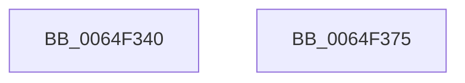

# EtwpUnsubscribeContainerStateWnf

- RVA: `0x0064F340`–`0x0064F376` (길이 `54` bytes)
- VA: `0x000000014064F340`
- 실행 섹션: `.text`
- PDB 이름 있음: `예`; PDB Function 태그: `아니요`
- unwind 정보 RVA: `0x0005CF00`
- 디코드: `13`개 명령, `54/54` bytes 표시
- 미해석 바이트: `0` (있으면 어셈블리에 `.byte`로 보존)

> 이 문서는 커널 이미지의 기계어와 PDB 기호를 분석해 생성했습니다. 4번과 5번은 함수 원형과 자료형을 바이너리 사용 방식에서 추정한 C 해석이며 원본 소스 복구 결과는 아닙니다.

## 1. Dependencies

- 직접 호출 지점: **2**; 고유 호출 대상: **2**
- 직접 호출자로 확인된 함수: **0**
- RIP 상대 이미지 참조: **1**

### Outgoing calls
- `0x0064F354` → [ExUnsubscribeWnfStateChange](../../page/A7/ExUnsubscribeWnfStateChange_function_00A7BE50.md) (function, `0x00A7BE50`)
- `0x0064F362` → [ExFreePoolWithTag](../../poolcode/B8/ExFreePoolWithTag_function_00B82870.md) (function, `0x00B82870`)

### Direct callers
- 이 함수 시작 RVA로 연결되는 직접 call은 확인되지 않았습니다. 간접 호출은 완전히 역산할 수 없습니다.

### Static image references
- `0x0064F346` → RVA `0x00FC6AA8` (`ALMOSTRO`; read)

## 2. Other-region calls and transfers

- 다른 실행 섹션으로 향하는 call: **2**
  - `0x0064F354` → [ExUnsubscribeWnfStateChange](../../page/A7/ExUnsubscribeWnfStateChange_function_00A7BE50.md) (`.text` → `PAGE`)
  - `0x0064F362` → [ExFreePoolWithTag](../../poolcode/B8/ExFreePoolWithTag_function_00B82870.md) (`.text` → `POOLCODE`)
- 별도 외부 분기/꼬리 이동을 확인하지 못했습니다.

## 3. Assembly (complete function range)

```asm
0064F340  40 53                           push rbx
0064F342  48 83 EC 20                     sub rsp, 0x20
0064F346  48 8B 1D 5B 77 97 00            mov rbx, qword ptr [rip + 0x97775b]
0064F34D  48 8B 8B 48 11 00 00            mov rcx, qword ptr [rbx + 0x1148]
0064F354  E8 F7 CA 42 00                  call 0x140a7be50
0064F359  48 8B 8B 58 11 00 00            mov rcx, qword ptr [rbx + 0x1158]
0064F360  33 D2                           xor edx, edx
0064F362  E8 09 35 53 00                  call 0x140b82870
0064F367  48 83 A3 58 11 00 00 00         and qword ptr [rbx + 0x1158], 0
0064F36F  48 83 C4 20                     add rsp, 0x20
0064F373  5B                              pop rbx
0064F374  C3                              ret
0064F375  CC                              int3
```

## 4. C-style interpretation (structured pseudocode)

```c
__int64 __fastcall EtwpUnsubscribeContainerStateWnf(__int64 a1, int a2)
{
    __int64 result;
    __int64 v_rsp;

    v_rsp = (v_rsp) - (32);
    result = ExUnsubscribeWnfStateChange(*(unsigned __int64 *)(*(unsigned __int64 *)(v_rip + 9926491) + 4424), a2, a3, a4);
    a2 = 0;
    result = ExFreePoolWithTag(*(unsigned __int64 *)(*(unsigned __int64 *)(v_rip + 9926491) + 4440), a2, a3, a4);
    v_rsp = (v_rsp) + (32);
    return result;
}
```

## 5. (Beta) C Style

```c
int64_t EtwpUnsubscribeContainerStateWnf(int64_t Arg1, int32_t Arg2)
{
    int64_t result;
    int64_t local_rsp;

    local_rsp = (local_rsp) - (32);
    result = ExUnsubscribeWnfStateChange(*(uint64_t *)(*(uint64_t *)(v_rip + 0x97775B) + 0x1148), Arg2, a3, a4);
    Arg2 = 0;
    result = ExFreePoolWithTag(*(uint64_t *)(*(uint64_t *)(v_rip + 0x97775B) + 0x1158), Arg2, a3, a4);
    local_rsp = (local_rsp) + (32);
    return result;
}
```

## 6. Execution-region graph

[열기: 2D/3D 그래프와 함수 탐색 컨트롤 패널](../../../control-panel.html?section=text&rva=0x0064F340&view=graph)

- 2D 그래프는 위에서 아래로 흐르고, 3D 그래프는 빈 공간을 드래그해 회전합니다. Shift+드래그는 이동, 휠은 확대·축소, 함수 노드 선택은 대상 보고서 이동입니다.

### Static fallback


