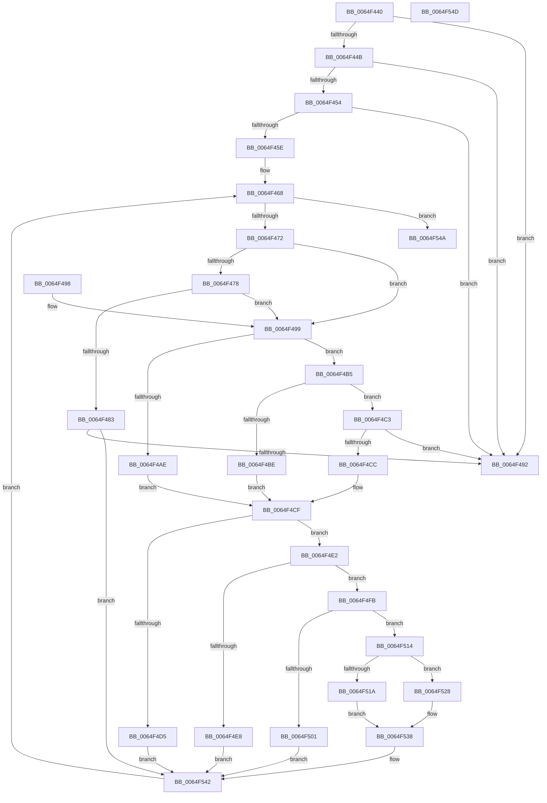

# StringToGuidNoBrackets

- RVA: `0x0064F440`–`0x0064F54E` (길이 `270` bytes)
- VA: `0x000000014064F440`
- 실행 섹션: `.text`
- PDB 이름 있음: `예`; PDB Function 태그: `아니요`
- unwind 정보 RVA: `0x000DB714`
- 디코드: `85`개 명령, `270/270` bytes 표시
- 미해석 바이트: `0` (있으면 어셈블리에 `.byte`로 보존)

> 이 문서는 커널 이미지의 기계어와 PDB 기호를 분석해 생성했습니다. 4번과 5번은 함수 원형과 자료형을 바이너리 사용 방식에서 추정한 C 해석이며 원본 소스 복구 결과는 아닙니다.

## 1. Dependencies

- 직접 호출 지점: **0**; 고유 호출 대상: **0**
- 직접 호출자로 확인된 함수: **1**
- RIP 상대 이미지 참조: **0**

### Outgoing calls
- 직접 디코드된 call 명령이 없습니다.

### Direct callers
- [EtwpQueryPartitionRegistryInformation](EtwpQueryPartitionRegistryInformation_function_0064ECCC.md) at `0x0064EE6A`
- [EtwpQueryPartitionRegistryInformation](EtwpQueryPartitionRegistryInformation_function_0064ECCC.md) at `0x0064EF0D`

### Static image references
- 디코드된 RIP-relative 메모리 참조가 없습니다.

## 2. Other-region calls and transfers

- 다른 실행 섹션으로 향하는 call: **0**
- 별도 외부 분기/꼬리 이동을 확인하지 못했습니다.

## 3. Assembly (complete function range)

```asm
0064F440  45 33 C0                        xor r8d, r8d
0064F443  4C 8B CA                        mov r9, rdx
0064F446  48 85 C9                        test rcx, rcx
0064F449  74 47                           je 0x14064f492
0064F44B  4C 8B 51 08                     mov r10, qword ptr [rcx + 8]
0064F44F  4D 85 D2                        test r10, r10
0064F452  74 3E                           je 0x14064f492
0064F454  0F B7 01                        movzx eax, word ptr [rcx]
0064F457  D1 E8                           shr eax, 1
0064F459  83 F8 24                        cmp eax, 0x24
0064F45C  75 34                           jne 0x14064f492
0064F45E  0F 57 C0                        xorps xmm0, xmm0
0064F461  45 8D 58 30                     lea r11d, [r8 + 0x30]
0064F465  0F 11 02                        movups xmmword ptr [rdx], xmm0
0064F468  41 83 F8 24                     cmp r8d, 0x24
0064F46C  0F 83 D8 00 00 00               jae 0x14064f54a
0064F472  41 83 F8 17                     cmp r8d, 0x17
0064F476  77 21                           ja 0x14064f499
0064F478  B8 00 21 84 00                  mov eax, 0x842100
0064F47D  44 0F A3 C0                     bt eax, r8d
0064F481  73 16                           jae 0x14064f499
0064F483  41 8B C0                        mov eax, r8d
0064F486  66 41 83 3C 42 2D               cmp word ptr [r10 + rax*2], 0x2d
0064F48C  0F 84 B0 00 00 00               je 0x14064f542
0064F492  B8 0D 00 00 C0                  mov eax, 0xc000000d
0064F497  C3                              ret
0064F498  CC                              int3
0064F499  41 8B C0                        mov eax, r8d
0064F49C  41 0F B7 0C 42                  movzx ecx, word ptr [r10 + rax*2]
0064F4A1  0F B7 C1                        movzx eax, cx
0064F4A4  66 41 2B C3                     sub ax, r11w
0064F4A8  66 83 F8 09                     cmp ax, 9
0064F4AC  77 07                           ja 0x14064f4b5
0064F4AE  8B D1                           mov edx, ecx
0064F4B0  41 2B D3                        sub edx, r11d
0064F4B3  EB 1A                           jmp 0x14064f4cf
0064F4B5  8D 41 9F                        lea eax, [rcx - 0x61]
0064F4B8  66 83 F8 05                     cmp ax, 5
0064F4BC  77 05                           ja 0x14064f4c3
0064F4BE  8D 51 A9                        lea edx, [rcx - 0x57]
0064F4C1  EB 0C                           jmp 0x14064f4cf
0064F4C3  8D 41 BF                        lea eax, [rcx - 0x41]
0064F4C6  66 83 F8 05                     cmp ax, 5
0064F4CA  77 C6                           ja 0x14064f492
0064F4CC  8D 51 C9                        lea edx, [rcx - 0x37]
0064F4CF  41 83 F8 08                     cmp r8d, 8
0064F4D3  73 0D                           jae 0x14064f4e2
0064F4D5  41 8B 01                        mov eax, dword ptr [r9]
0064F4D8  C1 E0 04                        shl eax, 4
0064F4DB  03 C2                           add eax, edx
0064F4DD  41 89 01                        mov dword ptr [r9], eax
0064F4E0  EB 60                           jmp 0x14064f542
0064F4E2  41 83 F8 0D                     cmp r8d, 0xd
0064F4E6  73 13                           jae 0x14064f4fb
0064F4E8  41 0F B7 41 04                  movzx eax, word ptr [r9 + 4]
0064F4ED  66 C1 E0 04                     shl ax, 4
0064F4F1  66 03 C2                        add ax, dx
0064F4F4  66 41 89 41 04                  mov word ptr [r9 + 4], ax
0064F4F9  EB 47                           jmp 0x14064f542
0064F4FB  41 83 F8 12                     cmp r8d, 0x12
0064F4FF  73 13                           jae 0x14064f514
0064F501  41 0F B7 41 06                  movzx eax, word ptr [r9 + 6]
0064F506  66 C1 E0 04                     shl ax, 4
0064F50A  66 03 C2                        add ax, dx
0064F50D  66 41 89 41 06                  mov word ptr [r9 + 6], ax
0064F512  EB 2E                           jmp 0x14064f542
0064F514  41 83 F8 17                     cmp r8d, 0x17
0064F518  73 0E                           jae 0x14064f528
0064F51A  41 8D 48 ED                     lea ecx, [r8 - 0x13]
0064F51E  48 D1 E9                        shr rcx, 1
0064F521  42 8A 44 09 08                  mov al, byte ptr [rcx + r9 + 8]
0064F526  EB 10                           jmp 0x14064f538
0064F528  41 8D 40 E8                     lea eax, [r8 - 0x18]
0064F52C  D1 E8                           shr eax, 1
0064F52E  83 C0 02                        add eax, 2
0064F531  8B C8                           mov ecx, eax
0064F533  42 8A 44 08 08                  mov al, byte ptr [rax + r9 + 8]
0064F538  C0 E0 04                        shl al, 4
0064F53B  02 C2                           add al, dl
0064F53D  42 88 44 09 08                  mov byte ptr [rcx + r9 + 8], al
0064F542  41 FF C0                        inc r8d
0064F545  E9 1E FF FF FF                  jmp 0x14064f468
0064F54A  33 C0                           xor eax, eax
0064F54C  C3                              ret
0064F54D  CC                              int3
```

## 4. C-style interpretation (structured pseudocode)

```c
__int64 __fastcall StringToGuidNoBrackets(__int64 a1, __int64 a2, int a3)
{
    __int64 result;

    a3 = 0;
    if (a1 == 0) goto loc_0064F492;
    if (*(unsigned __int64 *)(a1 + 8) == 0) goto loc_0064F492;
    result = (unsigned int)((*(unsigned __int16 *)(a1)) >> (1));
    if (((unsigned int)(result)) != 36) goto loc_0064F492;
    *(unsigned __int64 *)(a2) = v_xmm0;
loc_0064F468:
    if (0 >= 36) goto loc_0064F54A;
    if (0 > 23) goto loc_0064F499;
    if (0 >= 23) goto loc_0064F499;
    if ((*(unsigned __int16 *)(*(unsigned __int64 *)(a1 + 8) + 0 * 2)) == 45) goto loc_0064F542;
loc_0064F492:
    return (unsigned int)(0xC000000DULL);
loc_0064F499:
    result = (unsigned __int16)(((unsigned __int16)(*(unsigned __int16 *)(*(unsigned __int64 *)(a1 + 8) + 0 * 2))) - ((unsigned __int16)(a3 + 48)));
    if (((unsigned __int16)(result)) > 9) goto loc_0064F4B5;
    a2 = (unsigned int)(((unsigned int)((unsigned int)(*(unsigned __int16 *)(*(unsigned __int64 *)(a1 + 8) + 0 * 2)))) - ((unsigned int)(a3 + 48)));
    goto loc_0064F4CF;
loc_0064F4B5:
    if (((unsigned __int16)(*(unsigned __int16 *)(*(unsigned __int64 *)(a1 + 8) + 0 * 2) - 97)) > 5) goto loc_0064F4C3;
    goto loc_0064F4CF;
loc_0064F4C3:
    if (((unsigned __int16)(*(unsigned __int16 *)(*(unsigned __int64 *)(a1 + 8) + 0 * 2) - 65)) > 5) goto loc_0064F492;
loc_0064F4CF:
    if (0 >= 8) goto loc_0064F4E2;
    result = (unsigned int)(((unsigned int)(*(unsigned int *)(a2))) << (4));
    result = (unsigned int)((result) + ((unsigned int)(*(unsigned __int16 *)(*(unsigned __int64 *)(a1 + 8) + 0 * 2) - 55)));
    *(unsigned int *)(a2) = (unsigned int)(result);
    goto loc_0064F542;
loc_0064F4E2:
    if (0 >= 13) goto loc_0064F4FB;
    result = (unsigned __int16)((*(unsigned __int16 *)(a2 + 4)) << (4));
    result = (unsigned __int16)((result) + ((unsigned __int16)(*(unsigned __int16 *)(*(unsigned __int64 *)(a1 + 8) + 0 * 2) - 55)));
    *(unsigned __int16 *)(a2 + 4) = (unsigned __int16)(result);
    goto loc_0064F542;
loc_0064F4FB:
    if (0 >= 18) goto loc_0064F514;
    result = (unsigned __int16)((*(unsigned __int16 *)(a2 + 6)) << (4));
    result = (unsigned __int16)((result) + ((unsigned __int16)(*(unsigned __int16 *)(*(unsigned __int64 *)(a1 + 8) + 0 * 2) - 55)));
    *(unsigned __int16 *)(a2 + 6) = (unsigned __int16)(result);
    goto loc_0064F542;
loc_0064F514:
    if (0 >= 23) goto loc_0064F528;
    a1 = (a3 - 19) >> (1);
    goto loc_0064F538;
loc_0064F528:
    result = (unsigned int)((a3 - 24) >> (1));
    result = (unsigned int)((result) + (2));
loc_0064F538:
    result = (unsigned __int8)((*(unsigned __int8 *)(result + a2 * 1 + 8)) << (4));
    result = (unsigned __int8)((result) + ((unsigned __int8)(*(unsigned __int16 *)(*(unsigned __int64 *)(a1 + 8) + 0 * 2) - 55)));
    *(unsigned __int8 *)((unsigned int)((unsigned int)(result)) + a2 * 1 + 8) = (unsigned __int8)(result);
loc_0064F542:
    a3 = (unsigned int)((a3) + 1);
    goto loc_0064F468;
loc_0064F54A:
    result = 0;
    return result;
}
```

## 5. (Beta) C Style

```c
int64_t StringToGuidNoBrackets(int64_t Arg1, void *Arg2, int32_t Arg3)
{
    uint8_t *arg2 = (uint8_t *)Arg2;

    int64_t result;

    Arg3 = 0;
    if (Arg1 == 0) goto loc_0064F492;
    if (*(uint64_t *)(Arg1 + 0x8) == 0) goto loc_0064F492;
    result = (uint32_t)((*(uint16_t *)(Arg1)) >> (1));
    if (((uint32_t)(result)) != 36) goto loc_0064F492;
    *(uint64_t *)(arg2) = v_xmm0;
loc_0064F468:
    if (0 >= 36) goto loc_0064F54A;
    if (0 > 23) goto loc_0064F499;
    if (0 >= 23) goto loc_0064F499;
    if ((*(uint16_t *)(*(uint64_t *)(Arg1 + 0x8) + 0x0 * 2)) == 45) goto loc_0064F542;
loc_0064F492:
    return (uint32_t)(0xC000000DULL);
loc_0064F499:
    result = (uint16_t)(((uint16_t)(*(uint16_t *)(*(uint64_t *)(Arg1 + 0x8) + 0x0 * 2))) - ((uint16_t)(Arg3 + 48)));
    if (((uint16_t)(result)) > 9) goto loc_0064F4B5;
    Arg2 = (uint32_t)(((uint32_t)((uint32_t)(*(uint16_t *)(*(uint64_t *)(Arg1 + 0x8) + 0x0 * 2)))) - ((uint32_t)(Arg3 + 48)));
    goto loc_0064F4CF;
loc_0064F4B5:
    if (((uint16_t)(*(uint16_t *)(*(uint64_t *)(Arg1 + 0x8) + 0x0 * 2) - 97)) > 5) goto loc_0064F4C3;
    goto loc_0064F4CF;
loc_0064F4C3:
    if (((uint16_t)(*(uint16_t *)(*(uint64_t *)(Arg1 + 0x8) + 0x0 * 2) - 65)) > 5) goto loc_0064F492;
loc_0064F4CF:
    if (0 >= 8) goto loc_0064F4E2;
    result = (uint32_t)(((uint32_t)(*(uint32_t *)(arg2))) << (4));
    result = (uint32_t)((result) + ((uint32_t)(*(uint16_t *)(*(uint64_t *)(Arg1 + 0x8) + 0x0 * 2) - 55)));
    *(uint32_t *)(arg2) = (uint32_t)(result);
    goto loc_0064F542;
loc_0064F4E2:
    if (0 >= 13) goto loc_0064F4FB;
    result = (uint16_t)((*(uint16_t *)(arg2 + 0x4)) << (4));
    result = (uint16_t)((result) + ((uint16_t)(*(uint16_t *)(*(uint64_t *)(Arg1 + 0x8) + 0x0 * 2) - 55)));
    *(uint16_t *)(arg2 + 0x4) = (uint16_t)(result);
    goto loc_0064F542;
loc_0064F4FB:
    if (0 >= 18) goto loc_0064F514;
    result = (uint16_t)((*(uint16_t *)(arg2 + 0x6)) << (4));
    result = (uint16_t)((result) + ((uint16_t)(*(uint16_t *)(*(uint64_t *)(Arg1 + 0x8) + 0x0 * 2) - 55)));
    *(uint16_t *)(arg2 + 0x6) = (uint16_t)(result);
    goto loc_0064F542;
loc_0064F514:
    if (0 >= 23) goto loc_0064F528;
    Arg1 = (Arg3 - 19) >> (1);
    goto loc_0064F538;
loc_0064F528:
    result = (uint32_t)((Arg3 - 24) >> (1));
    result = (uint32_t)((result) + (2));
loc_0064F538:
    result = (uint8_t)((*(uint8_t *)(result + arg2 * 1 + 0x8)) << (4));
    result = (uint8_t)((result) + ((uint8_t)(*(uint16_t *)(*(uint64_t *)(Arg1 + 0x8) + 0x0 * 2) - 55)));
    *(uint8_t *)((uint32_t)((uint32_t)(result)) + arg2 * 1 + 0x8) = (uint8_t)(result);
loc_0064F542:
    Arg3 = (uint32_t)((Arg3) + 1);
    goto loc_0064F468;
loc_0064F54A:
    result = 0;
    return result;
}
```

### 관측된 메모리 오프셋

구조체 형식이 확인되지 않은 접근은 인자 기준의 오프셋으로만 기록했습니다.

| 기준 인자 | 오프셋 표현 | 폭 (bit) | 접근 |
|---|---:|---:|---|
| `Arg2` | `+ 0x0` | `32` | `R` |
| `Arg2` | `+ 0x0` | `32` | `W` |
| `Arg2` | `+ 0x0` | `128` | `R` |
| `Arg2` | `+ 0x4` | `16` | `R` |
| `Arg2` | `+ 0x4` | `16` | `W` |
| `Arg2` | `+ 0x6` | `16` | `R` |
| `Arg2` | `+ 0x6` | `16` | `W` |

## 6. Execution-region graph

[열기: 2D/3D 그래프와 함수 탐색 컨트롤 패널](../../../control-panel.html?section=text&rva=0x0064F440&view=graph)

- 2D 그래프는 위에서 아래로 흐르고, 3D 그래프는 빈 공간을 드래그해 회전합니다. Shift+드래그는 이동, 휠은 확대·축소, 함수 노드 선택은 대상 보고서 이동입니다.

### Static fallback


