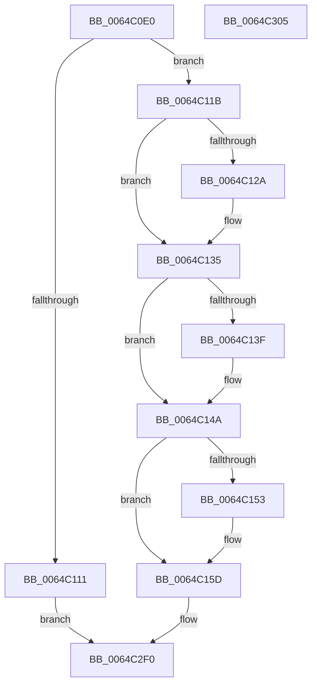

# VfLwSPEntry

- RVA: `0x0064C0E0`–`0x0064C306` (길이 `550` bytes)
- VA: `0x000000014064C0E0`
- 실행 섹션: `.text`
- PDB 이름 있음: `예`; PDB Function 태그: `아니요`
- unwind 정보 RVA: `0x000BD0F0`
- 디코드: `107`개 명령, `550/550` bytes 표시
- 미해석 바이트: `0` (있으면 어셈블리에 `.byte`로 보존)

> 이 문서는 커널 이미지의 기계어와 PDB 기호를 분석해 생성했습니다. 4번과 5번은 함수 원형과 자료형을 바이너리 사용 방식에서 추정한 C 해석이며 원본 소스 복구 결과는 아닙니다.

## 1. Dependencies

- 직접 호출 지점: **3**; 고유 호출 대상: **3**
- 직접 호출자로 확인된 함수: **0**
- RIP 상대 이미지 참조: **22**

### Outgoing calls
- `0x0064C0FC` → [DifGetAvailableSystemPages](../61/DifGetAvailableSystemPages_function_0061B704.md) (function, `0x0061B704`)
- `0x0064C2EB` → [DifRegisterPlugin](../61/DifRegisterPlugin_function_0061ABE0.md) (function, `0x0061ABE0`)
- `0x0064C2F7` → [_security_check_cookie](../6A/_security_check_cookie_function_006AC640.md) (function, `0x006AC640`)

### Direct callers
- 이 함수 시작 RVA로 연결되는 직접 call은 확인되지 않았습니다. 간접 호출은 완전히 역산할 수 없습니다.

### Static image references
- `0x0064C0EE` → RVA `0x00E0A740` (`.data`; read)
- `0x0064C101` → RVA `0x00F03DC8` (`.data`; write)
- `0x0064C11B` → RVA `0x00F03E70` (`.data`; read)
- `0x0064C12E` → RVA `0x00F03E70` (`.data`; write)
- `0x0064C135` → RVA `0x00F03E74` (`.data`; read)
- `0x0064C144` → RVA `0x00F03E74` (`.data`; write)
- `0x0064C14A` → RVA `0x00F03DBC` (`.data`; read)
- `0x0064C153` → RVA `0x00F03DBC` (`.data`; write)
- `0x0064C186` → RVA `0x00F03DC0` (`.data`; write)
- `0x0064C191` → RVA `0x006CE390` (` ?? ::FNODOBFM::`string'`; read)
- `0x0064C1A9` → RVA `0x00BB41B0` (`DifpExAllocatePool2_LwSP_Enter`; read)
- `0x0064C1BC` → RVA `0x00BB41D0` (`DifpExAllocatePool2_LwSP_Exit`; read)
- `0x0064C1C8` → RVA `0x006CE3B0` (` ?? ::FNODOBFM::`string'`; read)
- `0x0064C1EC` → RVA `0x006CE3A0` (` ?? ::FNODOBFM::`string'`; read)
- `0x0064C210` → RVA `0x006CE330` (` ?? ::FNODOBFM::`string'`; read)
- `0x0064C231` → RVA `0x006CE310` (` ?? ::FNODOBFM::`string'`; read)
- `0x0064C252` → RVA `0x006CE370` (` ?? ::FNODOBFM::`string'`; read)
- `0x0064C273` → RVA `0x006CE350` (` ?? ::FNODOBFM::`string'`; read)
- `0x0064C294` → RVA `0x006CE2E0` (` ?? ::FNODOBFM::`string'`; read)
- `0x0064C29F` → RVA `0x00BB4210` (`DifpExFreePool_LwSP_Enter`; read)
- `0x0064C2AA` → RVA `0x006CE2C0` (` ?? ::FNODOBFM::`string'`; read)
- `0x0064C2B5` → RVA `0x00BB41F0` (`DifpExFreePoolWithTag_LwSP_Enter`; read)

## 2. Other-region calls and transfers

- 다른 실행 섹션으로 향하는 call: **0**
- 별도 외부 분기/꼬리 이동을 확인하지 못했습니다.

## 3. Assembly (complete function range)

```asm
0064C0E0  40 55                           push rbp
0064C0E2  48 8D 6C 24 B0                  lea rbp, [rsp - 0x50]
0064C0E7  48 81 EC 50 01 00 00            sub rsp, 0x150
0064C0EE  48 8B 05 4B E6 7B 00            mov rax, qword ptr [rip + 0x7be64b]
0064C0F5  48 33 C4                        xor rax, rsp
0064C0F8  48 89 45 40                     mov qword ptr [rbp + 0x40], rax
0064C0FC  E8 03 F6 FC FF                  call 0x14061b704
0064C101  48 89 05 C0 7C 8B 00            mov qword ptr [rip + 0x8b7cc0], rax
0064C108  4C 8B C8                        mov r9, rax
0064C10B  48 83 F8 64                     cmp rax, 0x64
0064C10F  73 0A                           jae 0x14064c11b
0064C111  B8 9A 00 00 C0                  mov eax, 0xc000009a
0064C116  E9 D5 01 00 00                  jmp 0x14064c2f0
0064C11B  44 8B 05 4E 7D 8B 00            mov r8d, dword ptr [rip + 0x8b7d4e]
0064C122  45 33 D2                        xor r10d, r10d
0064C125  45 85 C0                        test r8d, r8d
0064C128  75 0B                           jne 0x14064c135
0064C12A  45 8D 42 01                     lea r8d, [r10 + 1]
0064C12E  44 89 05 3B 7D 8B 00            mov dword ptr [rip + 0x8b7d3b], r8d
0064C135  8B 05 39 7D 8B 00               mov eax, dword ptr [rip + 0x8b7d39]
0064C13B  85 C0                           test eax, eax
0064C13D  75 0B                           jne 0x14064c14a
0064C13F  B8 64 00 00 00                  mov eax, 0x64
0064C144  89 05 2A 7D 8B 00               mov dword ptr [rip + 0x8b7d2a], eax
0064C14A  44 39 15 6B 7C 8B 00            cmp dword ptr [rip + 0x8b7c6b], r10d
0064C151  75 0A                           jne 0x14064c15d
0064C153  C7 05 5F 7C 8B 00 64 00 00 00   mov dword ptr [rip + 0x8b7c5f], 0x64
0064C15D  8B C8                           mov ecx, eax
0064C15F  33 D2                           xor edx, edx
0064C161  49 8B C1                        mov rax, r9
0064C164  C7 44 24 28 9D 01 00 00         mov dword ptr [rsp + 0x28], 0x19d
0064C16C  48 F7 F1                        div rcx
0064C16F  41 8B C8                        mov ecx, r8d
0064C172  45 33 C9                        xor r9d, r9d
0064C175  48 0F AF C1                     imul rax, rcx
0064C179  48 8D 4C 24 20                  lea rcx, [rsp + 0x20]
0064C17E  C7 44 24 48 A3 01 00 00         mov dword ptr [rsp + 0x48], 0x1a3
0064C186  48 89 05 33 7C 8B 00            mov qword ptr [rip + 0x8b7c33], rax
0064C18D  41 8D 51 09                     lea edx, [r9 + 9]
0064C191  48 8D 05 F8 21 08 00            lea rax, [rip + 0x821f8]
0064C198  C7 44 24 68 A2 01 00 00         mov dword ptr [rsp + 0x68], 0x1a2
0064C1A0  48 89 44 24 20                  mov qword ptr [rsp + 0x20], rax
0064C1A5  45 8D 41 27                     lea r8d, [r9 + 0x27]
0064C1A9  48 8D 05 00 80 56 00            lea rax, [rip + 0x568000]
0064C1B0  C7 45 88 9E 01 00 00            mov dword ptr [rbp - 0x78], 0x19e
0064C1B7  48 89 44 24 30                  mov qword ptr [rsp + 0x30], rax
0064C1BC  48 8D 05 0D 80 56 00            lea rax, [rip + 0x56800d]
0064C1C3  48 89 44 24 38                  mov qword ptr [rsp + 0x38], rax
0064C1C8  48 8D 05 E1 21 08 00            lea rax, [rip + 0x821e1]
0064C1CF  48 89 44 24 40                  mov qword ptr [rsp + 0x40], rax
0064C1D4  48 8D 05 D5 7F 56 00            lea rax, [rip + 0x567fd5]
0064C1DB  48 89 44 24 50                  mov qword ptr [rsp + 0x50], rax
0064C1E0  48 8D 05 E9 7F 56 00            lea rax, [rip + 0x567fe9]
0064C1E7  48 89 44 24 58                  mov qword ptr [rsp + 0x58], rax
0064C1EC  48 8D 05 AD 21 08 00            lea rax, [rip + 0x821ad]
0064C1F3  48 89 44 24 60                  mov qword ptr [rsp + 0x60], rax
0064C1F8  48 8D 05 B1 7F 56 00            lea rax, [rip + 0x567fb1]
0064C1FF  48 89 44 24 70                  mov qword ptr [rsp + 0x70], rax
0064C204  48 8D 05 C5 7F 56 00            lea rax, [rip + 0x567fc5]
0064C20B  48 89 44 24 78                  mov qword ptr [rsp + 0x78], rax
0064C210  48 8D 05 19 21 08 00            lea rax, [rip + 0x82119]
0064C217  48 89 45 80                     mov qword ptr [rbp - 0x80], rax
0064C21B  48 8D 05 8E 7F 56 00            lea rax, [rip + 0x567f8e]
0064C222  48 89 45 90                     mov qword ptr [rbp - 0x70], rax
0064C226  48 8D 05 A3 7F 56 00            lea rax, [rip + 0x567fa3]
0064C22D  48 89 45 98                     mov qword ptr [rbp - 0x68], rax
0064C231  48 8D 05 D8 20 08 00            lea rax, [rip + 0x820d8]
0064C238  48 89 45 A0                     mov qword ptr [rbp - 0x60], rax
0064C23C  48 8D 05 6D 7F 56 00            lea rax, [rip + 0x567f6d]
0064C243  48 89 45 B0                     mov qword ptr [rbp - 0x50], rax
0064C247  48 8D 05 82 7F 56 00            lea rax, [rip + 0x567f82]
0064C24E  48 89 45 B8                     mov qword ptr [rbp - 0x48], rax
0064C252  48 8D 05 17 21 08 00            lea rax, [rip + 0x82117]
0064C259  48 89 45 C0                     mov qword ptr [rbp - 0x40], rax
0064C25D  48 8D 05 4C 7F 56 00            lea rax, [rip + 0x567f4c]
0064C264  48 89 45 D0                     mov qword ptr [rbp - 0x30], rax
0064C268  48 8D 05 61 7F 56 00            lea rax, [rip + 0x567f61]
0064C26F  48 89 45 D8                     mov qword ptr [rbp - 0x28], rax
0064C273  48 8D 05 D6 20 08 00            lea rax, [rip + 0x820d6]
0064C27A  48 89 45 E0                     mov qword ptr [rbp - 0x20], rax
0064C27E  48 8D 05 2B 7F 56 00            lea rax, [rip + 0x567f2b]
0064C285  48 89 45 F0                     mov qword ptr [rbp - 0x10], rax
0064C289  48 8D 05 40 7F 56 00            lea rax, [rip + 0x567f40]
0064C290  48 89 45 F8                     mov qword ptr [rbp - 8], rax
0064C294  48 8D 05 45 20 08 00            lea rax, [rip + 0x82045]
0064C29B  48 89 45 00                     mov qword ptr [rbp], rax
0064C29F  48 8D 05 6A 7F 56 00            lea rax, [rip + 0x567f6a]
0064C2A6  48 89 45 10                     mov qword ptr [rbp + 0x10], rax
0064C2AA  48 8D 05 0F 20 08 00            lea rax, [rip + 0x8200f]
0064C2B1  48 89 45 20                     mov qword ptr [rbp + 0x20], rax
0064C2B5  48 8D 05 34 7F 56 00            lea rax, [rip + 0x567f34]
0064C2BC  48 89 45 30                     mov qword ptr [rbp + 0x30], rax
0064C2C0  C7 45 A8 9F 01 00 00            mov dword ptr [rbp - 0x58], 0x19f
0064C2C7  C7 45 C8 A0 01 00 00            mov dword ptr [rbp - 0x38], 0x1a0
0064C2CE  C7 45 E8 A1 01 00 00            mov dword ptr [rbp - 0x18], 0x1a1
0064C2D5  C7 45 08 91 01 00 00            mov dword ptr [rbp + 8], 0x191
0064C2DC  4C 89 55 18                     mov qword ptr [rbp + 0x18], r10
0064C2E0  C7 45 28 90 01 00 00            mov dword ptr [rbp + 0x28], 0x190
0064C2E7  4C 89 55 38                     mov qword ptr [rbp + 0x38], r10
0064C2EB  E8 F0 E8 FC FF                  call 0x14061abe0
0064C2F0  48 8B 4D 40                     mov rcx, qword ptr [rbp + 0x40]
0064C2F4  48 33 CC                        xor rcx, rsp
0064C2F7  E8 44 03 06 00                  call 0x1406ac640
0064C2FC  48 81 C4 50 01 00 00            add rsp, 0x150
0064C303  5D                              pop rbp
0064C304  C3                              ret
0064C305  CC                              int3
```

## 4. C-style interpretation (structured pseudocode)

```c
__int64 __fastcall VfLwSPEntry(__int64 a1, int a2)
{
    __int64 result;
    __int64 v_r10;
    __int64 v_rsp;
    unsigned __int64 v_stack_m100;
    unsigned __int64 v_stack_m108;
    unsigned int v_stack_m110;
    unsigned __int64 v_stack_m118;
    unsigned __int64 v_stack_m120;
    unsigned __int64 v_stack_m128;
    unsigned int v_stack_m130;
    unsigned __int64 v_stack_m138;
    unsigned __int64 v_stack_m18;
    unsigned __int64 v_stack_m20;
    unsigned __int64 v_stack_m28;
    unsigned int v_stack_m30;
    unsigned __int64 v_stack_m38;
    unsigned __int64 v_stack_m40;
    unsigned __int64 v_stack_m48;
    unsigned int v_stack_m50;
    unsigned __int64 v_stack_m58;
    unsigned __int64 v_stack_m60;
    unsigned __int64 v_stack_m68;
    unsigned int v_stack_m70;
    unsigned __int64 v_stack_m78;
    unsigned __int64 v_stack_m80;
    unsigned __int64 v_stack_m88;
    unsigned int v_stack_m90;
    unsigned __int64 v_stack_m98;
    unsigned __int64 v_stack_mA0;
    unsigned __int64 v_stack_mA8;
    unsigned int v_stack_mB0;
    unsigned __int64 v_stack_mB8;
    unsigned __int64 v_stack_mC0;
    unsigned __int64 v_stack_mC8;
    unsigned int v_stack_mD0;
    unsigned __int64 v_stack_mD8;
    unsigned __int64 v_stack_mE0;
    unsigned __int64 v_stack_mE8;
    unsigned int v_stack_mF0;
    unsigned __int64 v_stack_mF8;

    v_rsp = (v_rsp) - (336);
    result = (*(unsigned __int64 *)(v_rip + 8119883)) ^ (v_rsp);
    v_stack_m18 = result;
    result = DifGetAvailableSystemPages(a1, a2, a3, a4);
    *(unsigned __int64 *)(v_rip + 9141440) = result;
    if (result >= 100) goto loc_0064C11B;
    goto loc_0064C2F0;
loc_0064C11B:
    v_r10 = 0;
    if ((unsigned int)((unsigned int)(*(unsigned int *)(v_rip + 9141582))) == 0) {
        a3 = v_r10 + 1;
        *(unsigned int *)(v_rip + 9141563) = (unsigned int)(a3);
    }
    result = (unsigned int)(*(unsigned int *)(v_rip + 9141561));
    if ((unsigned int)((unsigned int)(*(unsigned int *)(v_rip + 9141561))) == 0) {
        result = 100;
        *(unsigned int *)(v_rip + 9141546) = (unsigned int)(result);
    }
    if ((*(unsigned int *)(v_rip + 9141355)) == 0) {
        *(unsigned int *)(v_rip + 9141343) = 100;
    }
    a2 = 0;
    v_stack_m130 = 413;
    a4 = 0;
    result = (result) * ((unsigned int)((unsigned int)(a3)));
    v_stack_m110 = 419;
    *(unsigned __int64 *)(v_rip + 9141299) = result;
    v_stack_mF0 = 418;
    v_stack_m138 = v_rip + 532984;
    v_stack_mD0 = 414;
    v_stack_m128 = v_rip + 5668864;
    v_stack_m120 = v_rip + 5668877;
    v_stack_m118 = v_rip + 532961;
    v_stack_m108 = v_rip + 5668821;
    v_stack_m100 = v_rip + 5668841;
    v_stack_mF8 = v_rip + 532909;
    v_stack_mE8 = v_rip + 5668785;
    v_stack_mE0 = v_rip + 5668805;
    v_stack_mD8 = v_rip + 532761;
    v_stack_mC8 = v_rip + 5668750;
    v_stack_mC0 = v_rip + 5668771;
    v_stack_mB8 = v_rip + 532696;
    v_stack_mA8 = v_rip + 5668717;
    v_stack_mA0 = v_rip + 5668738;
    v_stack_m98 = v_rip + 532759;
    v_stack_m88 = v_rip + 5668684;
    v_stack_m80 = v_rip + 5668705;
    v_stack_m78 = v_rip + 532694;
    v_stack_m68 = v_rip + 5668651;
    v_stack_m60 = v_rip + 5668672;
    v_stack_m58 = v_rip + 532549;
    v_stack_m48 = v_rip + 5668714;
    v_stack_m38 = v_rip + 532495;
    v_stack_m28 = v_rip + 5668660;
    v_stack_mB0 = 415;
    v_stack_m90 = 416;
    v_stack_m70 = 417;
    v_stack_m50 = 401;
    v_stack_m40 = 0;
    v_stack_m30 = 400;
    v_stack_m20 = 0;
    result = DifRegisterPlugin(v_stack_m138, a4 + 9, a4 + 39, a4);
loc_0064C2F0:
    a1 = (v_stack_m18) ^ (v_rsp);
    result = _security_check_cookie(a1, a4 + 9, a4 + 39, a4);
    v_rsp = (v_rsp) + (336);
    return result;
}
```

## 5. (Beta) C Style

```c
int64_t VfLwSPEntry(int64_t Arg1, int32_t Arg2)
{
    int64_t result;
    int64_t local_r10;
    int64_t local_rsp;
    uint64_t v_stack_m100;
    uint64_t v_stack_m108;
    uint32_t v_stack_m110;
    uint64_t v_stack_m118;
    uint64_t v_stack_m120;
    uint64_t v_stack_m128;
    uint32_t v_stack_m130;
    uint64_t v_stack_m138;
    uint64_t v_stack_m18;
    uint64_t v_stack_m20;
    uint64_t v_stack_m28;
    uint32_t v_stack_m30;
    uint64_t v_stack_m38;
    uint64_t v_stack_m40;
    uint64_t v_stack_m48;
    uint32_t v_stack_m50;
    uint64_t v_stack_m58;
    uint64_t v_stack_m60;
    uint64_t v_stack_m68;
    uint32_t v_stack_m70;
    uint64_t v_stack_m78;
    uint64_t v_stack_m80;
    uint64_t v_stack_m88;
    uint32_t v_stack_m90;
    uint64_t v_stack_m98;
    uint64_t v_stack_mA0;
    uint64_t v_stack_mA8;
    uint32_t v_stack_mB0;
    uint64_t v_stack_mB8;
    uint64_t v_stack_mC0;
    uint64_t v_stack_mC8;
    uint32_t v_stack_mD0;
    uint64_t v_stack_mD8;
    uint64_t v_stack_mE0;
    uint64_t v_stack_mE8;
    uint32_t v_stack_mF0;
    uint64_t v_stack_mF8;

    local_rsp = (local_rsp) - (336);
    result = (*(uint64_t *)(v_rip + 0x7BE64B)) ^ (local_rsp);
    v_stack_m18 = result;
    result = DifGetAvailableSystemPages(Arg1, Arg2, a3, a4);
    *(uint64_t *)(v_rip + 0x8B7CC0) = result;
    if (result >= 100) goto loc_0064C11B;
    goto loc_0064C2F0;
loc_0064C11B:
    local_r10 = 0;
    if ((uint32_t)((uint32_t)(*(uint32_t *)(v_rip + 0x8B7D4E))) == 0) {
        a3 = local_r10 + 1;
        *(uint32_t *)(v_rip + 0x8B7D3B) = (uint32_t)(a3);
    }
    result = (uint32_t)(*(uint32_t *)(v_rip + 0x8B7D39));
    if ((uint32_t)((uint32_t)(*(uint32_t *)(v_rip + 0x8B7D39))) == 0) {
        result = 100;
        *(uint32_t *)(v_rip + 0x8B7D2A) = (uint32_t)(result);
    }
    if ((*(uint32_t *)(v_rip + 0x8B7C6B)) == 0) {
        *(uint32_t *)(v_rip + 0x8B7C5F) = 100;
    }
    Arg2 = 0;
    v_stack_m130 = 413;
    a4 = 0;
    result = (result) * ((uint32_t)((uint32_t)(a3)));
    v_stack_m110 = 419;
    *(uint64_t *)(v_rip + 0x8B7C33) = result;
    v_stack_mF0 = 418;
    v_stack_m138 = v_rip + 532984;
    v_stack_mD0 = 414;
    v_stack_m128 = v_rip + 5668864;
    v_stack_m120 = v_rip + 5668877;
    v_stack_m118 = v_rip + 532961;
    v_stack_m108 = v_rip + 5668821;
    v_stack_m100 = v_rip + 5668841;
    v_stack_mF8 = v_rip + 532909;
    v_stack_mE8 = v_rip + 5668785;
    v_stack_mE0 = v_rip + 5668805;
    v_stack_mD8 = v_rip + 532761;
    v_stack_mC8 = v_rip + 5668750;
    v_stack_mC0 = v_rip + 5668771;
    v_stack_mB8 = v_rip + 532696;
    v_stack_mA8 = v_rip + 5668717;
    v_stack_mA0 = v_rip + 5668738;
    v_stack_m98 = v_rip + 532759;
    v_stack_m88 = v_rip + 5668684;
    v_stack_m80 = v_rip + 5668705;
    v_stack_m78 = v_rip + 532694;
    v_stack_m68 = v_rip + 5668651;
    v_stack_m60 = v_rip + 5668672;
    v_stack_m58 = v_rip + 532549;
    v_stack_m48 = v_rip + 5668714;
    v_stack_m38 = v_rip + 532495;
    v_stack_m28 = v_rip + 5668660;
    v_stack_mB0 = 415;
    v_stack_m90 = 416;
    v_stack_m70 = 417;
    v_stack_m50 = 401;
    v_stack_m40 = 0;
    v_stack_m30 = 400;
    v_stack_m20 = 0;
    result = DifRegisterPlugin(v_stack_m138, a4 + 9, a4 + 39, a4);
loc_0064C2F0:
    Arg1 = (v_stack_m18) ^ (local_rsp);
    result = _security_check_cookie(Arg1, a4 + 9, a4 + 39, a4);
    local_rsp = (local_rsp) + (336);
    return result;
}
```

## 6. Execution-region graph

[열기: 2D/3D 그래프와 함수 탐색 컨트롤 패널](../../../control-panel.html?section=text&rva=0x0064C0E0&view=graph)

- 2D 그래프는 위에서 아래로 흐르고, 3D 그래프는 빈 공간을 드래그해 회전합니다. Shift+드래그는 이동, 휠은 확대·축소, 함수 노드 선택은 대상 보고서 이동입니다.

### Static fallback


