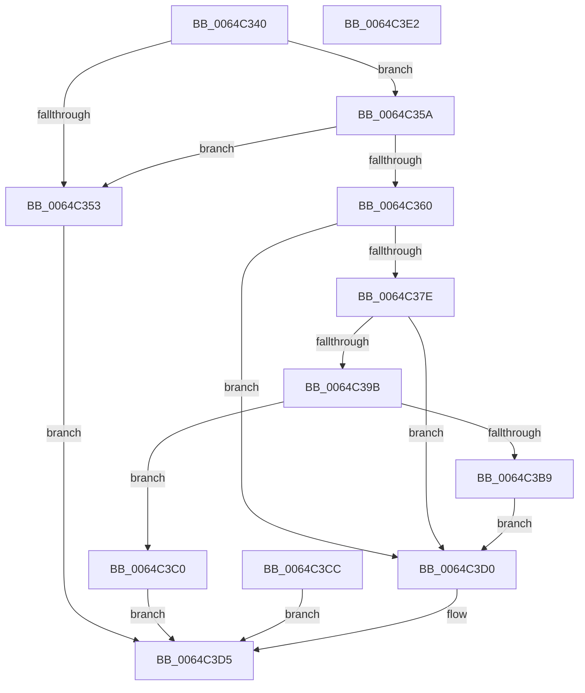

# VmProbeAndLockPages

- RVA: `0x0064C340`–`0x0064C3E3` (길이 `163` bytes)
- VA: `0x000000014064C340`
- 실행 섹션: `.text`
- PDB 이름 있음: `예`; PDB Function 태그: `아니요`
- unwind 정보 RVA: `0x000D2E68`
- 디코드: `50`개 명령, `163/163` bytes 표시
- 미해석 바이트: `0` (있으면 어셈블리에 `.byte`로 보존)

> 이 문서는 커널 이미지의 기계어와 PDB 기호를 분석해 생성했습니다. 4번과 5번은 함수 원형과 자료형을 바이너리 사용 방식에서 추정한 C 해석이며 원본 소스 복구 결과는 아닙니다.

## 1. Dependencies

- 직접 호출 지점: **3**; 고유 호출 대상: **3**
- 직접 호출자로 확인된 함수: **0**
- RIP 상대 이미지 참조: **0**

### Outgoing calls
- `0x0064C3A0` → [MmProbeAndLockPages](../23/MmProbeAndLockPages_function_0023B990.md) (function, `0x0023B990`)
- `0x0064C3B9` → [MmUnlockPages](../29/MmUnlockPages_function_0029EEE0.md) (function, `0x0029EEE0`)
- `0x0064C3C5` → [MmUpdateMdlTrackerForMdlSwitch](../67/MmUpdateMdlTrackerForMdlSwitch_function_00674298.md) (function, `0x00674298`)

### Direct callers
- 이 함수 시작 RVA로 연결되는 직접 call은 확인되지 않았습니다. 간접 호출은 완전히 역산할 수 없습니다.

### Static image references
- 디코드된 RIP-relative 메모리 참조가 없습니다.

## 2. Other-region calls and transfers

- 다른 실행 섹션으로 향하는 call: **0**
- 별도 외부 분기/꼬리 이동을 확인하지 못했습니다.

## 3. Assembly (complete function range)

```asm
0064C340  48 89 5C 24 08                  mov qword ptr [rsp + 8], rbx
0064C345  57                              push rdi
0064C346  48 83 EC 20                     sub rsp, 0x20
0064C34A  48 8B F9                        mov rdi, rcx
0064C34D  33 DB                           xor ebx, ebx
0064C34F  84 D2                           test dl, dl
0064C351  74 07                           je 0x14064c35a
0064C353  BB 0D 00 00 C0                  mov ebx, 0xc000000d
0064C358  EB 7B                           jmp 0x14064c3d5
0064C35A  41 83 F8 01                     cmp r8d, 1
0064C35E  77 F3                           ja 0x14064c353
0064C360  44 8B 49 28                     mov r9d, dword ptr [rcx + 0x28]
0064C364  8B 51 2C                        mov edx, dword ptr [rcx + 0x2c]
0064C367  48 03 51 20                     add rdx, qword ptr [rcx + 0x20]
0064C36B  49 8D 41 FF                     lea rax, [r9 - 1]
0064C36F  48 03 C2                        add rax, rdx
0064C372  45 85 C9                        test r9d, r9d
0064C375  48 0F 44 C2                     cmove rax, rdx
0064C379  48 3B C2                        cmp rax, rdx
0064C37C  72 52                           jb 0x14064c3d0
0064C37E  49 8D 41 FF                     lea rax, [r9 - 1]
0064C382  48 03 C2                        add rax, rdx
0064C385  45 85 C9                        test r9d, r9d
0064C388  48 0F 44 C2                     cmove rax, rdx
0064C38C  48 B9 FF FF FE FF FF 7F 00 00   movabs rcx, 0x7ffffffeffff
0064C396  48 3B C1                        cmp rax, rcx
0064C399  77 35                           ja 0x14064c3d0
0064C39B  33 D2                           xor edx, edx
0064C39D  48 8B CF                        mov rcx, rdi
0064C3A0  E8 EB F5 BE FF                  call 0x14023b990
0064C3A5  90                              nop
0064C3A6  0F BF 47 0A                     movsx eax, word ptr [rdi + 0xa]
0064C3AA  25 77 FF FF FF                  and eax, 0xffffff77
0064C3AF  48 8B CF                        mov rcx, rdi
0064C3B2  3D 02 01 00 00                  cmp eax, 0x102
0064C3B7  74 07                           je 0x14064c3c0
0064C3B9  E8 22 2B C5 FF                  call 0x14029eee0
0064C3BE  EB 10                           jmp 0x14064c3d0
0064C3C0  BA 01 00 00 00                  mov edx, 1
0064C3C5  E8 CE 7E 02 00                  call 0x140674298
0064C3CA  EB 09                           jmp 0x14064c3d5
0064C3CC  8B D8                           mov ebx, eax
0064C3CE  EB 05                           jmp 0x14064c3d5
0064C3D0  BB BB 00 00 C0                  mov ebx, 0xc00000bb
0064C3D5  8B C3                           mov eax, ebx
0064C3D7  48 8B 5C 24 30                  mov rbx, qword ptr [rsp + 0x30]
0064C3DC  48 83 C4 20                     add rsp, 0x20
0064C3E0  5F                              pop rdi
0064C3E1  C3                              ret
0064C3E2  CC                              int3
```

## 4. C-style interpretation (structured pseudocode)

```c
__int64 __fastcall VmProbeAndLockPages(__int64 a1, unsigned __int8 a2, int a3)
{
    __int64 result;
    __int64 v_rbx;
    __int64 v_rsp;
    unsigned __int64 v_stack_p8;

    v_stack_p8 = v_rbx;
    v_rsp = (v_rsp) - (32);
    v_rbx = 0;
    if (a2 == 0) goto loc_0064C35A;
loc_0064C353:
    goto loc_0064C3D5;
loc_0064C35A:
    if (a3 > 1) goto loc_0064C353;
    a2 = ((unsigned int)(*(unsigned int *)(a1 + 44))) + (*(unsigned __int64 *)(a1 + 32));
    result = ((unsigned int)(*(unsigned int *)(a1 + 40)) - 1) + (a2);
    if ((unsigned int)((unsigned int)(*(unsigned int *)(a1 + 40))) == 0) { result = a2; }
    if (result < a2) goto loc_0064C3D0;
    result = ((unsigned int)(*(unsigned int *)(a1 + 40)) - 1) + (a2);
    if ((unsigned int)((unsigned int)(*(unsigned int *)(a1 + 40))) == 0) { result = a2; }
    if (result > a1) goto loc_0064C3D0;
    a2 = 0;
    result = MmProbeAndLockPages(a1, a2, a3, (unsigned int)(*(unsigned int *)(a1 + 40)));
    result = (unsigned int)(((__int16)(*(unsigned __int16 *)(a1 + 10))) & (0xFFFFFF77ULL));
    if (((unsigned int)(result)) == 258) goto loc_0064C3C0;
    result = MmUnlockPages(a1, a2, a3, (unsigned int)(*(unsigned int *)(a1 + 40)));
    goto loc_0064C3D0;
loc_0064C3C0:
    result = MmUpdateMdlTrackerForMdlSwitch(a1, 1, a3, (unsigned int)(*(unsigned int *)(a1 + 40)));
    goto loc_0064C3D5;
loc_0064C3D0:
loc_0064C3D5:
    v_rsp = (v_rsp) + (32);
    return (unsigned int)((unsigned int)((unsigned int)(0xC00000BBULL)));
}
```

## 5. (Beta) C Style

```c
int64_t VmProbeAndLockPages(void *Arg1, uint8_t Arg2, int32_t Arg3)
{
    uint8_t *arg1 = (uint8_t *)Arg1;

    int64_t result;
    int64_t local_rbx;
    int64_t local_rsp;
    uint64_t v_stack_p8;

    v_stack_p8 = local_rbx;
    local_rsp = (local_rsp) - (32);
    local_rbx = 0;
    if (Arg2 == 0) goto loc_0064C35A;
loc_0064C353:
    goto loc_0064C3D5;
loc_0064C35A:
    if (Arg3 > 1) goto loc_0064C353;
    Arg2 = ((uint32_t)(*(uint32_t *)(arg1 + 0x2C))) + (*(uint64_t *)(arg1 + 0x20));
    result = ((uint32_t)(*(uint32_t *)(arg1 + 0x28)) - 1) + (Arg2);
    if ((uint32_t)((uint32_t)(*(uint32_t *)(arg1 + 0x28))) == 0) { result = Arg2; }
    if (result < Arg2) goto loc_0064C3D0;
    result = ((uint32_t)(*(uint32_t *)(arg1 + 0x28)) - 1) + (Arg2);
    if ((uint32_t)((uint32_t)(*(uint32_t *)(arg1 + 0x28))) == 0) { result = Arg2; }
    if (result > Arg1) goto loc_0064C3D0;
    Arg2 = 0;
    result = MmProbeAndLockPages(Arg1, Arg2, Arg3, (uint32_t)(*(uint32_t *)(arg1 + 0x28)));
    result = (uint32_t)(((int16_t)(*(uint16_t *)(arg1 + 0xA))) & (0xFFFFFF77ULL));
    if (((uint32_t)(result)) == 258) goto loc_0064C3C0;
    result = MmUnlockPages(Arg1, Arg2, Arg3, (uint32_t)(*(uint32_t *)(arg1 + 0x28)));
    goto loc_0064C3D0;
loc_0064C3C0:
    result = MmUpdateMdlTrackerForMdlSwitch(Arg1, 1, Arg3, (uint32_t)(*(uint32_t *)(arg1 + 0x28)));
    goto loc_0064C3D5;
loc_0064C3D0:
loc_0064C3D5:
    local_rsp = (local_rsp) + (32);
    return (uint32_t)((uint32_t)((uint32_t)(0xC00000BBULL)));
}
```

### 관측된 메모리 오프셋

구조체 형식이 확인되지 않은 접근은 인자 기준의 오프셋으로만 기록했습니다.

| 기준 인자 | 오프셋 표현 | 폭 (bit) | 접근 |
|---|---:|---:|---|
| `Arg1` | `+ 0xA` | `16` | `R` |
| `Arg1` | `+ 0x20` | `64` | `R` |
| `Arg1` | `+ 0x28` | `32` | `R` |
| `Arg1` | `+ 0x2C` | `32` | `R` |

## 6. Execution-region graph

[열기: 2D/3D 그래프와 함수 탐색 컨트롤 패널](../../../control-panel.html?section=text&rva=0x0064C340&view=graph)

- 2D 그래프는 위에서 아래로 흐르고, 3D 그래프는 빈 공간을 드래그해 회전합니다. Shift+드래그는 이동, 휠은 확대·축소, 함수 노드 선택은 대상 보고서 이동입니다.

### Static fallback


