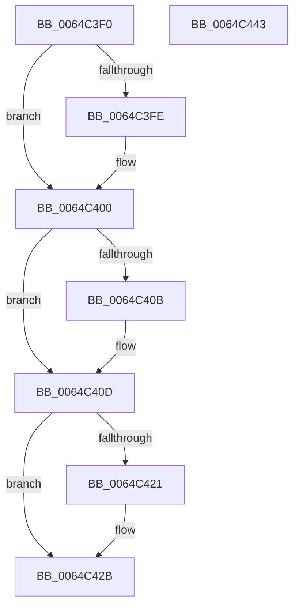

# VmUnlockPages

- RVA: `0x0064C3F0`–`0x0064C444` (길이 `84` bytes)
- VA: `0x000000014064C3F0`
- 실행 섹션: `.text`
- PDB 이름 있음: `예`; PDB Function 태그: `아니요`
- unwind 정보 RVA: `0x0005CF00`
- 디코드: `28`개 명령, `84/84` bytes 표시
- 미해석 바이트: `0` (있으면 어셈블리에 `.byte`로 보존)

> 이 문서는 커널 이미지의 기계어와 PDB 기호를 분석해 생성했습니다. 4번과 5번은 함수 원형과 자료형을 바이너리 사용 방식에서 추정한 C 해석이며 원본 소스 복구 결과는 아닙니다.

## 1. Dependencies

- 직접 호출 지점: **2**; 고유 호출 대상: **2**
- 직접 호출자로 확인된 함수: **0**
- RIP 상대 이미지 참조: **0**

### Outgoing calls
- `0x0064C430` → [MmUpdateMdlTrackerForMdlSwitch](../67/MmUpdateMdlTrackerForMdlSwitch_function_00674298.md) (function, `0x00674298`)
- `0x0064C438` → [MmUnlockPages](../29/MmUnlockPages_function_0029EEE0.md) (function, `0x0029EEE0`)

### Direct callers
- 이 함수 시작 RVA로 연결되는 직접 call은 확인되지 않았습니다. 간접 호출은 완전히 역산할 수 없습니다.

### Static image references
- 디코드된 RIP-relative 메모리 참조가 없습니다.

## 2. Other-region calls and transfers

- 다른 실행 섹션으로 향하는 call: **0**
- 별도 외부 분기/꼬리 이동을 확인하지 못했습니다.

## 3. Assembly (complete function range)

```asm
0064C3F0  40 53                           push rbx
0064C3F2  48 83 EC 20                     sub rsp, 0x20
0064C3F6  48 8B D9                        mov rbx, rcx
0064C3F9  83 FA 01                        cmp edx, 1
0064C3FC  76 02                           jbe 0x14064c400
0064C3FE  CD 2C                           int 0x2c
0064C400  0F B7 49 0A                     movzx ecx, word ptr [rcx + 0xa]
0064C404  66 F7 C1 F7 FF                  test cx, 0xfff7
0064C409  74 02                           je 0x14064c40d
0064C40B  CD 2C                           int 0x2c
0064C40D  B8 02 01 00 00                  mov eax, 0x102
0064C412  66 0B C8                        or cx, ax
0064C415  66 89 4B 0A                     mov word ptr [rbx + 0xa], cx
0064C419  0F B7 C1                        movzx eax, cx
0064C41C  83 FA 01                        cmp edx, 1
0064C41F  75 0A                           jne 0x14064c42b
0064C421  8D 4A 7F                        lea ecx, [rdx + 0x7f]
0064C424  66 0B C1                        or ax, cx
0064C427  66 89 43 0A                     mov word ptr [rbx + 0xa], ax
0064C42B  33 D2                           xor edx, edx
0064C42D  48 8B CB                        mov rcx, rbx
0064C430  E8 63 7E 02 00                  call 0x140674298
0064C435  48 8B CB                        mov rcx, rbx
0064C438  E8 A3 2A C5 FF                  call 0x14029eee0
0064C43D  48 83 C4 20                     add rsp, 0x20
0064C441  5B                              pop rbx
0064C442  C3                              ret
0064C443  CC                              int3
```

## 4. C-style interpretation (structured pseudocode)

```c
__int64 __fastcall VmUnlockPages(__int64 a1, __int64 a2)
{
    __int64 result;
    __int64 v_rsp;

    v_rsp = (v_rsp) - (32);
    if (((unsigned int)(a2)) >= = 1) {
    }
    if ((((unsigned __int16)(*(unsigned __int16 *)(a1 + 10))) & (0xFFF7ULL)) != 0) {
    }
    a1 = (unsigned __int16)((*(unsigned __int16 *)(a1 + 10)) | (258));
    *(unsigned __int16 *)(a1 + 10) = (unsigned __int16)(a1);
    result = (unsigned __int16)(a1);
    if (((unsigned int)(a2)) == 1) {
        a1 = a2 + 127;
        result = (unsigned __int16)(((unsigned __int16)(a1)) | ((unsigned __int16)(a1)));
        *(unsigned __int16 *)(a1 + 10) = (unsigned __int16)(result);
    }
    a2 = 0;
    result = MmUpdateMdlTrackerForMdlSwitch(a1, a2, a3, a4);
    result = MmUnlockPages(a1, a2, a3, a4);
    v_rsp = (v_rsp) + (32);
    return result;
}
```

## 5. (Beta) C Style

```c
int64_t VmUnlockPages(void *Arg1, int64_t Arg2)
{
    uint8_t *arg1 = (uint8_t *)Arg1;

    int64_t result;
    int64_t local_rsp;

    local_rsp = (local_rsp) - (32);
    if (((uint32_t)(Arg2)) >= = 1) {
    }
    if ((((uint16_t)(*(uint16_t *)(arg1 + 0xA))) & (0xFFF7ULL)) != 0) {
    }
    Arg1 = (uint16_t)((*(uint16_t *)(arg1 + 0xA)) | (258));
    *(uint16_t *)(arg1 + 0xA) = (uint16_t)(Arg1);
    result = (uint16_t)(Arg1);
    if (((uint32_t)(Arg2)) == 1) {
        Arg1 = Arg2 + 127;
        result = (uint16_t)(((uint16_t)(Arg1)) | ((uint16_t)(Arg1)));
        *(uint16_t *)(arg1 + 0xA) = (uint16_t)(result);
    }
    Arg2 = 0;
    result = MmUpdateMdlTrackerForMdlSwitch(Arg1, Arg2, a3, a4);
    result = MmUnlockPages(Arg1, Arg2, a3, a4);
    local_rsp = (local_rsp) + (32);
    return result;
}
```

### 관측된 메모리 오프셋

구조체 형식이 확인되지 않은 접근은 인자 기준의 오프셋으로만 기록했습니다.

| 기준 인자 | 오프셋 표현 | 폭 (bit) | 접근 |
|---|---:|---:|---|
| `Arg1` | `+ 0xA` | `16` | `R` |
| `Arg1` | `+ 0xA` | `16` | `W` |

## 6. Execution-region graph

[열기: 2D/3D 그래프와 함수 탐색 컨트롤 패널](../../../control-panel.html?section=text&rva=0x0064C3F0&view=graph)

- 2D 그래프는 위에서 아래로 흐르고, 3D 그래프는 빈 공간을 드래그해 회전합니다. Shift+드래그는 이동, 휠은 확대·축소, 함수 노드 선택은 대상 보고서 이동입니다.

### Static fallback


