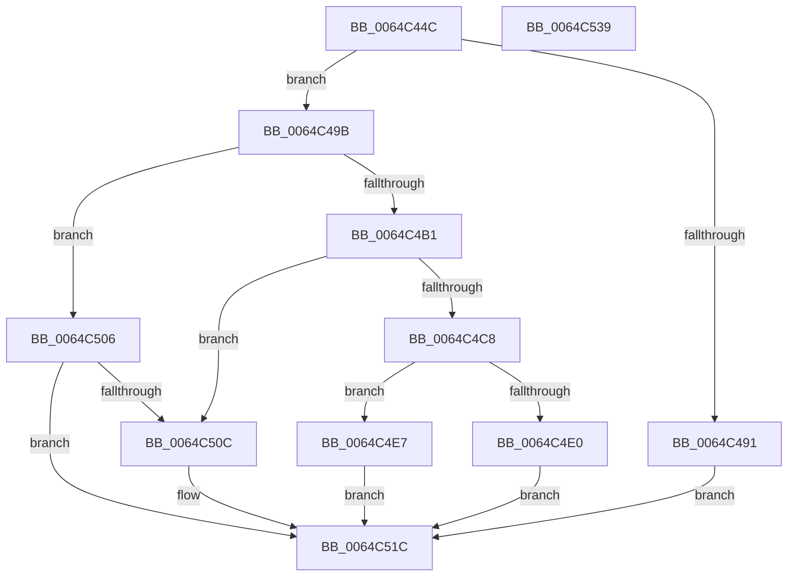

# VmpCheckPinAndReference

- RVA: `0x0064C44C`–`0x0064C53A` (길이 `238` bytes)
- VA: `0x000000014064C44C`
- 실행 섹션: `.text`
- PDB 이름 있음: `예`; PDB Function 태그: `아니요`
- unwind 정보 RVA: `0x0005D7BC`
- 디코드: `67`개 명령, `238/238` bytes 표시
- 미해석 바이트: `0` (있으면 어셈블리에 `.byte`로 보존)

> 이 문서는 커널 이미지의 기계어와 PDB 기호를 분석해 생성했습니다. 4번과 5번은 함수 원형과 자료형을 바이너리 사용 방식에서 추정한 C 해석이며 원본 소스 복구 결과는 아닙니다.

## 1. Dependencies

- 직접 호출 지점: **4**; 고유 호출 대상: **2**
- 직접 호출자로 확인된 함수: **1**
- RIP 상대 이미지 참조: **0**

### Outgoing calls
- `0x0064C4A7` → [VmpFindNextPinnedPageStateHelper](VmpFindNextPinnedPageStateHelper_function_0064C7E4.md) (function, `0x0064C7E4`)
- `0x0064C4BD` → [VmpFindNextPinnedPageStateHelper](VmpFindNextPinnedPageStateHelper_function_0064C7E4.md) (function, `0x0064C7E4`)
- `0x0064C4D5` → [VmpFindNextPinnedPageStateHelper](VmpFindNextPinnedPageStateHelper_function_0064C7E4.md) (function, `0x0064C7E4`)
- `0x0064C4F8` → [VmpRefDerefPinnedPages](VmpRefDerefPinnedPages_function_0064D1C0.md) (function, `0x0064D1C0`)

### Direct callers
- [VmpPinMemoryRange](VmpPinMemoryRange_function_0064CCD0.md) at `0x0064CF2F`
- [VmpPinMemoryRange](VmpPinMemoryRange_function_0064CCD0.md) at `0x0064CFC7`

### Static image references
- 디코드된 RIP-relative 메모리 참조가 없습니다.

## 2. Other-region calls and transfers

- 다른 실행 섹션으로 향하는 call: **0**
- 별도 외부 분기/꼬리 이동을 확인하지 못했습니다.

## 3. Assembly (complete function range)

```asm
0064C44C  48 8B C4                        mov rax, rsp
0064C44F  48 89 58 08                     mov qword ptr [rax + 8], rbx
0064C453  48 89 68 10                     mov qword ptr [rax + 0x10], rbp
0064C457  48 89 70 18                     mov qword ptr [rax + 0x18], rsi
0064C45B  48 89 78 20                     mov qword ptr [rax + 0x20], rdi
0064C45F  41 56                           push r14
0064C461  48 83 EC 30                     sub rsp, 0x30
0064C465  44 8B 52 48                     mov r10d, dword ptr [rdx + 0x48]
0064C469  33 DB                           xor ebx, ebx
0064C46B  4C 8B 74 24 68                  mov r14, qword ptr [rsp + 0x68]
0064C470  8B C3                           mov eax, ebx
0064C472  41 F7 D2                        not r10d
0064C475  49 8B F1                        mov rsi, r9
0064C478  41 83 E2 01                     and r10d, 1
0064C47C  49 8B F8                        mov rdi, r8
0064C47F  39 5C 24 60                     cmp dword ptr [rsp + 0x60], ebx
0064C483  48 8B E9                        mov rbp, rcx
0064C486  41 89 1E                        mov dword ptr [r14], ebx
0064C489  0F 94 C0                        sete al
0064C48C  41 3B C2                        cmp eax, r10d
0064C48F  74 0A                           je 0x14064c49b
0064C491  BB 45 00 00 C0                  mov ebx, 0xc0000045
0064C496  E9 81 00 00 00                  jmp 0x14064c51c
0064C49B  41 B9 01 00 00 00               mov r9d, 1
0064C4A1  4C 8B C6                        mov r8, rsi
0064C4A4  48 8B D7                        mov rdx, rdi
0064C4A7  E8 38 03 00 00                  call 0x14064c7e4
0064C4AC  48 3B C7                        cmp rax, rdi
0064C4AF  75 55                           jne 0x14064c506
0064C4B1  45 33 C9                        xor r9d, r9d
0064C4B4  4C 8B C6                        mov r8, rsi
0064C4B7  48 8B D7                        mov rdx, rdi
0064C4BA  48 8B CD                        mov rcx, rbp
0064C4BD  E8 22 03 00 00                  call 0x14064c7e4
0064C4C2  48 83 F8 FF                     cmp rax, -1
0064C4C6  75 44                           jne 0x14064c50c
0064C4C8  44 8D 48 05                     lea r9d, [rax + 5]
0064C4CC  4C 8B C6                        mov r8, rsi
0064C4CF  48 8B D7                        mov rdx, rdi
0064C4D2  48 8B CD                        mov rcx, rbp
0064C4D5  E8 0A 03 00 00                  call 0x14064c7e4
0064C4DA  48 83 F8 FF                     cmp rax, -1
0064C4DE  74 07                           je 0x14064c4e7
0064C4E0  BB C1 00 00 C0                  mov ebx, 0xc00000c1
0064C4E5  EB 35                           jmp 0x14064c51c
0064C4E7  45 33 C9                        xor r9d, r9d
0064C4EA  48 89 5C 24 20                  mov qword ptr [rsp + 0x20], rbx
0064C4EF  4C 8B C6                        mov r8, rsi
0064C4F2  48 8B D7                        mov rdx, rdi
0064C4F5  48 8B CD                        mov rcx, rbp
0064C4F8  E8 C3 0C 00 00                  call 0x14064d1c0
0064C4FD  41 C7 06 01 00 00 00            mov dword ptr [r14], 1
0064C504  EB 16                           jmp 0x14064c51c
0064C506  48 83 F8 FF                     cmp rax, -1
0064C50A  74 10                           je 0x14064c51c
0064C50C  48 8B 44 24 70                  mov rax, qword ptr [rsp + 0x70]
0064C511  BB 2D 02 00 C0                  mov ebx, 0xc000022d
0064C516  C7 00 01 00 00 00               mov dword ptr [rax], 1
0064C51C  48 8B 6C 24 48                  mov rbp, qword ptr [rsp + 0x48]
0064C521  8B C3                           mov eax, ebx
0064C523  48 8B 5C 24 40                  mov rbx, qword ptr [rsp + 0x40]
0064C528  48 8B 74 24 50                  mov rsi, qword ptr [rsp + 0x50]
0064C52D  48 8B 7C 24 58                  mov rdi, qword ptr [rsp + 0x58]
0064C532  48 83 C4 30                     add rsp, 0x30
0064C536  41 5E                           pop r14
0064C538  C3                              ret
0064C539  CC                              int3
```

## 4. C-style interpretation (structured pseudocode)

```c
__int64 __fastcall VmpCheckPinAndReference(__int64 a1, __int64 a2, __int64 a3, __int64 a4, unsigned int a5, __int64 a6, __int64 a7)
{
    __int64 result;
    __int64 v_r10;
    __int64 v_rbx;
    __int64 v_rsp;
    unsigned __int64 v_stack_m18;
    unsigned __int64 v_stack_p10;
    unsigned __int64 v_stack_p18;
    unsigned __int64 v_stack_p20;
    unsigned __int64 v_stack_p8;

    *(unsigned __int64 *)(v_rsp + 8) = v_rbx;
    *(unsigned __int64 *)(v_rsp + 16) = v_rbp;
    *(unsigned __int64 *)(v_rsp + 24) = v_rsi;
    *(unsigned __int64 *)(v_rsp + 32) = v_rdi;
    v_rsp = (v_rsp) - (48);
    v_rbx = 0;
    v_r10 = (unsigned int)(~((unsigned int)(*(unsigned int *)(a2 + 72))));
    v_r10 = (unsigned int)((v_r10) & (1));
    *(unsigned int *)(a6) = 0;
    result = (a5 == 0) ? 1 : 0;
    if (((unsigned int)(result)) == ((unsigned int)(v_r10))) goto loc_0064C49B;
    goto loc_0064C51C;
loc_0064C49B:
    result = VmpFindNextPinnedPageStateHelper(a1, a3, a4, 1);
    if (result != a3) goto loc_0064C506;
    a4 = 0;
    result = VmpFindNextPinnedPageStateHelper(a1, a3, 0, a4);
    if (result != -1) goto loc_0064C50C;
    result = VmpFindNextPinnedPageStateHelper(a1, a3, 0, result + 5);
    if (result == -1) goto loc_0064C4E7;
    goto loc_0064C51C;
loc_0064C4E7:
    a4 = 0;
    v_stack_m18 = (unsigned int)(0xC00000C1ULL);
    result = VmpRefDerefPinnedPages(a1, a3, 0, a4);
    *(unsigned int *)(a6) = 1;
    goto loc_0064C51C;
loc_0064C506:
    v_rbx = (unsigned int)(0xC00000C1ULL);
    if (result != -1) {
        result = a7;
        v_rbx = 0xC000022DULL;
        *(unsigned int *)(result) = 1;
    }
    v_rsp = (v_rsp) + (48);
    return (unsigned int)((unsigned int)(v_rbx));
}
```

## 5. (Beta) C Style

```c
int64_t VmpCheckPinAndReference(int64_t Arg1, void *Arg2, int64_t Arg3, int64_t Arg4, uint32_t Arg5, void *Arg6, void *Arg7)
{
    uint8_t *arg2 = (uint8_t *)Arg2;
    uint8_t *arg6 = (uint8_t *)Arg6;
    uint8_t *arg7 = (uint8_t *)Arg7;

    int64_t result;
    int64_t local_r10;
    int64_t local_rbx;
    int64_t local_rsp;
    uint64_t v_stack_m18;
    uint64_t v_stack_p10;
    uint64_t v_stack_p18;
    uint64_t v_stack_p20;
    uint64_t v_stack_p8;

    *(uint64_t *)(local_rsp + 0x8) = local_rbx;
    *(uint64_t *)(local_rsp + 0x10) = local_rbp;
    *(uint64_t *)(local_rsp + 0x18) = local_rsi;
    *(uint64_t *)(local_rsp + 0x20) = local_rdi;
    local_rsp = (local_rsp) - (48);
    local_rbx = 0;
    local_r10 = (uint32_t)(~((uint32_t)(*(uint32_t *)(arg2 + 0x48))));
    local_r10 = (uint32_t)((local_r10) & (1));
    *(uint32_t *)(arg6) = 0;
    result = (Arg5 == 0) ? 1 : 0;
    if (((uint32_t)(result)) == ((uint32_t)(local_r10))) goto loc_0064C49B;
    goto loc_0064C51C;
loc_0064C49B:
    result = VmpFindNextPinnedPageStateHelper(Arg1, Arg3, Arg4, 1);
    if (result != Arg3) goto loc_0064C506;
    Arg4 = 0;
    result = VmpFindNextPinnedPageStateHelper(Arg1, Arg3, 0, Arg4);
    if (result != -1) goto loc_0064C50C;
    result = VmpFindNextPinnedPageStateHelper(Arg1, Arg3, 0, result + 5);
    if (result == -1) goto loc_0064C4E7;
    goto loc_0064C51C;
loc_0064C4E7:
    Arg4 = 0;
    v_stack_m18 = (uint32_t)(0xC00000C1ULL);
    result = VmpRefDerefPinnedPages(Arg1, Arg3, 0, Arg4);
    *(uint32_t *)(arg6) = 1;
    goto loc_0064C51C;
loc_0064C506:
    local_rbx = (uint32_t)(0xC00000C1ULL);
    if (result != -1) {
        result = Arg7;
        local_rbx = 0xC000022DULL;
        *(uint32_t *)(result) = 1;
    }
    local_rsp = (local_rsp) + (48);
    return (uint32_t)((uint32_t)(local_rbx));
}
```

### 관측된 메모리 오프셋

구조체 형식이 확인되지 않은 접근은 인자 기준의 오프셋으로만 기록했습니다.

| 기준 인자 | 오프셋 표현 | 폭 (bit) | 접근 |
|---|---:|---:|---|
| `Arg2` | `+ 0x48` | `32` | `R` |
| `Arg6` | `+ 0x0` | `32` | `W` |
| `Arg7` | `+ 0x0` | `32` | `W` |

## 6. Execution-region graph

[열기: 2D/3D 그래프와 함수 탐색 컨트롤 패널](../../../control-panel.html?section=text&rva=0x0064C44C&view=graph)

- 2D 그래프는 위에서 아래로 흐르고, 3D 그래프는 빈 공간을 드래그해 회전합니다. Shift+드래그는 이동, 휠은 확대·축소, 함수 노드 선택은 대상 보고서 이동입니다.

### Static fallback


