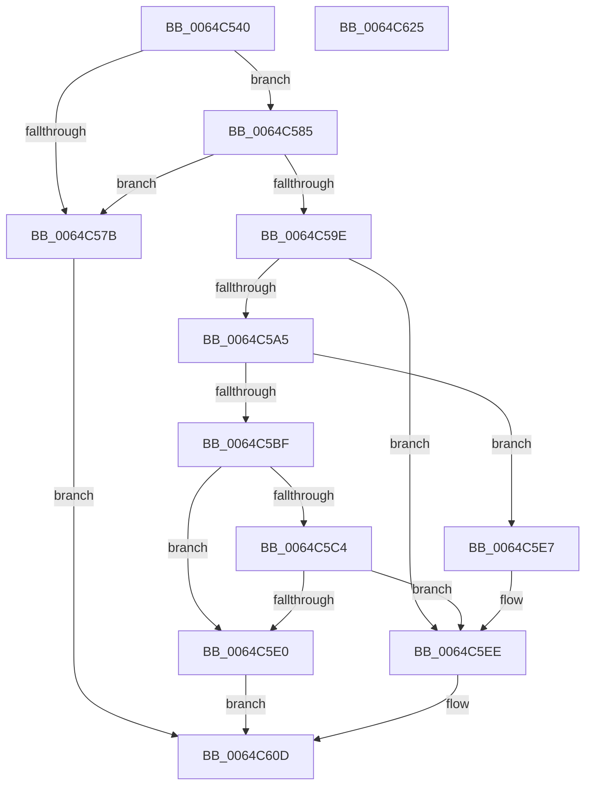

# VmpCheckUnpinAndDereference

- RVA: `0x0064C540`–`0x0064C626` (길이 `230` bytes)
- VA: `0x000000014064C540`
- 실행 섹션: `.text`
- PDB 이름 있음: `예`; PDB Function 태그: `아니요`
- unwind 정보 RVA: `0x0009B270`
- 디코드: `61`개 명령, `230/230` bytes 표시
- 미해석 바이트: `0` (있으면 어셈블리에 `.byte`로 보존)

> 이 문서는 커널 이미지의 기계어와 PDB 기호를 분석해 생성했습니다. 4번과 5번은 함수 원형과 자료형을 바이너리 사용 방식에서 추정한 C 해석이며 원본 소스 복구 결과는 아닙니다.

## 1. Dependencies

- 직접 호출 지점: **5**; 고유 호출 대상: **2**
- 직접 호출자로 확인된 함수: **1**
- RIP 상대 이미지 참조: **0**

### Outgoing calls
- `0x0064C571` → [VmpFindNextPinnedPageStateHelper](VmpFindNextPinnedPageStateHelper_function_0064C7E4.md) (function, `0x0064C7E4`)
- `0x0064C593` → [VmpFindNextPinnedPageStateHelper](VmpFindNextPinnedPageStateHelper_function_0064C7E4.md) (function, `0x0064C7E4`)
- `0x0064C5B4` → [VmpFindNextPinnedPageStateHelper](VmpFindNextPinnedPageStateHelper_function_0064C7E4.md) (function, `0x0064C7E4`)
- `0x0064C5D5` → [VmpFindNextPinnedPageStateHelper](VmpFindNextPinnedPageStateHelper_function_0064C7E4.md) (function, `0x0064C7E4`)
- `0x0064C608` → [VmpRefDerefPinnedPages](VmpRefDerefPinnedPages_function_0064D1C0.md) (function, `0x0064D1C0`)

### Direct callers
- [VmpUnpinMemoryRangeHelper](VmpUnpinMemoryRangeHelper_function_0064D370.md) at `0x0064D47D`

### Static image references
- 디코드된 RIP-relative 메모리 참조가 없습니다.

## 2. Other-region calls and transfers

- 다른 실행 섹션으로 향하는 call: **0**
- 별도 외부 분기/꼬리 이동을 확인하지 못했습니다.

## 3. Assembly (complete function range)

```asm
0064C540  48 89 5C 24 08                  mov qword ptr [rsp + 8], rbx
0064C545  48 89 74 24 10                  mov qword ptr [rsp + 0x10], rsi
0064C54A  48 89 7C 24 18                  mov qword ptr [rsp + 0x18], rdi
0064C54F  41 56                           push r14
0064C551  48 83 EC 30                     sub rsp, 0x30
0064C555  4C 8B 74 24 78                  mov r14, qword ptr [rsp + 0x78]
0064C55A  49 8B F9                        mov rdi, r9
0064C55D  4C 8B 44 24 60                  mov r8, qword ptr [rsp + 0x60]
0064C562  33 DB                           xor ebx, ebx
0064C564  48 8B D7                        mov rdx, rdi
0064C567  48 8B F1                        mov rsi, rcx
0064C56A  41 89 1E                        mov dword ptr [r14], ebx
0064C56D  44 8D 4B 01                     lea r9d, [rbx + 1]
0064C571  E8 6E 02 00 00                  call 0x14064c7e4
0064C576  48 3B C7                        cmp rax, rdi
0064C579  74 0A                           je 0x14064c585
0064C57B  BB 18 00 00 C0                  mov ebx, 0xc0000018
0064C580  E9 88 00 00 00                  jmp 0x14064c60d
0064C585  4C 8B 44 24 60                  mov r8, qword ptr [rsp + 0x60]
0064C58A  45 33 C9                        xor r9d, r9d
0064C58D  48 8B D7                        mov rdx, rdi
0064C590  48 8B CE                        mov rcx, rsi
0064C593  E8 4C 02 00 00                  call 0x14064c7e4
0064C598  48 83 F8 FF                     cmp rax, -1
0064C59C  75 DD                           jne 0x14064c57b
0064C59E  F6 44 24 68 01                  test byte ptr [rsp + 0x68], 1
0064C5A3  75 49                           jne 0x14064c5ee
0064C5A5  4C 8B 44 24 60                  mov r8, qword ptr [rsp + 0x60]
0064C5AA  44 8D 48 03                     lea r9d, [rax + 3]
0064C5AE  48 8B D7                        mov rdx, rdi
0064C5B1  48 8B CE                        mov rcx, rsi
0064C5B4  E8 2B 02 00 00                  call 0x14064c7e4
0064C5B9  48 83 F8 FF                     cmp rax, -1
0064C5BD  74 28                           je 0x14064c5e7
0064C5BF  48 3B C7                        cmp rax, rdi
0064C5C2  75 1C                           jne 0x14064c5e0
0064C5C4  4C 8B 44 24 60                  mov r8, qword ptr [rsp + 0x60]
0064C5C9  41 B9 03 00 00 00               mov r9d, 3
0064C5CF  48 8B D7                        mov rdx, rdi
0064C5D2  48 8B CE                        mov rcx, rsi
0064C5D5  E8 0A 02 00 00                  call 0x14064c7e4
0064C5DA  48 83 F8 FF                     cmp rax, -1
0064C5DE  74 0E                           je 0x14064c5ee
0064C5E0  BB 2D 02 00 C0                  mov ebx, 0xc000022d
0064C5E5  EB 26                           jmp 0x14064c60d
0064C5E7  41 C7 06 01 00 00 00            mov dword ptr [r14], 1
0064C5EE  48 8B 4C 24 70                  mov rcx, qword ptr [rsp + 0x70]
0064C5F3  48 8B D7                        mov rdx, rdi
0064C5F6  44 8B 4C 24 68                  mov r9d, dword ptr [rsp + 0x68]
0064C5FB  4C 8B 44 24 60                  mov r8, qword ptr [rsp + 0x60]
0064C600  48 89 4C 24 20                  mov qword ptr [rsp + 0x20], rcx
0064C605  48 8B CE                        mov rcx, rsi
0064C608  E8 B3 0B 00 00                  call 0x14064d1c0
0064C60D  48 8B 74 24 48                  mov rsi, qword ptr [rsp + 0x48]
0064C612  8B C3                           mov eax, ebx
0064C614  48 8B 5C 24 40                  mov rbx, qword ptr [rsp + 0x40]
0064C619  48 8B 7C 24 50                  mov rdi, qword ptr [rsp + 0x50]
0064C61E  48 83 C4 30                     add rsp, 0x30
0064C622  41 5E                           pop r14
0064C624  C3                              ret
0064C625  CC                              int3
```

## 4. C-style interpretation (structured pseudocode)

```c
__int64 __fastcall VmpCheckUnpinAndDereference(__int64 a1, __int64 a2, __int64 a3, __int64 a4, __int64 a5, unsigned __int8 a6, __int64 a7, __int64 a8)
{
    __int64 result;
    __int64 v_rbx;
    __int64 v_rsp;
    unsigned __int64 v_stack_m18;
    unsigned __int64 v_stack_p10;
    unsigned __int64 v_stack_p18;
    unsigned __int64 v_stack_p8;

    v_stack_p8 = v_rbx;
    v_stack_p10 = v_rsi;
    v_stack_p18 = v_rdi;
    v_rsp = (v_rsp) - (48);
    v_rbx = 0;
    *(unsigned int *)(a8) = 0;
    result = VmpFindNextPinnedPageStateHelper(a1, a4, a5, v_rbx + 1);
    if (result == a4) goto loc_0064C585;
loc_0064C57B:
    goto loc_0064C60D;
loc_0064C585:
    a4 = 0;
    result = VmpFindNextPinnedPageStateHelper(a1, 0, a5, a4);
    if (result != -1) goto loc_0064C57B;
    if (((a6) & (1)) != 0) goto loc_0064C5EE;
    result = VmpFindNextPinnedPageStateHelper(a1, 0, a5, result + 3);
    if (result == -1) goto loc_0064C5E7;
    if (result != 0) goto loc_0064C5E0;
    result = VmpFindNextPinnedPageStateHelper(a1, 0, a5, 3);
    if (result == -1) goto loc_0064C5EE;
loc_0064C5E0:
    goto loc_0064C60D;
loc_0064C5E7:
    *(unsigned int *)(a8) = 1;
loc_0064C5EE:
    v_stack_m18 = a7;
    result = VmpRefDerefPinnedPages(a1, 0, a5, (unsigned int)(a6));
loc_0064C60D:
    v_rsp = (v_rsp) + (48);
    return (unsigned int)((unsigned int)((unsigned int)(0xC000022DULL)));
}
```

## 5. (Beta) C Style

```c
int64_t VmpCheckUnpinAndDereference(int64_t Arg1, int64_t Arg2, int64_t Arg3, int64_t Arg4, int64_t Arg5, uint8_t Arg6, int64_t Arg7, void *Arg8)
{
    uint8_t *arg8 = (uint8_t *)Arg8;

    int64_t result;
    int64_t local_rbx;
    int64_t local_rsp;
    uint64_t v_stack_m18;
    uint64_t v_stack_p10;
    uint64_t v_stack_p18;
    uint64_t v_stack_p8;

    v_stack_p8 = local_rbx;
    v_stack_p10 = local_rsi;
    v_stack_p18 = local_rdi;
    local_rsp = (local_rsp) - (48);
    local_rbx = 0;
    *(uint32_t *)(arg8) = 0;
    result = VmpFindNextPinnedPageStateHelper(Arg1, Arg4, Arg5, local_rbx + 1);
    if (result == Arg4) goto loc_0064C585;
loc_0064C57B:
    goto loc_0064C60D;
loc_0064C585:
    Arg4 = 0;
    result = VmpFindNextPinnedPageStateHelper(Arg1, 0, Arg5, Arg4);
    if (result != -1) goto loc_0064C57B;
    if (((Arg6) & (1)) != 0) goto loc_0064C5EE;
    result = VmpFindNextPinnedPageStateHelper(Arg1, 0, Arg5, result + 3);
    if (result == -1) goto loc_0064C5E7;
    if (result != 0) goto loc_0064C5E0;
    result = VmpFindNextPinnedPageStateHelper(Arg1, 0, Arg5, 3);
    if (result == -1) goto loc_0064C5EE;
loc_0064C5E0:
    goto loc_0064C60D;
loc_0064C5E7:
    *(uint32_t *)(arg8) = 1;
loc_0064C5EE:
    v_stack_m18 = Arg7;
    result = VmpRefDerefPinnedPages(Arg1, 0, Arg5, (uint32_t)(Arg6));
loc_0064C60D:
    local_rsp = (local_rsp) + (48);
    return (uint32_t)((uint32_t)((uint32_t)(0xC000022DULL)));
}
```

### 관측된 메모리 오프셋

구조체 형식이 확인되지 않은 접근은 인자 기준의 오프셋으로만 기록했습니다.

| 기준 인자 | 오프셋 표현 | 폭 (bit) | 접근 |
|---|---:|---:|---|
| `Arg8` | `+ 0x0` | `32` | `W` |

## 6. Execution-region graph

[열기: 2D/3D 그래프와 함수 탐색 컨트롤 패널](../../../control-panel.html?section=text&rva=0x0064C540&view=graph)

- 2D 그래프는 위에서 아래로 흐르고, 3D 그래프는 빈 공간을 드래그해 회전합니다. Shift+드래그는 이동, 휠은 확대·축소, 함수 노드 선택은 대상 보고서 이동입니다.

### Static fallback


