# VmpCountNewPinnedRangesNeeded

- RVA: `0x0064C62C`–`0x0064C7BB` (길이 `399` bytes)
- VA: `0x000000014064C62C`
- 실행 섹션: `.text`
- PDB 이름 있음: `예`; PDB Function 태그: `아니요`
- unwind 정보 RVA: `0x000A6CEC`
- 디코드: `137`개 명령, `399/399` bytes 표시
- 미해석 바이트: `0` (있으면 어셈블리에 `.byte`로 보존)

> 이 문서는 커널 이미지의 기계어와 PDB 기호를 분석해 생성했습니다. 4번과 5번은 함수 원형과 자료형을 바이너리 사용 방식에서 추정한 C 해석이며 원본 소스 복구 결과는 아닙니다.

## 1. Dependencies

- 직접 호출 지점: **0**; 고유 호출 대상: **0**
- 직접 호출자로 확인된 함수: **1**
- RIP 상대 이미지 참조: **0**

### Outgoing calls
- 직접 디코드된 call 명령이 없습니다.

### Direct callers
- [VmpPinMemoryRange](VmpPinMemoryRange_function_0064CCD0.md) at `0x0064CE30`
- [VmpPinMemoryRange](VmpPinMemoryRange_function_0064CCD0.md) at `0x0064CFE8`

### Static image references
- 디코드된 RIP-relative 메모리 참조가 없습니다.

## 2. Other-region calls and transfers

- 다른 실행 섹션으로 향하는 call: **0**
- 별도 외부 분기/꼬리 이동을 확인하지 못했습니다.

## 3. Assembly (complete function range)

```asm
0064C62C  48 8B C4                        mov rax, rsp
0064C62F  48 89 58 08                     mov qword ptr [rax + 8], rbx
0064C633  48 89 68 10                     mov qword ptr [rax + 0x10], rbp
0064C637  48 89 70 18                     mov qword ptr [rax + 0x18], rsi
0064C63B  48 89 78 20                     mov qword ptr [rax + 0x20], rdi
0064C63F  41 56                           push r14
0064C641  48 8B 71 40                     mov rsi, qword ptr [rcx + 0x40]
0064C645  48 8B DA                        mov rbx, rdx
0064C648  48 8B EE                        mov rbp, rsi
0064C64B  4C 8B DA                        mov r11, rdx
0064C64E  33 FF                           xor edi, edi
0064C650  4D 8B C8                        mov r9, r8
0064C653  4C 8D 76 FF                     lea r14, [rsi - 1]
0064C657  49 8B C6                        mov rax, r14
0064C65A  48 23 C2                        and rax, rdx
0064C65D  48 8D 51 28                     lea rdx, [rcx + 0x28]
0064C661  48 8B 0A                        mov rcx, qword ptr [rdx]
0064C664  48 2B D8                        sub rbx, rax
0064C667  4A 8D 04 06                     lea rax, [rsi + r8]
0064C66B  49 23 C6                        and rax, r14
0064C66E  48 2B E8                        sub rbp, rax
0064C671  49 03 E8                        add rbp, r8
0064C674  F6 42 08 01                     test byte ptr [rdx + 8], 1
0064C678  74 08                           je 0x14064c682
0064C67A  48 85 C9                        test rcx, rcx
0064C67D  74 03                           je 0x14064c682
0064C67F  48 33 CA                        xor rcx, rdx
0064C682  0F B6 52 08                     movzx edx, byte ptr [rdx + 8]
0064C686  83 E2 01                        and edx, 1
0064C689  45 33 C0                        xor r8d, r8d
0064C68C  48 85 C9                        test rcx, rcx
0064C68F  74 79                           je 0x14064c70a
0064C691  4C 3B 59 18                     cmp r11, qword ptr [rcx + 0x18]
0064C695  73 08                           jae 0x14064c69f
0064C697  48 8B 01                        mov rax, qword ptr [rcx]
0064C69A  4C 8B C1                        mov r8, rcx
0064C69D  EB 0A                           jmp 0x14064c6a9
0064C69F  4C 3B 59 20                     cmp r11, qword ptr [rcx + 0x20]
0064C6A3  76 17                           jbe 0x14064c6bc
0064C6A5  48 8B 41 08                     mov rax, qword ptr [rcx + 8]
0064C6A9  85 D2                           test edx, edx
0064C6AB  74 0A                           je 0x14064c6b7
0064C6AD  48 85 C0                        test rax, rax
0064C6B0  74 05                           je 0x14064c6b7
0064C6B2  48 33 C8                        xor rcx, rax
0064C6B5  EB D5                           jmp 0x14064c68c
0064C6B7  48 8B C8                        mov rcx, rax
0064C6BA  EB D0                           jmp 0x14064c68c
0064C6BC  48 8B 01                        mov rax, qword ptr [rcx]
0064C6BF  85 D2                           test edx, edx
0064C6C1  74 08                           je 0x14064c6cb
0064C6C3  48 85 C0                        test rax, rax
0064C6C6  74 03                           je 0x14064c6cb
0064C6C8  48 33 C1                        xor rax, rcx
0064C6CB  45 33 D2                        xor r10d, r10d
0064C6CE  48 85 C0                        test rax, rax
0064C6D1  74 3F                           je 0x14064c712
0064C6D3  4C 3B 58 18                     cmp r11, qword ptr [rax + 0x18]
0064C6D7  72 0F                           jb 0x14064c6e8
0064C6D9  4C 3B 58 20                     cmp r11, qword ptr [rax + 0x20]
0064C6DD  76 06                           jbe 0x14064c6e5
0064C6DF  4C 8B 40 08                     mov r8, qword ptr [rax + 8]
0064C6E3  EB 06                           jmp 0x14064c6eb
0064C6E5  4C 8B D0                        mov r10, rax
0064C6E8  4C 8B 00                        mov r8, qword ptr [rax]
0064C6EB  85 D2                           test edx, edx
0064C6ED  74 0A                           je 0x14064c6f9
0064C6EF  4D 85 C0                        test r8, r8
0064C6F2  74 05                           je 0x14064c6f9
0064C6F4  49 33 C0                        xor rax, r8
0064C6F7  EB 03                           jmp 0x14064c6fc
0064C6F9  49 8B C0                        mov rax, r8
0064C6FC  48 85 C0                        test rax, rax
0064C6FF  75 D2                           jne 0x14064c6d3
0064C701  4D 85 D2                        test r10, r10
0064C704  49 0F 45 CA                     cmovne rcx, r10
0064C708  EB 08                           jmp 0x14064c712
0064C70A  49 8B C8                        mov rcx, r8
0064C70D  4D 85 C0                        test r8, r8
0064C710  74 64                           je 0x14064c776
0064C712  48 8B 41 18                     mov rax, qword ptr [rcx + 0x18]
0064C716  48 3B C3                        cmp rax, rbx
0064C719  76 10                           jbe 0x14064c72b
0064C71B  48 3B C5                        cmp rax, rbp
0064C71E  73 56                           jae 0x14064c776
0064C720  48 2B C3                        sub rax, rbx
0064C723  33 D2                           xor edx, edx
0064C725  48 F7 F6                        div rsi
0064C728  48 03 F8                        add rdi, rax
0064C72B  48 8B 41 20                     mov rax, qword ptr [rcx + 0x20]
0064C72F  48 8D 58 01                     lea rbx, [rax + 1]
0064C733  4C 3B C8                        cmp r9, rax
0064C736  76 3E                           jbe 0x14064c776
0064C738  48 8B 41 08                     mov rax, qword ptr [rcx + 8]
0064C73C  48 8B D1                        mov rdx, rcx
0064C73F  48 85 C0                        test rax, rax
0064C742  74 23                           je 0x14064c767
0064C744  48 8B 10                        mov rdx, qword ptr [rax]
0064C747  48 8B C8                        mov rcx, rax
0064C74A  48 85 D2                        test rdx, rdx
0064C74D  74 22                           je 0x14064c771
0064C74F  48 8B 02                        mov rax, qword ptr [rdx]
0064C752  48 8B CA                        mov rcx, rdx
0064C755  48 8B D0                        mov rdx, rax
0064C758  48 85 C0                        test rax, rax
0064C75B  75 F2                           jne 0x14064c74f
0064C75D  EB 12                           jmp 0x14064c771
0064C75F  48 39 11                        cmp qword ptr [rcx], rdx
0064C762  74 0D                           je 0x14064c771
0064C764  48 8B D1                        mov rdx, rcx
0064C767  48 8B 49 10                     mov rcx, qword ptr [rcx + 0x10]
0064C76B  48 83 E1 FC                     and rcx, 0xfffffffffffffffc
0064C76F  75 EE                           jne 0x14064c75f
0064C771  48 85 C9                        test rcx, rcx
0064C774  75 9C                           jne 0x14064c712
0064C776  4C 3B CB                        cmp r9, rbx
0064C779  72 25                           jb 0x14064c7a0
0064C77B  4C 2B CB                        sub r9, rbx
0064C77E  48 8D 56 FF                     lea rdx, [rsi - 1]
0064C782  49 FF C1                        inc r9
0064C785  48 8B CE                        mov rcx, rsi
0064C788  49 03 D1                        add rdx, r9
0064C78B  49 23 D6                        and rdx, r14
0064C78E  48 2B CA                        sub rcx, rdx
0064C791  33 D2                           xor edx, edx
0064C793  49 8D 41 FF                     lea rax, [r9 - 1]
0064C797  48 03 C1                        add rax, rcx
0064C79A  48 F7 F6                        div rsi
0064C79D  48 03 F8                        add rdi, rax
0064C7A0  48 8B 5C 24 10                  mov rbx, qword ptr [rsp + 0x10]
0064C7A5  48 8B C7                        mov rax, rdi
0064C7A8  48 8B 7C 24 28                  mov rdi, qword ptr [rsp + 0x28]
0064C7AD  48 8B 6C 24 18                  mov rbp, qword ptr [rsp + 0x18]
0064C7B2  48 8B 74 24 20                  mov rsi, qword ptr [rsp + 0x20]
0064C7B7  41 5E                           pop r14
0064C7B9  C3                              ret
0064C7BA  CC                              int3
```

## 4. C-style interpretation (structured pseudocode)

```c
__int64 __fastcall VmpCountNewPinnedRangesNeeded(__int64 a1, __int64 a2, __int64 a3)
{
    __int64 result;
    __int64 v_r10;
    __int64 v_rbp;
    __int64 v_rbx;
    __int64 v_rdi;
    unsigned __int64 v_stack_p10;
    unsigned __int64 v_stack_p18;
    unsigned __int64 v_stack_p20;
    unsigned __int64 v_stack_p8;

    *(unsigned __int64 *)(v_rsp + 8) = v_rbx;
    *(unsigned __int64 *)(v_rsp + 16) = v_rbp;
    *(unsigned __int64 *)(v_rsp + 24) = v_rsi;
    *(unsigned __int64 *)(v_rsp + 32) = v_rdi;
    v_rdi = 0;
    result = (*(unsigned __int64 *)(a1 + 64) - 1) & (a2);
    v_rbx = (a2) - (result);
    result = (*(unsigned __int64 *)(a1 + 64) + a3 * 1) & (*(unsigned __int64 *)(a1 + 64) - 1);
    v_rbp = (*(unsigned __int64 *)(a1 + 64)) - (result);
    v_rbp = (v_rbp) + (a3);
    if (((*(unsigned __int8 *)(a1 + 40 + 8)) & (1)) == 0) goto loc_0064C682;
    if (*(unsigned __int64 *)(a1 + 40) != 0) {
        a1 = (*(unsigned __int64 *)(a1 + 40)) ^ (a1 + 40);
    }
    a2 = (unsigned int)((*(unsigned __int8 *)(a1 + 40 + 8)) & (1));
    a3 = 0;
loc_0064C68C:
    if (a1 == 0) goto loc_0064C70A;
    if (a2 >= (*(unsigned __int64 *)(a1 + 24))) goto loc_0064C69F;
    goto loc_0064C6A9;
loc_0064C69F:
    if (a2 <= (*(unsigned __int64 *)(a1 + 32))) goto loc_0064C6BC;
loc_0064C6A9:
    if ((unsigned int)(a2) == 0) goto loc_0064C6B7;
    if (*(unsigned __int64 *)(a1 + 8) == 0) goto loc_0064C6B7;
    a1 = (a1) ^ (*(unsigned __int64 *)(a1 + 8));
    goto loc_0064C68C;
loc_0064C6B7:
    goto loc_0064C68C;
loc_0064C6BC:
    if ((unsigned int)(a2) == 0) goto loc_0064C6CB;
    result = *(unsigned __int64 *)(*(unsigned __int64 *)(a1 + 8));
    if (*(unsigned __int64 *)(*(unsigned __int64 *)(a1 + 8)) != 0) {
        result = (*(unsigned __int64 *)(*(unsigned __int64 *)(a1 + 8))) ^ (*(unsigned __int64 *)(a1 + 8));
    }
    v_r10 = 0;
    if (result == 0) goto loc_0064C712;
loc_0064C6D3:
    if (a2 < (*(unsigned __int64 *)(result + 24))) goto loc_0064C6E8;
    if (a2 <= (*(unsigned __int64 *)(result + 32))) goto loc_0064C6E5;
    goto loc_0064C6EB;
loc_0064C6E5:
loc_0064C6E8:
loc_0064C6EB:
    if ((unsigned int)(a2) == 0) goto loc_0064C6F9;
    if (*(unsigned __int64 *)(result) == 0) goto loc_0064C6F9;
    result = (result) ^ (*(unsigned __int64 *)(result));
    goto loc_0064C6FC;
loc_0064C6F9:
loc_0064C6FC:
    if (*(unsigned __int64 *)(result) != 0) goto loc_0064C6D3;
    a1 = *(unsigned __int64 *)(a1 + 8);
    if (result != 0) { a1 = result; }
    goto loc_0064C712;
loc_0064C70A:
    if (*(unsigned __int64 *)(result) == 0) goto loc_0064C776;
loc_0064C712:
    if ((*(unsigned __int64 *)(*(unsigned __int64 *)(result) + 24)) <= v_rbx) goto loc_0064C72B;
    if ((*(unsigned __int64 *)(*(unsigned __int64 *)(result) + 24)) >= v_rbp) goto loc_0064C776;
    result = (*(unsigned __int64 *)(*(unsigned __int64 *)(result) + 24)) - (v_rbx);
    a2 = 0;
    v_rdi = (v_rdi) + (result);
loc_0064C72B:
    if (0 <= (*(unsigned __int64 *)(*(unsigned __int64 *)(result) + 32))) goto loc_0064C776;
    if (*(unsigned __int64 *)(*(unsigned __int64 *)(result) + 8) == 0) goto loc_0064C767;
    if (*(unsigned __int64 *)(*(unsigned __int64 *)(*(unsigned __int64 *)(result) + 8)) == 0) goto loc_0064C771;
loc_0064C74F:
    if (*(unsigned __int64 *)(*(unsigned __int64 *)(*(unsigned __int64 *)(*(unsigned __int64 *)(result) + 8))) != 0) goto loc_0064C74F;
    goto loc_0064C771;
loc_0064C75F:
    if ((*(unsigned __int64 *)(*(unsigned __int64 *)(*(unsigned __int64 *)(*(unsigned __int64 *)(result) + 8)))) == (*(unsigned __int64 *)(*(unsigned __int64 *)(*(unsigned __int64 *)(*(unsigned __int64 *)(result) + 8))))) goto loc_0064C771;
loc_0064C767:
    a1 = (*(unsigned __int64 *)(*(unsigned __int64 *)(*(unsigned __int64 *)(*(unsigned __int64 *)(result) + 8)) + 16)) & (-4);
    if (condition_is_not_equal) goto loc_0064C75F;
loc_0064C771:
    if (a1 != 0) goto loc_0064C712;
loc_0064C776:
    result = *(unsigned __int64 *)(*(unsigned __int64 *)(*(unsigned __int64 *)(*(unsigned __int64 *)(result) + 8)));
    if (0 >= (*(unsigned __int64 *)(*(unsigned __int64 *)(result) + 32) + 1)) {
        a4 = (a3) - (*(unsigned __int64 *)(*(unsigned __int64 *)(result) + 32) + 1);
        a2 = *(unsigned __int64 *)(a1 + 64) - 1;
        a4 = (a4) + 1;
        a1 = *(unsigned __int64 *)(a1 + 64);
        a2 = (a2) + (a4);
        a2 = (a2) & (*(unsigned __int64 *)(a1 + 64) - 1);
        a1 = (a1) - (a2);
        a2 = 0;
        result = a4 - 1;
        result = (result) + (a1);
        v_rdi = (v_rdi) + (result);
    }
    return v_rdi;
}
```

## 5. (Beta) C Style

```c
int64_t VmpCountNewPinnedRangesNeeded(void *Arg1, int64_t Arg2, int64_t Arg3)
{
    uint8_t *arg1 = (uint8_t *)Arg1;

    int64_t result;
    int64_t local_r10;
    int64_t local_rbp;
    int64_t local_rbx;
    int64_t local_rdi;
    uint64_t v_stack_p10;
    uint64_t v_stack_p18;
    uint64_t v_stack_p20;
    uint64_t v_stack_p8;

    *(uint64_t *)(local_rsp + 0x8) = local_rbx;
    *(uint64_t *)(local_rsp + 0x10) = local_rbp;
    *(uint64_t *)(local_rsp + 0x18) = local_rsi;
    *(uint64_t *)(local_rsp + 0x20) = local_rdi;
    local_rdi = 0;
    result = (*(uint64_t *)(arg1 + 0x40) - 1) & (Arg2);
    local_rbx = (Arg2) - (result);
    result = (*(uint64_t *)(arg1 + 0x40) + Arg3 * 1) & (*(uint64_t *)(arg1 + 0x40) - 1);
    local_rbp = (*(uint64_t *)(arg1 + 0x40)) - (result);
    local_rbp = (local_rbp) + (Arg3);
    if (((*(uint8_t *)(arg1 + 0x28 + 0x8)) & (1)) == 0) goto loc_0064C682;
    if (*(uint64_t *)(arg1 + 0x28) != 0) {
        Arg1 = (*(uint64_t *)(arg1 + 0x28)) ^ (Arg1 + 40);
    }
    Arg2 = (uint32_t)((*(uint8_t *)(arg1 + 0x28 + 0x8)) & (1));
    Arg3 = 0;
loc_0064C68C:
    if (Arg1 == NULL) goto loc_0064C70A;
    if (Arg2 >= (*(uint64_t *)(arg1 + 0x18))) goto loc_0064C69F;
    goto loc_0064C6A9;
loc_0064C69F:
    if (Arg2 <= (*(uint64_t *)(arg1 + 0x20))) goto loc_0064C6BC;
loc_0064C6A9:
    if ((uint32_t)(Arg2) == 0) goto loc_0064C6B7;
    if (*(uint64_t *)(arg1 + 0x8) == 0) goto loc_0064C6B7;
    Arg1 = (Arg1) ^ (*(uint64_t *)(arg1 + 0x8));
    goto loc_0064C68C;
loc_0064C6B7:
    goto loc_0064C68C;
loc_0064C6BC:
    if ((uint32_t)(Arg2) == 0) goto loc_0064C6CB;
    result = *(uint64_t *)(*(uint64_t *)(arg1 + 0x8));
    if (*(uint64_t *)(*(uint64_t *)(arg1 + 0x8)) != 0) {
        result = (*(uint64_t *)(*(uint64_t *)(arg1 + 0x8))) ^ (*(uint64_t *)(arg1 + 0x8));
    }
    local_r10 = 0;
    if (result == 0) goto loc_0064C712;
loc_0064C6D3:
    if (Arg2 < (*(uint64_t *)(result + 0x18))) goto loc_0064C6E8;
    if (Arg2 <= (*(uint64_t *)(result + 0x20))) goto loc_0064C6E5;
    goto loc_0064C6EB;
loc_0064C6E5:
loc_0064C6E8:
loc_0064C6EB:
    if ((uint32_t)(Arg2) == 0) goto loc_0064C6F9;
    if (*(uint64_t *)(result) == 0) goto loc_0064C6F9;
    result = (result) ^ (*(uint64_t *)(result));
    goto loc_0064C6FC;
loc_0064C6F9:
loc_0064C6FC:
    if (*(uint64_t *)(result) != 0) goto loc_0064C6D3;
    Arg1 = *(uint64_t *)(arg1 + 0x8);
    if (result != 0) { Arg1 = result; }
    goto loc_0064C712;
loc_0064C70A:
    if (*(uint64_t *)(result) == 0) goto loc_0064C776;
loc_0064C712:
    if ((*(uint64_t *)(*(uint64_t *)(result) + 0x18)) <= local_rbx) goto loc_0064C72B;
    if ((*(uint64_t *)(*(uint64_t *)(result) + 0x18)) >= local_rbp) goto loc_0064C776;
    result = (*(uint64_t *)(*(uint64_t *)(result) + 0x18)) - (local_rbx);
    Arg2 = 0;
    local_rdi = (local_rdi) + (result);
loc_0064C72B:
    if (0 <= (*(uint64_t *)(*(uint64_t *)(result) + 0x20))) goto loc_0064C776;
    if (*(uint64_t *)(*(uint64_t *)(result) + 0x8) == 0) goto loc_0064C767;
    if (*(uint64_t *)(*(uint64_t *)(*(uint64_t *)(result) + 0x8)) == 0) goto loc_0064C771;
loc_0064C74F:
    if (*(uint64_t *)(*(uint64_t *)(*(uint64_t *)(*(uint64_t *)(result) + 0x8))) != 0) goto loc_0064C74F;
    goto loc_0064C771;
loc_0064C75F:
    if ((*(uint64_t *)(*(uint64_t *)(*(uint64_t *)(*(uint64_t *)(result) + 0x8)))) == (*(uint64_t *)(*(uint64_t *)(*(uint64_t *)(*(uint64_t *)(result) + 0x8))))) goto loc_0064C771;
loc_0064C767:
    Arg1 = (*(uint64_t *)(*(uint64_t *)(*(uint64_t *)(*(uint64_t *)(result) + 0x8)) + 0x10)) & (-4);
    if (condition_is_not_equal) goto loc_0064C75F;
loc_0064C771:
    if (Arg1 != NULL) goto loc_0064C712;
loc_0064C776:
    result = *(uint64_t *)(*(uint64_t *)(*(uint64_t *)(*(uint64_t *)(result) + 0x8)));
    if (0 >= (*(uint64_t *)(*(uint64_t *)(result) + 0x20) + 1)) {
        a4 = (Arg3) - (*(uint64_t *)(*(uint64_t *)(result) + 0x20) + 1);
        Arg2 = *(uint64_t *)(arg1 + 0x40) - 1;
        a4 = (a4) + 1;
        Arg1 = *(uint64_t *)(arg1 + 0x40);
        Arg2 = (Arg2) + (a4);
        Arg2 = (Arg2) & (*(uint64_t *)(arg1 + 0x40) - 1);
        Arg1 = (Arg1) - (Arg2);
        Arg2 = 0;
        result = a4 - 1;
        result = (result) + (Arg1);
        local_rdi = (local_rdi) + (result);
    }
    return local_rdi;
}
```

### 관측된 메모리 오프셋

구조체 형식이 확인되지 않은 접근은 인자 기준의 오프셋으로만 기록했습니다.

| 기준 인자 | 오프셋 표현 | 폭 (bit) | 접근 |
|---|---:|---:|---|
| `Arg1` | `+ 0x0` | `64` | `R` |
| `Arg1` | `+ 0x8` | `8` | `R` |
| `Arg1` | `+ 0x28` | `64` | `R` |
| `Arg1` | `+ 0x40` | `64` | `R` |

## 6. Execution-region graph

[열기: 2D/3D 그래프와 함수 탐색 컨트롤 패널](../../../control-panel.html?section=text&rva=0x0064C62C&view=graph)

- 2D 그래프는 위에서 아래로 흐르고, 3D 그래프는 빈 공간을 드래그해 회전합니다. Shift+드래그는 이동, 휠은 확대·축소, 함수 노드 선택은 대상 보고서 이동입니다.

### Static fallback

```mermaid
flowchart TD
  bb_0064C62C[BB_0064C62C]
  bb_0064C67A[BB_0064C67A]
  bb_0064C67F[BB_0064C67F]
  bb_0064C682[BB_0064C682]
  bb_0064C68C[BB_0064C68C]
  bb_0064C691[BB_0064C691]
  bb_0064C697[BB_0064C697]
  bb_0064C69F[BB_0064C69F]
  bb_0064C6A5[BB_0064C6A5]
  bb_0064C6A9[BB_0064C6A9]
  bb_0064C6AD[BB_0064C6AD]
  bb_0064C6B2[BB_0064C6B2]
  bb_0064C6B7[BB_0064C6B7]
  bb_0064C6BC[BB_0064C6BC]
  bb_0064C6C3[BB_0064C6C3]
  bb_0064C6C8[BB_0064C6C8]
  bb_0064C6CB[BB_0064C6CB]
  bb_0064C6D3[BB_0064C6D3]
  bb_0064C6D9[BB_0064C6D9]
  bb_0064C6DF[BB_0064C6DF]
  bb_0064C6E5[BB_0064C6E5]
  bb_0064C6E8[BB_0064C6E8]
  bb_0064C6EB[BB_0064C6EB]
  bb_0064C6EF[BB_0064C6EF]
  bb_0064C6F4[BB_0064C6F4]
  bb_0064C6F9[BB_0064C6F9]
  bb_0064C6FC[BB_0064C6FC]
  bb_0064C701[BB_0064C701]
  bb_0064C70A[BB_0064C70A]
  bb_0064C712[BB_0064C712]
  bb_0064C71B[BB_0064C71B]
  bb_0064C720[BB_0064C720]
  bb_0064C72B[BB_0064C72B]
  bb_0064C738[BB_0064C738]
  bb_0064C744[BB_0064C744]
  bb_0064C74F[BB_0064C74F]
  bb_0064C75D[BB_0064C75D]
  bb_0064C75F[BB_0064C75F]
  bb_0064C764[BB_0064C764]
  bb_0064C767[BB_0064C767]
  bb_0064C771[BB_0064C771]
  bb_0064C776[BB_0064C776]
  bb_0064C77B[BB_0064C77B]
  bb_0064C7A0[BB_0064C7A0]
  bb_0064C7BA[BB_0064C7BA]
  bb_0064C62C -->|branch| bb_0064C682
  bb_0064C62C -->|fallthrough| bb_0064C67A
  bb_0064C67A -->|branch| bb_0064C682
  bb_0064C67A -->|fallthrough| bb_0064C67F
  bb_0064C67F -->|flow| bb_0064C682
  bb_0064C682 -->|flow| bb_0064C68C
  bb_0064C68C -->|branch| bb_0064C70A
  bb_0064C68C -->|fallthrough| bb_0064C691
  bb_0064C691 -->|branch| bb_0064C69F
  bb_0064C691 -->|fallthrough| bb_0064C697
  bb_0064C697 -->|branch| bb_0064C6A9
  bb_0064C69F -->|branch| bb_0064C6BC
  bb_0064C69F -->|fallthrough| bb_0064C6A5
  bb_0064C6A5 -->|flow| bb_0064C6A9
  bb_0064C6A9 -->|branch| bb_0064C6B7
  bb_0064C6A9 -->|fallthrough| bb_0064C6AD
  bb_0064C6AD -->|branch| bb_0064C6B7
  bb_0064C6AD -->|fallthrough| bb_0064C6B2
  bb_0064C6B2 -->|branch| bb_0064C68C
  bb_0064C6B7 -->|branch| bb_0064C68C
  bb_0064C6BC -->|branch| bb_0064C6CB
  bb_0064C6BC -->|fallthrough| bb_0064C6C3
  bb_0064C6C3 -->|branch| bb_0064C6CB
  bb_0064C6C3 -->|fallthrough| bb_0064C6C8
  bb_0064C6C8 -->|flow| bb_0064C6CB
  bb_0064C6CB -->|branch| bb_0064C712
  bb_0064C6CB -->|fallthrough| bb_0064C6D3
  bb_0064C6D3 -->|branch| bb_0064C6E8
  bb_0064C6D3 -->|fallthrough| bb_0064C6D9
  bb_0064C6D9 -->|branch| bb_0064C6E5
  bb_0064C6D9 -->|fallthrough| bb_0064C6DF
  bb_0064C6DF -->|branch| bb_0064C6EB
  bb_0064C6E5 -->|flow| bb_0064C6E8
  bb_0064C6E8 -->|flow| bb_0064C6EB
  bb_0064C6EB -->|branch| bb_0064C6F9
  bb_0064C6EB -->|fallthrough| bb_0064C6EF
  bb_0064C6EF -->|branch| bb_0064C6F9
  bb_0064C6EF -->|fallthrough| bb_0064C6F4
  bb_0064C6F4 -->|branch| bb_0064C6FC
  bb_0064C6F9 -->|flow| bb_0064C6FC
  bb_0064C6FC -->|branch| bb_0064C6D3
  bb_0064C6FC -->|fallthrough| bb_0064C701
  bb_0064C701 -->|branch| bb_0064C712
  bb_0064C70A -->|branch| bb_0064C776
  bb_0064C70A -->|fallthrough| bb_0064C712
  bb_0064C712 -->|branch| bb_0064C72B
  bb_0064C712 -->|fallthrough| bb_0064C71B
  bb_0064C71B -->|branch| bb_0064C776
  bb_0064C71B -->|fallthrough| bb_0064C720
  bb_0064C720 -->|flow| bb_0064C72B
  bb_0064C72B -->|branch| bb_0064C776
  bb_0064C72B -->|fallthrough| bb_0064C738
  bb_0064C738 -->|branch| bb_0064C767
  bb_0064C738 -->|fallthrough| bb_0064C744
  bb_0064C744 -->|branch| bb_0064C771
  bb_0064C744 -->|fallthrough| bb_0064C74F
  bb_0064C74F -->|branch| bb_0064C74F
  bb_0064C74F -->|fallthrough| bb_0064C75D
  bb_0064C75D -->|branch| bb_0064C771
  bb_0064C75F -->|branch| bb_0064C771
  bb_0064C75F -->|fallthrough| bb_0064C764
  bb_0064C764 -->|flow| bb_0064C767
  bb_0064C767 -->|branch| bb_0064C75F
  bb_0064C767 -->|fallthrough| bb_0064C771
  bb_0064C771 -->|branch| bb_0064C712
  bb_0064C771 -->|fallthrough| bb_0064C776
  bb_0064C776 -->|branch| bb_0064C7A0
  bb_0064C776 -->|fallthrough| bb_0064C77B
  bb_0064C77B -->|flow| bb_0064C7A0
```


