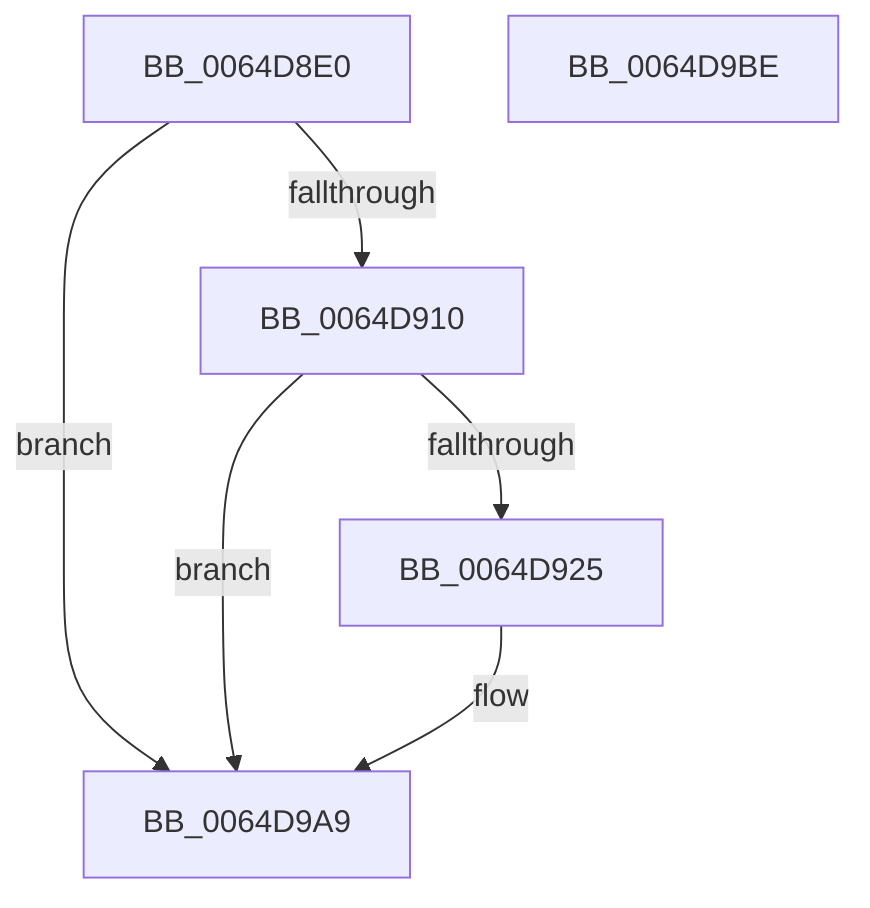

# VmpLogColdHint

- RVA: `0x0064D8E0`–`0x0064D9BF` (길이 `223` bytes)
- VA: `0x000000014064D8E0`
- 실행 섹션: `.text`
- PDB 이름 있음: `예`; PDB Function 태그: `아니요`
- unwind 정보 RVA: `0x000BAEE4`
- 디코드: `48`개 명령, `223/223` bytes 표시
- 미해석 바이트: `0` (있으면 어셈블리에 `.byte`로 보존)

> 이 문서는 커널 이미지의 기계어와 PDB 기호를 분석해 생성했습니다. 4번과 5번은 함수 원형과 자료형을 바이너리 사용 방식에서 추정한 C 해석이며 원본 소스 복구 결과는 아닙니다.

## 1. Dependencies

- 직접 호출 지점: **3**; 고유 호출 대상: **3**
- 직접 호출자로 확인된 함수: **1**
- RIP 상대 이미지 참조: **3**

### Outgoing calls
- `0x0064D918` → [tlgKeywordOn](../42/tlgKeywordOn_function_0042EAA0.md) (function, `0x0042EAA0`)
- `0x0064D9A4` → [tlgWriteEx_EtwWriteEx](../4A/tlgWriteEx_EtwWriteEx_function_004AA348.md) (function, `0x004AA348`)
- `0x0064D9B0` → [_security_check_cookie](../6A/_security_check_cookie_function_006AC640.md) (function, `0x006AC640`)

### Direct callers
- [VmColdPagesHint](../42/VmColdPagesHint_function_00429BB0.md) at `0x00429D49`

### Static image references
- `0x0064D8EE` → RVA `0x00E0A740` (`.data`; read)
- `0x0064D8FC` → RVA `0x00F02458` (`.data`; read)
- `0x0064D969` → RVA `0x00053BF9` (`.rdata`; read)

## 2. Other-region calls and transfers

- 다른 실행 섹션으로 향하는 call: **0**
- 별도 외부 분기/꼬리 이동을 확인하지 못했습니다.

## 3. Assembly (complete function range)

```asm
0064D8E0  40 55                           push rbp
0064D8E2  48 8D 6C 24 A9                  lea rbp, [rsp - 0x57]
0064D8E7  48 81 EC D0 00 00 00            sub rsp, 0xd0
0064D8EE  48 8B 05 4B CE 7B 00            mov rax, qword ptr [rip + 0x7bce4b]
0064D8F5  48 33 C4                        xor rax, rsp
0064D8F8  48 89 45 47                     mov qword ptr [rbp + 0x47], rax
0064D8FC  4C 8B 15 55 4B 8B 00            mov r10, qword ptr [rip + 0x8b4b55]
0064D903  4C 8B DA                        mov r11, rdx
0064D906  41 83 3A 05                     cmp dword ptr [r10], 5
0064D90A  0F 86 99 00 00 00               jbe 0x14064d9a9
0064D910  BA 04 00 00 00                  mov edx, 4
0064D915  49 8B CA                        mov rcx, r10
0064D918  E8 83 11 DE FF                  call 0x14042eaa0
0064D91D  84 C0                           test al, al
0064D91F  0F 84 84 00 00 00               je 0x14064d9a9
0064D925  65 48 8B 04 25 88 01 00 00      mov rax, qword ptr gs:[0x188]
0064D92E  48 8B 88 B8 00 00 00            mov rcx, qword ptr [rax + 0xb8]
0064D935  8B 81 D0 01 00 00               mov eax, dword ptr [rcx + 0x1d0]
0064D93B  49 8B CA                        mov rcx, r10
0064D93E  89 45 C7                        mov dword ptr [rbp - 0x39], eax
0064D941  48 8D 45 C7                     lea rax, [rbp - 0x39]
0064D945  48 89 45 07                     mov qword ptr [rbp + 7], rax
0064D949  48 8D 45 CF                     lea rax, [rbp - 0x31]
0064D94D  48 89 45 17                     mov qword ptr [rbp + 0x17], rax
0064D951  48 8D 45 D7                     lea rax, [rbp - 0x29]
0064D955  48 89 45 27                     mov qword ptr [rbp + 0x27], rax
0064D959  48 8D 45 DF                     lea rax, [rbp - 0x21]
0064D95D  48 89 45 37                     mov qword ptr [rbp + 0x37], rax
0064D961  48 8D 45 E7                     lea rax, [rbp - 0x19]
0064D965  48 89 55 0F                     mov qword ptr [rbp + 0xf], rdx
0064D969  48 8D 15 89 62 A0 FF            lea rdx, [rip - 0x5f9d77]
0064D970  4C 89 4D DF                     mov qword ptr [rbp - 0x21], r9
0064D974  45 33 C9                        xor r9d, r9d
0064D977  48 89 44 24 38                  mov qword ptr [rsp + 0x38], rax
0064D97C  C7 44 24 30 06 00 00 00         mov dword ptr [rsp + 0x30], 6
0064D984  4C 89 5D CF                     mov qword ptr [rbp - 0x31], r11
0064D988  48 C7 45 1F 08 00 00 00         mov qword ptr [rbp + 0x1f], 8
0064D990  4C 89 45 D7                     mov qword ptr [rbp - 0x29], r8
0064D994  48 C7 45 2F 08 00 00 00         mov qword ptr [rbp + 0x2f], 8
0064D99C  48 C7 45 3F 08 00 00 00         mov qword ptr [rbp + 0x3f], 8
0064D9A4  E8 9F C9 E5 FF                  call 0x1404aa348
0064D9A9  48 8B 4D 47                     mov rcx, qword ptr [rbp + 0x47]
0064D9AD  48 33 CC                        xor rcx, rsp
0064D9B0  E8 8B EC 05 00                  call 0x1406ac640
0064D9B5  48 81 C4 D0 00 00 00            add rsp, 0xd0
0064D9BC  5D                              pop rbp
0064D9BD  C3                              ret
0064D9BE  CC                              int3
```

## 4. C-style interpretation (structured pseudocode)

```c
__int64 __fastcall VmpLogColdHint(__int64 a1, __int64 a2, __int64 a3, __int64 a4)
{
    __int64 result;
    __int64 v_rsp;
    unsigned __int64 v_stack_m18;
    unsigned __int64 v_stack_m20;
    unsigned __int64 v_stack_m28;
    unsigned __int64 v_stack_m30;
    unsigned __int64 v_stack_m38;
    unsigned __int64 v_stack_m40;
    unsigned __int64 v_stack_m48;
    unsigned __int64 v_stack_m50;
    unsigned __int64 v_stack_m58;
    unsigned __int64 v_stack_m5F;
    unsigned __int64 v_stack_m78;
    unsigned __int64 v_stack_m80;
    unsigned __int64 v_stack_m88;
    unsigned __int64 v_stack_m90;
    unsigned int v_stack_m98;
    unsigned __int64 v_stack_mA0;
    unsigned int v_stack_mA8;

    v_rsp = (v_rsp) - (208);
    result = (*(unsigned __int64 *)(v_rip + 8113739)) ^ (v_rsp);
    v_stack_m18 = result;
    if ((*(unsigned int *)(*(unsigned __int64 *)(v_rip + 9128789))) <= 5) goto loc_0064D9A9;
    result = tlgKeywordOn(*(unsigned __int64 *)(v_rip + 9128789), 4, a3, a4);
    if ((unsigned __int8)(result) != 0) {
        result = *(unsigned __int64 *)(gs_base + (0 + 392));
        a1 = *(unsigned __int64 *)(result + 184);
        result = *(unsigned int *)(a1 + 464);
        a1 = *(unsigned __int64 *)(v_rip + 9128789);
        v_stack_m98 = (unsigned int)(result);
        result = v_stack_m98;
        v_stack_m58 = result;
        result = v_stack_m90;
        v_stack_m48 = result;
        result = v_stack_m88;
        v_stack_m38 = result;
        result = v_stack_m80;
        v_stack_m28 = result;
        result = v_stack_m78;
        v_stack_m50 = 4;
        a2 = v_rip - 6266231;
        v_stack_m80 = a4;
        a4 = 0;
        v_stack_mA0 = result;
        v_stack_mA8 = 6;
        v_stack_m90 = a2;
        v_stack_m40 = 8;
        v_stack_m88 = a3;
        v_stack_m30 = 8;
        v_stack_m20 = 8;
        result = tlgWriteEx_EtwWriteEx(a1, a2, a3, a4);
    }
    a1 = (v_stack_m18) ^ (v_rsp);
    result = _security_check_cookie(a1, a2, a3, a4);
    v_rsp = (v_rsp) + (208);
    return result;
}
```

## 5. (Beta) C Style

```c
int64_t VmpLogColdHint(int64_t Arg1, int64_t Arg2, int64_t Arg3, int64_t Arg4)
{
    int64_t result;
    int64_t local_rsp;
    uint64_t v_stack_m18;
    uint64_t v_stack_m20;
    uint64_t v_stack_m28;
    uint64_t v_stack_m30;
    uint64_t v_stack_m38;
    uint64_t v_stack_m40;
    uint64_t v_stack_m48;
    uint64_t v_stack_m50;
    uint64_t v_stack_m58;
    uint64_t v_stack_m5F;
    uint64_t v_stack_m78;
    uint64_t v_stack_m80;
    uint64_t v_stack_m88;
    uint64_t v_stack_m90;
    uint32_t v_stack_m98;
    uint64_t v_stack_mA0;
    uint32_t v_stack_mA8;

    local_rsp = (local_rsp) - (208);
    result = (*(uint64_t *)(v_rip + 0x7BCE4B)) ^ (local_rsp);
    v_stack_m18 = result;
    if ((*(uint32_t *)(*(uint64_t *)(v_rip + 0x8B4B55))) <= 5) goto loc_0064D9A9;
    result = tlgKeywordOn(*(uint64_t *)(v_rip + 0x8B4B55), 4, Arg3, Arg4);
    if ((uint8_t)(result) != 0) {
        result = *(uint64_t *)(gs_base + (0 + 0x188));
        Arg1 = *(uint64_t *)(result + 0xB8);
        result = *(uint32_t *)(Arg1 + 0x1D0);
        Arg1 = *(uint64_t *)(v_rip + 0x8B4B55);
        v_stack_m98 = (uint32_t)(result);
        result = v_stack_m98;
        v_stack_m58 = result;
        result = v_stack_m90;
        v_stack_m48 = result;
        result = v_stack_m88;
        v_stack_m38 = result;
        result = v_stack_m80;
        v_stack_m28 = result;
        result = v_stack_m78;
        v_stack_m50 = 4;
        Arg2 = v_rip - 6266231;
        v_stack_m80 = Arg4;
        Arg4 = 0;
        v_stack_mA0 = result;
        v_stack_mA8 = 6;
        v_stack_m90 = Arg2;
        v_stack_m40 = 8;
        v_stack_m88 = Arg3;
        v_stack_m30 = 8;
        v_stack_m20 = 8;
        result = tlgWriteEx_EtwWriteEx(Arg1, Arg2, Arg3, Arg4);
    }
    Arg1 = (v_stack_m18) ^ (local_rsp);
    result = _security_check_cookie(Arg1, Arg2, Arg3, Arg4);
    local_rsp = (local_rsp) + (208);
    return result;
}
```

## 6. Execution-region graph

[열기: 2D/3D 그래프와 함수 탐색 컨트롤 패널](../../../control-panel.html?section=text&rva=0x0064D8E0&view=graph)

- 2D 그래프는 위에서 아래로 흐르고, 3D 그래프는 빈 공간을 드래그해 회전합니다. Shift+드래그는 이동, 휠은 확대·축소, 함수 노드 선택은 대상 보고서 이동입니다.

### Static fallback


