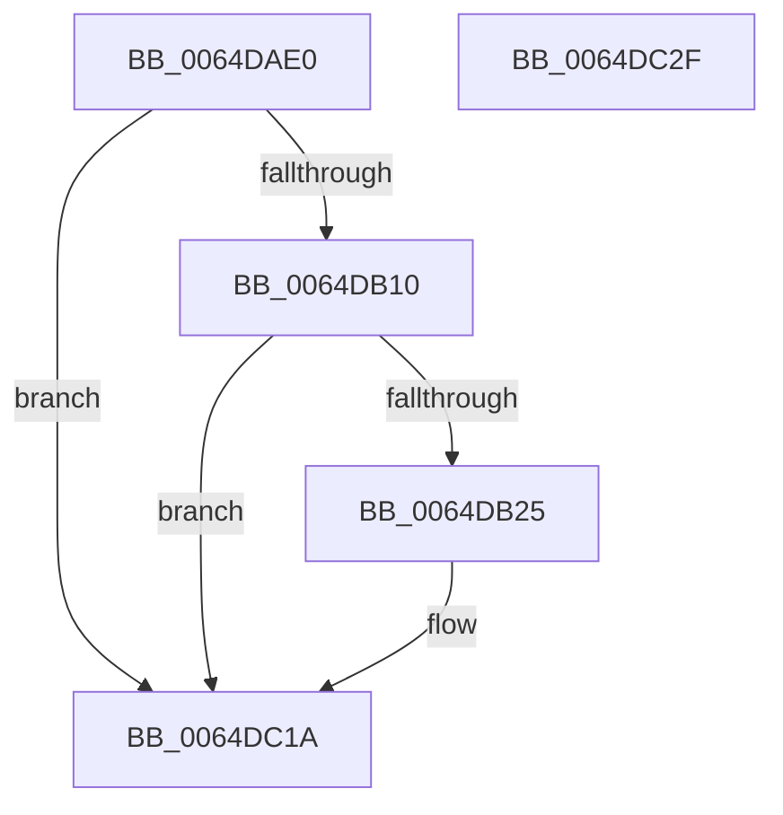

# VmpLogQueryAccessedState

- RVA: `0x0064DAE0`–`0x0064DC30` (길이 `336` bytes)
- VA: `0x000000014064DAE0`
- 실행 섹션: `.text`
- PDB 이름 있음: `예`; PDB Function 태그: `아니요`
- unwind 정보 RVA: `0x000CC6F8`
- 디코드: `68`개 명령, `336/336` bytes 표시
- 미해석 바이트: `0` (있으면 어셈블리에 `.byte`로 보존)

> 이 문서는 커널 이미지의 기계어와 PDB 기호를 분석해 생성했습니다. 4번과 5번은 함수 원형과 자료형을 바이너리 사용 방식에서 추정한 C 해석이며 원본 소스 복구 결과는 아닙니다.

## 1. Dependencies

- 직접 호출 지점: **3**; 고유 호출 대상: **3**
- 직접 호출자로 확인된 함수: **1**
- RIP 상대 이미지 참조: **3**

### Outgoing calls
- `0x0064DB18` → [tlgKeywordOn](../42/tlgKeywordOn_function_0042EAA0.md) (function, `0x0042EAA0`)
- `0x0064DC15` → [tlgWriteEx_EtwWriteEx](../4A/tlgWriteEx_EtwWriteEx_function_004AA348.md) (function, `0x004AA348`)
- `0x0064DC21` → [_security_check_cookie](../6A/_security_check_cookie_function_006AC640.md) (function, `0x006AC640`)

### Direct callers
- [sub_006EDFF2](../6E/Unknown_function_006EDFF2.md) at `0x006EE0B3`

### Static image references
- `0x0064DAEE` → RVA `0x00E0A740` (`.data`; read)
- `0x0064DAFC` → RVA `0x00F02458` (`.data`; read)
- `0x0064DB2E` → RVA `0x000533DE` (`.rdata`; read)

## 2. Other-region calls and transfers

- 다른 실행 섹션으로 향하는 call: **0**
- 별도 외부 분기/꼬리 이동을 확인하지 못했습니다.

## 3. Assembly (complete function range)

```asm
0064DAE0  40 55                           push rbp
0064DAE2  48 8D 6C 24 E0                  lea rbp, [rsp - 0x20]
0064DAE7  48 81 EC 20 01 00 00            sub rsp, 0x120
0064DAEE  48 8B 05 4B CC 7B 00            mov rax, qword ptr [rip + 0x7bcc4b]
0064DAF5  48 33 C4                        xor rax, rsp
0064DAF8  48 89 45 10                     mov qword ptr [rbp + 0x10], rax
0064DAFC  4C 8B 15 55 49 8B 00            mov r10, qword ptr [rip + 0x8b4955]
0064DB03  44 8B DA                        mov r11d, edx
0064DB06  41 83 3A 05                     cmp dword ptr [r10], 5
0064DB0A  0F 86 0A 01 00 00               jbe 0x14064dc1a
0064DB10  BA 00 02 00 00                  mov edx, 0x200
0064DB15  49 8B CA                        mov rcx, r10
0064DB18  E8 83 0F DE FF                  call 0x14042eaa0
0064DB1D  84 C0                           test al, al
0064DB1F  0F 84 F5 00 00 00               je 0x14064dc1a
0064DB25  65 48 8B 04 25 88 01 00 00      mov rax, qword ptr gs:[0x188]
0064DB2E  48 8D 15 A9 58 A0 FF            lea rdx, [rip - 0x5fa757]
0064DB35  48 8B 88 B8 00 00 00            mov rcx, qword ptr [rax + 0xb8]
0064DB3C  8B 81 D0 01 00 00               mov eax, dword ptr [rcx + 0x1d0]
0064DB42  49 8B CA                        mov rcx, r10
0064DB45  89 44 24 40                     mov dword ptr [rsp + 0x40], eax
0064DB49  48 8D 44 24 40                  lea rax, [rsp + 0x40]
0064DB4E  48 89 45 90                     mov qword ptr [rbp - 0x70], rax
0064DB52  48 8D 44 24 44                  lea rax, [rsp + 0x44]
0064DB57  48 89 45 A0                     mov qword ptr [rbp - 0x60], rax
0064DB5B  48 8D 44 24 48                  lea rax, [rsp + 0x48]
0064DB60  48 89 45 B0                     mov qword ptr [rbp - 0x50], rax
0064DB64  8B 45 50                        mov eax, dword ptr [rbp + 0x50]
0064DB67  89 44 24 4C                     mov dword ptr [rsp + 0x4c], eax
0064DB6B  48 8D 44 24 4C                  lea rax, [rsp + 0x4c]
0064DB70  48 89 45 C0                     mov qword ptr [rbp - 0x40], rax
0064DB74  48 8D 44 24 50                  lea rax, [rsp + 0x50]
0064DB79  48 89 45 D0                     mov qword ptr [rbp - 0x30], rax
0064DB7D  8B 45 58                        mov eax, dword ptr [rbp + 0x58]
0064DB80  89 44 24 54                     mov dword ptr [rsp + 0x54], eax
0064DB84  48 8D 44 24 54                  lea rax, [rsp + 0x54]
0064DB89  48 89 45 E0                     mov qword ptr [rbp - 0x20], rax
0064DB8D  48 8B 45 60                     mov rax, qword ptr [rbp + 0x60]
0064DB91  48 89 44 24 58                  mov qword ptr [rsp + 0x58], rax
0064DB96  48 8D 44 24 58                  lea rax, [rsp + 0x58]
0064DB9B  48 89 45 F0                     mov qword ptr [rbp - 0x10], rax
0064DB9F  48 8B 45 68                     mov rax, qword ptr [rbp + 0x68]
0064DBA3  48 89 44 24 60                  mov qword ptr [rsp + 0x60], rax
0064DBA8  48 8D 44 24 60                  lea rax, [rsp + 0x60]
0064DBAD  48 89 45 00                     mov qword ptr [rbp], rax
0064DBB1  48 8D 44 24 70                  lea rax, [rsp + 0x70]
0064DBB6  44 89 4C 24 50                  mov dword ptr [rsp + 0x50], r9d
0064DBBB  45 33 C9                        xor r9d, r9d
0064DBBE  48 89 44 24 38                  mov qword ptr [rsp + 0x38], rax
0064DBC3  C7 44 24 30 0A 00 00 00         mov dword ptr [rsp + 0x30], 0xa
0064DBCB  48 C7 45 98 04 00 00 00         mov qword ptr [rbp - 0x68], 4
0064DBD3  44 89 5C 24 44                  mov dword ptr [rsp + 0x44], r11d
0064DBD8  48 C7 45 A8 04 00 00 00         mov qword ptr [rbp - 0x58], 4
0064DBE0  44 89 44 24 48                  mov dword ptr [rsp + 0x48], r8d
0064DBE5  48 C7 45 B8 04 00 00 00         mov qword ptr [rbp - 0x48], 4
0064DBED  48 C7 45 C8 04 00 00 00         mov qword ptr [rbp - 0x38], 4
0064DBF5  48 C7 45 D8 04 00 00 00         mov qword ptr [rbp - 0x28], 4
0064DBFD  48 C7 45 E8 04 00 00 00         mov qword ptr [rbp - 0x18], 4
0064DC05  48 C7 45 F8 08 00 00 00         mov qword ptr [rbp - 8], 8
0064DC0D  48 C7 45 08 08 00 00 00         mov qword ptr [rbp + 8], 8
0064DC15  E8 2E C7 E5 FF                  call 0x1404aa348
0064DC1A  48 8B 4D 10                     mov rcx, qword ptr [rbp + 0x10]
0064DC1E  48 33 CC                        xor rcx, rsp
0064DC21  E8 1A EA 05 00                  call 0x1406ac640
0064DC26  48 81 C4 20 01 00 00            add rsp, 0x120
0064DC2D  5D                              pop rbp
0064DC2E  C3                              ret
0064DC2F  CC                              int3
```

## 4. C-style interpretation (structured pseudocode)

```c
__int64 __fastcall VmpLogQueryAccessedState(__int64 a1, int a2, int a3, int a4, unsigned int a5, unsigned int a6, __int64 a7, __int64 a8)
{
    __int64 result;
    __int64 v_rsp;
    unsigned __int64 v_stack_m18;
    unsigned __int64 v_stack_m20;
    unsigned __int64 v_stack_m28;
    unsigned __int64 v_stack_m30;
    unsigned __int64 v_stack_m38;
    unsigned __int64 v_stack_m40;
    unsigned __int64 v_stack_m48;
    unsigned __int64 v_stack_m50;
    unsigned __int64 v_stack_m58;
    unsigned __int64 v_stack_m60;
    unsigned __int64 v_stack_m68;
    unsigned __int64 v_stack_m70;
    unsigned __int64 v_stack_m78;
    unsigned __int64 v_stack_m80;
    unsigned __int64 v_stack_m88;
    unsigned __int64 v_stack_m90;
    unsigned __int64 v_stack_m98;
    unsigned __int64 v_stack_mB8;
    unsigned __int64 v_stack_mC8;
    unsigned __int64 v_stack_mD0;
    unsigned int v_stack_mD4;
    unsigned __int64 v_stack_mD8;
    unsigned int v_stack_mDC;
    unsigned __int64 v_stack_mE0;
    unsigned __int64 v_stack_mE4;
    unsigned int v_stack_mE8;
    unsigned __int64 v_stack_mF0;
    unsigned int v_stack_mF8;

    v_rsp = (v_rsp) - (288);
    result = (*(unsigned __int64 *)(v_rip + 8113227)) ^ (v_rsp);
    v_stack_m18 = result;
    if ((*(unsigned int *)(*(unsigned __int64 *)(v_rip + 9128277))) <= 5) goto loc_0064DC1A;
    result = tlgKeywordOn(*(unsigned __int64 *)(v_rip + 9128277), 512, a3, a4);
    if ((unsigned __int8)(result) != 0) {
        result = *(unsigned __int64 *)(gs_base + (0 + 392));
        a2 = v_rip - 6268759;
        a1 = *(unsigned __int64 *)(result + 184);
        result = *(unsigned int *)(a1 + 464);
        a1 = *(unsigned __int64 *)(v_rip + 9128277);
        v_stack_mE8 = (unsigned int)(result);
        result = v_stack_mE8;
        v_stack_m98 = result;
        result = v_stack_mE4;
        v_stack_m88 = result;
        result = v_stack_mE0;
        v_stack_m78 = result;
        result = a5;
        v_stack_mDC = (unsigned int)(result);
        result = v_stack_mDC;
        v_stack_m68 = result;
        result = v_stack_mD8;
        v_stack_m58 = result;
        result = a6;
        v_stack_mD4 = (unsigned int)(result);
        result = v_stack_mD4;
        v_stack_m48 = result;
        result = a7;
        v_stack_mD0 = result;
        result = v_stack_mD0;
        v_stack_m38 = result;
        result = a8;
        v_stack_mC8 = result;
        result = v_stack_mC8;
        v_stack_m28 = result;
        result = v_stack_mB8;
        v_stack_mD8 = a4;
        a4 = 0;
        v_stack_mF0 = result;
        v_stack_mF8 = 10;
        v_stack_m90 = 4;
        v_stack_mE4 = (unsigned int)((unsigned int)(a2));
        v_stack_m80 = 4;
        v_stack_mE0 = a3;
        v_stack_m70 = 4;
        v_stack_m60 = 4;
        v_stack_m50 = 4;
        v_stack_m40 = 4;
        v_stack_m30 = 8;
        v_stack_m20 = 8;
        result = tlgWriteEx_EtwWriteEx(a1, a2, a3, a4);
    }
    a1 = (v_stack_m18) ^ (v_rsp);
    result = _security_check_cookie(a1, a2, a3, a4);
    v_rsp = (v_rsp) + (288);
    return result;
}
```

## 5. (Beta) C Style

```c
int64_t VmpLogQueryAccessedState(int64_t Arg1, int32_t Arg2, int32_t Arg3, int32_t Arg4, uint32_t Arg5, uint32_t Arg6, int64_t Arg7, int64_t Arg8)
{
    int64_t result;
    int64_t local_rsp;
    uint64_t v_stack_m18;
    uint64_t v_stack_m20;
    uint64_t v_stack_m28;
    uint64_t v_stack_m30;
    uint64_t v_stack_m38;
    uint64_t v_stack_m40;
    uint64_t v_stack_m48;
    uint64_t v_stack_m50;
    uint64_t v_stack_m58;
    uint64_t v_stack_m60;
    uint64_t v_stack_m68;
    uint64_t v_stack_m70;
    uint64_t v_stack_m78;
    uint64_t v_stack_m80;
    uint64_t v_stack_m88;
    uint64_t v_stack_m90;
    uint64_t v_stack_m98;
    uint64_t v_stack_mB8;
    uint64_t v_stack_mC8;
    uint64_t v_stack_mD0;
    uint32_t v_stack_mD4;
    uint64_t v_stack_mD8;
    uint32_t v_stack_mDC;
    uint64_t v_stack_mE0;
    uint64_t v_stack_mE4;
    uint32_t v_stack_mE8;
    uint64_t v_stack_mF0;
    uint32_t v_stack_mF8;

    local_rsp = (local_rsp) - (288);
    result = (*(uint64_t *)(v_rip + 0x7BCC4B)) ^ (local_rsp);
    v_stack_m18 = result;
    if ((*(uint32_t *)(*(uint64_t *)(v_rip + 0x8B4955))) <= 5) goto loc_0064DC1A;
    result = tlgKeywordOn(*(uint64_t *)(v_rip + 0x8B4955), 512, Arg3, Arg4);
    if ((uint8_t)(result) != 0) {
        result = *(uint64_t *)(gs_base + (0 + 0x188));
        Arg2 = v_rip - 6268759;
        Arg1 = *(uint64_t *)(result + 0xB8);
        result = *(uint32_t *)(Arg1 + 0x1D0);
        Arg1 = *(uint64_t *)(v_rip + 0x8B4955);
        v_stack_mE8 = (uint32_t)(result);
        result = v_stack_mE8;
        v_stack_m98 = result;
        result = v_stack_mE4;
        v_stack_m88 = result;
        result = v_stack_mE0;
        v_stack_m78 = result;
        result = Arg5;
        v_stack_mDC = (uint32_t)(result);
        result = v_stack_mDC;
        v_stack_m68 = result;
        result = v_stack_mD8;
        v_stack_m58 = result;
        result = Arg6;
        v_stack_mD4 = (uint32_t)(result);
        result = v_stack_mD4;
        v_stack_m48 = result;
        result = Arg7;
        v_stack_mD0 = result;
        result = v_stack_mD0;
        v_stack_m38 = result;
        result = Arg8;
        v_stack_mC8 = result;
        result = v_stack_mC8;
        v_stack_m28 = result;
        result = v_stack_mB8;
        v_stack_mD8 = Arg4;
        Arg4 = 0;
        v_stack_mF0 = result;
        v_stack_mF8 = 10;
        v_stack_m90 = 4;
        v_stack_mE4 = (uint32_t)((uint32_t)(Arg2));
        v_stack_m80 = 4;
        v_stack_mE0 = Arg3;
        v_stack_m70 = 4;
        v_stack_m60 = 4;
        v_stack_m50 = 4;
        v_stack_m40 = 4;
        v_stack_m30 = 8;
        v_stack_m20 = 8;
        result = tlgWriteEx_EtwWriteEx(Arg1, Arg2, Arg3, Arg4);
    }
    Arg1 = (v_stack_m18) ^ (local_rsp);
    result = _security_check_cookie(Arg1, Arg2, Arg3, Arg4);
    local_rsp = (local_rsp) + (288);
    return result;
}
```

## 6. Execution-region graph

[열기: 2D/3D 그래프와 함수 탐색 컨트롤 패널](../../../control-panel.html?section=text&rva=0x0064DAE0&view=graph)

- 2D 그래프는 위에서 아래로 흐르고, 3D 그래프는 빈 공간을 드래그해 회전합니다. Shift+드래그는 이동, 휠은 확대·축소, 함수 노드 선택은 대상 보고서 이동입니다.

### Static fallback


