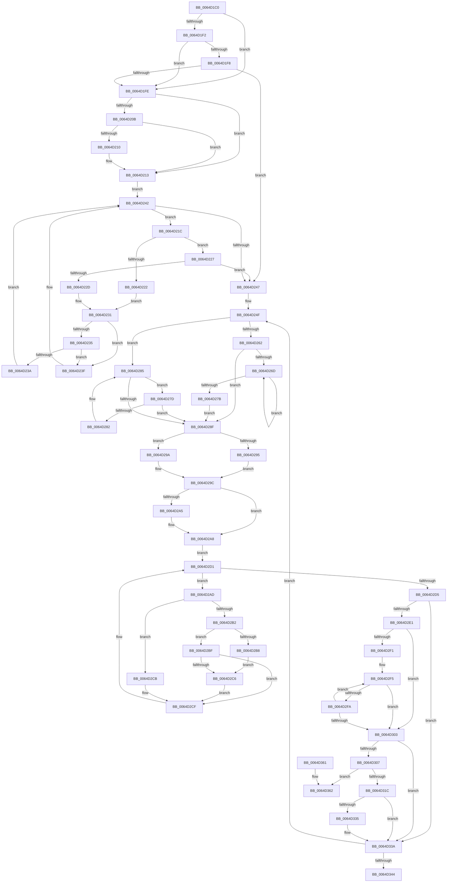

# VmpRefDerefPinnedPages

- RVA: `0x0064D1C0`–`0x0064D369` (길이 `425` bytes)
- VA: `0x000000014064D1C0`
- 실행 섹션: `.text`
- PDB 이름 있음: `예`; PDB Function 태그: `아니요`
- unwind 정보 RVA: `0x000D2DD0`
- 디코드: `143`개 명령, `425/425` bytes 표시
- 미해석 바이트: `0` (있으면 어셈블리에 `.byte`로 보존)

> 이 문서는 커널 이미지의 기계어와 PDB 기호를 분석해 생성했습니다. 4번과 5번은 함수 원형과 자료형을 바이너리 사용 방식에서 추정한 C 해석이며 원본 소스 복구 결과는 아닙니다.

## 1. Dependencies

- 직접 호출 지점: **1**; 고유 호출 대상: **1**
- 직접 호출자로 확인된 함수: **2**
- RIP 상대 이미지 참조: **0**

### Outgoing calls
- `0x0064D30E` → [RtlRbRemoveNode](../2E/RtlRbRemoveNode_function_002E4C10.md) (function, `0x002E4C10`)

### Direct callers
- [VmpCheckPinAndReference](VmpCheckPinAndReference_function_0064C44C.md) at `0x0064C4F8`
- [VmpCheckUnpinAndDereference](VmpCheckUnpinAndDereference_function_0064C540.md) at `0x0064C608`

### Static image references
- 디코드된 RIP-relative 메모리 참조가 없습니다.

## 2. Other-region calls and transfers

- 다른 실행 섹션으로 향하는 call: **0**
- 별도 외부 분기/꼬리 이동을 확인하지 못했습니다.

## 3. Assembly (complete function range)

```asm
0064D1C0  48 8B C4                        mov rax, rsp
0064D1C3  48 89 58 08                     mov qword ptr [rax + 8], rbx
0064D1C7  48 89 68 10                     mov qword ptr [rax + 0x10], rbp
0064D1CB  48 89 70 18                     mov qword ptr [rax + 0x18], rsi
0064D1CF  44 89 48 20                     mov dword ptr [rax + 0x20], r9d
0064D1D3  57                              push rdi
0064D1D4  41 54                           push r12
0064D1D6  41 55                           push r13
0064D1D8  41 56                           push r14
0064D1DA  41 57                           push r15
0064D1DC  48 83 EC 20                     sub rsp, 0x20
0064D1E0  48 8B 59 38                     mov rbx, qword ptr [rcx + 0x38]
0064D1E4  4D 8B E8                        mov r13, r8
0064D1E7  48 8B F2                        mov rsi, rdx
0064D1EA  4C 8B F9                        mov r15, rcx
0064D1ED  48 85 DB                        test rbx, rbx
0064D1F0  74 0C                           je 0x14064d1fe
0064D1F2  48 3B 53 18                     cmp rdx, qword ptr [rbx + 0x18]
0064D1F6  72 06                           jb 0x14064d1fe
0064D1F8  48 3B 53 20                     cmp rdx, qword ptr [rbx + 0x20]
0064D1FC  76 49                           jbe 0x14064d247
0064D1FE  48 83 C1 28                     add rcx, 0x28
0064D202  F6 41 08 01                     test byte ptr [rcx + 8], 1
0064D206  48 8B 19                        mov rbx, qword ptr [rcx]
0064D209  74 08                           je 0x14064d213
0064D20B  48 85 DB                        test rbx, rbx
0064D20E  74 03                           je 0x14064d213
0064D210  48 33 D9                        xor rbx, rcx
0064D213  0F B6 51 08                     movzx edx, byte ptr [rcx + 8]
0064D217  83 E2 01                        and edx, 1
0064D21A  EB 26                           jmp 0x14064d242
0064D21C  48 3B 73 18                     cmp rsi, qword ptr [rbx + 0x18]
0064D220  73 05                           jae 0x14064d227
0064D222  48 8B 03                        mov rax, qword ptr [rbx]
0064D225  EB 0A                           jmp 0x14064d231
0064D227  48 3B 73 20                     cmp rsi, qword ptr [rbx + 0x20]
0064D22B  76 1A                           jbe 0x14064d247
0064D22D  48 8B 43 08                     mov rax, qword ptr [rbx + 8]
0064D231  85 D2                           test edx, edx
0064D233  74 0A                           je 0x14064d23f
0064D235  48 85 C0                        test rax, rax
0064D238  74 05                           je 0x14064d23f
0064D23A  48 33 D8                        xor rbx, rax
0064D23D  EB 03                           jmp 0x14064d242
0064D23F  48 8B D8                        mov rbx, rax
0064D242  48 85 DB                        test rbx, rbx
0064D245  75 D5                           jne 0x14064d21c
0064D247  48 8B 6C 24 70                  mov rbp, qword ptr [rsp + 0x70]
0064D24C  45 33 F6                        xor r14d, r14d
0064D24F  4C 8D 63 08                     lea r12, [rbx + 8]
0064D253  48 8B FB                        mov rdi, rbx
0064D256  49 8B 04 24                     mov rax, qword ptr [r12]
0064D25A  48 8B CB                        mov rcx, rbx
0064D25D  48 85 C0                        test rax, rax
0064D260  74 23                           je 0x14064d285
0064D262  48 8B 08                        mov rcx, qword ptr [rax]
0064D265  48 8B D8                        mov rbx, rax
0064D268  48 85 C9                        test rcx, rcx
0064D26B  74 22                           je 0x14064d28f
0064D26D  48 8B 01                        mov rax, qword ptr [rcx]
0064D270  48 8B D9                        mov rbx, rcx
0064D273  48 8B C8                        mov rcx, rax
0064D276  48 85 C0                        test rax, rax
0064D279  75 F2                           jne 0x14064d26d
0064D27B  EB 12                           jmp 0x14064d28f
0064D27D  48 39 0B                        cmp qword ptr [rbx], rcx
0064D280  74 0D                           je 0x14064d28f
0064D282  48 8B CB                        mov rcx, rbx
0064D285  48 8B 5B 10                     mov rbx, qword ptr [rbx + 0x10]
0064D289  48 83 E3 FC                     and rbx, 0xfffffffffffffffc
0064D28D  75 EE                           jne 0x14064d27d
0064D28F  48 3B 77 18                     cmp rsi, qword ptr [rdi + 0x18]
0064D293  76 05                           jbe 0x14064d29a
0064D295  2B 77 18                        sub esi, dword ptr [rdi + 0x18]
0064D298  EB 02                           jmp 0x14064d29c
0064D29A  33 F6                           xor esi, esi
0064D29C  41 8B CD                        mov ecx, r13d
0064D29F  4C 3B 6F 20                     cmp r13, qword ptr [rdi + 0x20]
0064D2A3  72 03                           jb 0x14064d2a8
0064D2A5  8B 4F 20                        mov ecx, dword ptr [rdi + 0x20]
0064D2A8  2B 4F 18                        sub ecx, dword ptr [rdi + 0x18]
0064D2AB  EB 24                           jmp 0x14064d2d1
0064D2AD  48 85 ED                        test rbp, rbp
0064D2B0  74 19                           je 0x14064d2cb
0064D2B2  41 F6 C1 01                     test r9b, 1
0064D2B6  74 07                           je 0x14064d2bf
0064D2B8  C6 44 3E 28 00                  mov byte ptr [rsi + rdi + 0x28], 0
0064D2BD  EB 07                           jmp 0x14064d2c6
0064D2BF  80 44 3E 28 FF                  add byte ptr [rsi + rdi + 0x28], 0xff
0064D2C4  75 09                           jne 0x14064d2cf
0064D2C6  49 FF C6                        inc r14
0064D2C9  EB 04                           jmp 0x14064d2cf
0064D2CB  FE 44 3E 28                     inc byte ptr [rsi + rdi + 0x28]
0064D2CF  FF C6                           inc esi
0064D2D1  3B F1                           cmp esi, ecx
0064D2D3  76 D8                           jbe 0x14064d2ad
0064D2D5  48 8B 77 20                     mov rsi, qword ptr [rdi + 0x20]
0064D2D9  48 FF C6                        inc rsi
0064D2DC  4D 85 F6                        test r14, r14
0064D2DF  74 59                           je 0x14064d33a
0064D2E1  8B 4F 20                        mov ecx, dword ptr [rdi + 0x20]
0064D2E4  BA 00 00 00 00                  mov edx, 0
0064D2E9  2B 4F 18                        sub ecx, dword ptr [rdi + 0x18]
0064D2EC  83 C1 01                        add ecx, 1
0064D2EF  74 12                           je 0x14064d303
0064D2F1  48 8D 47 28                     lea rax, [rdi + 0x28]
0064D2F5  80 38 00                        cmp byte ptr [rax], 0
0064D2F8  75 09                           jne 0x14064d303
0064D2FA  FF C2                           inc edx
0064D2FC  48 FF C0                        inc rax
0064D2FF  3B D1                           cmp edx, ecx
0064D301  72 F2                           jb 0x14064d2f5
0064D303  3B D1                           cmp edx, ecx
0064D305  75 33                           jne 0x14064d33a
0064D307  49 8D 4F 28                     lea rcx, [r15 + 0x28]
0064D30B  48 8B D7                        mov rdx, rdi
0064D30E  E8 FD 78 C9 FF                  call 0x1402e4c10
0064D313  48 8B 45 08                     mov rax, qword ptr [rbp + 8]
0064D317  48 39 28                        cmp qword ptr [rax], rbp
0064D31A  75 46                           jne 0x14064d362
0064D31C  44 8B 4C 24 68                  mov r9d, dword ptr [rsp + 0x68]
0064D321  48 89 2F                        mov qword ptr [rdi], rbp
0064D324  49 89 04 24                     mov qword ptr [r12], rax
0064D328  48 89 38                        mov qword ptr [rax], rdi
0064D32B  48 89 7D 08                     mov qword ptr [rbp + 8], rdi
0064D32F  49 39 7F 38                     cmp qword ptr [r15 + 0x38], rdi
0064D333  75 05                           jne 0x14064d33a
0064D335  49 83 67 38 00                  and qword ptr [r15 + 0x38], 0
0064D33A  4C 3B 6F 20                     cmp r13, qword ptr [rdi + 0x20]
0064D33E  0F 87 0B FF FF FF               ja 0x14064d24f
0064D344  48 8B 5C 24 50                  mov rbx, qword ptr [rsp + 0x50]
0064D349  48 8B 6C 24 58                  mov rbp, qword ptr [rsp + 0x58]
0064D34E  48 8B 74 24 60                  mov rsi, qword ptr [rsp + 0x60]
0064D353  48 83 C4 20                     add rsp, 0x20
0064D357  41 5F                           pop r15
0064D359  41 5E                           pop r14
0064D35B  41 5D                           pop r13
0064D35D  41 5C                           pop r12
0064D35F  5F                              pop rdi
0064D360  C3                              ret
0064D361  CC                              int3
0064D362  B9 03 00 00 00                  mov ecx, 3
0064D367  CD 29                           int 0x29
```

## 4. C-style interpretation (structured pseudocode)

```c
__int64 __fastcall VmpRefDerefPinnedPages(__int64 a1, __int64 a2, __int64 a3, int a4, __int64 a5)
{
    __int64 result;
    __int64 v_r14;
    __int64 v_rbx;
    __int64 v_rsi;
    __int64 v_rsp;
    unsigned __int64 v_stack_p10;
    unsigned __int64 v_stack_p18;
    unsigned int v_stack_p20;
    unsigned __int64 v_stack_p8;

    *(unsigned __int64 *)(v_rsp + 8) = v_rbx;
    *(unsigned __int64 *)(v_rsp + 16) = v_rbp;
    *(unsigned __int64 *)(v_rsp + 24) = v_rsi;
    *(unsigned int *)(v_rsp + 32) = a4;
    v_rsp = (v_rsp) - (32);
    if (*(unsigned __int64 *)(a1 + 56) == 0) goto loc_0064D1FE;
    if (a2 < (*(unsigned __int64 *)(*(unsigned __int64 *)(a1 + 56) + 24))) goto loc_0064D1FE;
    if (a2 <= (*(unsigned __int64 *)(*(unsigned __int64 *)(a1 + 56) + 32))) goto loc_0064D247;
loc_0064D1FE:
    a1 = (a1) + (40);
    if (((*(unsigned __int8 *)(a1 + 8)) & (1)) == 0) goto loc_0064D213;
    v_rbx = *(unsigned __int64 *)(a1);
    if (*(unsigned __int64 *)(a1) != 0) {
        v_rbx = (*(unsigned __int64 *)(a1)) ^ (a1);
    }
    a2 = (unsigned int)((*(unsigned __int8 *)(a1 + 8)) & (1));
    goto loc_0064D242;
loc_0064D21C:
    if (a2 >= (*(unsigned __int64 *)(v_rbx + 24))) goto loc_0064D227;
    goto loc_0064D231;
loc_0064D227:
    if (a2 <= (*(unsigned __int64 *)(v_rbx + 32))) goto loc_0064D247;
loc_0064D231:
    if ((unsigned int)(a2) == 0) goto loc_0064D23F;
    if (*(unsigned __int64 *)(v_rbx + 8) == 0) goto loc_0064D23F;
    v_rbx = (v_rbx) ^ (*(unsigned __int64 *)(v_rbx + 8));
    goto loc_0064D242;
loc_0064D23F:
loc_0064D242:
    if (*(unsigned __int64 *)(v_rbx + 8) != 0) goto loc_0064D21C;
loc_0064D247:
    v_r14 = 0;
loc_0064D24F:
    if (*(unsigned __int64 *)(*(unsigned __int64 *)(v_rbx + 8) + 8) == 0) goto loc_0064D285;
    if (*(unsigned __int64 *)(*(unsigned __int64 *)(*(unsigned __int64 *)(v_rbx + 8) + 8)) == 0) goto loc_0064D28F;
loc_0064D26D:
    if (*(unsigned __int64 *)(*(unsigned __int64 *)(*(unsigned __int64 *)(*(unsigned __int64 *)(v_rbx + 8) + 8))) != 0) goto loc_0064D26D;
    goto loc_0064D28F;
loc_0064D27D:
    if ((*(unsigned __int64 *)(*(unsigned __int64 *)(*(unsigned __int64 *)(*(unsigned __int64 *)(v_rbx + 8) + 8)))) == (*(unsigned __int64 *)(*(unsigned __int64 *)(*(unsigned __int64 *)(*(unsigned __int64 *)(v_rbx + 8) + 8))))) goto loc_0064D28F;
loc_0064D285:
    v_rbx = (*(unsigned __int64 *)(*(unsigned __int64 *)(*(unsigned __int64 *)(*(unsigned __int64 *)(v_rbx + 8) + 8)) + 16)) & (-4);
    if (condition_is_not_equal) goto loc_0064D27D;
loc_0064D28F:
    if (a2 <= (*(unsigned __int64 *)(*(unsigned __int64 *)(v_rbx + 8) + 24))) goto loc_0064D29A;
    v_rsi = (unsigned int)((a2) - (*(unsigned int *)(*(unsigned __int64 *)(v_rbx + 8) + 24)));
    goto loc_0064D29C;
loc_0064D29A:
    v_rsi = 0;
loc_0064D29C:
    if (a3 >= (*(unsigned __int64 *)(*(unsigned __int64 *)(v_rbx + 8) + 32))) {
        a1 = *(unsigned int *)(*(unsigned __int64 *)(v_rbx + 8) + 32);
    }
    a1 = (unsigned int)((a1) - (*(unsigned int *)(*(unsigned __int64 *)(v_rbx + 8) + 24)));
    goto loc_0064D2D1;
loc_0064D2AD:
    if (a5 == 0) goto loc_0064D2CB;
    if ((((unsigned __int8)(a4)) & (1)) == 0) goto loc_0064D2BF;
    *(unsigned __int8 *)(v_rsi + *(unsigned __int64 *)(v_rbx + 8) * 1 + 40) = 0;
    goto loc_0064D2C6;
loc_0064D2BF:
    if ((((unsigned __int8)(a4)) & (1)) != 0) goto loc_0064D2CF;
loc_0064D2C6:
    v_r14 = (v_r14) + 1;
    goto loc_0064D2CF;
loc_0064D2CB:
loc_0064D2CF:
    v_rsi = (unsigned int)((v_rsi) + 1);
loc_0064D2D1:
    if (((unsigned int)(v_rsi)) <= ((unsigned int)(a1))) goto loc_0064D2AD;
    v_rsi = (*(unsigned __int64 *)(*(unsigned __int64 *)(v_rbx + 8) + 32)) + 1;
    if (v_r14 == 0) goto loc_0064D33A;
    a1 = (unsigned int)(((unsigned int)(*(unsigned int *)(*(unsigned __int64 *)(v_rbx + 8) + 32))) - (*(unsigned int *)(*(unsigned __int64 *)(v_rbx + 8) + 24)));
    a1 = (unsigned int)((a1) + (1));
    if (condition_is_equal) goto loc_0064D303;
loc_0064D2F5:
    if ((*(unsigned __int8 *)(*(unsigned __int64 *)(v_rbx + 8) + 40)) != 0) goto loc_0064D303;
    a2 = (unsigned int)((0) + 1);
    result = (*(unsigned __int64 *)(v_rbx + 8) + 40) + 1;
    if (((unsigned int)(a2)) < ((unsigned int)(a1))) goto loc_0064D2F5;
loc_0064D303:
    if (((unsigned int)(a2)) != ((unsigned int)(a1))) goto loc_0064D33A;
    result = RtlRbRemoveNode(a1 + 40, *(unsigned __int64 *)(v_rbx + 8), a3, a4);
    if ((*(unsigned __int64 *)(*(unsigned __int64 *)(a5 + 8))) != a5) goto loc_0064D362;
    *(unsigned __int64 *)(*(unsigned __int64 *)(v_rbx + 8)) = a5;
    *(unsigned __int64 *)(*(unsigned __int64 *)(v_rbx + 8) + 8) = *(unsigned __int64 *)(a5 + 8);
    *(unsigned __int64 *)(*(unsigned __int64 *)(a5 + 8)) = *(unsigned __int64 *)(v_rbx + 8);
    *(unsigned __int64 *)(a5 + 8) = *(unsigned __int64 *)(v_rbx + 8);
    if ((*(unsigned __int64 *)(a1 + 56)) == (*(unsigned __int64 *)(v_rbx + 8))) {
    }
    if (a3 > (*(unsigned __int64 *)(*(unsigned __int64 *)(v_rbx + 8) + 32))) goto loc_0064D24F;
    v_rsp = (v_rsp) + (32);
    return *(unsigned __int64 *)(a5 + 8);
loc_0064D362:
    return *(unsigned __int64 *)(a5 + 8);
}
```

## 5. (Beta) C Style

```c
int64_t VmpRefDerefPinnedPages(void *Arg1, int64_t Arg2, int64_t Arg3, int32_t Arg4, int64_t Arg5)
{
    uint8_t *arg1 = (uint8_t *)Arg1;

    int64_t result;
    int64_t local_r14;
    int64_t local_rbx;
    int64_t local_rsi;
    int64_t local_rsp;
    uint64_t v_stack_p10;
    uint64_t v_stack_p18;
    uint32_t v_stack_p20;
    uint64_t v_stack_p8;

    *(uint64_t *)(local_rsp + 0x8) = local_rbx;
    *(uint64_t *)(local_rsp + 0x10) = local_rbp;
    *(uint64_t *)(local_rsp + 0x18) = local_rsi;
    *(uint32_t *)(local_rsp + 0x20) = Arg4;
    local_rsp = (local_rsp) - (32);
    if (*(uint64_t *)(arg1 + 0x38) == 0) goto loc_0064D1FE;
    if (Arg2 < (*(uint64_t *)(*(uint64_t *)(arg1 + 0x38) + 0x18))) goto loc_0064D1FE;
    if (Arg2 <= (*(uint64_t *)(*(uint64_t *)(arg1 + 0x38) + 0x20))) goto loc_0064D247;
loc_0064D1FE:
    Arg1 = (Arg1) + (40);
    if (((*(uint8_t *)(arg1 + 0x8)) & (1)) == 0) goto loc_0064D213;
    local_rbx = *(uint64_t *)(arg1);
    if (*(uint64_t *)(arg1) != 0) {
        local_rbx = (*(uint64_t *)(arg1)) ^ (Arg1);
    }
    Arg2 = (uint32_t)((*(uint8_t *)(arg1 + 0x8)) & (1));
    goto loc_0064D242;
loc_0064D21C:
    if (Arg2 >= (*(uint64_t *)(local_rbx + 0x18))) goto loc_0064D227;
    goto loc_0064D231;
loc_0064D227:
    if (Arg2 <= (*(uint64_t *)(local_rbx + 0x20))) goto loc_0064D247;
loc_0064D231:
    if ((uint32_t)(Arg2) == 0) goto loc_0064D23F;
    if (*(uint64_t *)(local_rbx + 0x8) == 0) goto loc_0064D23F;
    local_rbx = (local_rbx) ^ (*(uint64_t *)(local_rbx + 0x8));
    goto loc_0064D242;
loc_0064D23F:
loc_0064D242:
    if (*(uint64_t *)(local_rbx + 0x8) != 0) goto loc_0064D21C;
loc_0064D247:
    local_r14 = 0;
loc_0064D24F:
    if (*(uint64_t *)(*(uint64_t *)(local_rbx + 0x8) + 0x8) == 0) goto loc_0064D285;
    if (*(uint64_t *)(*(uint64_t *)(*(uint64_t *)(local_rbx + 0x8) + 0x8)) == 0) goto loc_0064D28F;
loc_0064D26D:
    if (*(uint64_t *)(*(uint64_t *)(*(uint64_t *)(*(uint64_t *)(local_rbx + 0x8) + 0x8))) != 0) goto loc_0064D26D;
    goto loc_0064D28F;
loc_0064D27D:
    if ((*(uint64_t *)(*(uint64_t *)(*(uint64_t *)(*(uint64_t *)(local_rbx + 0x8) + 0x8)))) == (*(uint64_t *)(*(uint64_t *)(*(uint64_t *)(*(uint64_t *)(local_rbx + 0x8) + 0x8))))) goto loc_0064D28F;
loc_0064D285:
    local_rbx = (*(uint64_t *)(*(uint64_t *)(*(uint64_t *)(*(uint64_t *)(local_rbx + 0x8) + 0x8)) + 0x10)) & (-4);
    if (condition_is_not_equal) goto loc_0064D27D;
loc_0064D28F:
    if (Arg2 <= (*(uint64_t *)(*(uint64_t *)(local_rbx + 0x8) + 0x18))) goto loc_0064D29A;
    local_rsi = (uint32_t)((Arg2) - (*(uint32_t *)(*(uint64_t *)(local_rbx + 0x8) + 0x18)));
    goto loc_0064D29C;
loc_0064D29A:
    local_rsi = 0;
loc_0064D29C:
    if (Arg3 >= (*(uint64_t *)(*(uint64_t *)(local_rbx + 0x8) + 0x20))) {
        Arg1 = *(uint32_t *)(*(uint64_t *)(local_rbx + 0x8) + 0x20);
    }
    Arg1 = (uint32_t)((Arg1) - (*(uint32_t *)(*(uint64_t *)(local_rbx + 0x8) + 0x18)));
    goto loc_0064D2D1;
loc_0064D2AD:
    if (Arg5 == 0) goto loc_0064D2CB;
    if ((((uint8_t)(Arg4)) & (1)) == 0) goto loc_0064D2BF;
    *(uint8_t *)(local_rsi + *(uint64_t *)(local_rbx + 0x8) * 1 + 0x28) = 0;
    goto loc_0064D2C6;
loc_0064D2BF:
    if ((((uint8_t)(Arg4)) & (1)) != 0) goto loc_0064D2CF;
loc_0064D2C6:
    local_r14 = (local_r14) + 1;
    goto loc_0064D2CF;
loc_0064D2CB:
loc_0064D2CF:
    local_rsi = (uint32_t)((local_rsi) + 1);
loc_0064D2D1:
    if (((uint32_t)(local_rsi)) <= ((uint32_t)(Arg1))) goto loc_0064D2AD;
    local_rsi = (*(uint64_t *)(*(uint64_t *)(local_rbx + 0x8) + 0x20)) + 1;
    if (local_r14 == 0) goto loc_0064D33A;
    Arg1 = (uint32_t)(((uint32_t)(*(uint32_t *)(*(uint64_t *)(local_rbx + 0x8) + 0x20))) - (*(uint32_t *)(*(uint64_t *)(local_rbx + 0x8) + 0x18)));
    Arg1 = (uint32_t)((Arg1) + (1));
    if (condition_is_equal) goto loc_0064D303;
loc_0064D2F5:
    if ((*(uint8_t *)(*(uint64_t *)(local_rbx + 0x8) + 0x28)) != 0) goto loc_0064D303;
    Arg2 = (uint32_t)((0) + 1);
    result = (*(uint64_t *)(local_rbx + 0x8) + 40) + 1;
    if (((uint32_t)(Arg2)) < ((uint32_t)(Arg1))) goto loc_0064D2F5;
loc_0064D303:
    if (((uint32_t)(Arg2)) != ((uint32_t)(Arg1))) goto loc_0064D33A;
    result = RtlRbRemoveNode(Arg1 + 40, *(uint64_t *)(local_rbx + 0x8), Arg3, Arg4);
    if ((*(uint64_t *)(*(uint64_t *)(Arg5 + 0x8))) != Arg5) goto loc_0064D362;
    *(uint64_t *)(*(uint64_t *)(local_rbx + 0x8)) = Arg5;
    *(uint64_t *)(*(uint64_t *)(local_rbx + 0x8) + 0x8) = *(uint64_t *)(Arg5 + 0x8);
    *(uint64_t *)(*(uint64_t *)(Arg5 + 0x8)) = *(uint64_t *)(local_rbx + 0x8);
    *(uint64_t *)(Arg5 + 0x8) = *(uint64_t *)(local_rbx + 0x8);
    if ((*(uint64_t *)(arg1 + 0x38)) == (*(uint64_t *)(local_rbx + 0x8))) {
    }
    if (Arg3 > (*(uint64_t *)(*(uint64_t *)(local_rbx + 0x8) + 0x20))) goto loc_0064D24F;
    local_rsp = (local_rsp) + (32);
    return *(uint64_t *)(Arg5 + 0x8);
loc_0064D362:
    return *(uint64_t *)(Arg5 + 0x8);
}
```

### 관측된 메모리 오프셋

구조체 형식이 확인되지 않은 접근은 인자 기준의 오프셋으로만 기록했습니다.

| 기준 인자 | 오프셋 표현 | 폭 (bit) | 접근 |
|---|---:|---:|---|
| `Arg1` | `+ 0x0` | `64` | `R` |
| `Arg1` | `+ 0x8` | `8` | `R` |
| `Arg1` | `+ 0x28` | `64` | `R` |
| `Arg1` | `+ 0x38` | `64` | `R` |
| `Arg1` | `+ 0x38` | `64` | `R/W` |

## 6. Execution-region graph

[열기: 2D/3D 그래프와 함수 탐색 컨트롤 패널](../../../control-panel.html?section=text&rva=0x0064D1C0&view=graph)

- 2D 그래프는 위에서 아래로 흐르고, 3D 그래프는 빈 공간을 드래그해 회전합니다. Shift+드래그는 이동, 휠은 확대·축소, 함수 노드 선택은 대상 보고서 이동입니다.

### Static fallback


