# VmpUnpinMemoryRangeHelper

- RVA: `0x0064D370`–`0x0064D5CA` (길이 `602` bytes)
- VA: `0x000000014064D370`
- 실행 섹션: `.text`
- PDB 이름 있음: `예`; PDB Function 태그: `아니요`
- unwind 정보 RVA: `0x000D2E28`
- 디코드: `184`개 명령, `602/602` bytes 표시
- 미해석 바이트: `0` (있으면 어셈블리에 `.byte`로 보존)

> 이 문서는 커널 이미지의 기계어와 PDB 기호를 분석해 생성했습니다. 4번과 5번은 함수 원형과 자료형을 바이너리 사용 방식에서 추정한 C 해석이며 원본 소스 복구 결과는 아닙니다.

## 1. Dependencies

- 직접 호출 지점: **12**; 고유 호출 대상: **9**
- 직접 호출자로 확인된 함수: **1**
- RIP 상대 이미지 참조: **0**

### Outgoing calls
- `0x0064D3B8` → [VmpProcessContextLockExclusive](../31/VmpProcessContextLockExclusive_function_003147A4.md) (function, `0x003147A4`)
- `0x0064D47D` → [VmpCheckUnpinAndDereference](VmpCheckUnpinAndDereference_function_0064C540.md) (function, `0x0064C540`)
- `0x0064D4B4` → [VmpFindNextPinnedPageStateHelper](VmpFindNextPinnedPageStateHelper_function_0064C7E4.md) (function, `0x0064C7E4`)
- `0x0064D4F4` → [VmpInvalidateSlatBatched](../48/VmpInvalidateSlatBatched_function_00489300.md) (function, `0x00489300`)
- `0x0064D503` → [VmpProcessContextUnlockExclusive](../48/VmpProcessContextUnlockExclusive_function_004894C8.md) (function, `0x004894C8`)
- `0x0064D51A` → [MmUnlockPhysicalPagesByVa](../../page/7F/MmUnlockPhysicalPagesByVa_function_007FBA3C.md) (function, `0x007FBA3C`)
- `0x0064D522` → [VmpProcessContextLockExclusive](../31/VmpProcessContextLockExclusive_function_003147A4.md) (function, `0x003147A4`)
- `0x0064D52D` → [VmpDereferencePinInProgress](VmpDereferencePinInProgress_function_0064C7C4.md) (function, `0x0064C7C4`)
- `0x0064D53B` → [VmpProcessContextUnlockExclusive](../48/VmpProcessContextUnlockExclusive_function_004894C8.md) (function, `0x004894C8`)
- `0x0064D560` → [VmpUnsecureMemoryForPin](../../page/7A/VmpUnsecureMemoryForPin_function_007AE05C.md) (function, `0x007AE05C`)
- `0x0064D593` → [ExFreePoolWithTag](../../poolcode/B8/ExFreePoolWithTag_function_00B82870.md) (function, `0x00B82870`)
- `0x0064D5B0` → [VmpProcessContextUnlockExclusive](../48/VmpProcessContextUnlockExclusive_function_004894C8.md) (function, `0x004894C8`)

### Direct callers
- [VmpUnpinMemoryRange](../../page/7A/VmpUnpinMemoryRange_function_007ADF6C.md) at `0x007ADFAC`
- [VmpUnpinMemoryRange](../../page/7A/VmpUnpinMemoryRange_function_007ADF6C.md) at `0x007ADFF4`
- [VmpUnpinMemoryRange](../../page/7A/VmpUnpinMemoryRange_function_007ADF6C.md) at `0x007AE029`

### Static image references
- 디코드된 RIP-relative 메모리 참조가 없습니다.

## 2. Other-region calls and transfers

- 다른 실행 섹션으로 향하는 call: **3**
  - `0x0064D51A` → [MmUnlockPhysicalPagesByVa](../../page/7F/MmUnlockPhysicalPagesByVa_function_007FBA3C.md) (`.text` → `PAGE`)
  - `0x0064D560` → [VmpUnsecureMemoryForPin](../../page/7A/VmpUnsecureMemoryForPin_function_007AE05C.md) (`.text` → `PAGE`)
  - `0x0064D593` → [ExFreePoolWithTag](../../poolcode/B8/ExFreePoolWithTag_function_00B82870.md) (`.text` → `POOLCODE`)
- 별도 외부 분기/꼬리 이동을 확인하지 못했습니다.

## 3. Assembly (complete function range)

```asm
0064D370  4C 89 4C 24 20                  mov qword ptr [rsp + 0x20], r9
0064D375  4C 89 44 24 18                  mov qword ptr [rsp + 0x18], r8
0064D37A  55                              push rbp
0064D37B  53                              push rbx
0064D37C  56                              push rsi
0064D37D  57                              push rdi
0064D37E  41 54                           push r12
0064D380  41 55                           push r13
0064D382  41 56                           push r14
0064D384  41 57                           push r15
0064D386  48 8B EC                        mov rbp, rsp
0064D389  48 83 EC 68                     sub rsp, 0x68
0064D38D  83 65 48 00                     and dword ptr [rbp + 0x48], 0
0064D391  49 8D 71 FF                     lea rsi, [r9 - 1]
0064D395  48 8B D9                        mov rbx, rcx
0064D398  48 03 F2                        add rsi, rdx
0064D39B  48 8D 4D E0                     lea rcx, [rbp - 0x20]
0064D39F  48 89 75 D8                     mov qword ptr [rbp - 0x28], rsi
0064D3A3  48 89 4D E8                     mov qword ptr [rbp - 0x18], rcx
0064D3A7  4D 8B F0                        mov r14, r8
0064D3AA  48 8D 4D E0                     lea rcx, [rbp - 0x20]
0064D3AE  4C 8B FA                        mov r15, rdx
0064D3B1  48 89 4D E0                     mov qword ptr [rbp - 0x20], rcx
0064D3B5  48 8B CB                        mov rcx, rbx
0064D3B8  E8 E7 73 CC FF                  call 0x1403147a4
0064D3BD  48 8B 55 68                     mov rdx, qword ptr [rbp + 0x68]
0064D3C1  4C 8B E8                        mov r13, rax
0064D3C4  48 89 45 50                     mov qword ptr [rbp + 0x50], rax
0064D3C8  48 39 53 68                     cmp qword ptr [rbx + 0x68], rdx
0064D3CC  74 02                           je 0x14064d3d0
0064D3CE  CD 2C                           int 0x2c
0064D3D0  48 8D 53 08                     lea rdx, [rbx + 8]
0064D3D4  F6 42 08 01                     test byte ptr [rdx + 8], 1
0064D3D8  48 8B 0A                        mov rcx, qword ptr [rdx]
0064D3DB  74 08                           je 0x14064d3e5
0064D3DD  48 85 C9                        test rcx, rcx
0064D3E0  74 03                           je 0x14064d3e5
0064D3E2  48 33 CA                        xor rcx, rdx
0064D3E5  0F B6 42 08                     movzx eax, byte ptr [rdx + 8]
0064D3E9  83 E0 01                        and eax, 1
0064D3EC  EB 26                           jmp 0x14064d414
0064D3EE  4C 3B 79 20                     cmp r15, qword ptr [rcx + 0x20]
0064D3F2  76 06                           jbe 0x14064d3fa
0064D3F4  48 8B 51 08                     mov rdx, qword ptr [rcx + 8]
0064D3F8  EB 09                           jmp 0x14064d403
0064D3FA  4C 3B 79 18                     cmp r15, qword ptr [rcx + 0x18]
0064D3FE  73 19                           jae 0x14064d419
0064D400  48 8B 11                        mov rdx, qword ptr [rcx]
0064D403  85 C0                           test eax, eax
0064D405  74 0A                           je 0x14064d411
0064D407  48 85 D2                        test rdx, rdx
0064D40A  74 05                           je 0x14064d411
0064D40C  48 33 CA                        xor rcx, rdx
0064D40F  EB 03                           jmp 0x14064d414
0064D411  48 8B CA                        mov rcx, rdx
0064D414  48 85 C9                        test rcx, rcx
0064D417  75 D5                           jne 0x14064d3ee
0064D419  48 8D 41 E8                     lea rax, [rcx - 0x18]
0064D41D  48 F7 D9                        neg rcx
0064D420  48 1B FF                        sbb rdi, rdi
0064D423  48 23 F8                        and rdi, rax
0064D426  75 02                           jne 0x14064d42a
0064D428  CD 2C                           int 0x2c
0064D42A  48 39 77 38                     cmp qword ptr [rdi + 0x38], rsi
0064D42E  73 02                           jae 0x14064d432
0064D430  CD 2C                           int 0x2c
0064D432  48 8B 77 10                     mov rsi, qword ptr [rdi + 0x10]
0064D436  48 8B 47 30                     mov rax, qword ptr [rdi + 0x30]
0064D43A  49 2B C7                        sub rax, r15
0064D43D  49 03 C6                        add rax, r14
0064D440  48 8B 4E 18                     mov rcx, qword ptr [rsi + 0x18]
0064D444  48 3B C8                        cmp rcx, rax
0064D447  74 02                           je 0x14064d44b
0064D449  CD 2C                           int 0x2c
0064D44B  4C 8B 66 20                     mov r12, qword ptr [rsi + 0x20]
0064D44F  48 8D 45 48                     lea rax, [rbp + 0x48]
0064D453  48 89 44 24 38                  mov qword ptr [rsp + 0x38], rax
0064D458  4C 2B E1                        sub r12, rcx
0064D45B  48 8D 45 E0                     lea rax, [rbp - 0x20]
0064D45F  4D 8B CF                        mov r9, r15
0064D462  48 89 44 24 30                  mov qword ptr [rsp + 0x30], rax
0064D467  48 8B CB                        mov rcx, rbx
0064D46A  8B 45 70                        mov eax, dword ptr [rbp + 0x70]
0064D46D  49 FF C4                        inc r12
0064D470  89 44 24 28                     mov dword ptr [rsp + 0x28], eax
0064D474  48 8B 45 D8                     mov rax, qword ptr [rbp - 0x28]
0064D478  48 89 44 24 20                  mov qword ptr [rsp + 0x20], rax
0064D47D  E8 BE F0 FF FF                  call 0x14064c540
0064D482  44 8B F0                        mov r14d, eax
0064D485  85 C0                           test eax, eax
0064D487  0F 88 17 01 00 00               js 0x14064d5a4
0064D48D  83 7D 48 00                     cmp dword ptr [rbp + 0x48], 0
0064D491  0F 85 0D 01 00 00               jne 0x14064d5a4
0064D497  48 FF 46 40                     inc qword ptr [rsi + 0x40]
0064D49B  41 B9 01 00 00 00               mov r9d, 1
0064D4A1  44 8B 76 48                     mov r14d, dword ptr [rsi + 0x48]
0064D4A5  48 8B CB                        mov rcx, rbx
0064D4A8  4C 8B 47 38                     mov r8, qword ptr [rdi + 0x38]
0064D4AC  41 83 E6 01                     and r14d, 1
0064D4B0  48 8B 57 30                     mov rdx, qword ptr [rdi + 0x30]
0064D4B4  E8 2B F3 FF FF                  call 0x14064c7e4
0064D4B9  48 83 F8 FF                     cmp rax, -1
0064D4BD  75 04                           jne 0x14064d4c3
0064D4BF  83 67 40 FE                     and dword ptr [rdi + 0x40], 0xfffffffe
0064D4C3  48 FF 43 48                     inc qword ptr [rbx + 0x48]
0064D4C7  F6 45 70 02                     test byte ptr [rbp + 0x70], 2
0064D4CB  48 8B 7D 60                     mov rdi, qword ptr [rbp + 0x60]
0064D4CF  75 2C                           jne 0x14064d4fd
0064D4D1  8B 46 48                        mov eax, dword ptr [rsi + 0x48]
0064D4D4  4C 8B CF                        mov r9, rdi
0064D4D7  4C 8B 45 58                     mov r8, qword ptr [rbp + 0x58]
0064D4DB  83 E0 02                        and eax, 2
0064D4DE  83 C8 01                        or eax, 1
0064D4E1  49 8B D7                        mov rdx, r15
0064D4E4  89 44 24 28                     mov dword ptr [rsp + 0x28], eax
0064D4E8  48 8B CB                        mov rcx, rbx
0064D4EB  48 8D 45 50                     lea rax, [rbp + 0x50]
0064D4EF  48 89 44 24 20                  mov qword ptr [rsp + 0x20], rax
0064D4F4  E8 07 BE E3 FF                  call 0x140489300
0064D4F9  4C 8B 6D 50                     mov r13, qword ptr [rbp + 0x50]
0064D4FD  49 8B D5                        mov rdx, r13
0064D500  48 8B CB                        mov rcx, rbx
0064D503  E8 C0 BF E3 FF                  call 0x1404894c8
0064D508  48 8B 4D 58                     mov rcx, qword ptr [rbp + 0x58]
0064D50C  45 8B CE                        mov r9d, r14d
0064D50F  48 C1 E7 0C                     shl rdi, 0xc
0064D513  48 C1 E1 0C                     shl rcx, 0xc
0064D517  48 8B D7                        mov rdx, rdi
0064D51A  E8 1D E5 1A 00                  call 0x1407fba3c
0064D51F  48 8B CB                        mov rcx, rbx
0064D522  E8 7D 72 CC FF                  call 0x1403147a4
0064D527  48 8B CE                        mov rcx, rsi
0064D52A  4C 8B D0                        mov r10, rax
0064D52D  E8 92 F2 FF FF                  call 0x14064c7c4
0064D532  49 8B D2                        mov rdx, r10
0064D535  48 8B CB                        mov rcx, rbx
0064D538  48 8B F8                        mov rdi, rax
0064D53B  E8 88 BF E3 FF                  call 0x1404894c8
0064D540  49 83 CD FF                     or r13, 0xffffffffffffffff
0064D544  48 85 FF                        test rdi, rdi
0064D547  74 1C                           je 0x14064d565
0064D549  4C 8B 46 18                     mov r8, qword ptr [rsi + 0x18]
0064D54D  4D 8B CC                        mov r9, r12
0064D550  4C 89 64 24 28                  mov qword ptr [rsp + 0x28], r12
0064D555  48 8B D7                        mov rdx, rdi
0064D558  48 8B CB                        mov rcx, rbx
0064D55B  4C 89 44 24 20                  mov qword ptr [rsp + 0x20], r8
0064D560  E8 F7 0A 16 00                  call 0x1407ae05c
0064D565  48 8B 4D E0                     mov rcx, qword ptr [rbp - 0x20]
0064D569  48 8D 45 E0                     lea rax, [rbp - 0x20]
0064D56D  48 3B C8                        cmp rcx, rax
0064D570  74 2F                           je 0x14064d5a1
0064D572  48 8D 45 E0                     lea rax, [rbp - 0x20]
0064D576  48 39 41 08                     cmp qword ptr [rcx + 8], rax
0064D57A  75 1E                           jne 0x14064d59a
0064D57C  48 8B 01                        mov rax, qword ptr [rcx]
0064D57F  48 39 48 08                     cmp qword ptr [rax + 8], rcx
0064D583  75 15                           jne 0x14064d59a
0064D585  48 8D 55 E0                     lea rdx, [rbp - 0x20]
0064D589  48 89 45 E0                     mov qword ptr [rbp - 0x20], rax
0064D58D  48 89 50 08                     mov qword ptr [rax + 8], rdx
0064D591  33 D2                           xor edx, edx
0064D593  E8 D8 52 53 00                  call 0x140b82870
0064D598  EB CB                           jmp 0x14064d565
0064D59A  B9 03 00 00 00                  mov ecx, 3
0064D59F  CD 29                           int 0x29
0064D5A1  45 33 F6                        xor r14d, r14d
0064D5A4  49 83 FD FF                     cmp r13, -1
0064D5A8  74 0B                           je 0x14064d5b5
0064D5AA  49 8B D5                        mov rdx, r13
0064D5AD  48 8B CB                        mov rcx, rbx
0064D5B0  E8 13 BF E3 FF                  call 0x1404894c8
0064D5B5  41 8B C6                        mov eax, r14d
0064D5B8  48 83 C4 68                     add rsp, 0x68
0064D5BC  41 5F                           pop r15
0064D5BE  41 5E                           pop r14
0064D5C0  41 5D                           pop r13
0064D5C2  41 5C                           pop r12
0064D5C4  5F                              pop rdi
0064D5C5  5E                              pop rsi
0064D5C6  5B                              pop rbx
0064D5C7  5D                              pop rbp
0064D5C8  C3                              ret
0064D5C9  CC                              int3
```

## 4. C-style interpretation (structured pseudocode)

```c
__int64 __fastcall VmpUnpinMemoryRangeHelper(__int64 a1, __int64 a2, __int64 a3, __int64 a4, __int64 a5, unsigned __int8 a6)
{
    __int64 result;
    __int64 v_r12;
    __int64 v_r13;
    __int64 v_r14;
    __int64 v_rdi;
    __int64 v_rsi;
    __int64 v_rsp;
    unsigned __int64 v_stack_m58;
    unsigned __int64 v_stack_m60;
    unsigned __int64 v_stack_m68;
    unsigned __int64 v_stack_m70;
    unsigned __int64 v_stack_m78;
    unsigned int v_stack_m80;
    unsigned __int64 v_stack_m88;
    unsigned __int64 v_stack_p10;
    unsigned __int64 v_stack_p18;
    unsigned __int64 v_stack_p20;
    unsigned int v_stack_p8;

    v_stack_p20 = a4;
    v_stack_p18 = a3;
    v_rsp = (v_rsp) - (104);
    v_rsi = (a4 - 1) + (a2);
    v_stack_m68 = v_rsi;
    v_stack_m58 = v_stack_m60;
    v_stack_m60 = v_stack_m60;
    result = VmpProcessContextLockExclusive(a1, a2, a3, a4);
    v_stack_p10 = result;
    if ((*(unsigned __int64 *)(a1 + 104)) != a5) {
    }
    if (((*(unsigned __int8 *)(a1 + 8 + 8)) & (1)) == 0) goto loc_0064D3E5;
    if (*(unsigned __int64 *)(a1 + 8) != 0) {
        a1 = (*(unsigned __int64 *)(a1 + 8)) ^ (a1 + 8);
    }
    result = (unsigned int)((*(unsigned __int8 *)(a1 + 8 + 8)) & (1));
    goto loc_0064D414;
loc_0064D3EE:
    if (a2 <= (*(unsigned __int64 *)(a1 + 32))) goto loc_0064D3FA;
    goto loc_0064D403;
loc_0064D3FA:
    if (a2 >= (*(unsigned __int64 *)(a1 + 24))) goto loc_0064D419;
loc_0064D403:
    if ((unsigned int)(result) == 0) goto loc_0064D411;
    if (*(unsigned __int64 *)(a1) == 0) goto loc_0064D411;
    a1 = (a1) ^ (*(unsigned __int64 *)(a1));
    goto loc_0064D414;
loc_0064D411:
loc_0064D414:
    if (*(unsigned __int64 *)(a1) != 0) goto loc_0064D3EE;
loc_0064D419:
    a1 = -(*(unsigned __int64 *)(a1));
    v_rdi = (v_rdi) & (*(unsigned __int64 *)(a1) - 24);
    if (!(condition_is_not_equal)) {
    }
    if ((*(unsigned __int64 *)(v_rdi + 56)) < v_rsi) {
    }
    result = (*(unsigned __int64 *)(v_rdi + 48)) - (a2);
    result = (result) + (a3);
    if ((*(unsigned __int64 *)(*(unsigned __int64 *)(v_rdi + 16) + 24)) != result) {
    }
    v_stack_m70 = v_stack_p8;
    v_r12 = (*(unsigned __int64 *)(*(unsigned __int64 *)(v_rdi + 16) + 32)) - (*(unsigned __int64 *)(*(unsigned __int64 *)(v_rdi + 16) + 24));
    v_stack_m78 = v_stack_m60;
    v_r12 = (v_r12) + 1;
    v_stack_m80 = (unsigned int)((unsigned int)(a6));
    v_stack_m88 = v_stack_m68;
    result = VmpCheckUnpinAndDereference(a1, *(unsigned __int64 *)(a1), a3, a2);
    if (sign_flag) goto loc_0064D5A4;
    if (v_stack_p8 != 0) goto loc_0064D5A4;
    v_r14 = (unsigned int)(((unsigned int)(*(unsigned int *)(*(unsigned __int64 *)(v_rdi + 16) + 72))) & (1));
    result = VmpFindNextPinnedPageStateHelper(a1, *(unsigned __int64 *)(v_rdi + 48), *(unsigned __int64 *)(v_rdi + 56), 1);
    if (result == -1) {
    }
    v_r13 = result;
    if (((a6) & (2)) == 0) {
        result = *(unsigned int *)(*(unsigned __int64 *)(v_rdi + 16) + 72);
        a4 = v_stack_p20;
        a3 = v_stack_p18;
        result = (unsigned int)((result) & (2));
        result = (unsigned int)((result) | (1));
        a2 = a2;
        v_stack_m80 = (unsigned int)(result);
        a1 = a1;
        result = v_stack_p10;
        v_stack_m88 = result;
        result = VmpInvalidateSlatBatched(a1, a2, a3, a4);
        v_r13 = v_stack_p10;
    }
    result = VmpProcessContextUnlockExclusive(a1, v_r13, a3, a4);
    v_rdi = (v_stack_p20) << (12);
    a1 = (v_stack_p18) << (12);
    result = MmUnlockPhysicalPagesByVa(a1, v_rdi, a3, (unsigned int)((unsigned int)(v_r14)));
    result = VmpProcessContextLockExclusive(a1, v_rdi, a3, (unsigned int)((unsigned int)(v_r14)));
    result = VmpDereferencePinInProgress(*(unsigned __int64 *)(v_rdi + 16), v_rdi, a3, (unsigned int)((unsigned int)(v_r14)));
    result = VmpProcessContextUnlockExclusive(a1, result, a3, (unsigned int)((unsigned int)(v_r14)));
    v_r13 = (v_r13) | (-1);
    if (result != 0) {
        a3 = *(unsigned __int64 *)(*(unsigned __int64 *)(v_rdi + 16) + 24);
        a4 = v_r12;
        v_stack_m80 = v_r12;
        a2 = result;
        a1 = a1;
        v_stack_m88 = a3;
        result = VmpUnsecureMemoryForPin(a1, a2, a3, a4);
    }
    if (v_stack_m60 == v_stack_m60) goto loc_0064D5A1;
    if ((*(unsigned __int64 *)(v_stack_m60 + 8)) != v_stack_m60) goto loc_0064D59A;
    if ((*(unsigned __int64 *)(*(unsigned __int64 *)(v_stack_m60) + 8)) != v_stack_m60) goto loc_0064D59A;
    v_stack_m60 = *(unsigned __int64 *)(v_stack_m60);
    *(unsigned __int64 *)(*(unsigned __int64 *)(v_stack_m60) + 8) = v_stack_m60;
    a2 = 0;
    result = ExFreePoolWithTag(v_stack_m60, a2, a3, a4);
    goto loc_0064D565;
loc_0064D59A:
loc_0064D5A1:
    v_r14 = 0;
loc_0064D5A4:
    if (v_r13 != -1) {
        a2 = v_r13;
        a1 = a1;
        result = VmpProcessContextUnlockExclusive(a1, a2, a3, a4);
    }
    v_rsp = (v_rsp) + (104);
    return 0;
}
```

## 5. (Beta) C Style

```c
int64_t VmpUnpinMemoryRangeHelper(void *Arg1, int64_t Arg2, int64_t Arg3, void *Arg4, int64_t Arg5, uint8_t Arg6)
{
    uint8_t *arg1 = (uint8_t *)Arg1;
    uint8_t *arg4 = (uint8_t *)Arg4;

    int64_t result;
    int64_t local_r12;
    int64_t local_r13;
    int64_t local_r14;
    int64_t local_rdi;
    int64_t local_rsi;
    int64_t local_rsp;
    uint64_t v_stack_m58;
    uint64_t v_stack_m60;
    uint64_t v_stack_m68;
    uint64_t v_stack_m70;
    uint64_t v_stack_m78;
    uint32_t v_stack_m80;
    uint64_t v_stack_m88;
    uint64_t v_stack_p10;
    uint64_t v_stack_p18;
    uint64_t v_stack_p20;
    uint32_t v_stack_p8;

    v_stack_p20 = Arg4;
    v_stack_p18 = Arg3;
    local_rsp = (local_rsp) - (104);
    local_rsi = (Arg4 - 1) + (Arg2);
    v_stack_m68 = local_rsi;
    v_stack_m58 = v_stack_m60;
    v_stack_m60 = v_stack_m60;
    result = VmpProcessContextLockExclusive(Arg1, Arg2, Arg3, Arg4);
    v_stack_p10 = result;
    if ((*(uint64_t *)(arg1 + 0x68)) != Arg5) {
    }
    if (((*(uint8_t *)(arg1 + 0x8 + 0x8)) & (1)) == 0) goto loc_0064D3E5;
    if (*(uint64_t *)(arg1 + 0x8) != 0) {
        Arg1 = (*(uint64_t *)(arg1 + 0x8)) ^ (Arg1 + 8);
    }
    result = (uint32_t)((*(uint8_t *)(arg1 + 0x8 + 0x8)) & (1));
    goto loc_0064D414;
loc_0064D3EE:
    if (Arg2 <= (*(uint64_t *)(arg1 + 0x20))) goto loc_0064D3FA;
    goto loc_0064D403;
loc_0064D3FA:
    if (Arg2 >= (*(uint64_t *)(arg1 + 0x18))) goto loc_0064D419;
loc_0064D403:
    if ((uint32_t)(result) == 0) goto loc_0064D411;
    if (*(uint64_t *)(arg1) == 0) goto loc_0064D411;
    Arg1 = (Arg1) ^ (*(uint64_t *)(arg1));
    goto loc_0064D414;
loc_0064D411:
loc_0064D414:
    if (*(uint64_t *)(arg1) != 0) goto loc_0064D3EE;
loc_0064D419:
    Arg1 = -(*(uint64_t *)(arg1));
    local_rdi = (local_rdi) & (*(uint64_t *)(arg1) - 24);
    if (!(condition_is_not_equal)) {
    }
    if ((*(uint64_t *)(local_rdi + 0x38)) < local_rsi) {
    }
    result = (*(uint64_t *)(local_rdi + 0x30)) - (Arg2);
    result = (result) + (Arg3);
    if ((*(uint64_t *)(*(uint64_t *)(local_rdi + 0x10) + 0x18)) != result) {
    }
    v_stack_m70 = v_stack_p8;
    local_r12 = (*(uint64_t *)(*(uint64_t *)(local_rdi + 0x10) + 0x20)) - (*(uint64_t *)(*(uint64_t *)(local_rdi + 0x10) + 0x18));
    v_stack_m78 = v_stack_m60;
    local_r12 = (local_r12) + 1;
    v_stack_m80 = (uint32_t)((uint32_t)(Arg6));
    v_stack_m88 = v_stack_m68;
    result = VmpCheckUnpinAndDereference(Arg1, *(uint64_t *)(arg1), Arg3, Arg2);
    if (sign_flag) goto loc_0064D5A4;
    if (v_stack_p8 != 0) goto loc_0064D5A4;
    local_r14 = (uint32_t)(((uint32_t)(*(uint32_t *)(*(uint64_t *)(local_rdi + 0x10) + 0x48))) & (1));
    result = VmpFindNextPinnedPageStateHelper(Arg1, *(uint64_t *)(local_rdi + 0x30), *(uint64_t *)(local_rdi + 0x38), 1);
    if (result == -1) {
    }
    local_r13 = result;
    if (((Arg6) & (2)) == 0) {
        result = *(uint32_t *)(*(uint64_t *)(local_rdi + 0x10) + 0x48);
        Arg4 = v_stack_p20;
        Arg3 = v_stack_p18;
        result = (uint32_t)((result) & (2));
        result = (uint32_t)((result) | (1));
        Arg2 = Arg2;
        v_stack_m80 = (uint32_t)(result);
        Arg1 = Arg1;
        result = v_stack_p10;
        v_stack_m88 = result;
        result = VmpInvalidateSlatBatched(Arg1, Arg2, Arg3, Arg4);
        local_r13 = v_stack_p10;
    }
    result = VmpProcessContextUnlockExclusive(Arg1, local_r13, Arg3, Arg4);
    local_rdi = (v_stack_p20) << (12);
    Arg1 = (v_stack_p18) << (12);
    result = MmUnlockPhysicalPagesByVa(Arg1, local_rdi, Arg3, (uint32_t)((uint32_t)(local_r14)));
    result = VmpProcessContextLockExclusive(Arg1, local_rdi, Arg3, (uint32_t)((uint32_t)(local_r14)));
    result = VmpDereferencePinInProgress(*(uint64_t *)(local_rdi + 0x10), local_rdi, Arg3, (uint32_t)((uint32_t)(local_r14)));
    result = VmpProcessContextUnlockExclusive(Arg1, result, Arg3, (uint32_t)((uint32_t)(local_r14)));
    local_r13 = (local_r13) | (-1);
    if (result != 0) {
        Arg3 = *(uint64_t *)(*(uint64_t *)(local_rdi + 0x10) + 0x18);
        Arg4 = local_r12;
        v_stack_m80 = local_r12;
        Arg2 = result;
        Arg1 = Arg1;
        v_stack_m88 = Arg3;
        result = VmpUnsecureMemoryForPin(Arg1, Arg2, Arg3, Arg4);
    }
    if (v_stack_m60 == v_stack_m60) goto loc_0064D5A1;
    if ((*(uint64_t *)(v_stack_m60 + 0x8)) != v_stack_m60) goto loc_0064D59A;
    if ((*(uint64_t *)(*(uint64_t *)(v_stack_m60) + 0x8)) != v_stack_m60) goto loc_0064D59A;
    v_stack_m60 = *(uint64_t *)(v_stack_m60);
    *(uint64_t *)(*(uint64_t *)(v_stack_m60) + 0x8) = v_stack_m60;
    Arg2 = 0;
    result = ExFreePoolWithTag(v_stack_m60, Arg2, Arg3, Arg4);
    goto loc_0064D565;
loc_0064D59A:
loc_0064D5A1:
    local_r14 = 0;
loc_0064D5A4:
    if (local_r13 != -1) {
        Arg2 = local_r13;
        Arg1 = Arg1;
        result = VmpProcessContextUnlockExclusive(Arg1, Arg2, Arg3, Arg4);
    }
    local_rsp = (local_rsp) + (104);
    return 0;
}
```

### 관측된 메모리 오프셋

구조체 형식이 확인되지 않은 접근은 인자 기준의 오프셋으로만 기록했습니다.

| 기준 인자 | 오프셋 표현 | 폭 (bit) | 접근 |
|---|---:|---:|---|
| `Arg1` | `+ 0x0` | `64` | `R` |
| `Arg1` | `+ 0x8` | `8` | `R` |
| `Arg1` | `+ 0x8` | `64` | `R` |
| `Arg1` | `+ 0x48` | `64` | `R/W` |
| `Arg1` | `+ 0x68` | `64` | `R` |
| `Arg4` | `- 0x1` | `64` | `R` |

## 6. Execution-region graph

[열기: 2D/3D 그래프와 함수 탐색 컨트롤 패널](../../../control-panel.html?section=text&rva=0x0064D370&view=graph)

- 2D 그래프는 위에서 아래로 흐르고, 3D 그래프는 빈 공간을 드래그해 회전합니다. Shift+드래그는 이동, 휠은 확대·축소, 함수 노드 선택은 대상 보고서 이동입니다.

### Static fallback

```mermaid
flowchart TD
  bb_0064D370[BB_0064D370]
  bb_0064D3CE[BB_0064D3CE]
  bb_0064D3D0[BB_0064D3D0]
  bb_0064D3DD[BB_0064D3DD]
  bb_0064D3E2[BB_0064D3E2]
  bb_0064D3E5[BB_0064D3E5]
  bb_0064D3EE[BB_0064D3EE]
  bb_0064D3F4[BB_0064D3F4]
  bb_0064D3FA[BB_0064D3FA]
  bb_0064D400[BB_0064D400]
  bb_0064D403[BB_0064D403]
  bb_0064D407[BB_0064D407]
  bb_0064D40C[BB_0064D40C]
  bb_0064D411[BB_0064D411]
  bb_0064D414[BB_0064D414]
  bb_0064D419[BB_0064D419]
  bb_0064D428[BB_0064D428]
  bb_0064D42A[BB_0064D42A]
  bb_0064D430[BB_0064D430]
  bb_0064D432[BB_0064D432]
  bb_0064D449[BB_0064D449]
  bb_0064D44B[BB_0064D44B]
  bb_0064D48D[BB_0064D48D]
  bb_0064D497[BB_0064D497]
  bb_0064D4BF[BB_0064D4BF]
  bb_0064D4C3[BB_0064D4C3]
  bb_0064D4D1[BB_0064D4D1]
  bb_0064D4FD[BB_0064D4FD]
  bb_0064D549[BB_0064D549]
  bb_0064D565[BB_0064D565]
  bb_0064D572[BB_0064D572]
  bb_0064D57C[BB_0064D57C]
  bb_0064D585[BB_0064D585]
  bb_0064D59A[BB_0064D59A]
  bb_0064D5A1[BB_0064D5A1]
  bb_0064D5A4[BB_0064D5A4]
  bb_0064D5AA[BB_0064D5AA]
  bb_0064D5B5[BB_0064D5B5]
  bb_0064D5C9[BB_0064D5C9]
  bb_0064D370 -->|branch| bb_0064D3D0
  bb_0064D370 -->|fallthrough| bb_0064D3CE
  bb_0064D3CE -->|flow| bb_0064D3D0
  bb_0064D3D0 -->|branch| bb_0064D3E5
  bb_0064D3D0 -->|fallthrough| bb_0064D3DD
  bb_0064D3DD -->|branch| bb_0064D3E5
  bb_0064D3DD -->|fallthrough| bb_0064D3E2
  bb_0064D3E2 -->|flow| bb_0064D3E5
  bb_0064D3E5 -->|branch| bb_0064D414
  bb_0064D3EE -->|branch| bb_0064D3FA
  bb_0064D3EE -->|fallthrough| bb_0064D3F4
  bb_0064D3F4 -->|branch| bb_0064D403
  bb_0064D3FA -->|branch| bb_0064D419
  bb_0064D3FA -->|fallthrough| bb_0064D400
  bb_0064D400 -->|flow| bb_0064D403
  bb_0064D403 -->|branch| bb_0064D411
  bb_0064D403 -->|fallthrough| bb_0064D407
  bb_0064D407 -->|branch| bb_0064D411
  bb_0064D407 -->|fallthrough| bb_0064D40C
  bb_0064D40C -->|branch| bb_0064D414
  bb_0064D411 -->|flow| bb_0064D414
  bb_0064D414 -->|branch| bb_0064D3EE
  bb_0064D414 -->|fallthrough| bb_0064D419
  bb_0064D419 -->|branch| bb_0064D42A
  bb_0064D419 -->|fallthrough| bb_0064D428
  bb_0064D428 -->|flow| bb_0064D42A
  bb_0064D42A -->|branch| bb_0064D432
  bb_0064D42A -->|fallthrough| bb_0064D430
  bb_0064D430 -->|flow| bb_0064D432
  bb_0064D432 -->|branch| bb_0064D44B
  bb_0064D432 -->|fallthrough| bb_0064D449
  bb_0064D449 -->|flow| bb_0064D44B
  bb_0064D44B -->|branch| bb_0064D5A4
  bb_0064D44B -->|fallthrough| bb_0064D48D
  bb_0064D48D -->|branch| bb_0064D5A4
  bb_0064D48D -->|fallthrough| bb_0064D497
  bb_0064D497 -->|branch| bb_0064D4C3
  bb_0064D497 -->|fallthrough| bb_0064D4BF
  bb_0064D4BF -->|flow| bb_0064D4C3
  bb_0064D4C3 -->|branch| bb_0064D4FD
  bb_0064D4C3 -->|fallthrough| bb_0064D4D1
  bb_0064D4D1 -->|flow| bb_0064D4FD
  bb_0064D4FD -->|branch| bb_0064D565
  bb_0064D4FD -->|fallthrough| bb_0064D549
  bb_0064D549 -->|flow| bb_0064D565
  bb_0064D565 -->|branch| bb_0064D5A1
  bb_0064D565 -->|fallthrough| bb_0064D572
  bb_0064D572 -->|branch| bb_0064D59A
  bb_0064D572 -->|fallthrough| bb_0064D57C
  bb_0064D57C -->|branch| bb_0064D59A
  bb_0064D57C -->|fallthrough| bb_0064D585
  bb_0064D585 -->|branch| bb_0064D565
  bb_0064D59A -->|flow| bb_0064D5A1
  bb_0064D5A1 -->|flow| bb_0064D5A4
  bb_0064D5A4 -->|branch| bb_0064D5B5
  bb_0064D5A4 -->|fallthrough| bb_0064D5AA
  bb_0064D5AA -->|flow| bb_0064D5B5
```


