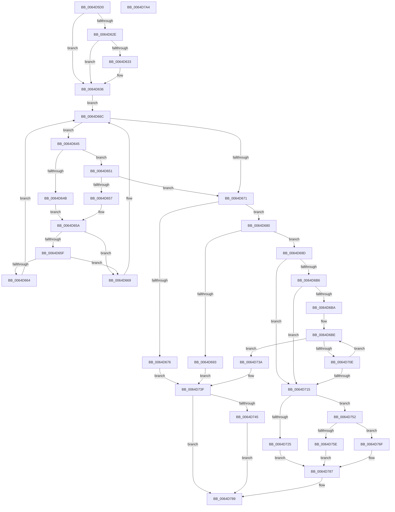

# VmpUpdateCommitStateMemoryRange

- RVA: `0x0064D5D0`–`0x0064D7A5` (길이 `469` bytes)
- VA: `0x000000014064D5D0`
- 실행 섹션: `.text`
- PDB 이름 있음: `예`; PDB Function 태그: `아니요`
- unwind 정보 RVA: `0x000D2E10`
- 디코드: `134`개 명령, `469/469` bytes 표시
- 미해석 바이트: `0` (있으면 어셈블리에 `.byte`로 보존)

> 이 문서는 커널 이미지의 기계어와 PDB 기호를 분석해 생성했습니다. 4번과 5번은 함수 원형과 자료형을 바이너리 사용 방식에서 추정한 C 해석이며 원본 소스 복구 결과는 아닙니다.

## 1. Dependencies

- 직접 호출 지점: **8**; 고유 호출 대상: **7**
- 직접 호출자로 확인된 함수: **1**
- RIP 상대 이미지 참조: **0**

### Outgoing calls
- `0x0064D619` → [VmpProcessContextLockShared](../42/VmpProcessContextLockShared_function_00429DB0.md) (function, `0x00429DB0`)
- `0x0064D6E7` → [VmpConvertPortionVpnRangeToGpnRange](../31/VmpConvertPortionVpnRangeToGpnRange_function_003147F0.md) (function, `0x003147F0`)
- `0x0064D703` → [VmpFindNextPinnedPageStateHelper](VmpFindNextPinnedPageStateHelper_function_0064C7E4.md) (function, `0x0064C7E4`)
- `0x0064D71B` → [VmpProcessContextUnlockShared](../42/VmpProcessContextUnlockShared_function_00429DFC.md) (function, `0x00429DFC`)
- `0x0064D733` → [MmCommitDecommitSecuredMemory](../../page/7F/MmCommitDecommitSecuredMemory_function_007FE904.md) (function, `0x007FE904`)
- `0x0064D74B` → [VmpProcessContextUnlockShared](../42/VmpProcessContextUnlockShared_function_00429DFC.md) (function, `0x00429DFC`)
- `0x0064D768` → [ZwFreeVirtualMemory](../6A/ZwFreeVirtualMemory_function_006AD490.md) (function, `0x006AD490`)
- `0x0064D782` → [ZwAllocateVirtualMemory](../6A/ZwAllocateVirtualMemory_function_006AD3D0.md) (function, `0x006AD3D0`)

### Direct callers
- [VmUpdateCommitMemoryRange](../../page/7A/VmUpdateCommitMemoryRange_function_007AD860.md) at `0x007AD8C6`

### Static image references
- 디코드된 RIP-relative 메모리 참조가 없습니다.

## 2. Other-region calls and transfers

- 다른 실행 섹션으로 향하는 call: **1**
  - `0x0064D733` → [MmCommitDecommitSecuredMemory](../../page/7F/MmCommitDecommitSecuredMemory_function_007FE904.md) (`.text` → `PAGE`)
- 별도 외부 분기/꼬리 이동을 확인하지 못했습니다.

## 3. Assembly (complete function range)

```asm
0064D5D0  48 89 5C 24 08                  mov qword ptr [rsp + 8], rbx
0064D5D5  48 89 74 24 18                  mov qword ptr [rsp + 0x18], rsi
0064D5DA  55                              push rbp
0064D5DB  41 56                           push r14
0064D5DD  41 57                           push r15
0064D5DF  48 8B EC                        mov rbp, rsp
0064D5E2  48 81 EC 80 00 00 00            sub rsp, 0x80
0064D5E9  48 83 65 C0 00                  and qword ptr [rbp - 0x40], 0
0064D5EE  0F 57 C0                        xorps xmm0, xmm0
0064D5F1  48 83 65 38 00                  and qword ptr [rbp + 0x38], 0
0064D5F6  0F 57 C9                        xorps xmm1, xmm1
0064D5F9  83 65 28 00                     and dword ptr [rbp + 0x28], 0
0064D5FD  33 C0                           xor eax, eax
0064D5FF  0F 11 45 D8                     movups xmmword ptr [rbp - 0x28], xmm0
0064D603  41 8B F0                        mov esi, r8d
0064D606  4C 8B F1                        mov r14, rcx
0064D609  0F 10 02                        movups xmm0, xmmword ptr [rdx]
0064D60C  48 89 45 F8                     mov qword ptr [rbp - 8], rax
0064D610  0F 11 4D E8                     movups xmmword ptr [rbp - 0x18], xmm1
0064D614  F3 0F 7F 45 C8                  movdqu xmmword ptr [rbp - 0x38], xmm0
0064D619  E8 92 C7 DD FF                  call 0x140429db0
0064D61E  49 8D 56 18                     lea rdx, [r14 + 0x18]
0064D622  4C 8B F8                        mov r15, rax
0064D625  F6 42 08 01                     test byte ptr [rdx + 8], 1
0064D629  48 8B 0A                        mov rcx, qword ptr [rdx]
0064D62C  74 08                           je 0x14064d636
0064D62E  48 85 C9                        test rcx, rcx
0064D631  74 03                           je 0x14064d636
0064D633  48 33 CA                        xor rcx, rdx
0064D636  44 0F B6 42 08                  movzx r8d, byte ptr [rdx + 8]
0064D63B  48 8B 55 C8                     mov rdx, qword ptr [rbp - 0x38]
0064D63F  41 83 E0 01                     and r8d, 1
0064D643  EB 27                           jmp 0x14064d66c
0064D645  48 3B 51 20                     cmp rdx, qword ptr [rcx + 0x20]
0064D649  76 06                           jbe 0x14064d651
0064D64B  48 8B 41 08                     mov rax, qword ptr [rcx + 8]
0064D64F  EB 09                           jmp 0x14064d65a
0064D651  48 3B 51 18                     cmp rdx, qword ptr [rcx + 0x18]
0064D655  73 1A                           jae 0x14064d671
0064D657  48 8B 01                        mov rax, qword ptr [rcx]
0064D65A  45 85 C0                        test r8d, r8d
0064D65D  74 0A                           je 0x14064d669
0064D65F  48 85 C0                        test rax, rax
0064D662  74 05                           je 0x14064d669
0064D664  48 33 C8                        xor rcx, rax
0064D667  EB 03                           jmp 0x14064d66c
0064D669  48 8B C8                        mov rcx, rax
0064D66C  48 85 C9                        test rcx, rcx
0064D66F  75 D4                           jne 0x14064d645
0064D671  48 85 C9                        test rcx, rcx
0064D674  75 0A                           jne 0x14064d680
0064D676  BB 8C 02 00 C0                  mov ebx, 0xc000028c
0064D67B  E9 BF 00 00 00                  jmp 0x14064d73f
0064D680  48 8B 41 20                     mov rax, qword ptr [rcx + 0x20]
0064D684  4C 8B 45 D0                     mov r8, qword ptr [rbp - 0x30]
0064D688  48 2B C2                        sub rax, rdx
0064D68B  48 FF C0                        inc rax
0064D68E  49 3B C0                        cmp rax, r8
0064D691  73 0A                           jae 0x14064d69d
0064D693  BB 18 00 00 C0                  mov ebx, 0xc0000018
0064D698  E9 A2 00 00 00                  jmp 0x14064d73f
0064D69D  48 C1 E2 0C                     shl rdx, 0xc
0064D6A1  49 C1 E0 0C                     shl r8, 0xc
0064D6A5  48 89 55 C0                     mov qword ptr [rbp - 0x40], rdx
0064D6A9  4C 89 45 38                     mov qword ptr [rbp + 0x38], r8
0064D6AD  48 8B 59 38                     mov rbx, qword ptr [rcx + 0x38]
0064D6B1  48 85 DB                        test rbx, rbx
0064D6B4  74 5F                           je 0x14064d715
0064D6B6  85 F6                           test esi, esi
0064D6B8  75 5B                           jne 0x14064d715
0064D6BA  48 89 4D E8                     mov qword ptr [rbp - 0x18], rcx
0064D6BE  48 8D 45 28                     lea rax, [rbp + 0x28]
0064D6C2  C7 44 24 30 02 00 00 00         mov dword ptr [rsp + 0x30], 2
0064D6CA  48 89 44 24 28                  mov qword ptr [rsp + 0x28], rax
0064D6CF  4C 8D 4D E8                     lea r9, [rbp - 0x18]
0064D6D3  48 8D 45 D8                     lea rax, [rbp - 0x28]
0064D6D7  49 83 C8 FF                     or r8, 0xffffffffffffffff
0064D6DB  48 8D 55 C8                     lea rdx, [rbp - 0x38]
0064D6DF  48 89 44 24 20                  mov qword ptr [rsp + 0x20], rax
0064D6E4  49 8B CE                        mov rcx, r14
0064D6E7  E8 04 71 CC FF                  call 0x1403147f0
0064D6EC  48 8B 55 D8                     mov rdx, qword ptr [rbp - 0x28]
0064D6F0  41 B9 01 00 00 00               mov r9d, 1
0064D6F6  4C 8B 45 E0                     mov r8, qword ptr [rbp - 0x20]
0064D6FA  49 8B CE                        mov rcx, r14
0064D6FD  49 FF C8                        dec r8
0064D700  4C 03 C2                        add r8, rdx
0064D703  E8 DC F0 FF FF                  call 0x14064c7e4
0064D708  48 83 F8 FF                     cmp rax, -1
0064D70C  75 2C                           jne 0x14064d73a
0064D70E  48 83 7D D0 00                  cmp qword ptr [rbp - 0x30], 0
0064D713  75 A9                           jne 0x14064d6be
0064D715  49 8B D7                        mov rdx, r15
0064D718  49 8B CE                        mov rcx, r14
0064D71B  E8 DC C6 DD FF                  call 0x140429dfc
0064D720  48 85 DB                        test rbx, rbx
0064D723  74 2D                           je 0x14064d752
0064D725  48 8B 55 38                     mov rdx, qword ptr [rbp + 0x38]
0064D729  4C 8B CB                        mov r9, rbx
0064D72C  48 8B 4D C0                     mov rcx, qword ptr [rbp - 0x40]
0064D730  44 8B C6                        mov r8d, esi
0064D733  E8 CC 11 1B 00                  call 0x1407fe904
0064D738  EB 4D                           jmp 0x14064d787
0064D73A  BB 2C 00 00 C0                  mov ebx, 0xc000002c
0064D73F  49 83 FF FF                     cmp r15, -1
0064D743  74 44                           je 0x14064d789
0064D745  49 8B D7                        mov rdx, r15
0064D748  49 8B CE                        mov rcx, r14
0064D74B  E8 AC C6 DD FF                  call 0x140429dfc
0064D750  EB 37                           jmp 0x14064d789
0064D752  48 83 C9 FF                     or rcx, 0xffffffffffffffff
0064D756  48 8D 55 C0                     lea rdx, [rbp - 0x40]
0064D75A  85 F6                           test esi, esi
0064D75C  75 11                           jne 0x14064d76f
0064D75E  41 B9 00 40 00 00               mov r9d, 0x4000
0064D764  4C 8D 45 38                     lea r8, [rbp + 0x38]
0064D768  E8 23 FD 05 00                  call 0x1406ad490
0064D76D  EB 18                           jmp 0x14064d787
0064D76F  89 74 24 28                     mov dword ptr [rsp + 0x28], esi
0064D773  4C 8D 4D 38                     lea r9, [rbp + 0x38]
0064D777  45 33 C0                        xor r8d, r8d
0064D77A  C7 44 24 20 00 10 00 00         mov dword ptr [rsp + 0x20], 0x1000
0064D782  E8 49 FC 05 00                  call 0x1406ad3d0
0064D787  8B D8                           mov ebx, eax
0064D789  4C 8D 9C 24 80 00 00 00         lea r11, [rsp + 0x80]
0064D791  8B C3                           mov eax, ebx
0064D793  49 8B 5B 20                     mov rbx, qword ptr [r11 + 0x20]
0064D797  49 8B 73 30                     mov rsi, qword ptr [r11 + 0x30]
0064D79B  49 8B E3                        mov rsp, r11
0064D79E  41 5F                           pop r15
0064D7A0  41 5E                           pop r14
0064D7A2  5D                              pop rbp
0064D7A3  C3                              ret
0064D7A4  CC                              int3
```

## 4. C-style interpretation (structured pseudocode)

```c
__int64 __fastcall VmpUpdateCommitStateMemoryRange(__int64 a1, __int64 a2, int a3)
{
    __int64 result;
    __int64 v_rsp;
    unsigned __int64 v_stack_m18;
    unsigned __int64 v_stack_m20;
    unsigned __int64 v_stack_m30;
    unsigned __int64 v_stack_m38;
    unsigned __int64 v_stack_m40;
    unsigned __int64 v_stack_m48;
    unsigned __int64 v_stack_m50;
    unsigned __int64 v_stack_m58;
    unsigned int v_stack_m68;
    unsigned __int64 v_stack_m70;
    unsigned __int64 v_stack_m78;
    unsigned int v_stack_p10;
    unsigned __int64 v_stack_p18;
    unsigned __int64 v_stack_p20;
    unsigned __int64 v_stack_p8;

    v_stack_p8 = v_rbx;
    v_stack_p18 = v_rsi;
    v_rsp = (v_rsp) - (128);
    result = 0;
    v_stack_m40 = v_xmm0;
    v_stack_m20 = 0;
    v_stack_m30 = v_xmm1;
    v_stack_m50 = v_xmm0;
    result = VmpProcessContextLockShared(a1, a2, a3, a4);
    if (((*(unsigned __int8 *)(a1 + 24 + 8)) & (1)) == 0) goto loc_0064D636;
    if (*(unsigned __int64 *)(a1 + 24) != 0) {
        a1 = (*(unsigned __int64 *)(a1 + 24)) ^ (a1 + 24);
    }
    a3 = (unsigned int)((*(unsigned __int8 *)(a1 + 24 + 8)) & (1));
    goto loc_0064D66C;
loc_0064D645:
    if (v_stack_m50 <= (*(unsigned __int64 *)(a1 + 32))) goto loc_0064D651;
    goto loc_0064D65A;
loc_0064D651:
    if (v_stack_m50 >= (*(unsigned __int64 *)(a1 + 24))) goto loc_0064D671;
loc_0064D65A:
    if (a3 == 0) goto loc_0064D669;
    if (*(unsigned __int64 *)(a1) == 0) goto loc_0064D669;
    a1 = (a1) ^ (*(unsigned __int64 *)(a1));
    goto loc_0064D66C;
loc_0064D669:
loc_0064D66C:
    if (*(unsigned __int64 *)(a1) != 0) goto loc_0064D645;
loc_0064D671:
    if (*(unsigned __int64 *)(a1) != 0) goto loc_0064D680;
    goto loc_0064D73F;
loc_0064D680:
    result = (*(unsigned __int64 *)(*(unsigned __int64 *)(a1) + 32)) - (v_stack_m50);
    result = (result) + 1;
    if (result >= v_stack_m48) goto loc_0064D69D;
    goto loc_0064D73F;
loc_0064D69D:
    a2 = (v_stack_m50) << (12);
    a3 = (v_stack_m48) << (12);
    v_stack_m58 = a2;
    v_stack_p20 = a3;
    if (*(unsigned __int64 *)(*(unsigned __int64 *)(a1) + 56) == 0) goto loc_0064D715;
    if ((unsigned int)((unsigned int)(a3)) != 0) goto loc_0064D715;
    v_stack_m30 = *(unsigned __int64 *)(a1);
loc_0064D6BE:
    v_stack_m68 = 2;
    v_stack_m70 = v_stack_p10;
    a3 = (a3) | (-1);
    v_stack_m78 = v_stack_m40;
    result = VmpConvertPortionVpnRangeToGpnRange(a1, v_stack_m50, a3, v_stack_m30);
    a3 = (v_stack_m38) - 1;
    a3 = (a3) + (v_stack_m40);
    result = VmpFindNextPinnedPageStateHelper(a1, v_stack_m40, a3, 1);
    if (result != -1) goto loc_0064D73A;
    if (v_stack_m48 != 0) goto loc_0064D6BE;
loc_0064D715:
    result = VmpProcessContextUnlockShared(a1, result, a3, 1);
    if (*(unsigned __int64 *)(*(unsigned __int64 *)(a1) + 56) == 0) goto loc_0064D752;
    result = MmCommitDecommitSecuredMemory(v_stack_m58, v_stack_p20, (unsigned int)((unsigned int)((unsigned int)(a3))), *(unsigned __int64 *)(*(unsigned __int64 *)(a1) + 56));
    goto loc_0064D787;
loc_0064D73A:
loc_0064D73F:
    if (result == -1) goto loc_0064D789;
    result = VmpProcessContextUnlockShared(a1, result, (unsigned int)((unsigned int)((unsigned int)(a3))), *(unsigned __int64 *)(*(unsigned __int64 *)(a1) + 56));
    goto loc_0064D789;
loc_0064D752:
    a1 = (a1) | (-1);
    if ((unsigned int)((unsigned int)(a3)) != 0) goto loc_0064D76F;
    result = ZwFreeVirtualMemory(a1, v_stack_m58, v_stack_p20, (unsigned int)(0x4000ULL));
    goto loc_0064D787;
loc_0064D76F:
    v_stack_m70 = (unsigned int)((unsigned int)(a3));
    a3 = 0;
    v_stack_m78 = 0x1000ULL;
    result = ZwAllocateVirtualMemory(a1, v_stack_m58, a3, v_stack_p20);
loc_0064D787:
loc_0064D789:
    return (unsigned int)((unsigned int)((unsigned int)((unsigned int)(result))));
}
```

## 5. (Beta) C Style

```c
int64_t VmpUpdateCommitStateMemoryRange(void *Arg1, void *Arg2, int32_t Arg3)
{
    uint8_t *arg1 = (uint8_t *)Arg1;
    uint8_t *arg2 = (uint8_t *)Arg2;

    int64_t result;
    int64_t local_rsp;
    uint64_t v_stack_m18;
    uint64_t v_stack_m20;
    uint64_t v_stack_m30;
    uint64_t v_stack_m38;
    uint64_t v_stack_m40;
    uint64_t v_stack_m48;
    uint64_t v_stack_m50;
    uint64_t v_stack_m58;
    uint32_t v_stack_m68;
    uint64_t v_stack_m70;
    uint64_t v_stack_m78;
    uint32_t v_stack_p10;
    uint64_t v_stack_p18;
    uint64_t v_stack_p20;
    uint64_t v_stack_p8;

    v_stack_p8 = local_rbx;
    v_stack_p18 = local_rsi;
    local_rsp = (local_rsp) - (128);
    result = 0;
    v_stack_m40 = v_xmm0;
    v_stack_m20 = 0;
    v_stack_m30 = v_xmm1;
    v_stack_m50 = v_xmm0;
    result = VmpProcessContextLockShared(Arg1, Arg2, Arg3, a4);
    if (((*(uint8_t *)(arg1 + 0x18 + 0x8)) & (1)) == 0) goto loc_0064D636;
    if (*(uint64_t *)(arg1 + 0x18) != 0) {
        Arg1 = (*(uint64_t *)(arg1 + 0x18)) ^ (Arg1 + 24);
    }
    Arg3 = (uint32_t)((*(uint8_t *)(arg1 + 0x18 + 0x8)) & (1));
    goto loc_0064D66C;
loc_0064D645:
    if (v_stack_m50 <= (*(uint64_t *)(arg1 + 0x20))) goto loc_0064D651;
    goto loc_0064D65A;
loc_0064D651:
    if (v_stack_m50 >= (*(uint64_t *)(arg1 + 0x18))) goto loc_0064D671;
loc_0064D65A:
    if (Arg3 == 0) goto loc_0064D669;
    if (*(uint64_t *)(arg1) == 0) goto loc_0064D669;
    Arg1 = (Arg1) ^ (*(uint64_t *)(arg1));
    goto loc_0064D66C;
loc_0064D669:
loc_0064D66C:
    if (*(uint64_t *)(arg1) != 0) goto loc_0064D645;
loc_0064D671:
    if (*(uint64_t *)(arg1) != 0) goto loc_0064D680;
    goto loc_0064D73F;
loc_0064D680:
    result = (*(uint64_t *)(*(uint64_t *)(arg1) + 0x20)) - (v_stack_m50);
    result = (result) + 1;
    if (result >= v_stack_m48) goto loc_0064D69D;
    goto loc_0064D73F;
loc_0064D69D:
    Arg2 = (v_stack_m50) << (12);
    Arg3 = (v_stack_m48) << (12);
    v_stack_m58 = Arg2;
    v_stack_p20 = Arg3;
    if (*(uint64_t *)(*(uint64_t *)(arg1) + 0x38) == 0) goto loc_0064D715;
    if ((uint32_t)((uint32_t)(Arg3)) != 0) goto loc_0064D715;
    v_stack_m30 = *(uint64_t *)(arg1);
loc_0064D6BE:
    v_stack_m68 = 2;
    v_stack_m70 = v_stack_p10;
    Arg3 = (Arg3) | (-1);
    v_stack_m78 = v_stack_m40;
    result = VmpConvertPortionVpnRangeToGpnRange(Arg1, v_stack_m50, Arg3, v_stack_m30);
    Arg3 = (v_stack_m38) - 1;
    Arg3 = (Arg3) + (v_stack_m40);
    result = VmpFindNextPinnedPageStateHelper(Arg1, v_stack_m40, Arg3, 1);
    if (result != -1) goto loc_0064D73A;
    if (v_stack_m48 != 0) goto loc_0064D6BE;
loc_0064D715:
    result = VmpProcessContextUnlockShared(Arg1, result, Arg3, 1);
    if (*(uint64_t *)(*(uint64_t *)(arg1) + 0x38) == 0) goto loc_0064D752;
    result = MmCommitDecommitSecuredMemory(v_stack_m58, v_stack_p20, (uint32_t)((uint32_t)((uint32_t)(Arg3))), *(uint64_t *)(*(uint64_t *)(arg1) + 0x38));
    goto loc_0064D787;
loc_0064D73A:
loc_0064D73F:
    if (result == -1) goto loc_0064D789;
    result = VmpProcessContextUnlockShared(Arg1, result, (uint32_t)((uint32_t)((uint32_t)(Arg3))), *(uint64_t *)(*(uint64_t *)(arg1) + 0x38));
    goto loc_0064D789;
loc_0064D752:
    Arg1 = (Arg1) | (-1);
    if ((uint32_t)((uint32_t)(Arg3)) != 0) goto loc_0064D76F;
    result = ZwFreeVirtualMemory(Arg1, v_stack_m58, v_stack_p20, (uint32_t)(0x4000ULL));
    goto loc_0064D787;
loc_0064D76F:
    v_stack_m70 = (uint32_t)((uint32_t)(Arg3));
    Arg3 = 0;
    v_stack_m78 = 0x1000ULL;
    result = ZwAllocateVirtualMemory(Arg1, v_stack_m58, Arg3, v_stack_p20);
loc_0064D787:
loc_0064D789:
    return (uint32_t)((uint32_t)((uint32_t)((uint32_t)(result))));
}
```

### 관측된 메모리 오프셋

구조체 형식이 확인되지 않은 접근은 인자 기준의 오프셋으로만 기록했습니다.

| 기준 인자 | 오프셋 표현 | 폭 (bit) | 접근 |
|---|---:|---:|---|
| `Arg1` | `+ 0x0` | `64` | `R` |
| `Arg1` | `+ 0x8` | `8` | `R` |
| `Arg1` | `+ 0x18` | `64` | `R` |
| `Arg2` | `+ 0x0` | `128` | `R` |

## 6. Execution-region graph

[열기: 2D/3D 그래프와 함수 탐색 컨트롤 패널](../../../control-panel.html?section=text&rva=0x0064D5D0&view=graph)

- 2D 그래프는 위에서 아래로 흐르고, 3D 그래프는 빈 공간을 드래그해 회전합니다. Shift+드래그는 이동, 휠은 확대·축소, 함수 노드 선택은 대상 보고서 이동입니다.

### Static fallback


