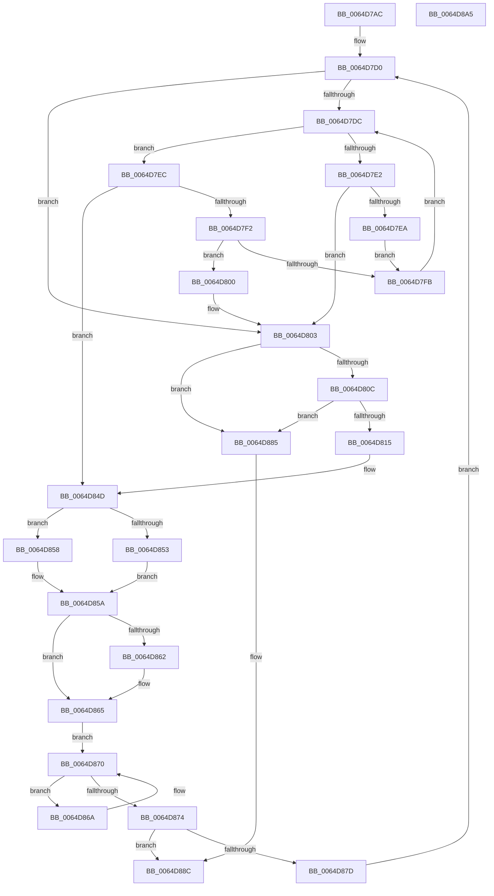

# VmpUpdatePinRangesForFirstPin

- RVA: `0x0064D7AC`–`0x0064D8A6` (길이 `250` bytes)
- VA: `0x000000014064D7AC`
- 실행 섹션: `.text`
- PDB 이름 있음: `예`; PDB Function 태그: `아니요`
- unwind 정보 RVA: `0x00060300`
- 디코드: `82`개 명령, `250/250` bytes 표시
- 미해석 바이트: `0` (있으면 어셈블리에 `.byte`로 보존)

> 이 문서는 커널 이미지의 기계어와 PDB 기호를 분석해 생성했습니다. 4번과 5번은 함수 원형과 자료형을 바이너리 사용 방식에서 추정한 C 해석이며 원본 소스 복구 결과는 아닙니다.

## 1. Dependencies

- 직접 호출 지점: **1**; 고유 호출 대상: **1**
- 직접 호출자로 확인된 함수: **1**
- RIP 상대 이미지 참조: **0**

### Outgoing calls
- `0x0064D845` → [RtlRbInsertNodeEx](../2E/RtlRbInsertNodeEx_function_002E4570.md) (function, `0x002E4570`)

### Direct callers
- [VmpPinMemoryRange](VmpPinMemoryRange_function_0064CCD0.md) at `0x0064D015`

### Static image references
- 디코드된 RIP-relative 메모리 참조가 없습니다.

## 2. Other-region calls and transfers

- 다른 실행 섹션으로 향하는 call: **0**
- 별도 외부 분기/꼬리 이동을 확인하지 못했습니다.

## 3. Assembly (complete function range)

```asm
0064D7AC  48 89 5C 24 08                  mov qword ptr [rsp + 8], rbx
0064D7B1  48 89 6C 24 10                  mov qword ptr [rsp + 0x10], rbp
0064D7B6  48 89 74 24 18                  mov qword ptr [rsp + 0x18], rsi
0064D7BB  57                              push rdi
0064D7BC  41 56                           push r14
0064D7BE  41 57                           push r15
0064D7C0  48 83 EC 20                     sub rsp, 0x20
0064D7C4  4D 8B F1                        mov r14, r9
0064D7C7  49 8B F0                        mov rsi, r8
0064D7CA  48 8B DA                        mov rbx, rdx
0064D7CD  48 8B E9                        mov rbp, rcx
0064D7D0  48 8B 55 28                     mov rdx, qword ptr [rbp + 0x28]
0064D7D4  45 32 C0                        xor r8b, r8b
0064D7D7  48 85 D2                        test rdx, rdx
0064D7DA  74 27                           je 0x14064d803
0064D7DC  48 3B 5A 18                     cmp rbx, qword ptr [rdx + 0x18]
0064D7E0  73 0A                           jae 0x14064d7ec
0064D7E2  48 8B 02                        mov rax, qword ptr [rdx]
0064D7E5  48 85 C0                        test rax, rax
0064D7E8  74 19                           je 0x14064d803
0064D7EA  EB 0F                           jmp 0x14064d7fb
0064D7EC  48 3B 5A 20                     cmp rbx, qword ptr [rdx + 0x20]
0064D7F0  76 5B                           jbe 0x14064d84d
0064D7F2  48 8B 42 08                     mov rax, qword ptr [rdx + 8]
0064D7F6  48 85 C0                        test rax, rax
0064D7F9  74 05                           je 0x14064d800
0064D7FB  48 8B D0                        mov rdx, rax
0064D7FE  EB DC                           jmp 0x14064d7dc
0064D800  41 B0 01                        mov r8b, 1
0064D803  49 8B 3E                        mov rdi, qword ptr [r14]
0064D806  4C 39 77 08                     cmp qword ptr [rdi + 8], r14
0064D80A  75 79                           jne 0x14064d885
0064D80C  48 8B 07                        mov rax, qword ptr [rdi]
0064D80F  48 39 78 08                     cmp qword ptr [rax + 8], rdi
0064D813  75 70                           jne 0x14064d885
0064D815  49 89 06                        mov qword ptr [r14], rax
0064D818  48 8B CB                        mov rcx, rbx
0064D81B  4C 89 70 08                     mov qword ptr [rax + 8], r14
0064D81F  4C 8B CF                        mov r9, rdi
0064D822  48 8B 45 40                     mov rax, qword ptr [rbp + 0x40]
0064D826  48 FF C8                        dec rax
0064D829  48 23 C3                        and rax, rbx
0064D82C  48 2B C8                        sub rcx, rax
0064D82F  48 89 4F 18                     mov qword ptr [rdi + 0x18], rcx
0064D833  48 8B 45 40                     mov rax, qword ptr [rbp + 0x40]
0064D837  48 FF C8                        dec rax
0064D83A  48 03 C8                        add rcx, rax
0064D83D  48 89 4F 20                     mov qword ptr [rdi + 0x20], rcx
0064D841  48 8D 4D 28                     lea rcx, [rbp + 0x28]
0064D845  E8 26 6D C9 FF                  call 0x1402e4570
0064D84A  48 8B D7                        mov rdx, rdi
0064D84D  48 3B 5A 18                     cmp rbx, qword ptr [rdx + 0x18]
0064D851  76 05                           jbe 0x14064d858
0064D853  2B 5A 18                        sub ebx, dword ptr [rdx + 0x18]
0064D856  EB 02                           jmp 0x14064d85a
0064D858  33 DB                           xor ebx, ebx
0064D85A  8B CE                           mov ecx, esi
0064D85C  48 3B 72 20                     cmp rsi, qword ptr [rdx + 0x20]
0064D860  72 03                           jb 0x14064d865
0064D862  8B 4A 20                        mov ecx, dword ptr [rdx + 0x20]
0064D865  2B 4A 18                        sub ecx, dword ptr [rdx + 0x18]
0064D868  EB 06                           jmp 0x14064d870
0064D86A  FE 44 13 28                     inc byte ptr [rbx + rdx + 0x28]
0064D86E  FF C3                           inc ebx
0064D870  3B D9                           cmp ebx, ecx
0064D872  76 F6                           jbe 0x14064d86a
0064D874  48 8B 5A 20                     mov rbx, qword ptr [rdx + 0x20]
0064D878  48 3B F3                        cmp rsi, rbx
0064D87B  76 0F                           jbe 0x14064d88c
0064D87D  48 FF C3                        inc rbx
0064D880  E9 4B FF FF FF                  jmp 0x14064d7d0
0064D885  B9 03 00 00 00                  mov ecx, 3
0064D88A  CD 29                           int 0x29
0064D88C  48 8B 5C 24 40                  mov rbx, qword ptr [rsp + 0x40]
0064D891  48 8B 6C 24 48                  mov rbp, qword ptr [rsp + 0x48]
0064D896  48 8B 74 24 50                  mov rsi, qword ptr [rsp + 0x50]
0064D89B  48 83 C4 20                     add rsp, 0x20
0064D89F  41 5F                           pop r15
0064D8A1  41 5E                           pop r14
0064D8A3  5F                              pop rdi
0064D8A4  C3                              ret
0064D8A5  CC                              int3
```

## 4. C-style interpretation (structured pseudocode)

```c
__int64 __fastcall VmpUpdatePinRangesForFirstPin(__int64 a1, __int64 a2, __int64 a3, __int64 a4)
{
    __int64 result;
    __int64 v_rbx;
    __int64 v_rsp;
    unsigned __int64 v_stack_p10;
    unsigned __int64 v_stack_p18;
    unsigned __int64 v_stack_p8;

    v_stack_p8 = v_rbx;
    v_stack_p10 = v_rbp;
    v_stack_p18 = v_rsi;
    v_rsp = (v_rsp) - (32);
loc_0064D7D0:
    a3 = 0;
    if (*(unsigned __int64 *)(a1 + 40) == 0) goto loc_0064D803;
loc_0064D7DC:
    if (a2 >= (*(unsigned __int64 *)(*(unsigned __int64 *)(a1 + 40) + 24))) goto loc_0064D7EC;
    if (*(unsigned __int64 *)(*(unsigned __int64 *)(a1 + 40)) == 0) goto loc_0064D803;
    goto loc_0064D7FB;
loc_0064D7EC:
    if (a2 <= (*(unsigned __int64 *)(*(unsigned __int64 *)(a1 + 40) + 32))) goto loc_0064D84D;
    if (*(unsigned __int64 *)(*(unsigned __int64 *)(a1 + 40) + 8) == 0) goto loc_0064D800;
loc_0064D7FB:
    goto loc_0064D7DC;
loc_0064D800:
loc_0064D803:
    if ((*(unsigned __int64 *)(*(unsigned __int64 *)(a4) + 8)) != a4) goto loc_0064D885;
    if ((*(unsigned __int64 *)(*(unsigned __int64 *)(*(unsigned __int64 *)(a4)) + 8)) != (*(unsigned __int64 *)(a4))) goto loc_0064D885;
    *(unsigned __int64 *)(a4) = *(unsigned __int64 *)(*(unsigned __int64 *)(a4));
    *(unsigned __int64 *)(*(unsigned __int64 *)(*(unsigned __int64 *)(a4)) + 8) = a4;
    result = (*(unsigned __int64 *)(a1 + 64)) - 1;
    result = (result) & (a2);
    a1 = (a2) - (result);
    *(unsigned __int64 *)(*(unsigned __int64 *)(a4) + 24) = a1;
    result = (*(unsigned __int64 *)(a1 + 64)) - 1;
    a1 = (a1) + (result);
    *(unsigned __int64 *)(*(unsigned __int64 *)(a4) + 32) = a1;
    result = RtlRbInsertNodeEx(a1 + 40, *(unsigned __int64 *)(*(unsigned __int64 *)(a1 + 40) + 8), 1, *(unsigned __int64 *)(a4));
loc_0064D84D:
    if (a2 <= (*(unsigned __int64 *)(*(unsigned __int64 *)(a4) + 24))) goto loc_0064D858;
    v_rbx = (unsigned int)((a2) - (*(unsigned int *)(*(unsigned __int64 *)(a4) + 24)));
    goto loc_0064D85A;
loc_0064D858:
    v_rbx = 0;
loc_0064D85A:
    if (0 >= (*(unsigned __int64 *)(*(unsigned __int64 *)(a4) + 32))) {
        a1 = *(unsigned int *)(*(unsigned __int64 *)(a4) + 32);
    }
    a1 = (unsigned int)((a1) - (*(unsigned int *)(*(unsigned __int64 *)(a4) + 24)));
    goto loc_0064D870;
loc_0064D86A:
    v_rbx = (unsigned int)((v_rbx) + 1);
loc_0064D870:
    if (((unsigned int)(v_rbx)) <= ((unsigned int)(a1))) goto loc_0064D86A;
    if (0 <= (*(unsigned __int64 *)(*(unsigned __int64 *)(a4) + 32))) goto loc_0064D88C;
    v_rbx = (*(unsigned __int64 *)(*(unsigned __int64 *)(a4) + 32)) + 1;
    goto loc_0064D7D0;
loc_0064D885:
loc_0064D88C:
    v_rsp = (v_rsp) + (32);
    return result;
}
```

## 5. (Beta) C Style

```c
int64_t VmpUpdatePinRangesForFirstPin(void *Arg1, int64_t Arg2, int64_t Arg3, void *Arg4)
{
    uint8_t *arg1 = (uint8_t *)Arg1;
    uint8_t *arg4 = (uint8_t *)Arg4;

    int64_t result;
    int64_t local_rbx;
    int64_t local_rsp;
    uint64_t v_stack_p10;
    uint64_t v_stack_p18;
    uint64_t v_stack_p8;

    v_stack_p8 = local_rbx;
    v_stack_p10 = local_rbp;
    v_stack_p18 = local_rsi;
    local_rsp = (local_rsp) - (32);
loc_0064D7D0:
    Arg3 = 0;
    if (*(uint64_t *)(arg1 + 0x28) == 0) goto loc_0064D803;
loc_0064D7DC:
    if (Arg2 >= (*(uint64_t *)(*(uint64_t *)(arg1 + 0x28) + 0x18))) goto loc_0064D7EC;
    if (*(uint64_t *)(*(uint64_t *)(arg1 + 0x28)) == 0) goto loc_0064D803;
    goto loc_0064D7FB;
loc_0064D7EC:
    if (Arg2 <= (*(uint64_t *)(*(uint64_t *)(arg1 + 0x28) + 0x20))) goto loc_0064D84D;
    if (*(uint64_t *)(*(uint64_t *)(arg1 + 0x28) + 0x8) == 0) goto loc_0064D800;
loc_0064D7FB:
    goto loc_0064D7DC;
loc_0064D800:
loc_0064D803:
    if ((*(uint64_t *)(*(uint64_t *)(arg4) + 0x8)) != Arg4) goto loc_0064D885;
    if ((*(uint64_t *)(*(uint64_t *)(*(uint64_t *)(arg4)) + 0x8)) != (*(uint64_t *)(arg4))) goto loc_0064D885;
    *(uint64_t *)(arg4) = *(uint64_t *)(*(uint64_t *)(arg4));
    *(void **)(*(uint64_t *)(*(uint64_t *)(arg4)) + 0x8) = Arg4;
    result = (*(uint64_t *)(arg1 + 0x40)) - 1;
    result = (result) & (Arg2);
    Arg1 = (Arg2) - (result);
    *(void **)(*(uint64_t *)(arg4) + 0x18) = Arg1;
    result = (*(uint64_t *)(arg1 + 0x40)) - 1;
    Arg1 = (Arg1) + (result);
    *(void **)(*(uint64_t *)(arg4) + 0x20) = Arg1;
    result = RtlRbInsertNodeEx(Arg1 + 40, *(uint64_t *)(*(uint64_t *)(arg1 + 0x28) + 0x8), 1, *(uint64_t *)(arg4));
loc_0064D84D:
    if (Arg2 <= (*(uint64_t *)(*(uint64_t *)(arg4) + 0x18))) goto loc_0064D858;
    local_rbx = (uint32_t)((Arg2) - (*(uint32_t *)(*(uint64_t *)(arg4) + 0x18)));
    goto loc_0064D85A;
loc_0064D858:
    local_rbx = 0;
loc_0064D85A:
    if (0 >= (*(uint64_t *)(*(uint64_t *)(arg4) + 0x20))) {
        Arg1 = *(uint32_t *)(*(uint64_t *)(arg4) + 0x20);
    }
    Arg1 = (uint32_t)((Arg1) - (*(uint32_t *)(*(uint64_t *)(arg4) + 0x18)));
    goto loc_0064D870;
loc_0064D86A:
    local_rbx = (uint32_t)((local_rbx) + 1);
loc_0064D870:
    if (((uint32_t)(local_rbx)) <= ((uint32_t)(Arg1))) goto loc_0064D86A;
    if (0 <= (*(uint64_t *)(*(uint64_t *)(arg4) + 0x20))) goto loc_0064D88C;
    local_rbx = (*(uint64_t *)(*(uint64_t *)(arg4) + 0x20)) + 1;
    goto loc_0064D7D0;
loc_0064D885:
loc_0064D88C:
    local_rsp = (local_rsp) + (32);
    return result;
}
```

### 관측된 메모리 오프셋

구조체 형식이 확인되지 않은 접근은 인자 기준의 오프셋으로만 기록했습니다.

| 기준 인자 | 오프셋 표현 | 폭 (bit) | 접근 |
|---|---:|---:|---|
| `Arg1` | `+ 0x28` | `64` | `R` |
| `Arg1` | `+ 0x40` | `64` | `R` |
| `Arg4` | `+ 0x0` | `64` | `R` |
| `Arg4` | `+ 0x0` | `64` | `W` |

## 6. Execution-region graph

[열기: 2D/3D 그래프와 함수 탐색 컨트롤 패널](../../../control-panel.html?section=text&rva=0x0064D7AC&view=graph)

- 2D 그래프는 위에서 아래로 흐르고, 3D 그래프는 빈 공간을 드래그해 회전합니다. Shift+드래그는 이동, 휠은 확대·축소, 함수 노드 선택은 대상 보고서 이동입니다.

### Static fallback


