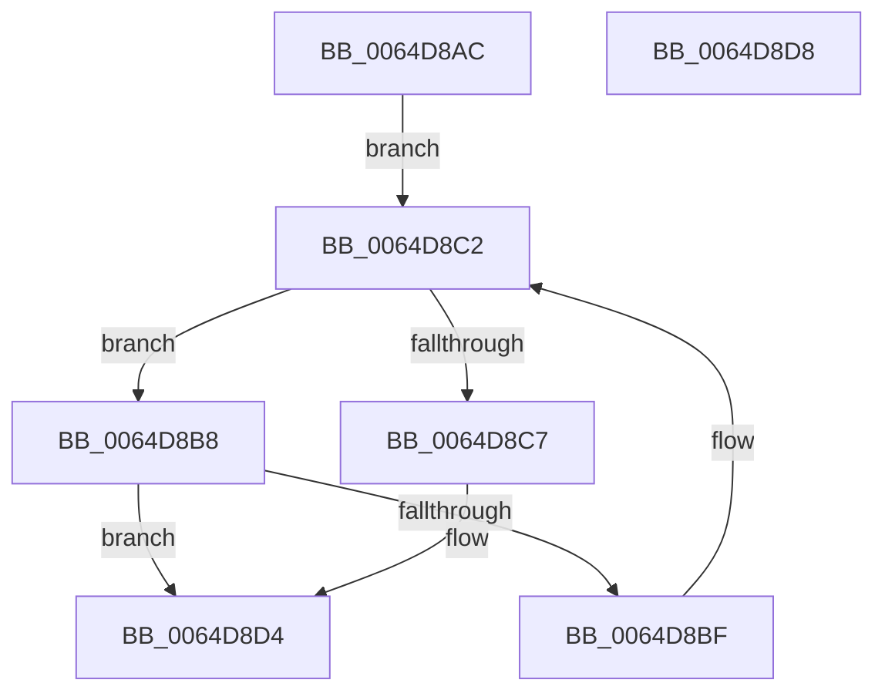

# VmpVaRangeCheckPinnedGpaRanges

- RVA: `0x0064D8AC`–`0x0064D8D9` (길이 `45` bytes)
- VA: `0x000000014064D8AC`
- 실행 섹션: `.text`
- PDB 이름 있음: `예`; PDB Function 태그: `아니요`
- unwind 정보 RVA: `0x000DB714`
- 디코드: `16`개 명령, `45/45` bytes 표시
- 미해석 바이트: `0` (있으면 어셈블리에 `.byte`로 보존)

> 이 문서는 커널 이미지의 기계어와 PDB 기호를 분석해 생성했습니다. 4번과 5번은 함수 원형과 자료형을 바이너리 사용 방식에서 추정한 C 해석이며 원본 소스 복구 결과는 아닙니다.

## 1. Dependencies

- 직접 호출 지점: **0**; 고유 호출 대상: **0**
- 직접 호출자로 확인된 함수: **2**
- RIP 상대 이미지 참조: **0**

### Outgoing calls
- 직접 디코드된 call 명령이 없습니다.

### Direct callers
- [VmpSplitMemoryRange](../42/VmpSplitMemoryRange_function_00429754.md) at `0x00429AFC`
- [VmpSplitMemoryRange](../42/VmpSplitMemoryRange_function_00429754.md) at `0x00429B07`
- [VmpDereferencePinInProgress](VmpDereferencePinInProgress_function_0064C7C4.md) at `0x0064C7D1`

### Static image references
- 디코드된 RIP-relative 메모리 참조가 없습니다.

## 2. Other-region calls and transfers

- 다른 실행 섹션으로 향하는 call: **0**
- 별도 외부 분기/꼬리 이동을 확인하지 못했습니다.

## 3. Assembly (complete function range)

```asm
0064D8AC  4C 8D 49 28                     lea r9, [rcx + 0x28]
0064D8B0  45 33 C0                        xor r8d, r8d
0064D8B3  49 8B 11                        mov rdx, qword ptr [r9]
0064D8B6  EB 0A                           jmp 0x14064d8c2
0064D8B8  8B 42 40                        mov eax, dword ptr [rdx + 0x40]
0064D8BB  A8 01                           test al, 1
0064D8BD  75 15                           jne 0x14064d8d4
0064D8BF  48 8B 12                        mov rdx, qword ptr [rdx]
0064D8C2  49 3B D1                        cmp rdx, r9
0064D8C5  75 F1                           jne 0x14064d8b8
0064D8C7  4C 8B 41 38                     mov r8, qword ptr [rcx + 0x38]
0064D8CB  48 83 61 38 00                  and qword ptr [rcx + 0x38], 0
0064D8D0  83 61 48 FE                     and dword ptr [rcx + 0x48], 0xfffffffe
0064D8D4  49 8B C0                        mov rax, r8
0064D8D7  C3                              ret
0064D8D8  CC                              int3
```

## 4. C-style interpretation (structured pseudocode)

```c
__int64 __fastcall VmpVaRangeCheckPinnedGpaRanges(__int64 a1, __int64 a2, int a3)
{
    a3 = 0;
    goto loc_0064D8C2;
loc_0064D8B8:
    if ((((unsigned __int8)((unsigned int)(*(unsigned int *)(*(unsigned __int64 *)(a1 + 40) + 64)))) & (1)) != 0) goto loc_0064D8D4;
loc_0064D8C2:
    if ((*(unsigned __int64 *)(*(unsigned __int64 *)(a1 + 40))) != (a1 + 40)) goto loc_0064D8B8;
loc_0064D8D4:
    return *(unsigned __int64 *)(a1 + 56);
}
```

## 5. (Beta) C Style

```c
int64_t VmpVaRangeCheckPinnedGpaRanges(void *Arg1, int64_t Arg2, int32_t Arg3)
{
    uint8_t *arg1 = (uint8_t *)Arg1;

    Arg3 = 0;
    goto loc_0064D8C2;
loc_0064D8B8:
    if ((((uint8_t)((uint32_t)(*(uint32_t *)(*(uint64_t *)(arg1 + 0x28) + 0x40)))) & (1)) != 0) goto loc_0064D8D4;
loc_0064D8C2:
    if ((*(uint64_t *)(*(uint64_t *)(arg1 + 0x28))) != (Arg1 + 40)) goto loc_0064D8B8;
loc_0064D8D4:
    return *(uint64_t *)(arg1 + 0x38);
}
```

### 관측된 메모리 오프셋

구조체 형식이 확인되지 않은 접근은 인자 기준의 오프셋으로만 기록했습니다.

| 기준 인자 | 오프셋 표현 | 폭 (bit) | 접근 |
|---|---:|---:|---|
| `Arg1` | `+ 0x0` | `64` | `R` |
| `Arg1` | `+ 0x28` | `64` | `R` |
| `Arg1` | `+ 0x38` | `64` | `R` |
| `Arg1` | `+ 0x38` | `64` | `R/W` |
| `Arg1` | `+ 0x48` | `32` | `R/W` |

## 6. Execution-region graph

[열기: 2D/3D 그래프와 함수 탐색 컨트롤 패널](../../../control-panel.html?section=text&rva=0x0064D8AC&view=graph)

- 2D 그래프는 위에서 아래로 흐르고, 3D 그래프는 빈 공간을 드래그해 회전합니다. Shift+드래그는 이동, 휠은 확대·축소, 함수 노드 선택은 대상 보고서 이동입니다.

### Static fallback


