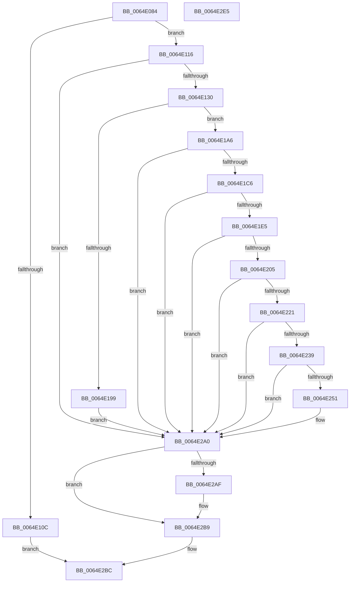

# WdipAccessCheck

- RVA: `0x0064E084`–`0x0064E2E6` (길이 `610` bytes)
- VA: `0x000000014064E084`
- 실행 섹션: `.text`
- PDB 이름 있음: `예`; PDB Function 태그: `아니요`
- unwind 정보 RVA: `0x000CBE34`
- 디코드: `156`개 명령, `610/610` bytes 표시
- 미해석 바이트: `0` (있으면 어셈블리에 `.byte`로 보존)

> 이 문서는 커널 이미지의 기계어와 PDB 기호를 분석해 생성했습니다. 4번과 5번은 함수 원형과 자료형을 바이너리 사용 방식에서 추정한 C 해석이며 원본 소스 복구 결과는 아닙니다.

## 1. Dependencies

- 직접 호출 지점: **16**; 고유 호출 대상: **12**
- 직접 호출자로 확인된 함수: **1**
- RIP 상대 이미지 참조: **3**

### Outgoing calls
- `0x0064E0E7` → [RtlLengthRequiredSid](../../page/9C/RtlLengthRequiredSid_function_009CA4D0.md) (function, `0x009CA4D0`)
- `0x0064E0FF` → [ExAllocatePool2](../../poolcode/B8/ExAllocatePool2_function_00B820F0.md) (function, `0x00B820F0`)
- `0x0064E120` → [RtlInitializeSid](../../page/9E/RtlInitializeSid_function_009EB720.md) (function, `0x009EB720`)
- `0x0064E18C` → [ExAllocatePool2](../../poolcode/B8/ExAllocatePool2_function_00B820F0.md) (function, `0x00B820F0`)
- `0x0064E1B6` → [RtlCreateSecurityDescriptor](../../page/9F/RtlCreateSecurityDescriptor_function_009F1DF0.md) (function, `0x009F1DF0`)
- `0x0064E1D5` → [RtlCreateAcl](../../page/91/RtlCreateAcl_function_00916F00.md) (function, `0x00916F00`)
- `0x0064E1F5` → [RtlAddAccessAllowedAce](../../page/92/RtlAddAccessAllowedAce_function_009298C0.md) (function, `0x009298C0`)
- `0x0064E215` → [RtlAddAccessAllowedAce](../../page/92/RtlAddAccessAllowedAce_function_009298C0.md) (function, `0x009298C0`)
- `0x0064E22D` → [RtlAddAccessAllowedAce](../../page/92/RtlAddAccessAllowedAce_function_009298C0.md) (function, `0x009298C0`)
- `0x0064E245` → [RtlSetDaclSecurityDescriptor](../../page/9E/RtlSetDaclSecurityDescriptor_function_009EC210.md) (function, `0x009EC210`)
- `0x0064E255` → [SeCaptureSubjectContext](../../page/86/SeCaptureSubjectContext_function_0086B820.md) (function, `0x0086B820`)
- `0x0064E292` → [SeAccessCheck](../3A/SeAccessCheck_function_003A6BC0.md) (function, `0x003A6BC0`)
- `0x0064E29B` → [SeReleaseSubjectContext](../../page/86/SeReleaseSubjectContext_function_0086B710.md) (function, `0x0086B710`)
- `0x0064E2A5` → [ExFreePoolWithTag](../../poolcode/B8/ExFreePoolWithTag_function_00B82870.md) (function, `0x00B82870`)
- `0x0064E2B4` → [ExFreePoolWithTag](../../poolcode/B8/ExFreePoolWithTag_function_00B82870.md) (function, `0x00B82870`)
- `0x0064E2C3` → [_security_check_cookie](../6A/_security_check_cookie_function_006AC640.md) (function, `0x006AC640`)

### Direct callers
- [WdiUpdateSem](WdiUpdateSem_function_0064E064.md) at `0x0064E068`

### Static image references
- `0x0064E0A3` → RVA `0x00E0A740` (`.data`; read)
- `0x0064E130` → RVA `0x00E67D58` (`.data`; read)
- `0x0064E16C` → RVA `0x00FD9A68` (`PAGEDATA`; read)

## 2. Other-region calls and transfers

- 다른 실행 섹션으로 향하는 call: **14**
  - `0x0064E0E7` → [RtlLengthRequiredSid](../../page/9C/RtlLengthRequiredSid_function_009CA4D0.md) (`.text` → `PAGE`)
  - `0x0064E0FF` → [ExAllocatePool2](../../poolcode/B8/ExAllocatePool2_function_00B820F0.md) (`.text` → `POOLCODE`)
  - `0x0064E120` → [RtlInitializeSid](../../page/9E/RtlInitializeSid_function_009EB720.md) (`.text` → `PAGE`)
  - `0x0064E18C` → [ExAllocatePool2](../../poolcode/B8/ExAllocatePool2_function_00B820F0.md) (`.text` → `POOLCODE`)
  - `0x0064E1B6` → [RtlCreateSecurityDescriptor](../../page/9F/RtlCreateSecurityDescriptor_function_009F1DF0.md) (`.text` → `PAGE`)
  - `0x0064E1D5` → [RtlCreateAcl](../../page/91/RtlCreateAcl_function_00916F00.md) (`.text` → `PAGE`)
  - `0x0064E1F5` → [RtlAddAccessAllowedAce](../../page/92/RtlAddAccessAllowedAce_function_009298C0.md) (`.text` → `PAGE`)
  - `0x0064E215` → [RtlAddAccessAllowedAce](../../page/92/RtlAddAccessAllowedAce_function_009298C0.md) (`.text` → `PAGE`)
  - `0x0064E22D` → [RtlAddAccessAllowedAce](../../page/92/RtlAddAccessAllowedAce_function_009298C0.md) (`.text` → `PAGE`)
  - `0x0064E245` → [RtlSetDaclSecurityDescriptor](../../page/9E/RtlSetDaclSecurityDescriptor_function_009EC210.md) (`.text` → `PAGE`)
  - `0x0064E255` → [SeCaptureSubjectContext](../../page/86/SeCaptureSubjectContext_function_0086B820.md) (`.text` → `PAGE`)
  - `0x0064E29B` → [SeReleaseSubjectContext](../../page/86/SeReleaseSubjectContext_function_0086B710.md) (`.text` → `PAGE`)
  - `0x0064E2A5` → [ExFreePoolWithTag](../../poolcode/B8/ExFreePoolWithTag_function_00B82870.md) (`.text` → `POOLCODE`)
  - `0x0064E2B4` → [ExFreePoolWithTag](../../poolcode/B8/ExFreePoolWithTag_function_00B82870.md) (`.text` → `POOLCODE`)
- 별도 외부 분기/꼬리 이동을 확인하지 못했습니다.

## 3. Assembly (complete function range)

```asm
0064E084  48 8B C4                        mov rax, rsp
0064E087  48 89 58 08                     mov qword ptr [rax + 8], rbx
0064E08B  48 89 70 10                     mov qword ptr [rax + 0x10], rsi
0064E08F  48 89 78 18                     mov qword ptr [rax + 0x18], rdi
0064E093  55                              push rbp
0064E094  41 54                           push r12
0064E096  41 56                           push r14
0064E098  48 8D 68 A1                     lea rbp, [rax - 0x5f]
0064E09C  48 81 EC A0 00 00 00            sub rsp, 0xa0
0064E0A3  48 8B 05 96 C6 7B 00            mov rax, qword ptr [rip + 0x7bc696]
0064E0AA  48 33 C4                        xor rax, rsp
0064E0AD  48 89 45 37                     mov qword ptr [rbp + 0x37], rax
0064E0B1  83 65 FB 00                     and dword ptr [rbp - 5], 0
0064E0B5  B8 00 00 02 00                  mov eax, 0x20000
0064E0BA  0F 57 C0                        xorps xmm0, xmm0
0064E0BD  66 C7 45 FF 00 05               mov word ptr [rbp - 1], 0x500
0064E0C3  33 DB                           xor ebx, ebx
0064E0C5  C7 45 27 01 00 02 00            mov dword ptr [rbp + 0x27], 0x20001
0064E0CC  21 5D 03                        and dword ptr [rbp + 3], ebx
0064E0CF  89 45 2B                        mov dword ptr [rbp + 0x2b], eax
0064E0D2  89 45 2F                        mov dword ptr [rbp + 0x2f], eax
0064E0D5  8D 4B 06                        lea ecx, [rbx + 6]
0064E0D8  C7 45 33 01 00 1F 00            mov dword ptr [rbp + 0x33], 0x1f0001
0064E0DF  0F 11 45 07                     movups xmmword ptr [rbp + 7], xmm0
0064E0E3  0F 11 45 17                     movups xmmword ptr [rbp + 0x17], xmm0
0064E0E7  E8 E4 C3 37 00                  call 0x1409ca4d0
0064E0EC  BE 57 44 49 73                  mov esi, 0x73494457
0064E0F1  8B D0                           mov edx, eax
0064E0F3  41 BC 00 01 00 00               mov r12d, 0x100
0064E0F9  44 8B C6                        mov r8d, esi
0064E0FC  41 8B CC                        mov ecx, r12d
0064E0FF  E8 EC 3F 53 00                  call 0x140b820f0
0064E104  48 8B F8                        mov rdi, rax
0064E107  48 85 C0                        test rax, rax
0064E10A  75 0A                           jne 0x14064e116
0064E10C  B8 9A 00 00 C0                  mov eax, 0xc000009a
0064E111  E9 A6 01 00 00                  jmp 0x14064e2bc
0064E116  41 B0 06                        mov r8b, 6
0064E119  48 8D 55 FB                     lea rdx, [rbp - 5]
0064E11D  48 8B CF                        mov rcx, rdi
0064E120  E8 FB D5 39 00                  call 0x1409eb720
0064E125  89 45 F7                        mov dword ptr [rbp - 9], eax
0064E128  85 C0                           test eax, eax
0064E12A  0F 88 70 01 00 00               js 0x14064e2a0
0064E130  48 8B 05 21 9C 81 00            mov rax, qword ptr [rip + 0x819c21]
0064E137  44 8B C6                        mov r8d, esi
0064E13A  C7 47 08 50 00 00 00            mov dword ptr [rdi + 8], 0x50
0064E141  49 8B CC                        mov rcx, r12
0064E144  C7 47 0C 5E F3 0F B1            mov dword ptr [rdi + 0xc], 0xb10ff35e
0064E14B  C7 47 10 81 64 AE 04            mov dword ptr [rdi + 0x10], 0x4ae6481
0064E152  C7 47 14 B1 4C A2 29            mov dword ptr [rdi + 0x14], 0x29a24cb1
0064E159  C7 47 18 14 B1 4C 21            mov dword ptr [rdi + 0x18], 0x214cb114
0064E160  C7 47 1C A6 56 86 56            mov dword ptr [rdi + 0x1c], 0x568656a6
0064E167  44 0F B6 48 01                  movzx r9d, byte ptr [rax + 1]
0064E16C  48 8B 05 F5 B8 98 00            mov rax, qword ptr [rip + 0x98b8f5]
0064E173  0F B6 50 01                     movzx edx, byte ptr [rax + 1]
0064E177  0F B6 47 01                     movzx eax, byte ptr [rdi + 1]
0064E17B  44 03 CA                        add r9d, edx
0064E17E  44 03 C8                        add r9d, eax
0064E181  46 8D 34 8D 6C 00 00 00         lea r14d, [r9*4 + 0x6c]
0064E189  41 8B D6                        mov edx, r14d
0064E18C  E8 5F 3F 53 00                  call 0x140b820f0
0064E191  48 8B D8                        mov rbx, rax
0064E194  48 85 C0                        test rax, rax
0064E197  75 0D                           jne 0x14064e1a6
0064E199  B8 9A 00 00 C0                  mov eax, 0xc000009a
0064E19E  89 45 F7                        mov dword ptr [rbp - 9], eax
0064E1A1  E9 FA 00 00 00                  jmp 0x14064e2a0
0064E1A6  41 BC 01 00 00 00               mov r12d, 1
0064E1AC  48 8D 70 28                     lea rsi, [rax + 0x28]
0064E1B0  41 8B D4                        mov edx, r12d
0064E1B3  48 8B CB                        mov rcx, rbx
0064E1B6  E8 35 3C 3A 00                  call 0x1409f1df0
0064E1BB  89 45 F7                        mov dword ptr [rbp - 9], eax
0064E1BE  85 C0                           test eax, eax
0064E1C0  0F 88 DA 00 00 00               js 0x14064e2a0
0064E1C6  41 8D 56 D8                     lea edx, [r14 - 0x28]
0064E1CA  48 8B CE                        mov rcx, rsi
0064E1CD  45 8D 74 24 01                  lea r14d, [r12 + 1]
0064E1D2  45 8B C6                        mov r8d, r14d
0064E1D5  E8 26 8D 2C 00                  call 0x140916f00
0064E1DA  89 45 F7                        mov dword ptr [rbp - 9], eax
0064E1DD  85 C0                           test eax, eax
0064E1DF  0F 88 BB 00 00 00               js 0x14064e2a0
0064E1E5  4C 8B 0D 7C B8 98 00            mov r9, qword ptr [rip + 0x98b87c]
0064E1EC  45 8B C4                        mov r8d, r12d
0064E1EF  41 8B D6                        mov edx, r14d
0064E1F2  48 8B CE                        mov rcx, rsi
0064E1F5  E8 C6 B6 2D 00                  call 0x1409298c0
0064E1FA  89 45 F7                        mov dword ptr [rbp - 9], eax
0064E1FD  85 C0                           test eax, eax
0064E1FF  0F 88 9B 00 00 00               js 0x14064e2a0
0064E205  4C 8B 0D 4C 9B 81 00            mov r9, qword ptr [rip + 0x819b4c]
0064E20C  45 8B C4                        mov r8d, r12d
0064E20F  41 8B D6                        mov edx, r14d
0064E212  48 8B CE                        mov rcx, rsi
0064E215  E8 A6 B6 2D 00                  call 0x1409298c0
0064E21A  89 45 F7                        mov dword ptr [rbp - 9], eax
0064E21D  85 C0                           test eax, eax
0064E21F  78 7F                           js 0x14064e2a0
0064E221  4C 8B CF                        mov r9, rdi
0064E224  45 8B C4                        mov r8d, r12d
0064E227  41 8B D6                        mov edx, r14d
0064E22A  48 8B CE                        mov rcx, rsi
0064E22D  E8 8E B6 2D 00                  call 0x1409298c0
0064E232  89 45 F7                        mov dword ptr [rbp - 9], eax
0064E235  85 C0                           test eax, eax
0064E237  78 67                           js 0x14064e2a0
0064E239  45 33 C9                        xor r9d, r9d
0064E23C  4C 8B C6                        mov r8, rsi
0064E23F  41 8A D4                        mov dl, r12b
0064E242  48 8B CB                        mov rcx, rbx
0064E245  E8 C6 DF 39 00                  call 0x1409ec210
0064E24A  89 45 F7                        mov dword ptr [rbp - 9], eax
0064E24D  85 C0                           test eax, eax
0064E24F  78 4F                           js 0x14064e2a0
0064E251  48 8D 4D 07                     lea rcx, [rbp + 7]
0064E255  E8 C6 D5 21 00                  call 0x14086b820
0064E25A  48 8D 45 F7                     lea rax, [rbp - 9]
0064E25E  45 8B CC                        mov r9d, r12d
0064E261  48 89 44 24 48                  mov qword ptr [rsp + 0x48], rax
0064E266  48 8D 55 07                     lea rdx, [rbp + 7]
0064E26A  48 8D 45 03                     lea rax, [rbp + 3]
0064E26E  45 33 C0                        xor r8d, r8d
0064E271  48 89 44 24 40                  mov qword ptr [rsp + 0x40], rax
0064E276  48 8B CB                        mov rcx, rbx
0064E279  44 88 64 24 38                  mov byte ptr [rsp + 0x38], r12b
0064E27E  48 8D 45 27                     lea rax, [rbp + 0x27]
0064E282  48 89 44 24 30                  mov qword ptr [rsp + 0x30], rax
0064E287  48 83 64 24 28 00               and qword ptr [rsp + 0x28], 0
0064E28D  83 64 24 20 00                  and dword ptr [rsp + 0x20], 0
0064E292  E8 29 89 D5 FF                  call 0x1403a6bc0
0064E297  48 8D 4D 07                     lea rcx, [rbp + 7]
0064E29B  E8 70 D4 21 00                  call 0x14086b710
0064E2A0  33 D2                           xor edx, edx
0064E2A2  48 8B CF                        mov rcx, rdi
0064E2A5  E8 C6 45 53 00                  call 0x140b82870
0064E2AA  48 85 DB                        test rbx, rbx
0064E2AD  74 0A                           je 0x14064e2b9
0064E2AF  33 D2                           xor edx, edx
0064E2B1  48 8B CB                        mov rcx, rbx
0064E2B4  E8 B7 45 53 00                  call 0x140b82870
0064E2B9  8B 45 F7                        mov eax, dword ptr [rbp - 9]
0064E2BC  48 8B 4D 37                     mov rcx, qword ptr [rbp + 0x37]
0064E2C0  48 33 CC                        xor rcx, rsp
0064E2C3  E8 78 E3 05 00                  call 0x1406ac640
0064E2C8  4C 8D 9C 24 A0 00 00 00         lea r11, [rsp + 0xa0]
0064E2D0  49 8B 5B 20                     mov rbx, qword ptr [r11 + 0x20]
0064E2D4  49 8B 73 28                     mov rsi, qword ptr [r11 + 0x28]
0064E2D8  49 8B 7B 30                     mov rdi, qword ptr [r11 + 0x30]
0064E2DC  49 8B E3                        mov rsp, r11
0064E2DF  41 5E                           pop r14
0064E2E1  41 5C                           pop r12
0064E2E3  5D                              pop rbp
0064E2E4  C3                              ret
0064E2E5  CC                              int3
```

## 4. C-style interpretation (structured pseudocode)

```c
__int64 __fastcall WdipAccessCheck(void)
{
    __int64 result;
    __int64 v_rbx;
    __int64 v_rsp;
    unsigned __int64 v_stack_m18;
    unsigned __int64 v_stack_m70;
    unsigned __int64 v_stack_m78;
    unsigned __int8 v_stack_m80;
    unsigned __int64 v_stack_m88;
    unsigned __int64 v_stack_m90;
    unsigned int v_stack_m98;

    *(unsigned __int64 *)(v_rsp + 8) = v_rbx;
    *(unsigned __int64 *)(v_rsp + 16) = v_rsi;
    *(unsigned __int64 *)(v_rsp + 24) = v_rdi;
    v_rsp = (v_rsp) - (160);
    result = (*(unsigned __int64 *)(v_rip + 8111766)) ^ (v_rsp);
    *(unsigned __int64 *)(v_rsp - 95 + 55) = result;
    *(unsigned __int16 *)(v_rsp - 95 - 1) = 0x500ULL;
    v_rbx = 0;
    *(unsigned int *)(v_rsp - 95 + 39) = 0x20001ULL;
    *(unsigned int *)(v_rsp - 95 + 43) = (unsigned int)((unsigned int)(0x20000ULL));
    *(unsigned int *)(v_rsp - 95 + 47) = (unsigned int)((unsigned int)(0x20000ULL));
    *(unsigned int *)(v_rsp - 95 + 51) = 0x1F0001ULL;
    *(unsigned __int64 *)(v_rsp - 95 + 7) = v_xmm0;
    *(unsigned __int64 *)(v_rsp - 95 + 23) = v_xmm0;
    result = RtlLengthRequiredSid(v_rbx + 6, a2, a3, a4);
    result = ExAllocatePool2(256, (unsigned int)((unsigned int)(result)), (unsigned int)((unsigned int)((unsigned int)(0x73494457ULL))), a4);
    if (result != 0) goto loc_0064E116;
    goto loc_0064E2BC;
loc_0064E116:
    result = RtlInitializeSid(result, v_rsp - 95 - 5, 6, a4);
    *(unsigned int *)(v_rsp - 95 - 9) = (unsigned int)(result);
    if (sign_flag) goto loc_0064E2A0;
    *(unsigned int *)(result + 8) = 80;
    *(unsigned int *)(result + 12) = 0xB10FF35EULL;
    *(unsigned int *)(result + 16) = 0x4AE6481ULL;
    *(unsigned int *)(result + 20) = 0x29A24CB1ULL;
    *(unsigned int *)(result + 24) = 0x214CB114ULL;
    *(unsigned int *)(result + 28) = 0x568656A6ULL;
    a4 = (unsigned int)((*(unsigned __int8 *)(*(unsigned __int64 *)(v_rip + 8494113) + 1)) + ((unsigned int)(*(unsigned __int8 *)(*(unsigned __int64 *)(v_rip + 10008821) + 1))));
    a4 = (unsigned int)((a4) + ((unsigned int)(*(unsigned __int8 *)(result + 1))));
    result = ExAllocatePool2(256, (unsigned int)((unsigned int)(a4 * 4 + 108)), (unsigned int)((unsigned int)((unsigned int)(0x73494457ULL))), a4);
    if (result != 0) goto loc_0064E1A6;
    *(unsigned int *)(v_rsp - 95 - 9) = (unsigned int)((unsigned int)(0xC000009AULL));
    goto loc_0064E2A0;
loc_0064E1A6:
    result = RtlCreateSecurityDescriptor(result, 1, (unsigned int)((unsigned int)((unsigned int)(0x73494457ULL))), a4);
    *(unsigned int *)(v_rsp - 95 - 9) = (unsigned int)(result);
    if (sign_flag) goto loc_0064E2A0;
    result = RtlCreateAcl((unsigned int)(0xC000009AULL) + 40, a4 * 4 + 108 - 40, (unsigned int)((unsigned int)(1 + 1)), a4);
    *(unsigned int *)(v_rsp - 95 - 9) = (unsigned int)(result);
    if (sign_flag) goto loc_0064E2A0;
    result = RtlAddAccessAllowedAce((unsigned int)(0xC000009AULL) + 40, (unsigned int)((unsigned int)(1 + 1)), 1, *(unsigned __int64 *)(v_rip + 10008700));
    *(unsigned int *)(v_rsp - 95 - 9) = (unsigned int)(result);
    if (sign_flag) goto loc_0064E2A0;
    result = RtlAddAccessAllowedAce((unsigned int)(0xC000009AULL) + 40, (unsigned int)((unsigned int)(1 + 1)), 1, *(unsigned __int64 *)(v_rip + 8493900));
    *(unsigned int *)(v_rsp - 95 - 9) = (unsigned int)(result);
    if (sign_flag) goto loc_0064E2A0;
    result = RtlAddAccessAllowedAce((unsigned int)(0xC000009AULL) + 40, (unsigned int)((unsigned int)(1 + 1)), 1, result);
    *(unsigned int *)(v_rsp - 95 - 9) = (unsigned int)(result);
    if (sign_flag) goto loc_0064E2A0;
    a4 = 0;
    result = RtlSetDaclSecurityDescriptor(result, 1, (unsigned int)(0xC000009AULL) + 40, a4);
    *(unsigned int *)(v_rsp - 95 - 9) = (unsigned int)(result);
    if (!(sign_flag)) {
        a1 = v_rsp - 95 + 7;
        result = SeCaptureSubjectContext(a1, 1, (unsigned int)(0xC000009AULL) + 40, a4);
        result = v_rsp - 95 - 9;
        a4 = 1;
        v_stack_m70 = result;
        a2 = v_rsp - 95 + 7;
        result = v_rsp - 95 + 3;
        a3 = 0;
        v_stack_m78 = result;
        a1 = result;
        v_stack_m80 = 1;
        result = v_rsp - 95 + 39;
        v_stack_m88 = result;
        result = SeAccessCheck(a1, a2, a3, a4);
        a1 = v_rsp - 95 + 7;
        result = SeReleaseSubjectContext(a1, a2, a3, a4);
    }
    a2 = 0;
    result = ExFreePoolWithTag(result, a2, a3, a4);
    if (result != 0) {
        a2 = 0;
        a1 = result;
        result = ExFreePoolWithTag(a1, a2, a3, a4);
    }
loc_0064E2BC:
    a1 = (*(unsigned __int64 *)(v_rsp - 95 + 55)) ^ (v_rsp);
    result = _security_check_cookie(a1, a2, a3, a4);
    return result;
}
```

## 5. (Beta) C Style

```c
void WdipAccessCheck(void)
{
    int64_t result;
    int64_t local_rbx;
    int64_t local_rsp;
    uint64_t v_stack_m18;
    uint64_t v_stack_m70;
    uint64_t v_stack_m78;
    uint8_t v_stack_m80;
    uint64_t v_stack_m88;
    uint64_t v_stack_m90;
    uint32_t v_stack_m98;

    *(uint64_t *)(local_rsp + 0x8) = local_rbx;
    *(uint64_t *)(local_rsp + 0x10) = local_rsi;
    *(uint64_t *)(local_rsp + 0x18) = local_rdi;
    local_rsp = (local_rsp) - (160);
    result = (*(uint64_t *)(v_rip + 0x7BC696)) ^ (local_rsp);
    *(uint64_t *)(local_rsp - 0x5F + 0x37) = result;
    *(uint16_t *)(local_rsp - 0x5F - 0x1) = 0x500ULL;
    local_rbx = 0;
    *(uint32_t *)(local_rsp - 0x5F + 0x27) = 0x20001ULL;
    *(uint32_t *)(local_rsp - 0x5F + 0x2B) = (uint32_t)((uint32_t)(0x20000ULL));
    *(uint32_t *)(local_rsp - 0x5F + 0x2F) = (uint32_t)((uint32_t)(0x20000ULL));
    *(uint32_t *)(local_rsp - 0x5F + 0x33) = 0x1F0001ULL;
    *(uint64_t *)(local_rsp - 0x5F + 0x7) = v_xmm0;
    *(uint64_t *)(local_rsp - 0x5F + 0x17) = v_xmm0;
    result = RtlLengthRequiredSid(local_rbx + 6, a2, a3, a4);
    result = ExAllocatePool2(256, (uint32_t)((uint32_t)(result)), (uint32_t)((uint32_t)((uint32_t)(0x73494457ULL))), a4);
    if (result != 0) goto loc_0064E116;
    goto loc_0064E2BC;
loc_0064E116:
    result = RtlInitializeSid(result, local_rsp - 95 - 5, 6, a4);
    *(uint32_t *)(local_rsp - 0x5F - 0x9) = (uint32_t)(result);
    if (sign_flag) goto loc_0064E2A0;
    *(uint32_t *)(result + 0x8) = 80;
    *(uint32_t *)(result + 0xC) = 0xB10FF35EULL;
    *(uint32_t *)(result + 0x10) = 0x4AE6481ULL;
    *(uint32_t *)(result + 0x14) = 0x29A24CB1ULL;
    *(uint32_t *)(result + 0x18) = 0x214CB114ULL;
    *(uint32_t *)(result + 0x1C) = 0x568656A6ULL;
    a4 = (uint32_t)((*(uint8_t *)(*(uint64_t *)(v_rip + 0x819C21) + 0x1)) + ((uint32_t)(*(uint8_t *)(*(uint64_t *)(v_rip + 0x98B8F5) + 0x1))));
    a4 = (uint32_t)((a4) + ((uint32_t)(*(uint8_t *)(result + 0x1))));
    result = ExAllocatePool2(256, (uint32_t)((uint32_t)(a4 * 4 + 108)), (uint32_t)((uint32_t)((uint32_t)(0x73494457ULL))), a4);
    if (result != 0) goto loc_0064E1A6;
    *(uint32_t *)(local_rsp - 0x5F - 0x9) = (uint32_t)((uint32_t)(0xC000009AULL));
    goto loc_0064E2A0;
loc_0064E1A6:
    result = RtlCreateSecurityDescriptor(result, 1, (uint32_t)((uint32_t)((uint32_t)(0x73494457ULL))), a4);
    *(uint32_t *)(local_rsp - 0x5F - 0x9) = (uint32_t)(result);
    if (sign_flag) goto loc_0064E2A0;
    result = RtlCreateAcl((uint32_t)(0xC000009AULL) + 40, a4 * 4 + 108 - 40, (uint32_t)((uint32_t)(1 + 1)), a4);
    *(uint32_t *)(local_rsp - 0x5F - 0x9) = (uint32_t)(result);
    if (sign_flag) goto loc_0064E2A0;
    result = RtlAddAccessAllowedAce((uint32_t)(0xC000009AULL) + 40, (uint32_t)((uint32_t)(1 + 1)), 1, *(uint64_t *)(v_rip + 0x98B87C));
    *(uint32_t *)(local_rsp - 0x5F - 0x9) = (uint32_t)(result);
    if (sign_flag) goto loc_0064E2A0;
    result = RtlAddAccessAllowedAce((uint32_t)(0xC000009AULL) + 40, (uint32_t)((uint32_t)(1 + 1)), 1, *(uint64_t *)(v_rip + 0x819B4C));
    *(uint32_t *)(local_rsp - 0x5F - 0x9) = (uint32_t)(result);
    if (sign_flag) goto loc_0064E2A0;
    result = RtlAddAccessAllowedAce((uint32_t)(0xC000009AULL) + 40, (uint32_t)((uint32_t)(1 + 1)), 1, result);
    *(uint32_t *)(local_rsp - 0x5F - 0x9) = (uint32_t)(result);
    if (sign_flag) goto loc_0064E2A0;
    a4 = 0;
    result = RtlSetDaclSecurityDescriptor(result, 1, (uint32_t)(0xC000009AULL) + 40, a4);
    *(uint32_t *)(local_rsp - 0x5F - 0x9) = (uint32_t)(result);
    if (!(sign_flag)) {
        a1 = local_rsp - 95 + 7;
        result = SeCaptureSubjectContext(a1, 1, (uint32_t)(0xC000009AULL) + 40, a4);
        result = local_rsp - 95 - 9;
        a4 = 1;
        v_stack_m70 = result;
        a2 = local_rsp - 95 + 7;
        result = local_rsp - 95 + 3;
        a3 = 0;
        v_stack_m78 = result;
        a1 = result;
        v_stack_m80 = 1;
        result = local_rsp - 95 + 39;
        v_stack_m88 = result;
        result = SeAccessCheck(a1, a2, a3, a4);
        a1 = local_rsp - 95 + 7;
        result = SeReleaseSubjectContext(a1, a2, a3, a4);
    }
    a2 = 0;
    result = ExFreePoolWithTag(result, a2, a3, a4);
    if (result != 0) {
        a2 = 0;
        a1 = result;
        result = ExFreePoolWithTag(a1, a2, a3, a4);
    }
loc_0064E2BC:
    a1 = (*(uint64_t *)(local_rsp - 0x5F + 0x37)) ^ (local_rsp);
    result = _security_check_cookie(a1, a2, a3, a4);
    return result;
}
```

## 6. Execution-region graph

[열기: 2D/3D 그래프와 함수 탐색 컨트롤 패널](../../../control-panel.html?section=text&rva=0x0064E084&view=graph)

- 2D 그래프는 위에서 아래로 흐르고, 3D 그래프는 빈 공간을 드래그해 회전합니다. Shift+드래그는 이동, 휠은 확대·축소, 함수 노드 선택은 대상 보고서 이동입니다.

### Static fallback


