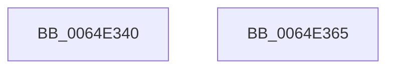

# WdipSemClearFrequentScenarioTable

- RVA: `0x0064E340`–`0x0064E366` (길이 `38` bytes)
- VA: `0x000000014064E340`
- 실행 섹션: `.text`
- PDB 이름 있음: `예`; PDB Function 태그: `아니요`
- unwind 정보 RVA: `0x0005C788`
- 디코드: `9`개 명령, `38/38` bytes 표시
- 미해석 바이트: `0` (있으면 어셈블리에 `.byte`로 보존)

> 이 문서는 커널 이미지의 기계어와 PDB 기호를 분석해 생성했습니다. 4번과 5번은 함수 원형과 자료형을 바이너리 사용 방식에서 추정한 C 해석이며 원본 소스 복구 결과는 아닙니다.

## 1. Dependencies

- 직접 호출 지점: **1**; 고유 호출 대상: **1**
- 직접 호출자로 확인된 함수: **2**
- RIP 상대 이미지 참조: **2**

### Outgoing calls
- `0x0064E353` → [memset](../6C/memset_function_006C6C40.md) (function, `0x006C6C40`)

### Direct callers
- [WdipSemInitializeGlobalState](../../page/7A/WdipSemInitializeGlobalState_function_007AF5FC.md) at `0x007AF6DB`
- [WdipSemShutdown](../../page/7B/WdipSemShutdown_function_007B0954.md) at `0x007B09DF`

### Static image references
- `0x0064E346` → RVA `0x00F02040` (`.data`; read)
- `0x0064E358` → RVA `0x00F02448` (`.data`; read/write)

## 2. Other-region calls and transfers

- 다른 실행 섹션으로 향하는 call: **0**
- 별도 외부 분기/꼬리 이동을 확인하지 못했습니다.

## 3. Assembly (complete function range)

```asm
0064E340  48 83 EC 28                     sub rsp, 0x28
0064E344  33 D2                           xor edx, edx
0064E346  48 8D 0D F3 3C 8B 00            lea rcx, [rip + 0x8b3cf3]
0064E34D  41 B8 08 04 00 00               mov r8d, 0x408
0064E353  E8 E8 88 07 00                  call 0x1406c6c40
0064E358  48 83 25 E8 40 8B 00 00         and qword ptr [rip + 0x8b40e8], 0
0064E360  48 83 C4 28                     add rsp, 0x28
0064E364  C3                              ret
0064E365  CC                              int3
```

## 4. C-style interpretation (structured pseudocode)

```c
__int64 __fastcall WdipSemClearFrequentScenarioTable(__int64 a1, int a2)
{
    __int64 result;
    __int64 v_rsp;

    v_rsp = (v_rsp) - (40);
    a2 = 0;
    result = memset(v_rip + 9125107, a2, (unsigned int)(0x408ULL), a4);
    v_rsp = (v_rsp) + (40);
    return result;
}
```

## 5. (Beta) C Style

```c
int64_t WdipSemClearFrequentScenarioTable(int64_t Arg1, int32_t Arg2)
{
    int64_t result;
    int64_t local_rsp;

    local_rsp = (local_rsp) - (40);
    Arg2 = 0;
    result = memset(v_rip + 9125107, Arg2, (uint32_t)(0x408ULL), a4);
    local_rsp = (local_rsp) + (40);
    return result;
}
```

## 6. Execution-region graph

[열기: 2D/3D 그래프와 함수 탐색 컨트롤 패널](../../../control-panel.html?section=text&rva=0x0064E340&view=graph)

- 2D 그래프는 위에서 아래로 흐르고, 3D 그래프는 빈 공간을 드래그해 회전합니다. Shift+드래그는 이동, 휠은 확대·축소, 함수 노드 선택은 대상 보고서 이동입니다.

### Static fallback


