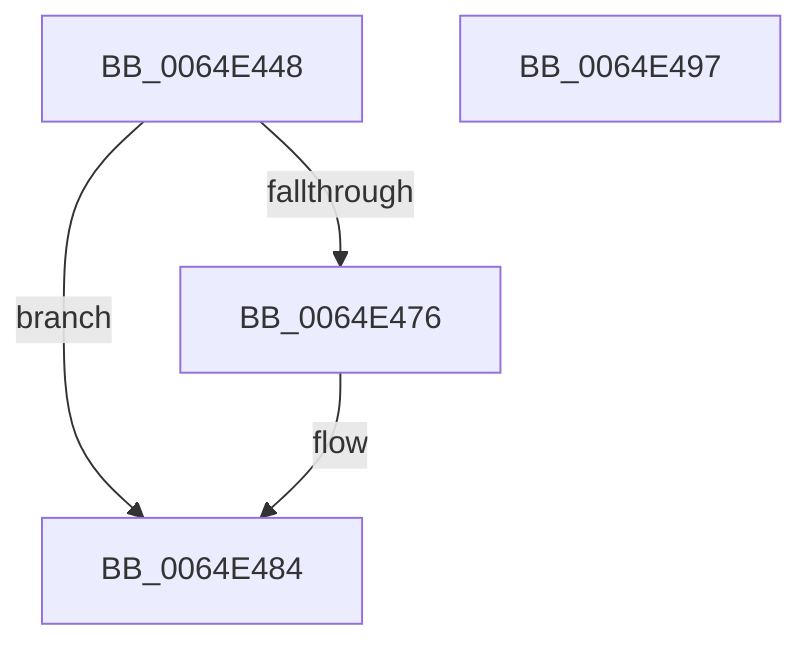

# WmiVerifierCopyEvent

- RVA: `0x0064E448`–`0x0064E498` (길이 `80` bytes)
- VA: `0x000000014064E448`
- 실행 섹션: `.text`
- PDB 이름 있음: `예`; PDB Function 태그: `아니요`
- unwind 정보 RVA: `0x00060BC4`
- 디코드: `24`개 명령, `80/80` bytes 표시
- 미해석 바이트: `0` (있으면 어셈블리에 `.byte`로 보존)

> 이 문서는 커널 이미지의 기계어와 PDB 기호를 분석해 생성했습니다. 4번과 5번은 함수 원형과 자료형을 바이너리 사용 방식에서 추정한 C 해석이며 원본 소스 복구 결과는 아닙니다.

## 1. Dependencies

- 직접 호출 지점: **2**; 고유 호출 대상: **2**
- 직접 호출자로 확인된 함수: **1**
- RIP 상대 이미지 참조: **0**

### Outgoing calls
- `0x0064E469` → [ExAllocatePool2](../../poolcode/B8/ExAllocatePool2_function_00B820F0.md) (function, `0x00B820F0`)
- `0x0064E47F` → [memcpy](../6C/memcpy_function_006C6840.md) (function, `0x006C6840`)

### Direct callers
- [VerifierIoWMIWriteEvent](../../pagevrfy/BB/VerifierIoWMIWriteEvent_function_00BB1640.md) at `0x00BB166B`

### Static image references
- 디코드된 RIP-relative 메모리 참조가 없습니다.

## 2. Other-region calls and transfers

- 다른 실행 섹션으로 향하는 call: **1**
  - `0x0064E469` → [ExAllocatePool2](../../poolcode/B8/ExAllocatePool2_function_00B820F0.md) (`.text` → `POOLCODE`)
- 별도 외부 분기/꼬리 이동을 확인하지 못했습니다.

## 3. Assembly (complete function range)

```asm
0064E448  48 89 5C 24 08                  mov qword ptr [rsp + 8], rbx
0064E44D  48 89 74 24 10                  mov qword ptr [rsp + 0x10], rsi
0064E452  57                              push rdi
0064E453  48 83 EC 20                     sub rsp, 0x20
0064E457  8B 31                           mov esi, dword ptr [rcx]
0064E459  48 8B F9                        mov rdi, rcx
0064E45C  8B D6                           mov edx, esi
0064E45E  41 B8 57 6D 69 70               mov r8d, 0x70696d57
0064E464  B9 40 00 00 00                  mov ecx, 0x40
0064E469  E8 82 3C 53 00                  call 0x140b820f0
0064E46E  48 8B D8                        mov rbx, rax
0064E471  48 85 C0                        test rax, rax
0064E474  74 0E                           je 0x14064e484
0064E476  44 8B C6                        mov r8d, esi
0064E479  48 8B D7                        mov rdx, rdi
0064E47C  48 8B C8                        mov rcx, rax
0064E47F  E8 BC 83 07 00                  call 0x1406c6840
0064E484  48 8B 74 24 38                  mov rsi, qword ptr [rsp + 0x38]
0064E489  48 8B C3                        mov rax, rbx
0064E48C  48 8B 5C 24 30                  mov rbx, qword ptr [rsp + 0x30]
0064E491  48 83 C4 20                     add rsp, 0x20
0064E495  5F                              pop rdi
0064E496  C3                              ret
0064E497  CC                              int3
```

## 4. C-style interpretation (structured pseudocode)

```c
__int64 __fastcall WmiVerifierCopyEvent(__int64 a1)
{
    __int64 result;
    __int64 v_rsp;
    unsigned __int64 v_stack_p10;
    unsigned __int64 v_stack_p8;

    v_stack_p8 = v_rbx;
    v_stack_p10 = v_rsi;
    v_rsp = (v_rsp) - (32);
    result = ExAllocatePool2(64, (unsigned int)((unsigned int)((unsigned int)(*(unsigned int *)(a1)))), (unsigned int)(0x70696D57ULL), a4);
    if (result != 0) {
        a3 = (unsigned int)((unsigned int)(*(unsigned int *)(a1)));
        a2 = a1;
        a1 = result;
        result = memcpy(a1, a2, a3, a4);
    }
    v_rsp = (v_rsp) + (32);
    return result;
}
```

## 5. (Beta) C Style

```c
int64_t WmiVerifierCopyEvent(void *Arg1)
{
    uint8_t *arg1 = (uint8_t *)Arg1;

    int64_t result;
    int64_t local_rsp;
    uint64_t v_stack_p10;
    uint64_t v_stack_p8;

    v_stack_p8 = local_rbx;
    v_stack_p10 = local_rsi;
    local_rsp = (local_rsp) - (32);
    result = ExAllocatePool2(64, (uint32_t)((uint32_t)((uint32_t)(*(uint32_t *)(arg1)))), (uint32_t)(0x70696D57ULL), a4);
    if (result != 0) {
        a3 = (uint32_t)((uint32_t)(*(uint32_t *)(arg1)));
        a2 = Arg1;
        Arg1 = result;
        result = memcpy(Arg1, a2, a3, a4);
    }
    local_rsp = (local_rsp) + (32);
    return result;
}
```

### 관측된 메모리 오프셋

구조체 형식이 확인되지 않은 접근은 인자 기준의 오프셋으로만 기록했습니다.

| 기준 인자 | 오프셋 표현 | 폭 (bit) | 접근 |
|---|---:|---:|---|
| `Arg1` | `+ 0x0` | `32` | `R` |

## 6. Execution-region graph

[열기: 2D/3D 그래프와 함수 탐색 컨트롤 패널](../../../control-panel.html?section=text&rva=0x0064E448&view=graph)

- 2D 그래프는 위에서 아래로 흐르고, 3D 그래프는 빈 공간을 드래그해 회전합니다. Shift+드래그는 이동, 휠은 확대·축소, 함수 노드 선택은 대상 보고서 이동입니다.

### Static fallback


