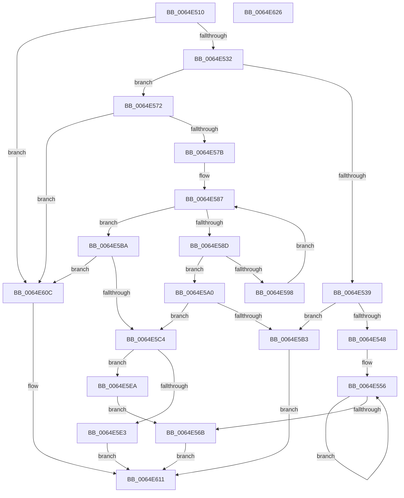

# WmipFirmwareTableHandler

- RVA: `0x0064E510`–`0x0064E627` (길이 `279` bytes)
- VA: `0x000000014064E510`
- 실행 섹션: `.text`
- PDB 이름 있음: `예`; PDB Function 태그: `아니요`
- unwind 정보 RVA: `0x0005C954`
- 디코드: `81`개 명령, `279/279` bytes 표시
- 미해석 바이트: `0` (있으면 어셈블리에 `.byte`로 보존)

> 이 문서는 커널 이미지의 기계어와 PDB 기호를 분석해 생성했습니다. 4번과 5번은 함수 원형과 자료형을 바이너리 사용 방식에서 추정한 C 해석이며 원본 소스 복구 결과는 아닙니다.

## 1. Dependencies

- 직접 호출 지점: **3**; 고유 호출 대상: **3**
- 직접 호출자로 확인된 함수: **0**
- RIP 상대 이미지 참조: **1**

### Outgoing calls
- `0x0064E5D6` → [MmMapIoSpaceEx](../32/MmMapIoSpaceEx_function_00327830.md) (function, `0x00327830`)
- `0x0064E5F4` → [memcpy](../6C/memcpy_function_006C6840.md) (function, `0x006C6840`)
- `0x0064E602` → [MiUnmapContiguousMemory](../3F/MiUnmapContiguousMemory_function_003F7908.md) (function, `0x003F7908`)

### Direct callers
- 이 함수 시작 RVA로 연결되는 직접 call은 확인되지 않았습니다. 간접 호출은 완전히 역산할 수 없습니다.

### Static image references
- `0x0064E54F` → RVA `0x00038358` (`.rdata`; read)

## 2. Other-region calls and transfers

- 다른 실행 섹션으로 향하는 call: **0**
- 별도 외부 분기/꼬리 이동을 확인하지 못했습니다.

## 3. Assembly (complete function range)

```asm
0064E510  48 89 5C 24 08                  mov qword ptr [rsp + 8], rbx
0064E515  48 89 6C 24 10                  mov qword ptr [rsp + 0x10], rbp
0064E51A  48 89 74 24 18                  mov qword ptr [rsp + 0x18], rsi
0064E51F  57                              push rdi
0064E520  48 83 EC 20                     sub rsp, 0x20
0064E524  33 FF                           xor edi, edi
0064E526  48 8B D9                        mov rbx, rcx
0064E529  48 85 C9                        test rcx, rcx
0064E52C  0F 84 DA 00 00 00               je 0x14064e60c
0064E532  8B 41 04                        mov eax, dword ptr [rcx + 4]
0064E535  85 C0                           test eax, eax
0064E537  75 39                           jne 0x14064e572
0064E539  8B 41 0C                        mov eax, dword ptr [rcx + 0xc]
0064E53C  C7 41 0C 08 00 00 00            mov dword ptr [rcx + 0xc], 8
0064E543  83 F8 08                        cmp eax, 8
0064E546  72 6B                           jb 0x14064e5b3
0064E548  48 83 C3 10                     add rbx, 0x10
0064E54C  8D 4F 02                        lea ecx, [rdi + 2]
0064E54F  4C 8D 0D 02 9E 9E FF            lea r9, [rip - 0x6161fe]
0064E556  8B C7                           mov eax, edi
0064E558  83 C7 02                        add edi, 2
0064E55B  41 8B 04 81                     mov eax, dword ptr [r9 + rax*4]
0064E55F  89 03                           mov dword ptr [rbx], eax
0064E561  48 8D 5B 04                     lea rbx, [rbx + 4]
0064E565  48 83 E9 01                     sub rcx, 1
0064E569  75 EB                           jne 0x14064e556
0064E56B  33 C0                           xor eax, eax
0064E56D  E9 9F 00 00 00                  jmp 0x14064e611
0064E572  83 F8 01                        cmp eax, 1
0064E575  0F 85 91 00 00 00               jne 0x14064e60c
0064E57B  8B D7                           mov edx, edi
0064E57D  4C 8D 0D D4 9D 9E FF            lea r9, [rip - 0x61622c]
0064E584  44 8B C7                        mov r8d, edi
0064E587  41 83 F8 02                     cmp r8d, 2
0064E58B  73 2D                           jae 0x14064e5ba
0064E58D  8B 43 08                        mov eax, dword ptr [rbx + 8]
0064E590  8B CA                           mov ecx, edx
0064E592  41 39 04 89                     cmp dword ptr [r9 + rcx*4], eax
0064E596  74 08                           je 0x14064e5a0
0064E598  41 FF C0                        inc r8d
0064E59B  83 C2 02                        add edx, 2
0064E59E  EB E7                           jmp 0x14064e587
0064E5A0  8D 42 01                        lea eax, [rdx + 1]
0064E5A3  45 8B 14 81                     mov r10d, dword ptr [r9 + rax*4]
0064E5A7  8B 43 0C                        mov eax, dword ptr [rbx + 0xc]
0064E5AA  44 89 53 0C                     mov dword ptr [rbx + 0xc], r10d
0064E5AE  41 3B C2                        cmp eax, r10d
0064E5B1  73 11                           jae 0x14064e5c4
0064E5B3  B8 23 00 00 C0                  mov eax, 0xc0000023
0064E5B8  EB 57                           jmp 0x14064e611
0064E5BA  BA 02 00 00 00                  mov edx, 2
0064E5BF  44 8B D7                        mov r10d, edi
0064E5C2  74 48                           je 0x14064e60c
0064E5C4  8B C2                           mov eax, edx
0064E5C6  41 B8 04 02 00 00               mov r8d, 0x204
0064E5CC  41 8B D2                        mov edx, r10d
0064E5CF  41 8B F2                        mov esi, r10d
0064E5D2  41 8B 0C 81                     mov ecx, dword ptr [r9 + rax*4]
0064E5D6  E8 55 92 CD FF                  call 0x140327830
0064E5DB  48 8B E8                        mov rbp, rax
0064E5DE  48 85 C0                        test rax, rax
0064E5E1  75 07                           jne 0x14064e5ea
0064E5E3  B8 25 02 00 C0                  mov eax, 0xc0000225
0064E5E8  EB 27                           jmp 0x14064e611
0064E5EA  48 8D 4B 10                     lea rcx, [rbx + 0x10]
0064E5EE  4C 8B C6                        mov r8, rsi
0064E5F1  48 8B D5                        mov rdx, rbp
0064E5F4  E8 47 82 07 00                  call 0x1406c6840
0064E5F9  41 B0 01                        mov r8b, 1
0064E5FC  48 8B D6                        mov rdx, rsi
0064E5FF  48 8B CD                        mov rcx, rbp
0064E602  E8 01 93 DA FF                  call 0x1403f7908
0064E607  E9 5F FF FF FF                  jmp 0x14064e56b
0064E60C  B8 EF 00 00 C0                  mov eax, 0xc00000ef
0064E611  48 8B 5C 24 30                  mov rbx, qword ptr [rsp + 0x30]
0064E616  48 8B 6C 24 38                  mov rbp, qword ptr [rsp + 0x38]
0064E61B  48 8B 74 24 40                  mov rsi, qword ptr [rsp + 0x40]
0064E620  48 83 C4 20                     add rsp, 0x20
0064E624  5F                              pop rdi
0064E625  C3                              ret
0064E626  CC                              int3
```

## 4. C-style interpretation (structured pseudocode)

```c
__int64 __fastcall WmipFirmwareTableHandler(__int64 a1)
{
    __int64 result;
    __int64 v_rbx;
    __int64 v_rdi;
    __int64 v_rsp;
    unsigned __int64 v_stack_p10;
    unsigned __int64 v_stack_p18;
    unsigned __int64 v_stack_p8;

    v_stack_p8 = v_rbx;
    v_stack_p10 = v_rbp;
    v_stack_p18 = v_rsi;
    v_rsp = (v_rsp) - (32);
    v_rdi = 0;
    if (a1 == 0) goto loc_0064E60C;
    if ((unsigned int)((unsigned int)(*(unsigned int *)(a1 + 4))) != 0) goto loc_0064E572;
    *(unsigned int *)(a1 + 12) = 8;
    if (((unsigned int)((unsigned int)(*(unsigned int *)(a1 + 12)))) < 8) goto loc_0064E5B3;
    v_rbx = (a1) + (16);
loc_0064E556:
    v_rdi = (unsigned int)((v_rdi) + (2));
    *(unsigned int *)(v_rbx) = (unsigned int)((unsigned int)(*(unsigned int *)(v_rip - 6382078 + 0 * 4)));
    a1 = (v_rdi + 2) - (1);
    if (condition_is_not_equal) goto loc_0064E556;
loc_0064E56B:
    result = 0;
    goto loc_0064E611;
loc_0064E572:
    if (0 != 1) goto loc_0064E60C;
loc_0064E587:
    if (((unsigned int)((unsigned int)((unsigned int)(v_rdi)))) >= 2) goto loc_0064E5BA;
    if ((*(unsigned int *)(v_rip - 6382124 + (unsigned int)((unsigned int)((unsigned int)((unsigned int)(v_rdi)))) * 4)) == ((unsigned int)((unsigned int)(*(unsigned int *)(v_rbx + 4 + 8))))) goto loc_0064E5A0;
    a3 = (unsigned int)(((unsigned int)((unsigned int)(v_rdi))) + 1);
    a2 = (unsigned int)(((unsigned int)((unsigned int)(v_rdi))) + (2));
    goto loc_0064E587;
loc_0064E5A0:
    *(unsigned int *)(v_rbx + 4 + 12) = (unsigned int)((unsigned int)(*(unsigned int *)(v_rip - 6382124 + a2 + 1 * 4)));
    if (((unsigned int)((unsigned int)(*(unsigned int *)(v_rbx + 4 + 12)))) >= ((unsigned int)((unsigned int)(*(unsigned int *)(v_rip - 6382124 + a2 + 1 * 4))))) goto loc_0064E5C4;
loc_0064E5B3:
    goto loc_0064E611;
loc_0064E5BA:
    if (((unsigned int)((unsigned int)(*(unsigned int *)(v_rbx + 4 + 12)))) == ((unsigned int)((unsigned int)(*(unsigned int *)(v_rip - 6382124 + a2 + 1 * 4))))) goto loc_0064E60C;
loc_0064E5C4:
    result = MmMapIoSpaceEx((unsigned int)(*(unsigned int *)(v_rip - 6382124 + 2 * 4)), (unsigned int)((unsigned int)((unsigned int)((unsigned int)(v_rdi)))), 516, v_rip - 6382124);
    if (result != 0) goto loc_0064E5EA;
    goto loc_0064E611;
loc_0064E5EA:
    result = memcpy(v_rbx + 4 + 16, result, (unsigned int)((unsigned int)((unsigned int)((unsigned int)(v_rdi)))), v_rip - 6382124);
    result = MiUnmapContiguousMemory(result, (unsigned int)((unsigned int)((unsigned int)((unsigned int)(v_rdi)))), 1, v_rip - 6382124);
    goto loc_0064E56B;
loc_0064E60C:
loc_0064E611:
    v_rsp = (v_rsp) + (32);
    return (unsigned int)(0xC00000EFULL);
}
```

## 5. (Beta) C Style

```c
int64_t WmipFirmwareTableHandler(void *Arg1)
{
    uint8_t *arg1 = (uint8_t *)Arg1;

    int64_t result;
    int64_t local_rbx;
    int64_t local_rdi;
    int64_t local_rsp;
    uint64_t v_stack_p10;
    uint64_t v_stack_p18;
    uint64_t v_stack_p8;

    v_stack_p8 = local_rbx;
    v_stack_p10 = local_rbp;
    v_stack_p18 = local_rsi;
    local_rsp = (local_rsp) - (32);
    local_rdi = 0;
    if (Arg1 == NULL) goto loc_0064E60C;
    if ((uint32_t)((uint32_t)(*(uint32_t *)(arg1 + 0x4))) != 0) goto loc_0064E572;
    *(uint32_t *)(arg1 + 0xC) = 8;
    if (((uint32_t)((uint32_t)(*(uint32_t *)(arg1 + 0xC)))) < 8) goto loc_0064E5B3;
    local_rbx = (Arg1) + (16);
loc_0064E556:
    local_rdi = (uint32_t)((local_rdi) + (2));
    *(uint32_t *)(local_rbx) = (uint32_t)((uint32_t)(*(uint32_t *)(v_rip - 0x6161FE + 0x0 * 4)));
    Arg1 = (local_rdi + 2) - (1);
    if (condition_is_not_equal) goto loc_0064E556;
loc_0064E56B:
    result = 0;
    goto loc_0064E611;
loc_0064E572:
    if (0 != 1) goto loc_0064E60C;
loc_0064E587:
    if (((uint32_t)((uint32_t)((uint32_t)(local_rdi)))) >= 2) goto loc_0064E5BA;
    if ((*(uint32_t *)(v_rip - 0x61622C + (uint32_t)((uint32_t)((uint32_t)((uint32_t)(local_rdi)))) * 4)) == ((uint32_t)((uint32_t)(*(uint32_t *)(local_rbx + 0x4 + 0x8))))) goto loc_0064E5A0;
    a3 = (uint32_t)(((uint32_t)((uint32_t)(local_rdi))) + 1);
    a2 = (uint32_t)(((uint32_t)((uint32_t)(local_rdi))) + (2));
    goto loc_0064E587;
loc_0064E5A0:
    *(uint32_t *)(local_rbx + 0x4 + 0xC) = (uint32_t)((uint32_t)(*(uint32_t *)(v_rip - 0x61622C + a2 + 0x1 * 4)));
    if (((uint32_t)((uint32_t)(*(uint32_t *)(local_rbx + 0x4 + 0xC)))) >= ((uint32_t)((uint32_t)(*(uint32_t *)(v_rip - 0x61622C + a2 + 0x1 * 4))))) goto loc_0064E5C4;
loc_0064E5B3:
    goto loc_0064E611;
loc_0064E5BA:
    if (((uint32_t)((uint32_t)(*(uint32_t *)(local_rbx + 0x4 + 0xC)))) == ((uint32_t)((uint32_t)(*(uint32_t *)(v_rip - 0x61622C + a2 + 0x1 * 4))))) goto loc_0064E60C;
loc_0064E5C4:
    result = MmMapIoSpaceEx((uint32_t)(*(uint32_t *)(v_rip - 0x61622C + 0x2 * 4)), (uint32_t)((uint32_t)((uint32_t)((uint32_t)(local_rdi)))), 516, v_rip - 6382124);
    if (result != 0) goto loc_0064E5EA;
    goto loc_0064E611;
loc_0064E5EA:
    result = memcpy(local_rbx + 4 + 16, result, (uint32_t)((uint32_t)((uint32_t)((uint32_t)(local_rdi)))), v_rip - 6382124);
    result = MiUnmapContiguousMemory(result, (uint32_t)((uint32_t)((uint32_t)((uint32_t)(local_rdi)))), 1, v_rip - 6382124);
    goto loc_0064E56B;
loc_0064E60C:
loc_0064E611:
    local_rsp = (local_rsp) + (32);
    return (uint32_t)(0xC00000EFULL);
}
```

### 관측된 메모리 오프셋

구조체 형식이 확인되지 않은 접근은 인자 기준의 오프셋으로만 기록했습니다.

| 기준 인자 | 오프셋 표현 | 폭 (bit) | 접근 |
|---|---:|---:|---|
| `Arg1` | `+ 0x0` | `32` | `W` |
| `Arg1` | `+ 0x4` | `64` | `R` |
| `Arg1` | `+ 0x8` | `32` | `R` |
| `Arg1` | `+ 0xC` | `32` | `R` |
| `Arg1` | `+ 0xC` | `32` | `W` |
| `Arg1` | `+ 0x10` | `64` | `R` |

## 6. Execution-region graph

[열기: 2D/3D 그래프와 함수 탐색 컨트롤 패널](../../../control-panel.html?section=text&rva=0x0064E510&view=graph)

- 2D 그래프는 위에서 아래로 흐르고, 3D 그래프는 빈 공간을 드래그해 회전합니다. Shift+드래그는 이동, 휠은 확대·축소, 함수 노드 선택은 대상 보고서 이동입니다.

### Static fallback


