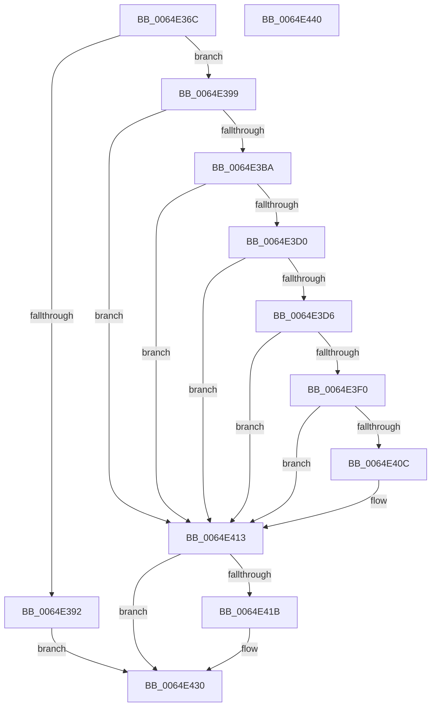

# WmipReadSMBiosSysInfo

- RVA: `0x0064E36C`–`0x0064E441` (길이 `213` bytes)
- VA: `0x000000014064E36C`
- 실행 섹션: `.text`
- PDB 이름 있음: `예`; PDB Function 태그: `아니요`
- unwind 정보 RVA: `0x000D3144`
- 디코드: `62`개 명령, `213/213` bytes 표시
- 미해석 바이트: `0` (있으면 어셈블리에 `.byte`로 보존)

> 이 문서는 커널 이미지의 기계어와 PDB 기호를 분석해 생성했습니다. 4번과 5번은 함수 원형과 자료형을 바이너리 사용 방식에서 추정한 C 해석이며 원본 소스 복구 결과는 아닙니다.

## 1. Dependencies

- 직접 호출 지점: **5**; 고유 호출 대상: **4**
- 직접 호출자로 확인된 함수: **1**
- RIP 상대 이미지 참조: **4**

### Outgoing calls
- `0x0064E3AA` → [WmipFindSMBiosStructure](../../page/7B/WmipFindSMBiosStructure_function_007B2944.md) (function, `0x007B2944`)
- `0x0064E3E5` → [WmipGetSMBiosString](../../page/7B/WmipGetSMBiosString_function_007B2D30.md) (function, `0x007B2D30`)
- `0x0064E401` → [WmipGetSMBiosString](../../page/7B/WmipGetSMBiosString_function_007B2D30.md) (function, `0x007B2D30`)
- `0x0064E426` → [MiUnmapContiguousMemory](../3F/MiUnmapContiguousMemory_function_003F7908.md) (function, `0x003F7908`)
- `0x0064E42B` → [WmiReleaseSmbiosLockExclusive](../../page/A9/WmiReleaseSmbiosLockExclusive_function_00A946F8.md) (function, `0x00A946F8`)

### Direct callers
- [WmiMatchSMBiosSysInfo](../../page/7B/WmiMatchSMBiosSysInfo_function_007B2820.md) at `0x007B284F`

### Static image references
- `0x0064E389` → RVA `0x00EFFBE8` (`.data`; read)
- `0x0064E3D8` → RVA `0x00EFFBC0` (`.data`; read)
- `0x0064E3F4` → RVA `0x00EFFBD0` (`.data`; read)
- `0x0064E40C` → RVA `0x00EFFBE8` (`.data`; write)

## 2. Other-region calls and transfers

- 다른 실행 섹션으로 향하는 call: **4**
  - `0x0064E3AA` → [WmipFindSMBiosStructure](../../page/7B/WmipFindSMBiosStructure_function_007B2944.md) (`.text` → `PAGE`)
  - `0x0064E3E5` → [WmipGetSMBiosString](../../page/7B/WmipGetSMBiosString_function_007B2D30.md) (`.text` → `PAGE`)
  - `0x0064E401` → [WmipGetSMBiosString](../../page/7B/WmipGetSMBiosString_function_007B2D30.md) (`.text` → `PAGE`)
  - `0x0064E42B` → [WmiReleaseSmbiosLockExclusive](../../page/A9/WmiReleaseSmbiosLockExclusive_function_00A946F8.md) (`.text` → `PAGE`)
- 별도 외부 분기/꼬리 이동을 확인하지 못했습니다.

## 3. Assembly (complete function range)

```asm
0064E36C  48 8B C4                        mov rax, rsp
0064E36F  48 89 58 20                     mov qword ptr [rax + 0x20], rbx
0064E373  55                              push rbp
0064E374  57                              push rdi
0064E375  41 56                           push r14
0064E377  48 83 EC 20                     sub rsp, 0x20
0064E37B  48 83 60 18 00                  and qword ptr [rax + 0x18], 0
0064E380  48 83 60 10 00                  and qword ptr [rax + 0x10], 0
0064E385  83 60 08 00                     and dword ptr [rax + 8], 0
0064E389  80 3D 58 18 8B 00 01            cmp byte ptr [rip + 0x8b1858], 1
0064E390  75 07                           jne 0x14064e399
0064E392  33 DB                           xor ebx, ebx
0064E394  E9 97 00 00 00                  jmp 0x14064e430
0064E399  4C 8D 4C 24 40                  lea r9, [rsp + 0x40]
0064E39E  B1 01                           mov cl, 1
0064E3A0  4C 8D 44 24 48                  lea r8, [rsp + 0x48]
0064E3A5  48 8D 54 24 50                  lea rdx, [rsp + 0x50]
0064E3AA  E8 95 45 16 00                  call 0x1407b2944
0064E3AF  44 8B 74 24 40                  mov r14d, dword ptr [rsp + 0x40]
0064E3B4  8B D8                           mov ebx, eax
0064E3B6  85 C0                           test eax, eax
0064E3B8  78 59                           js 0x14064e413
0064E3BA  48 8B 7C 24 50                  mov rdi, qword ptr [rsp + 0x50]
0064E3BF  41 8D 6E FF                     lea ebp, [r14 - 1]
0064E3C3  48 03 6C 24 48                  add rbp, qword ptr [rsp + 0x48]
0064E3C8  0F B6 47 04                     movzx eax, byte ptr [rdi + 4]
0064E3CC  84 C0                           test al, al
0064E3CE  74 43                           je 0x14064e413
0064E3D0  80 7F 05 00                     cmp byte ptr [rdi + 5], 0
0064E3D4  74 3D                           je 0x14064e413
0064E3D6  8B D0                           mov edx, eax
0064E3D8  4C 8D 0D E1 17 8B 00            lea r9, [rip + 0x8b17e1]
0064E3DF  4C 8B C5                        mov r8, rbp
0064E3E2  48 8B CF                        mov rcx, rdi
0064E3E5  E8 46 49 16 00                  call 0x1407b2d30
0064E3EA  8B D8                           mov ebx, eax
0064E3EC  85 C0                           test eax, eax
0064E3EE  78 23                           js 0x14064e413
0064E3F0  0F B6 57 05                     movzx edx, byte ptr [rdi + 5]
0064E3F4  4C 8D 0D D5 17 8B 00            lea r9, [rip + 0x8b17d5]
0064E3FB  4C 8B C5                        mov r8, rbp
0064E3FE  48 8B CF                        mov rcx, rdi
0064E401  E8 2A 49 16 00                  call 0x1407b2d30
0064E406  8B D8                           mov ebx, eax
0064E408  85 C0                           test eax, eax
0064E40A  78 07                           js 0x14064e413
0064E40C  C6 05 D5 17 8B 00 01            mov byte ptr [rip + 0x8b17d5], 1
0064E413  48 83 7C 24 48 00               cmp qword ptr [rsp + 0x48], 0
0064E419  74 15                           je 0x14064e430
0064E41B  48 8B 4C 24 48                  mov rcx, qword ptr [rsp + 0x48]
0064E420  49 8B D6                        mov rdx, r14
0064E423  41 B0 01                        mov r8b, 1
0064E426  E8 DD 94 DA FF                  call 0x1403f7908
0064E42B  E8 C8 62 44 00                  call 0x140a946f8
0064E430  8B C3                           mov eax, ebx
0064E432  48 8B 5C 24 58                  mov rbx, qword ptr [rsp + 0x58]
0064E437  48 83 C4 20                     add rsp, 0x20
0064E43B  41 5E                           pop r14
0064E43D  5F                              pop rdi
0064E43E  5D                              pop rbp
0064E43F  C3                              ret
0064E440  CC                              int3
```

## 4. C-style interpretation (structured pseudocode)

```c
__int64 __fastcall WmipReadSMBiosSysInfo(void)
{
    __int64 result;
    __int64 v_rbp;
    __int64 v_rbx;
    __int64 v_rsp;
    unsigned __int64 v_stack_p10;
    unsigned __int64 v_stack_p18;
    unsigned __int64 v_stack_p20;
    unsigned __int64 v_stack_p8;

    *(unsigned __int64 *)(v_rsp + 32) = v_rbx;
    v_rsp = (v_rsp) - (32);
    if ((*(unsigned __int8 *)(v_rip + 9115736)) != 1) goto loc_0064E399;
    v_rbx = 0;
    goto loc_0064E430;
loc_0064E399:
    result = WmipFindSMBiosStructure(1, v_stack_p18, v_stack_p10, v_stack_p8);
    if (sign_flag) goto loc_0064E413;
    v_rbp = ((unsigned int)(v_stack_p8) - 1) + (v_stack_p10);
    if ((unsigned __int8)(*(unsigned __int8 *)(v_stack_p18 + 4)) == 0) goto loc_0064E413;
    if ((*(unsigned __int8 *)(v_stack_p18 + 5)) == 0) goto loc_0064E413;
    result = WmipGetSMBiosString(v_stack_p18, (unsigned int)((unsigned int)(*(unsigned __int8 *)(v_stack_p18 + 4))), v_rbp, v_rip + 9115617);
    if (sign_flag) goto loc_0064E413;
    result = WmipGetSMBiosString(v_stack_p18, *(unsigned __int8 *)(v_stack_p18 + 5), v_rbp, v_rip + 9115605);
    if (!(sign_flag)) {
        *(unsigned __int8 *)(v_rip + 9115605) = 1;
    }
    if (v_stack_p10 != 0) {
        a1 = v_stack_p10;
        a2 = (unsigned int)(v_stack_p8);
        a3 = 1;
        result = MiUnmapContiguousMemory(a1, a2, a3, v_rip + 9115605);
        result = WmiReleaseSmbiosLockExclusive(a1, a2, a3, v_rip + 9115605);
    }
    v_rsp = (v_rsp) + (32);
    return (unsigned int)((unsigned int)((unsigned int)((unsigned int)(result))));
}
```

## 5. (Beta) C Style

```c
void WmipReadSMBiosSysInfo(void)
{
    int64_t result;
    int64_t local_rbp;
    int64_t local_rbx;
    int64_t local_rsp;
    uint64_t v_stack_p10;
    uint64_t v_stack_p18;
    uint64_t v_stack_p20;
    uint64_t v_stack_p8;

    *(uint64_t *)(local_rsp + 0x20) = local_rbx;
    local_rsp = (local_rsp) - (32);
    if ((*(uint8_t *)(v_rip + 0x8B1858)) != 1) goto loc_0064E399;
    local_rbx = 0;
    goto loc_0064E430;
loc_0064E399:
    result = WmipFindSMBiosStructure(1, v_stack_p18, v_stack_p10, v_stack_p8);
    if (sign_flag) goto loc_0064E413;
    local_rbp = ((uint32_t)(v_stack_p8) - 1) + (v_stack_p10);
    if ((uint8_t)(*(uint8_t *)(v_stack_p18 + 0x4)) == 0) goto loc_0064E413;
    if ((*(uint8_t *)(v_stack_p18 + 0x5)) == 0) goto loc_0064E413;
    result = WmipGetSMBiosString(v_stack_p18, (uint32_t)((uint32_t)(*(uint8_t *)(v_stack_p18 + 0x4))), local_rbp, v_rip + 9115617);
    if (sign_flag) goto loc_0064E413;
    result = WmipGetSMBiosString(v_stack_p18, *(uint8_t *)(v_stack_p18 + 0x5), local_rbp, v_rip + 9115605);
    if (!(sign_flag)) {
        *(uint8_t *)(v_rip + 0x8B17D5) = 1;
    }
    if (v_stack_p10 != 0) {
        a1 = v_stack_p10;
        a2 = (uint32_t)(v_stack_p8);
        a3 = 1;
        result = MiUnmapContiguousMemory(a1, a2, a3, v_rip + 9115605);
        result = WmiReleaseSmbiosLockExclusive(a1, a2, a3, v_rip + 9115605);
    }
    local_rsp = (local_rsp) + (32);
    return (uint32_t)((uint32_t)((uint32_t)((uint32_t)(result))));
}
```

## 6. Execution-region graph

[열기: 2D/3D 그래프와 함수 탐색 컨트롤 패널](../../../control-panel.html?section=text&rva=0x0064E36C&view=graph)

- 2D 그래프는 위에서 아래로 흐르고, 3D 그래프는 빈 공간을 드래그해 회전합니다. Shift+드래그는 이동, 휠은 확대·축소, 함수 노드 선택은 대상 보고서 이동입니다.

### Static fallback


