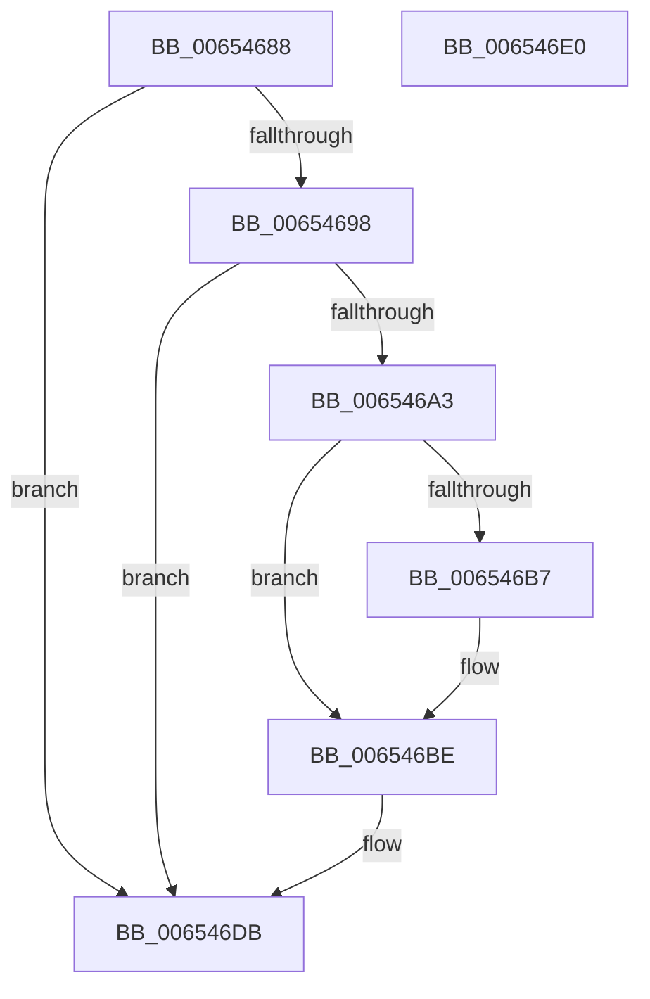

# BapdpInitializePageDatabase

- RVA: `0x00654688`–`0x006546E1` (길이 `89` bytes)
- VA: `0x0000000140654688`
- 실행 섹션: `.text`
- PDB 이름 있음: `예`; PDB Function 태그: `아니요`
- unwind 정보 RVA: `0x0005C788`
- 디코드: `21`개 명령, `89/89` bytes 표시
- 미해석 바이트: `0` (있으면 어셈블리에 `.byte`로 보존)

> 이 문서는 커널 이미지의 기계어와 PDB 기호를 분석해 생성했습니다. 4번과 5번은 함수 원형과 자료형을 바이너리 사용 방식에서 추정한 C 해석이며 원본 소스 복구 결과는 아닙니다.

## 1. Dependencies

- 직접 호출 지점: **2**; 고유 호출 대상: **2**
- 직접 호출자로 확인된 함수: **1**
- RIP 상대 이미지 참조: **6**

### Outgoing calls
- `0x006546A7` → `ext-ms-win-ntos-ksr-l1-1-5.dll!KsrInitPageDatabase` (import, 간접 대상; import `ext-ms-win-ntos-ksr-l1-1-5.dll!KsrInitPageDatabase`)
- `0x006546C7` → [ExFreePoolWithTag](../../poolcode/B8/ExFreePoolWithTag_function_00B82870.md) (function, `0x00B82870`)

### Direct callers
- [BootApplicationPersistentDataProcess](../../init/BE/BootApplicationPersistentDataProcess_function_00BEEBD4.md) at `0x00BEECB5`

### Static image references
- `0x0065468C` → RVA `0x00EFF010` (`.data`; read)
- `0x00654698` → RVA `0x00EFF008` (`.data`; read)
- `0x006546A7` → RVA `0x00151300` (`ext-ms-win-ntos-ksr-l1-1-5.dll!KsrInitPageDatabase (IAT)`; read)
- `0x006546B7` → RVA `0x00E68544` (`.data`; read/write)
- `0x006546CC` → RVA `0x00EFF010` (`.data`; read/write)
- `0x006546D4` → RVA `0x00EFF008` (`.data`; read/write)

## 2. Other-region calls and transfers

- 다른 실행 섹션으로 향하는 call: **1**
  - `0x006546C7` → [ExFreePoolWithTag](../../poolcode/B8/ExFreePoolWithTag_function_00B82870.md) (`.text` → `POOLCODE`)
- 별도 외부 분기/꼬리 이동을 확인하지 못했습니다.

## 3. Assembly (complete function range)

```asm
00654688  48 83 EC 28                     sub rsp, 0x28
0065468C  48 8B 0D 7D A9 8A 00            mov rcx, qword ptr [rip + 0x8aa97d]
00654693  48 85 C9                        test rcx, rcx
00654696  74 43                           je 0x1406546db
00654698  8B 15 6A A9 8A 00               mov edx, dword ptr [rip + 0x8aa96a]
0065469E  83 FA 04                        cmp edx, 4
006546A1  76 38                           jbe 0x1406546db
006546A3  48 83 C1 04                     add rcx, 4
006546A7  48 FF 15 52 CC AF FF            call qword ptr [rip - 0x5033ae]
006546AE  0F 1F 44 00 00                  nop dword ptr [rax + rax]
006546B3  85 C0                           test eax, eax
006546B5  78 07                           js 0x1406546be
006546B7  83 0D 86 3E 81 00 04            or dword ptr [rip + 0x813e86], 4
006546BE  48 8B 0D 4B A9 8A 00            mov rcx, qword ptr [rip + 0x8aa94b]
006546C5  33 D2                           xor edx, edx
006546C7  E8 A4 E1 52 00                  call 0x140b82870
006546CC  48 83 25 3C A9 8A 00 00         and qword ptr [rip + 0x8aa93c], 0
006546D4  83 25 2D A9 8A 00 00            and dword ptr [rip + 0x8aa92d], 0
006546DB  48 83 C4 28                     add rsp, 0x28
006546DF  C3                              ret
006546E0  CC                              int3
```

## 4. C-style interpretation (structured pseudocode)

```c
__int64 __fastcall BapdpInitializePageDatabase(void)
{
    __int64 result;
    __int64 v_rsp;

    v_rsp = (v_rsp) - (40);
    if (*(unsigned __int64 *)(v_rip + 9087357) == 0) goto loc_006546DB;
    if (((unsigned int)((unsigned int)(*(unsigned int *)(v_rip + 9087338)))) <= 4) goto loc_006546DB;
    a1 = (*(unsigned __int64 *)(v_rip + 9087357)) + (4);
    result = ext_ms_win_ntos_ksr_l1_1_5_dll_KsrInitPageDatabase(a1, (unsigned int)(*(unsigned int *)(v_rip + 9087338)), a3, a4);
    if (!(sign_flag)) {
    }
    a2 = 0;
    result = ExFreePoolWithTag(*(unsigned __int64 *)(v_rip + 9087307), a2, a3, a4);
loc_006546DB:
    v_rsp = (v_rsp) + (40);
    return result;
}
```

## 5. (Beta) C Style

```c
void BapdpInitializePageDatabase(void)
{
    int64_t result;
    int64_t local_rsp;

    local_rsp = (local_rsp) - (40);
    if (*(uint64_t *)(v_rip + 0x8AA97D) == 0) goto loc_006546DB;
    if (((uint32_t)((uint32_t)(*(uint32_t *)(v_rip + 0x8AA96A)))) <= 4) goto loc_006546DB;
    a1 = (*(uint64_t *)(v_rip + 0x8AA97D)) + (4);
    result = kernel_indirect_call(a1, (uint32_t)(*(uint32_t *)(v_rip + 0x8AA96A)), a3, a4);
    if (!(sign_flag)) {
    }
    a2 = 0;
    result = ExFreePoolWithTag(*(uint64_t *)(v_rip + 0x8AA94B), a2, a3, a4);
loc_006546DB:
    local_rsp = (local_rsp) + (40);
    return result;
}
```

## 6. Execution-region graph

[열기: 2D/3D 그래프와 함수 탐색 컨트롤 패널](../../../control-panel.html?section=text&rva=0x00654688&view=graph)

- 2D 그래프는 위에서 아래로 흐르고, 3D 그래프는 빈 공간을 드래그해 회전합니다. Shift+드래그는 이동, 휠은 확대·축소, 함수 노드 선택은 대상 보고서 이동입니다.

### Static fallback


