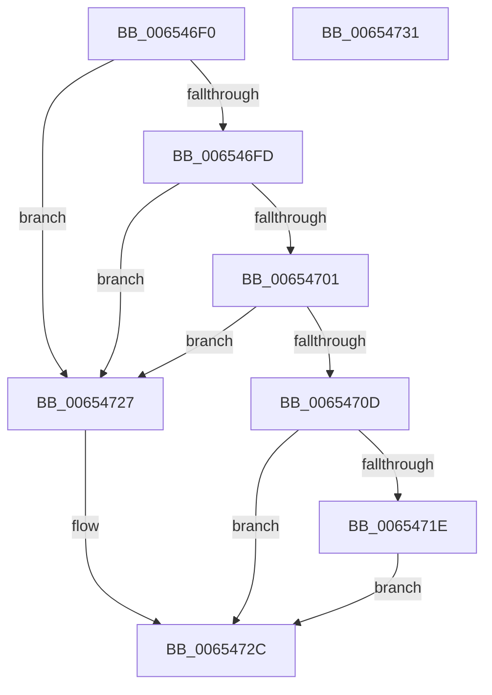

# BapdpKsrCancelScenario

- RVA: `0x006546F0`–`0x00654732` (길이 `66` bytes)
- VA: `0x00000001406546F0`
- 실행 섹션: `.text`
- PDB 이름 있음: `예`; PDB Function 태그: `아니요`
- unwind 정보 RVA: `0x0005D2F4`
- 디코드: `21`개 명령, `66/66` bytes 표시
- 미해석 바이트: `0` (있으면 어셈블리에 `.byte`로 보존)

> 이 문서는 커널 이미지의 기계어와 PDB 기호를 분석해 생성했습니다. 4번과 5번은 함수 원형과 자료형을 바이너리 사용 방식에서 추정한 C 해석이며 원본 소스 복구 결과는 아닙니다.

## 1. Dependencies

- 직접 호출 지점: **1**; 고유 호출 대상: **1**
- 직접 호출자로 확인된 함수: **0**
- RIP 상대 이미지 참조: **2**

### Outgoing calls
- `0x00654715` → [guard_dispatch_icall](../6B/guard_dispatch_icall_function_006BAAD0.md) (function, `0x006BAAD0`)

### Direct callers
- 이 함수 시작 RVA로 연결되는 직접 call은 확인되지 않았습니다. 간접 호출은 완전히 역산할 수 없습니다.

### Static image references
- `0x00654701` → RVA `0x00EFEFF0` (`.data`; read)
- `0x0065471E` → RVA `0x00E68544` (`.data`; read/write)

## 2. Other-region calls and transfers

- 다른 실행 섹션으로 향하는 call: **0**
- 별도 외부 분기/꼬리 이동을 확인하지 못했습니다.

## 3. Assembly (complete function range)

```asm
006546F0  48 83 EC 38                     sub rsp, 0x38
006546F4  B8 00 00 00 05                  mov eax, 0x5000000
006546F9  23 C8                           and ecx, eax
006546FB  74 2A                           je 0x140654727
006546FD  85 D0                           test eax, edx
006546FF  75 26                           jne 0x140654727
00654701  48 8B 05 E8 A8 8A 00            mov rax, qword ptr [rip + 0x8aa8e8]
00654708  48 85 C0                        test rax, rax
0065470B  74 1A                           je 0x140654727
0065470D  45 33 C9                        xor r9d, r9d
00654710  45 33 C0                        xor r8d, r8d
00654713  33 D2                           xor edx, edx
00654715  E8 B6 63 06 00                  call 0x1406baad0
0065471A  85 C0                           test eax, eax
0065471C  78 0E                           js 0x14065472c
0065471E  83 25 1F 3E 81 00 FB            and dword ptr [rip + 0x813e1f], 0xfffffffb
00654725  EB 05                           jmp 0x14065472c
00654727  B8 BB 00 00 C0                  mov eax, 0xc00000bb
0065472C  48 83 C4 38                     add rsp, 0x38
00654730  C3                              ret
00654731  CC                              int3
```

## 4. C-style interpretation (structured pseudocode)

```c
__int64 __fastcall BapdpKsrCancelScenario(int a1, int a2, int a3, int a4)
{
    __int64 result;
    __int64 v_rsp;

    v_rsp = (v_rsp) - (56);
    a1 = (unsigned int)((a1) & ((unsigned int)((unsigned int)(0x5000000ULL))));
    if (condition_is_equal) goto loc_00654727;
    if ((((unsigned int)((unsigned int)(0x5000000ULL))) & (a2)) != 0) goto loc_00654727;
    if (*(unsigned __int64 *)(v_rip + 9087208) == 0) goto loc_00654727;
    a4 = 0;
    a3 = 0;
    a2 = 0;
    result = guard_dispatch_icall(a1, a2, a3, a4);
    if (sign_flag) goto loc_0065472C;
    goto loc_0065472C;
loc_00654727:
loc_0065472C:
    v_rsp = (v_rsp) + (56);
    return (unsigned int)(0xC00000BBULL);
}
```

## 5. (Beta) C Style

```c
int64_t BapdpKsrCancelScenario(int32_t Arg1, int32_t Arg2, int32_t Arg3, int32_t Arg4)
{
    int64_t result;
    int64_t local_rsp;

    local_rsp = (local_rsp) - (56);
    Arg1 = (uint32_t)((Arg1) & ((uint32_t)((uint32_t)(0x5000000ULL))));
    if (condition_is_equal) goto loc_00654727;
    if ((((uint32_t)((uint32_t)(0x5000000ULL))) & (Arg2)) != 0) goto loc_00654727;
    if (*(uint64_t *)(v_rip + 0x8AA8E8) == 0) goto loc_00654727;
    Arg4 = 0;
    Arg3 = 0;
    Arg2 = 0;
    result = guard_dispatch_icall(Arg1, Arg2, Arg3, Arg4);
    if (sign_flag) goto loc_0065472C;
    goto loc_0065472C;
loc_00654727:
loc_0065472C:
    local_rsp = (local_rsp) + (56);
    return (uint32_t)(0xC00000BBULL);
}
```

## 6. Execution-region graph

[열기: 2D/3D 그래프와 함수 탐색 컨트롤 패널](../../../control-panel.html?section=text&rva=0x006546F0&view=graph)

- 2D 그래프는 위에서 아래로 흐르고, 3D 그래프는 빈 공간을 드래그해 회전합니다. Shift+드래그는 이동, 휠은 확대·축소, 함수 노드 선택은 대상 보고서 이동입니다.

### Static fallback


