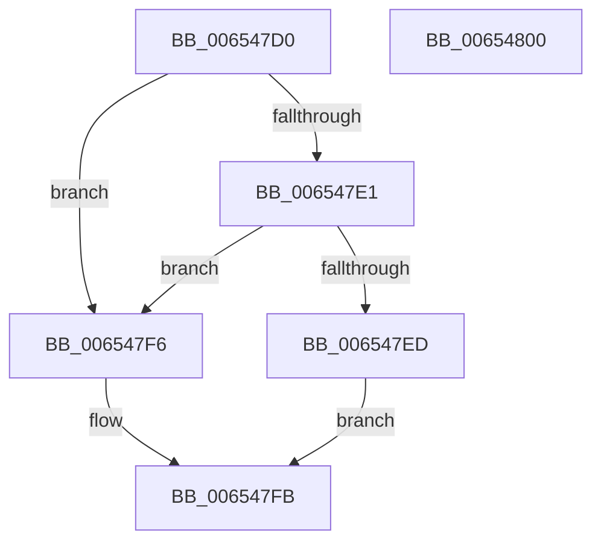

# BapdpKsrCompleteScenarioPhase0

- RVA: `0x006547D0`–`0x00654801` (길이 `49` bytes)
- VA: `0x00000001406547D0`
- 실행 섹션: `.text`
- PDB 이름 있음: `예`; PDB Function 태그: `아니요`
- unwind 정보 RVA: `0x0005C788`
- 디코드: `16`개 명령, `49/49` bytes 표시
- 미해석 바이트: `0` (있으면 어셈블리에 `.byte`로 보존)

> 이 문서는 커널 이미지의 기계어와 PDB 기호를 분석해 생성했습니다. 4번과 5번은 함수 원형과 자료형을 바이너리 사용 방식에서 추정한 C 해석이며 원본 소스 복구 결과는 아닙니다.

## 1. Dependencies

- 직접 호출 지점: **1**; 고유 호출 대상: **1**
- 직접 호출자로 확인된 함수: **0**
- RIP 상대 이미지 참조: **1**

### Outgoing calls
- `0x006547EF` → [guard_dispatch_icall](../6B/guard_dispatch_icall_function_006BAAD0.md) (function, `0x006BAAD0`)

### Direct callers
- 이 함수 시작 RVA로 연결되는 직접 call은 확인되지 않았습니다. 간접 호출은 완전히 역산할 수 없습니다.

### Static image references
- `0x006547E1` → RVA `0x00EFEFE8` (`.data`; read)

## 2. Other-region calls and transfers

- 다른 실행 섹션으로 향하는 call: **0**
- 별도 외부 분기/꼬리 이동을 확인하지 못했습니다.

## 3. Assembly (complete function range)

```asm
006547D0  48 83 EC 28                     sub rsp, 0x28
006547D4  B8 00 00 00 05                  mov eax, 0x5000000
006547D9  23 D0                           and edx, eax
006547DB  23 C8                           and ecx, eax
006547DD  3B CA                           cmp ecx, edx
006547DF  75 15                           jne 0x1406547f6
006547E1  48 8B 05 00 A8 8A 00            mov rax, qword ptr [rip + 0x8aa800]
006547E8  48 85 C0                        test rax, rax
006547EB  74 09                           je 0x1406547f6
006547ED  8B CA                           mov ecx, edx
006547EF  E8 DC 62 06 00                  call 0x1406baad0
006547F4  EB 05                           jmp 0x1406547fb
006547F6  B8 BB 00 00 C0                  mov eax, 0xc00000bb
006547FB  48 83 C4 28                     add rsp, 0x28
006547FF  C3                              ret
00654800  CC                              int3
```

## 4. C-style interpretation (structured pseudocode)

```c
__int64 __fastcall BapdpKsrCompleteScenarioPhase0(int a1, int a2)
{
    __int64 result;
    __int64 v_rsp;

    v_rsp = (v_rsp) - (40);
    a2 = (unsigned int)((a2) & ((unsigned int)((unsigned int)(0x5000000ULL))));
    a1 = (unsigned int)((a1) & ((unsigned int)((unsigned int)(0x5000000ULL))));
    if (a1 != a2) goto loc_006547F6;
    if (*(unsigned __int64 *)(v_rip + 9086976) == 0) goto loc_006547F6;
    result = guard_dispatch_icall((unsigned int)(a2), a2, a3, a4);
    goto loc_006547FB;
loc_006547F6:
loc_006547FB:
    v_rsp = (v_rsp) + (40);
    return (unsigned int)(0xC00000BBULL);
}
```

## 5. (Beta) C Style

```c
int64_t BapdpKsrCompleteScenarioPhase0(int32_t Arg1, int32_t Arg2)
{
    int64_t result;
    int64_t local_rsp;

    local_rsp = (local_rsp) - (40);
    Arg2 = (uint32_t)((Arg2) & ((uint32_t)((uint32_t)(0x5000000ULL))));
    Arg1 = (uint32_t)((Arg1) & ((uint32_t)((uint32_t)(0x5000000ULL))));
    if (Arg1 != Arg2) goto loc_006547F6;
    if (*(uint64_t *)(v_rip + 0x8AA800) == 0) goto loc_006547F6;
    result = guard_dispatch_icall((uint32_t)(Arg2), Arg2, a3, a4);
    goto loc_006547FB;
loc_006547F6:
loc_006547FB:
    local_rsp = (local_rsp) + (40);
    return (uint32_t)(0xC00000BBULL);
}
```

## 6. Execution-region graph

[열기: 2D/3D 그래프와 함수 탐색 컨트롤 패널](../../../control-panel.html?section=text&rva=0x006547D0&view=graph)

- 2D 그래프는 위에서 아래로 흐르고, 3D 그래프는 빈 공간을 드래그해 회전합니다. Shift+드래그는 이동, 휠은 확대·축소, 함수 노드 선택은 대상 보고서 이동입니다.

### Static fallback


