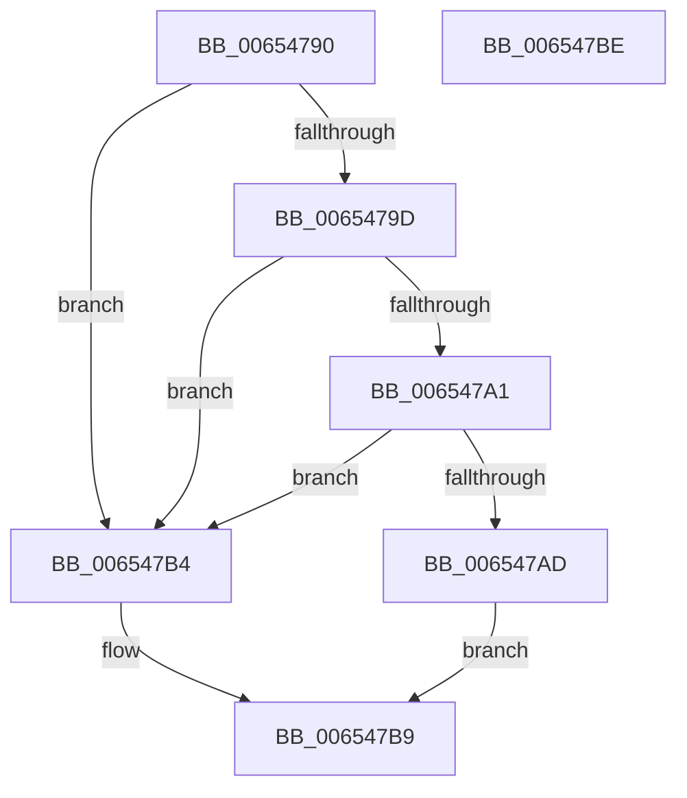

# BapdpKsrCompleteScenario

- RVA: `0x00654790`–`0x006547BF` (길이 `47` bytes)
- VA: `0x0000000140654790`
- 실행 섹션: `.text`
- PDB 이름 있음: `예`; PDB Function 태그: `아니요`
- unwind 정보 RVA: `0x0005C788`
- 디코드: `15`개 명령, `47/47` bytes 표시
- 미해석 바이트: `0` (있으면 어셈블리에 `.byte`로 보존)

> 이 문서는 커널 이미지의 기계어와 PDB 기호를 분석해 생성했습니다. 4번과 5번은 함수 원형과 자료형을 바이너리 사용 방식에서 추정한 C 해석이며 원본 소스 복구 결과는 아닙니다.

## 1. Dependencies

- 직접 호출 지점: **1**; 고유 호출 대상: **1**
- 직접 호출자로 확인된 함수: **0**
- RIP 상대 이미지 참조: **1**

### Outgoing calls
- `0x006547AD` → [guard_dispatch_icall](../6B/guard_dispatch_icall_function_006BAAD0.md) (function, `0x006BAAD0`)

### Direct callers
- 이 함수 시작 RVA로 연결되는 직접 call은 확인되지 않았습니다. 간접 호출은 완전히 역산할 수 없습니다.

### Static image references
- `0x006547A1` → RVA `0x00EFEFF8` (`.data`; read)

## 2. Other-region calls and transfers

- 다른 실행 섹션으로 향하는 call: **0**
- 별도 외부 분기/꼬리 이동을 확인하지 못했습니다.

## 3. Assembly (complete function range)

```asm
00654790  48 83 EC 28                     sub rsp, 0x28
00654794  B8 00 00 00 05                  mov eax, 0x5000000
00654799  23 C8                           and ecx, eax
0065479B  74 17                           je 0x1406547b4
0065479D  85 D0                           test eax, edx
0065479F  75 13                           jne 0x1406547b4
006547A1  48 8B 05 50 A8 8A 00            mov rax, qword ptr [rip + 0x8aa850]
006547A8  48 85 C0                        test rax, rax
006547AB  74 07                           je 0x1406547b4
006547AD  E8 1E 63 06 00                  call 0x1406baad0
006547B2  EB 05                           jmp 0x1406547b9
006547B4  B8 BB 00 00 C0                  mov eax, 0xc00000bb
006547B9  48 83 C4 28                     add rsp, 0x28
006547BD  C3                              ret
006547BE  CC                              int3
```

## 4. C-style interpretation (structured pseudocode)

```c
__int64 __fastcall BapdpKsrCompleteScenario(int a1, int a2)
{
    __int64 result;
    __int64 v_rsp;

    v_rsp = (v_rsp) - (40);
    a1 = (unsigned int)((a1) & ((unsigned int)((unsigned int)(0x5000000ULL))));
    if (condition_is_equal) goto loc_006547B4;
    if ((((unsigned int)((unsigned int)(0x5000000ULL))) & (a2)) != 0) goto loc_006547B4;
    if (*(unsigned __int64 *)(v_rip + 9087056) == 0) goto loc_006547B4;
    result = guard_dispatch_icall(a1, a2, a3, a4);
    goto loc_006547B9;
loc_006547B4:
loc_006547B9:
    v_rsp = (v_rsp) + (40);
    return (unsigned int)(0xC00000BBULL);
}
```

## 5. (Beta) C Style

```c
int64_t BapdpKsrCompleteScenario(int32_t Arg1, int32_t Arg2)
{
    int64_t result;
    int64_t local_rsp;

    local_rsp = (local_rsp) - (40);
    Arg1 = (uint32_t)((Arg1) & ((uint32_t)((uint32_t)(0x5000000ULL))));
    if (condition_is_equal) goto loc_006547B4;
    if ((((uint32_t)((uint32_t)(0x5000000ULL))) & (Arg2)) != 0) goto loc_006547B4;
    if (*(uint64_t *)(v_rip + 0x8AA850) == 0) goto loc_006547B4;
    result = guard_dispatch_icall(Arg1, Arg2, a3, a4);
    goto loc_006547B9;
loc_006547B4:
loc_006547B9:
    local_rsp = (local_rsp) + (40);
    return (uint32_t)(0xC00000BBULL);
}
```

## 6. Execution-region graph

[열기: 2D/3D 그래프와 함수 탐색 컨트롤 패널](../../../control-panel.html?section=text&rva=0x00654790&view=graph)

- 2D 그래프는 위에서 아래로 흐르고, 3D 그래프는 빈 공간을 드래그해 회전합니다. Shift+드래그는 이동, 휠은 확대·축소, 함수 노드 선택은 대상 보고서 이동입니다.

### Static fallback


