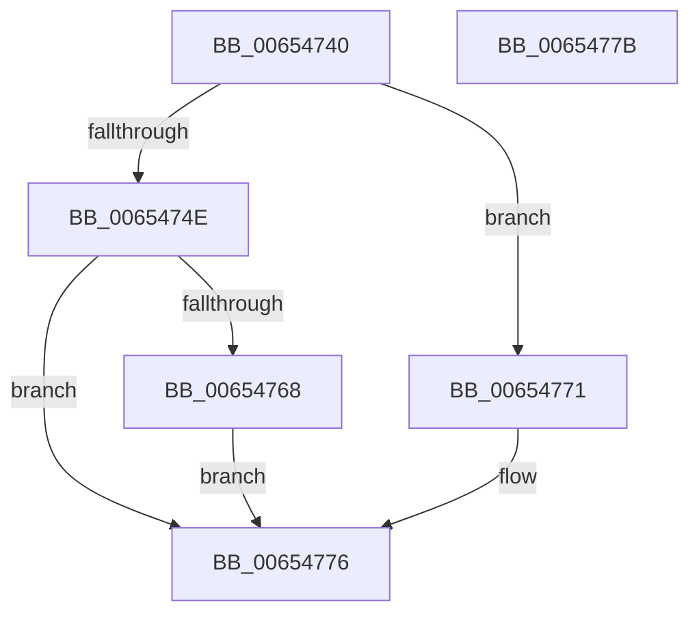

# BapdpKsrComplete

- RVA: `0x00654740`–`0x0065477C` (길이 `60` bytes)
- VA: `0x0000000140654740`
- 실행 섹션: `.text`
- PDB 이름 있음: `예`; PDB Function 태그: `아니요`
- unwind 정보 RVA: `0x0005C788`
- 디코드: `18`개 명령, `60/60` bytes 표시
- 미해석 바이트: `0` (있으면 어셈블리에 `.byte`로 보존)

> 이 문서는 커널 이미지의 기계어와 PDB 기호를 분석해 생성했습니다. 4번과 5번은 함수 원형과 자료형을 바이너리 사용 방식에서 추정한 C 해석이며 원본 소스 복구 결과는 아닙니다.

## 1. Dependencies

- 직접 호출 지점: **1**; 고유 호출 대상: **1**
- 직접 호출자로 확인된 함수: **0**
- RIP 상대 이미지 참조: **2**

### Outgoing calls
- `0x00654758` → `ext-ms-win-ntos-ksr-l1-1-5.dll!KsrCleanupPageDatabase` (import, 간접 대상; import `ext-ms-win-ntos-ksr-l1-1-5.dll!KsrCleanupPageDatabase`)

### Direct callers
- 이 함수 시작 RVA로 연결되는 직접 call은 확인되지 않았습니다. 간접 호출은 완전히 역산할 수 없습니다.

### Static image references
- `0x00654758` → RVA `0x001512F8` (`ext-ms-win-ntos-ksr-l1-1-5.dll!KsrCleanupPageDatabase (IAT)`; read)
- `0x00654768` → RVA `0x00E68544` (`.data`; read/write)

## 2. Other-region calls and transfers

- 다른 실행 섹션으로 향하는 call: **0**
- 별도 외부 분기/꼬리 이동을 확인하지 못했습니다.

## 3. Assembly (complete function range)

```asm
00654740  48 83 EC 28                     sub rsp, 0x28
00654744  0B CA                           or ecx, edx
00654746  F7 C1 00 00 00 05               test ecx, 0x5000000
0065474C  75 23                           jne 0x140654771
0065474E  C1 EA 02                        shr edx, 2
00654751  F6 D2                           not dl
00654753  80 E2 01                        and dl, 1
00654756  8A CA                           mov cl, dl
00654758  48 FF 15 99 CB AF FF            call qword ptr [rip - 0x503467]
0065475F  0F 1F 44 00 00                  nop dword ptr [rax + rax]
00654764  85 C0                           test eax, eax
00654766  78 0E                           js 0x140654776
00654768  83 25 D5 3D 81 00 FB            and dword ptr [rip + 0x813dd5], 0xfffffffb
0065476F  EB 05                           jmp 0x140654776
00654771  B8 BB 00 00 C0                  mov eax, 0xc00000bb
00654776  48 83 C4 28                     add rsp, 0x28
0065477A  C3                              ret
0065477B  CC                              int3
```

## 4. C-style interpretation (structured pseudocode)

```c
__int64 __fastcall BapdpKsrComplete(int a1, int a2)
{
    __int64 result;
    __int64 v_rsp;

    v_rsp = (v_rsp) - (40);
    a1 = (unsigned int)((a1) | (a2));
    if (((a1) & (0x5000000ULL)) != 0) goto loc_00654771;
    a2 = (unsigned int)((a2) >> (2));
    a2 = (unsigned __int8)(~(a2));
    a2 = (unsigned __int8)((a2) & (1));
    result = ext_ms_win_ntos_ksr_l1_1_5_dll_KsrCleanupPageDatabase((unsigned __int8)(a2), a2, a3, a4);
    if (sign_flag) goto loc_00654776;
    goto loc_00654776;
loc_00654771:
loc_00654776:
    v_rsp = (v_rsp) + (40);
    return (unsigned int)(0xC00000BBULL);
}
```

## 5. (Beta) C Style

```c
int64_t BapdpKsrComplete(int32_t Arg1, int32_t Arg2)
{
    int64_t result;
    int64_t local_rsp;

    local_rsp = (local_rsp) - (40);
    Arg1 = (uint32_t)((Arg1) | (Arg2));
    if (((Arg1) & (0x5000000ULL)) != 0) goto loc_00654771;
    Arg2 = (uint32_t)((Arg2) >> (2));
    Arg2 = (uint8_t)(~(Arg2));
    Arg2 = (uint8_t)((Arg2) & (1));
    result = kernel_indirect_call((uint8_t)(Arg2), Arg2, a3, a4);
    if (sign_flag) goto loc_00654776;
    goto loc_00654776;
loc_00654771:
loc_00654776:
    local_rsp = (local_rsp) + (40);
    return (uint32_t)(0xC00000BBULL);
}
```

## 6. Execution-region graph

[열기: 2D/3D 그래프와 함수 탐색 컨트롤 패널](../../../control-panel.html?section=text&rva=0x00654740&view=graph)

- 2D 그래프는 위에서 아래로 흐르고, 3D 그래프는 빈 공간을 드래그해 회전합니다. Shift+드래그는 이동, 휠은 확대·축소, 함수 노드 선택은 대상 보고서 이동입니다.

### Static fallback


