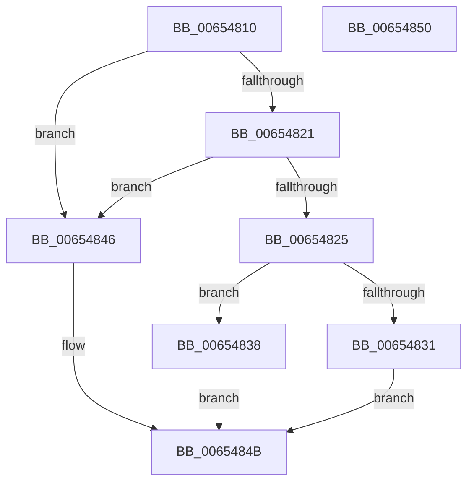

# BapdpKsrInitiateScenarioPhase0

- RVA: `0x00654810`–`0x00654851` (길이 `65` bytes)
- VA: `0x0000000140654810`
- 실행 섹션: `.text`
- PDB 이름 있음: `예`; PDB Function 태그: `아니요`
- unwind 정보 RVA: `0x0005C788`
- 디코드: `22`개 명령, `65/65` bytes 표시
- 미해석 바이트: `0` (있으면 어셈블리에 `.byte`로 보존)

> 이 문서는 커널 이미지의 기계어와 PDB 기호를 분석해 생성했습니다. 4번과 5번은 함수 원형과 자료형을 바이너리 사용 방식에서 추정한 C 해석이며 원본 소스 복구 결과는 아닙니다.

## 1. Dependencies

- 직접 호출 지점: **1**; 고유 호출 대상: **1**
- 직접 호출자로 확인된 함수: **0**
- RIP 상대 이미지 참조: **1**

### Outgoing calls
- `0x0065483F` → [guard_dispatch_icall](../6B/guard_dispatch_icall_function_006BAAD0.md) (function, `0x006BAAD0`)

### Direct callers
- 이 함수 시작 RVA로 연결되는 직접 call은 확인되지 않았습니다. 간접 호출은 완전히 역산할 수 없습니다.

### Static image references
- `0x00654825` → RVA `0x00EFEFE0` (`.data`; read)

## 2. Other-region calls and transfers

- 다른 실행 섹션으로 향하는 call: **0**
- 별도 외부 분기/꼬리 이동을 확인하지 못했습니다.

## 3. Assembly (complete function range)

```asm
00654810  48 83 EC 28                     sub rsp, 0x28
00654814  8B C2                           mov eax, edx
00654816  BA 00 00 00 05                  mov edx, 0x5000000
0065481B  23 C2                           and eax, edx
0065481D  85 CA                           test edx, ecx
0065481F  75 25                           jne 0x140654846
00654821  85 C0                           test eax, eax
00654823  74 21                           je 0x140654846
00654825  4C 8B 05 B4 A7 8A 00            mov r8, qword ptr [rip + 0x8aa7b4]
0065482C  4D 85 C0                        test r8, r8
0065482F  75 07                           jne 0x140654838
00654831  B8 BB 00 00 C0                  mov eax, 0xc00000bb
00654836  EB 13                           jmp 0x14065484b
00654838  8B C8                           mov ecx, eax
0065483A  33 D2                           xor edx, edx
0065483C  49 8B C0                        mov rax, r8
0065483F  E8 8C 62 06 00                  call 0x1406baad0
00654844  EB 05                           jmp 0x14065484b
00654846  B8 0D 00 00 C0                  mov eax, 0xc000000d
0065484B  48 83 C4 28                     add rsp, 0x28
0065484F  C3                              ret
00654850  CC                              int3
```

## 4. C-style interpretation (structured pseudocode)

```c
__int64 __fastcall BapdpKsrInitiateScenarioPhase0(int a1, int a2)
{
    __int64 result;
    __int64 v_rsp;

    v_rsp = (v_rsp) - (40);
    result = (unsigned int)(((unsigned int)(a2)) & ((unsigned int)((unsigned int)(0x5000000ULL))));
    if ((((unsigned int)((unsigned int)(0x5000000ULL))) & (a1)) != 0) goto loc_00654846;
    if ((unsigned int)(result) == 0) goto loc_00654846;
    if (*(unsigned __int64 *)(v_rip + 9086900) != 0) goto loc_00654838;
    goto loc_0065484B;
loc_00654838:
    a2 = 0;
    result = guard_dispatch_icall((unsigned int)((unsigned int)((unsigned int)(0xC00000BBULL))), a2, *(unsigned __int64 *)(v_rip + 9086900), a4);
    goto loc_0065484B;
loc_00654846:
loc_0065484B:
    v_rsp = (v_rsp) + (40);
    return (unsigned int)(0xC000000DULL);
}
```

## 5. (Beta) C Style

```c
int64_t BapdpKsrInitiateScenarioPhase0(int32_t Arg1, int32_t Arg2)
{
    int64_t result;
    int64_t local_rsp;

    local_rsp = (local_rsp) - (40);
    result = (uint32_t)(((uint32_t)(Arg2)) & ((uint32_t)((uint32_t)(0x5000000ULL))));
    if ((((uint32_t)((uint32_t)(0x5000000ULL))) & (Arg1)) != 0) goto loc_00654846;
    if ((uint32_t)(result) == 0) goto loc_00654846;
    if (*(uint64_t *)(v_rip + 0x8AA7B4) != 0) goto loc_00654838;
    goto loc_0065484B;
loc_00654838:
    Arg2 = 0;
    result = guard_dispatch_icall((uint32_t)((uint32_t)((uint32_t)(0xC00000BBULL))), Arg2, *(uint64_t *)(v_rip + 0x8AA7B4), a4);
    goto loc_0065484B;
loc_00654846:
loc_0065484B:
    local_rsp = (local_rsp) + (40);
    return (uint32_t)(0xC000000DULL);
}
```

## 6. Execution-region graph

[열기: 2D/3D 그래프와 함수 탐색 컨트롤 패널](../../../control-panel.html?section=text&rva=0x00654810&view=graph)

- 2D 그래프는 위에서 아래로 흐르고, 3D 그래프는 빈 공간을 드래그해 회전합니다. Shift+드래그는 이동, 휠은 확대·축소, 함수 노드 선택은 대상 보고서 이동입니다.

### Static fallback


