# BapdpMarshallBootDataToRegistry

- RVA: `0x006548A8`–`0x00654C6B` (길이 `963` bytes)
- VA: `0x00000001406548A8`
- 실행 섹션: `.text`
- PDB 이름 있음: `예`; PDB Function 태그: `아니요`
- unwind 정보 RVA: `0x000D480C`
- 디코드: `244`개 명령, `963/963` bytes 표시
- 미해석 바이트: `0` (있으면 어셈블리에 `.byte`로 보존)

> 이 문서는 커널 이미지의 기계어와 PDB 기호를 분석해 생성했습니다. 4번과 5번은 함수 원형과 자료형을 바이너리 사용 방식에서 추정한 C 해석이며 원본 소스 복구 결과는 아닙니다.

## 1. Dependencies

- 직접 호출 지점: **14**; 고유 호출 대상: **10**
- 직접 호출자로 확인된 함수: **1**
- RIP 상대 이미지 참조: **4**

### Outgoing calls
- `0x00654975` → [ExAllocatePool2](../../poolcode/B8/ExAllocatePool2_function_00B820F0.md) (function, `0x00B820F0`)
- `0x006549DB` → [RtlInitUnicodeString](../42/RtlInitUnicodeString_function_0042A780.md) (function, `0x0042A780`)
- `0x00654A10` → [ZwOpenKey](../6A/ZwOpenKey_function_006AD310.md) (function, `0x006AD310`)
- `0x00654A3D` → [RtlInitUnicodeString](../42/RtlInitUnicodeString_function_0042A780.md) (function, `0x0042A780`)
- `0x00654A8C` → [ZwCreateKey](../6A/ZwCreateKey_function_006AD470.md) (function, `0x006AD470`)
- `0x00654AF8` → [RtlStringFromGUIDEx](../../page/91/RtlStringFromGUIDEx_function_00915450.md) (function, `0x00915450`)
- `0x00654B50` → [ZwCreateKey](../6A/ZwCreateKey_function_006AD470.md) (function, `0x006AD470`)
- `0x00654BAC` → [RtlIntegerToUnicodeString](../../page/91/RtlIntegerToUnicodeString_function_0091D3E0.md) (function, `0x0091D3E0`)
- `0x00654BDD` → [ZwSetValueKey](../6A/ZwSetValueKey_function_006ADCD0.md) (function, `0x006ADCD0`)
- `0x00654BFA` → [ZwClose](../6A/ZwClose_function_006AD2B0.md) (function, `0x006AD2B0`)
- `0x00654C17` → [ZwClose](../6A/ZwClose_function_006AD2B0.md) (function, `0x006AD2B0`)
- `0x00654C26` → [ZwClose](../6A/ZwClose_function_006AD2B0.md) (function, `0x006AD2B0`)
- `0x00654C38` → [ExFreePoolWithTag](../../poolcode/B8/ExFreePoolWithTag_function_00B82870.md) (function, `0x00B82870`)
- `0x00654C44` → [_security_check_cookie](../6A/_security_check_cookie_function_006AC640.md) (function, `0x006AC640`)

### Direct callers
- [BootApplicationPersistentDataProcess](../../init/BE/BootApplicationPersistentDataProcess_function_00BEEBD4.md) at `0x00BEEC59`

### Static image references
- `0x006548CB` → RVA `0x00E0A740` (`.data`; read)
- `0x006548D9` → RVA `0x00E62410` (`.data`; read)
- `0x006549C8` → RVA `0x006CC810` (` ?? ::FNODOBFM::`string'`; read)
- `0x00654A2A` → RVA `0x006CFF50` (` ?? ::FNODOBFM::`string'`; read)

## 2. Other-region calls and transfers

- 다른 실행 섹션으로 향하는 call: **4**
  - `0x00654975` → [ExAllocatePool2](../../poolcode/B8/ExAllocatePool2_function_00B820F0.md) (`.text` → `POOLCODE`)
  - `0x00654AF8` → [RtlStringFromGUIDEx](../../page/91/RtlStringFromGUIDEx_function_00915450.md) (`.text` → `PAGE`)
  - `0x00654BAC` → [RtlIntegerToUnicodeString](../../page/91/RtlIntegerToUnicodeString_function_0091D3E0.md) (`.text` → `PAGE`)
  - `0x00654C38` → [ExFreePoolWithTag](../../poolcode/B8/ExFreePoolWithTag_function_00B82870.md) (`.text` → `POOLCODE`)
- 별도 외부 분기/꼬리 이동을 확인하지 못했습니다.

## 3. Assembly (complete function range)

```asm
006548A8  48 8B C4                        mov rax, rsp
006548AB  48 89 58 08                     mov qword ptr [rax + 8], rbx
006548AF  48 89 70 10                     mov qword ptr [rax + 0x10], rsi
006548B3  48 89 78 18                     mov qword ptr [rax + 0x18], rdi
006548B7  55                              push rbp
006548B8  41 54                           push r12
006548BA  41 55                           push r13
006548BC  41 56                           push r14
006548BE  41 57                           push r15
006548C0  48 8D 68 B8                     lea rbp, [rax - 0x48]
006548C4  48 81 EC 20 01 00 00            sub rsp, 0x120
006548CB  48 8B 05 6E 5E 7B 00            mov rax, qword ptr [rip + 0x7b5e6e]
006548D2  48 33 C4                        xor rax, rsp
006548D5  48 89 45 10                     mov qword ptr [rbp + 0x10], rax
006548D9  48 8B 1D 30 DB 80 00            mov rbx, qword ptr [rip + 0x80db30]
006548E0  45 33 E4                        xor r12d, r12d
006548E3  C7 44 24 70 6E F2 9A 72         mov dword ptr [rsp + 0x70], 0x729af26e
006548EB  48 8B CB                        mov rcx, rbx
006548EE  C7 44 24 74 FA 85 F5 43         mov dword ptr [rsp + 0x74], 0x43f585fa
006548F6  41 8B FC                        mov edi, r12d
006548F9  C7 44 24 78 B8 0C F2 45         mov dword ptr [rsp + 0x78], 0x45f20cb8
00654901  C7 44 24 7C 74 EB C1 55         mov dword ptr [rsp + 0x7c], 0x55c1eb74
00654909  4C 89 64 24 40                  mov qword ptr [rsp + 0x40], r12
0065490E  4C 89 64 24 48                  mov qword ptr [rsp + 0x48], r12
00654913  48 85 DB                        test rbx, rbx
00654916  0F 84 21 03 00 00               je 0x140654c3d
0065491C  4C 8D 3D ED DA 80 00            lea r15, [rip + 0x80daed]
00654923  49 3B CF                        cmp rcx, r15
00654926  74 31                           je 0x140654959
00654928  48 8B 51 10                     mov rdx, qword ptr [rcx + 0x10]
0065492C  48 8B 09                        mov rcx, qword ptr [rcx]
0065492F  8B 42 20                        mov eax, dword ptr [rdx + 0x20]
00654932  FF C8                           dec eax
00654934  83 F8 01                        cmp eax, 1
00654937  77 1B                           ja 0x140654954
00654939  48 8B 42 10                     mov rax, qword ptr [rdx + 0x10]
0065493D  48 2B 44 24 70                  sub rax, qword ptr [rsp + 0x70]
00654942  75 09                           jne 0x14065494d
00654944  48 8B 42 18                     mov rax, qword ptr [rdx + 0x18]
00654948  48 2B 44 24 78                  sub rax, qword ptr [rsp + 0x78]
0065494D  48 85 C0                        test rax, rax
00654950  75 02                           jne 0x140654954
00654952  FF C7                           inc edi
00654954  48 85 C9                        test rcx, rcx
00654957  75 CA                           jne 0x140654923
00654959  85 FF                           test edi, edi
0065495B  0F 84 DC 02 00 00               je 0x140654c3d
00654961  8B D7                           mov edx, edi
00654963  B9 00 01 00 00                  mov ecx, 0x100
00654968  48 C1 E2 03                     shl rdx, 3
0065496C  41 B8 42 61 50 64               mov r8d, 0x64506142
00654972  45 8B F4                        mov r14d, r12d
00654975  E8 76 D7 52 00                  call 0x140b820f0
0065497A  48 8B F0                        mov rsi, rax
0065497D  48 85 C0                        test rax, rax
00654980  0F 84 87 02 00 00               je 0x140654c0d
00654986  EB 34                           jmp 0x1406549bc
00654988  48 8B 53 10                     mov rdx, qword ptr [rbx + 0x10]
0065498C  48 8B 1B                        mov rbx, qword ptr [rbx]
0065498F  8B 4A 20                        mov ecx, dword ptr [rdx + 0x20]
00654992  FF C9                           dec ecx
00654994  83 F9 01                        cmp ecx, 1
00654997  77 23                           ja 0x1406549bc
00654999  48 8B 42 10                     mov rax, qword ptr [rdx + 0x10]
0065499D  48 2B 44 24 70                  sub rax, qword ptr [rsp + 0x70]
006549A2  75 09                           jne 0x1406549ad
006549A4  48 8B 42 18                     mov rax, qword ptr [rdx + 0x18]
006549A8  48 2B 44 24 78                  sub rax, qword ptr [rsp + 0x78]
006549AD  48 85 C0                        test rax, rax
006549B0  75 0A                           jne 0x1406549bc
006549B2  41 8B C6                        mov eax, r14d
006549B5  41 FF C6                        inc r14d
006549B8  48 89 14 C6                     mov qword ptr [rsi + rax*8], rdx
006549BC  49 3B DF                        cmp rbx, r15
006549BF  75 C7                           jne 0x140654988
006549C1  0F 57 C0                        xorps xmm0, xmm0
006549C4  44 89 65 94                     mov dword ptr [rbp - 0x6c], r12d
006549C8  48 8D 15 41 7E 07 00            lea rdx, [rip + 0x77e41]
006549CF  44 89 65 AC                     mov dword ptr [rbp - 0x54], r12d
006549D3  48 8D 4D 80                     lea rcx, [rbp - 0x80]
006549D7  0F 11 45 80                     movups xmmword ptr [rbp - 0x80], xmm0
006549DB  E8 A0 5D DD FF                  call 0x14042a780
006549E0  48 8D 45 80                     lea rax, [rbp - 0x80]
006549E4  C7 45 90 30 00 00 00            mov dword ptr [rbp - 0x70], 0x30
006549EB  0F 57 C0                        xorps xmm0, xmm0
006549EE  48 89 45 A0                     mov qword ptr [rbp - 0x60], rax
006549F2  4C 8D 45 90                     lea r8, [rbp - 0x70]
006549F6  4C 89 65 98                     mov qword ptr [rbp - 0x68], r12
006549FA  BA 19 00 02 00                  mov edx, 0x20019
006549FF  C7 45 A8 40 02 00 00            mov dword ptr [rbp - 0x58], 0x240
00654A06  48 8D 4C 24 40                  lea rcx, [rsp + 0x40]
00654A0B  F3 0F 7F 45 B0                  movdqu xmmword ptr [rbp - 0x50], xmm0
00654A10  E8 FB 88 05 00                  call 0x1406ad310
00654A15  85 C0                           test eax, eax
00654A17  79 0A                           jns 0x140654a23
00654A19  4C 89 64 24 40                  mov qword ptr [rsp + 0x40], r12
00654A1E  E9 F9 01 00 00                  jmp 0x140654c1c
00654A23  0F 57 C0                        xorps xmm0, xmm0
00654A26  44 89 65 94                     mov dword ptr [rbp - 0x6c], r12d
00654A2A  48 8D 15 1F B5 07 00            lea rdx, [rip + 0x7b51f]
00654A31  44 89 65 AC                     mov dword ptr [rbp - 0x54], r12d
00654A35  48 8D 4D 80                     lea rcx, [rbp - 0x80]
00654A39  0F 11 45 80                     movups xmmword ptr [rbp - 0x80], xmm0
00654A3D  E8 3E 5D DD FF                  call 0x14042a780
00654A42  48 8B 44 24 40                  mov rax, qword ptr [rsp + 0x40]
00654A47  4C 8D 45 90                     lea r8, [rbp - 0x70]
00654A4B  48 89 45 98                     mov qword ptr [rbp - 0x68], rax
00654A4F  48 8D 4C 24 48                  lea rcx, [rsp + 0x48]
00654A54  48 8D 45 80                     lea rax, [rbp - 0x80]
00654A58  4C 89 64 24 30                  mov qword ptr [rsp + 0x30], r12
00654A5D  0F 57 C0                        xorps xmm0, xmm0
00654A60  C7 44 24 28 01 00 00 00         mov dword ptr [rsp + 0x28], 1
00654A68  45 33 C9                        xor r9d, r9d
00654A6B  48 89 45 A0                     mov qword ptr [rbp - 0x60], rax
00654A6F  BA 1F 00 06 00                  mov edx, 0x6001f
00654A74  C7 45 90 30 00 00 00            mov dword ptr [rbp - 0x70], 0x30
00654A7B  C7 45 A8 40 02 00 00            mov dword ptr [rbp - 0x58], 0x240
00654A82  F3 0F 7F 45 B0                  movdqu xmmword ptr [rbp - 0x50], xmm0
00654A87  4C 89 64 24 20                  mov qword ptr [rsp + 0x20], r12
00654A8C  E8 DF 89 05 00                  call 0x1406ad470
00654A91  85 C0                           test eax, eax
00654A93  79 0A                           jns 0x140654a9f
00654A95  4C 89 64 24 48                  mov qword ptr [rsp + 0x48], r12
00654A9A  E9 6E 01 00 00                  jmp 0x140654c0d
00654A9F  41 8B DC                        mov ebx, r12d
00654AA2  85 FF                           test edi, edi
00654AA4  0F 84 63 01 00 00               je 0x140654c0d
00654AAA  4C 8B FE                        mov r15, rsi
00654AAD  49 8B 07                        mov rax, qword ptr [r15]
00654AB0  4C 89 64 24 70                  mov qword ptr [rsp + 0x70], r12
00654AB5  48 85 C0                        test rax, rax
00654AB8  0F 84 41 01 00 00               je 0x140654bff
00654ABE  0F 10 00                        movups xmm0, xmmword ptr [rax]
00654AC1  33 C0                           xor eax, eax
00654AC3  48 C7 44 24 50 00 00 4E 00      mov qword ptr [rsp + 0x50], 0x4e0000
00654ACC  48 89 45 B0                     mov qword ptr [rbp - 0x50], rax
00654AD0  48 8D 54 24 50                  lea rdx, [rsp + 0x50]
00654AD5  F3 0F 7F 45 80                  movdqu xmmword ptr [rbp - 0x80], xmm0
00654ADA  89 45 B8                        mov dword ptr [rbp - 0x48], eax
00654ADD  48 8D 45 C0                     lea rax, [rbp - 0x40]
00654AE1  0F 57 C0                        xorps xmm0, xmm0
00654AE4  48 89 44 24 58                  mov qword ptr [rsp + 0x58], rax
00654AE9  45 33 C0                        xor r8d, r8d
00654AEC  48 8D 4D 80                     lea rcx, [rbp - 0x80]
00654AF0  0F 11 45 90                     movups xmmword ptr [rbp - 0x70], xmm0
00654AF4  0F 11 45 A0                     movups xmmword ptr [rbp - 0x60], xmm0
00654AF8  E8 53 09 2C 00                  call 0x140915450
00654AFD  85 C0                           test eax, eax
00654AFF  0F 88 FA 00 00 00               js 0x140654bff
00654B05  48 8B 44 24 48                  mov rax, qword ptr [rsp + 0x48]
00654B0A  4C 8D 45 90                     lea r8, [rbp - 0x70]
00654B0E  48 89 45 98                     mov qword ptr [rbp - 0x68], rax
00654B12  48 8D 4C 24 70                  lea rcx, [rsp + 0x70]
00654B17  48 8D 44 24 50                  lea rax, [rsp + 0x50]
00654B1C  4C 89 64 24 30                  mov qword ptr [rsp + 0x30], r12
00654B21  0F 57 C0                        xorps xmm0, xmm0
00654B24  C7 44 24 28 01 00 00 00         mov dword ptr [rsp + 0x28], 1
00654B2C  45 33 C9                        xor r9d, r9d
00654B2F  48 89 45 A0                     mov qword ptr [rbp - 0x60], rax
00654B33  BA 1F 00 06 00                  mov edx, 0x6001f
00654B38  C7 45 90 30 00 00 00            mov dword ptr [rbp - 0x70], 0x30
00654B3F  C7 45 A8 40 02 00 00            mov dword ptr [rbp - 0x58], 0x240
00654B46  F3 0F 7F 45 B0                  movdqu xmmword ptr [rbp - 0x50], xmm0
00654B4B  4C 89 64 24 20                  mov qword ptr [rsp + 0x20], r12
00654B50  E8 1B 89 05 00                  call 0x1406ad470
00654B55  85 C0                           test eax, eax
00654B57  0F 88 A2 00 00 00               js 0x140654bff
00654B5D  45 8B EC                        mov r13d, r12d
00654B60  8B C3                           mov eax, ebx
00654B62  44 8B E7                        mov r12d, edi
00654B65  44 2B E3                        sub r12d, ebx
00654B68  33 D2                           xor edx, edx
00654B6A  4C 8D 34 C6                     lea r14, [rsi + rax*8]
00654B6E  49 8B 0E                        mov rcx, qword ptr [r14]
00654B71  48 8D 45 90                     lea rax, [rbp - 0x70]
00654B75  48 C7 44 24 60 00 00 18 00      mov qword ptr [rsp + 0x60], 0x180000
00654B7E  48 89 44 24 68                  mov qword ptr [rsp + 0x68], rax
00654B83  48 85 C9                        test rcx, rcx
00654B86  74 5F                           je 0x140654be7
00654B88  48 8B 01                        mov rax, qword ptr [rcx]
00654B8B  48 2B 45 80                     sub rax, qword ptr [rbp - 0x80]
00654B8F  75 08                           jne 0x140654b99
00654B91  48 8B 41 08                     mov rax, qword ptr [rcx + 8]
00654B95  48 2B 45 88                     sub rax, qword ptr [rbp - 0x78]
00654B99  48 85 C0                        test rax, rax
00654B9C  75 49                           jne 0x140654be7
00654B9E  41 8B CD                        mov ecx, r13d
00654BA1  4C 8D 44 24 60                  lea r8, [rsp + 0x60]
00654BA6  8D 50 0A                        lea edx, [rax + 0xa]
00654BA9  41 FF C5                        inc r13d
00654BAC  E8 2F 88 2C 00                  call 0x14091d3e0
00654BB1  33 D2                           xor edx, edx
00654BB3  85 C0                           test eax, eax
00654BB5  78 30                           js 0x140654be7
00654BB7  49 8B 06                        mov rax, qword ptr [r14]
00654BBA  44 8D 4A 03                     lea r9d, [rdx + 3]
00654BBE  45 33 C0                        xor r8d, r8d
00654BC1  48 8D 54 24 60                  lea rdx, [rsp + 0x60]
00654BC6  8B 48 28                        mov ecx, dword ptr [rax + 0x28]
00654BC9  48 03 C8                        add rcx, rax
00654BCC  8B 40 24                        mov eax, dword ptr [rax + 0x24]
00654BCF  89 44 24 28                     mov dword ptr [rsp + 0x28], eax
00654BD3  48 89 4C 24 20                  mov qword ptr [rsp + 0x20], rcx
00654BD8  48 8B 4C 24 70                  mov rcx, qword ptr [rsp + 0x70]
00654BDD  E8 EE 90 05 00                  call 0x1406adcd0
00654BE2  33 D2                           xor edx, edx
00654BE4  49 89 16                        mov qword ptr [r14], rdx
00654BE7  49 83 C6 08                     add r14, 8
00654BEB  49 83 EC 01                     sub r12, 1
00654BEF  0F 85 79 FF FF FF               jne 0x140654b6e
00654BF5  48 8B 4C 24 70                  mov rcx, qword ptr [rsp + 0x70]
00654BFA  E8 B1 86 05 00                  call 0x1406ad2b0
00654BFF  FF C3                           inc ebx
00654C01  49 83 C7 08                     add r15, 8
00654C05  3B DF                           cmp ebx, edi
00654C07  0F 82 A0 FE FF FF               jb 0x140654aad
00654C0D  48 8B 4C 24 40                  mov rcx, qword ptr [rsp + 0x40]
00654C12  48 85 C9                        test rcx, rcx
00654C15  74 05                           je 0x140654c1c
00654C17  E8 94 86 05 00                  call 0x1406ad2b0
00654C1C  48 8B 4C 24 48                  mov rcx, qword ptr [rsp + 0x48]
00654C21  48 85 C9                        test rcx, rcx
00654C24  74 05                           je 0x140654c2b
00654C26  E8 85 86 05 00                  call 0x1406ad2b0
00654C2B  48 85 F6                        test rsi, rsi
00654C2E  74 0D                           je 0x140654c3d
00654C30  BA 42 61 50 64                  mov edx, 0x64506142
00654C35  48 8B CE                        mov rcx, rsi
00654C38  E8 33 DC 52 00                  call 0x140b82870
00654C3D  48 8B 4D 10                     mov rcx, qword ptr [rbp + 0x10]
00654C41  48 33 CC                        xor rcx, rsp
00654C44  E8 F7 79 05 00                  call 0x1406ac640
00654C49  4C 8D 9C 24 20 01 00 00         lea r11, [rsp + 0x120]
00654C51  49 8B 5B 30                     mov rbx, qword ptr [r11 + 0x30]
00654C55  49 8B 73 38                     mov rsi, qword ptr [r11 + 0x38]
00654C59  49 8B 7B 40                     mov rdi, qword ptr [r11 + 0x40]
00654C5D  49 8B E3                        mov rsp, r11
00654C60  41 5F                           pop r15
00654C62  41 5E                           pop r14
00654C64  41 5D                           pop r13
00654C66  41 5C                           pop r12
00654C68  5D                              pop rbp
00654C69  C3                              ret
00654C6A  CC                              int3
```

## 4. C-style interpretation (structured pseudocode)

```c
__int64 __fastcall BapdpMarshallBootDataToRegistry(__int64 a1, __int64 a2, __int64 a3, int a4)
{
    __int64 result;
    __int64 v_r12;
    __int64 v_r13;
    __int64 v_r14;
    __int64 v_r15;
    __int64 v_rbx;
    __int64 v_rdi;
    __int64 v_rsp;
    unsigned __int64 v_stack_m100;
    unsigned __int64 v_stack_m108;
    unsigned __int64 v_stack_m118;
    unsigned int v_stack_m120;
    unsigned __int64 v_stack_m128;
    unsigned __int64 v_stack_m28;
    unsigned int v_stack_mCC;
    unsigned int v_stack_mD0;
    unsigned int v_stack_mD4;
    unsigned int v_stack_mD8;
    unsigned __int64 v_stack_mE0;
    unsigned __int64 v_stack_mE8;
    unsigned __int64 v_stack_mF0;
    unsigned __int64 v_stack_mF8;

    *(unsigned __int64 *)(v_rsp + 8) = v_rbx;
    *(unsigned __int64 *)(v_rsp + 16) = v_rsi;
    *(unsigned __int64 *)(v_rsp + 24) = v_rdi;
    v_rsp = (v_rsp) - (288);
    result = (*(unsigned __int64 *)(v_rip + 8085102)) ^ (v_rsp);
    *(unsigned __int64 *)(v_rsp - 72 + 16) = result;
    v_r12 = 0;
    v_stack_mD8 = 0x729AF26EULL;
    v_stack_mD4 = 0x43F585FAULL;
    v_stack_mD0 = 0x45F20CB8ULL;
    v_stack_mCC = 0x55C1EB74ULL;
    v_stack_m108 = 0;
    v_stack_m100 = 0;
    if (*(unsigned __int64 *)(v_rip + 8444720) == 0) goto loc_00654C3D;
loc_00654923:
    if ((*(unsigned __int64 *)(v_rip + 8444720)) == (v_rip + 8444653)) goto loc_00654959;
    result = (unsigned int)(((unsigned int)(*(unsigned int *)(*(unsigned __int64 *)(*(unsigned __int64 *)(v_rip + 8444720) + 16) + 32))) - 1);
    if (((unsigned int)(result)) > 1) goto loc_00654954;
    result = (*(unsigned __int64 *)(*(unsigned __int64 *)(*(unsigned __int64 *)(v_rip + 8444720) + 16) + 16)) - (v_stack_mD8);
    if (!(condition_is_not_equal)) {
        result = *(unsigned __int64 *)(*(unsigned __int64 *)(*(unsigned __int64 *)(v_rip + 8444720) + 16) + 24);
        result = (result) - (v_stack_mD0);
    }
    v_rdi = 0;
    if (result == 0) {
        v_rdi = (unsigned int)((0) + 1);
    }
    if (*(unsigned __int64 *)(*(unsigned __int64 *)(v_rip + 8444720)) != 0) goto loc_00654923;
loc_00654959:
    if ((unsigned int)(v_rdi) == 0) goto loc_00654C3D;
    a2 = ((unsigned int)((unsigned int)(v_rdi))) << (3);
    result = ExAllocatePool2(256, a2, (unsigned int)(0x64506142ULL), a4);
    if (result == 0) goto loc_00654C0D;
    goto loc_006549BC;
loc_00654988:
    a1 = (unsigned int)(((unsigned int)(*(unsigned int *)(*(unsigned __int64 *)(*(unsigned __int64 *)(v_rip + 8444720) + 16) + 32))) - 1);
    if (((unsigned int)(a1)) > 1) goto loc_006549BC;
    result = (*(unsigned __int64 *)(*(unsigned __int64 *)(*(unsigned __int64 *)(v_rip + 8444720) + 16) + 16)) - (v_stack_mD8);
    if (!(condition_is_not_equal)) {
        result = *(unsigned __int64 *)(*(unsigned __int64 *)(*(unsigned __int64 *)(v_rip + 8444720) + 16) + 24);
        result = (result) - (v_stack_mD0);
    }
    v_r14 = 0;
    if (result == 0) {
        result = 0;
        v_r14 = (unsigned int)((0) + 1);
        *(unsigned __int64 *)(result + result * 8) = *(unsigned __int64 *)(*(unsigned __int64 *)(v_rip + 8444720) + 16);
    }
    if ((*(unsigned __int64 *)(*(unsigned __int64 *)(v_rip + 8444720))) != (v_rip + 8444653)) goto loc_00654988;
    *(unsigned int *)(v_rsp - 72 - 108) = 0;
    *(unsigned int *)(v_rsp - 72 - 84) = 0;
    *(unsigned __int64 *)(v_rsp - 72 - 128) = v_xmm0;
    result = RtlInitUnicodeString(v_rsp - 72 - 128, v_rip + 491073, (unsigned int)(0x64506142ULL), a4);
    *(unsigned int *)(v_rsp - 72 - 112) = 48;
    *(unsigned __int64 *)(v_rsp - 72 - 96) = v_rsp - 72 - 128;
    *(unsigned __int64 *)(v_rsp - 72 - 104) = 0;
    *(unsigned int *)(v_rsp - 72 - 88) = 576;
    *(unsigned __int64 *)(v_rsp - 72 - 80) = v_xmm0;
    result = ZwOpenKey(v_stack_m108, (unsigned int)(0x20019ULL), v_rsp - 72 - 112, a4);
    if (!sign_flag) goto loc_00654A23;
    v_stack_m108 = 0;
    goto loc_00654C1C;
loc_00654A23:
    *(unsigned int *)(v_rsp - 72 - 108) = 0;
    *(unsigned int *)(v_rsp - 72 - 84) = 0;
    *(unsigned __int64 *)(v_rsp - 72 - 128) = v_xmm0;
    result = RtlInitUnicodeString(v_rsp - 72 - 128, v_rip + 505119, v_rsp - 72 - 112, a4);
    *(unsigned __int64 *)(v_rsp - 72 - 104) = v_stack_m108;
    v_stack_m118 = 0;
    v_stack_m120 = 1;
    a4 = 0;
    *(unsigned __int64 *)(v_rsp - 72 - 96) = v_rsp - 72 - 128;
    *(unsigned int *)(v_rsp - 72 - 112) = 48;
    *(unsigned int *)(v_rsp - 72 - 88) = 576;
    *(unsigned __int64 *)(v_rsp - 72 - 80) = v_xmm0;
    v_stack_m128 = 0;
    result = ZwCreateKey(v_stack_m100, (unsigned int)(0x6001FULL), v_rsp - 72 - 112, a4);
    if (!sign_flag) goto loc_00654A9F;
    v_stack_m100 = 0;
    goto loc_00654C0D;
loc_00654A9F:
    if ((unsigned int)(v_rdi) == 0) goto loc_00654C0D;
loc_00654AAD:
    v_stack_mD8 = 0;
    if (*(unsigned __int64 *)(result) == 0) goto loc_00654BFF;
    result = 0;
    v_stack_mF8 = 0x4E0000ULL;
    *(unsigned __int64 *)(v_rsp - 72 - 80) = 0;
    *(unsigned __int64 *)(v_rsp - 72 - 128) = v_xmm0;
    *(unsigned int *)(v_rsp - 72 - 72) = 0;
    v_stack_mF0 = v_rsp - 72 - 64;
    a3 = 0;
    *(unsigned __int64 *)(v_rsp - 72 - 112) = v_xmm0;
    *(unsigned __int64 *)(v_rsp - 72 - 96) = v_xmm0;
    result = RtlStringFromGUIDEx(v_rsp - 72 - 128, v_stack_mF8, a3, a4);
    if (sign_flag) goto loc_00654BFF;
    *(unsigned __int64 *)(v_rsp - 72 - 104) = v_stack_m100;
    v_stack_m118 = 0;
    v_stack_m120 = 1;
    a4 = 0;
    *(unsigned __int64 *)(v_rsp - 72 - 96) = v_stack_mF8;
    *(unsigned int *)(v_rsp - 72 - 112) = 48;
    *(unsigned int *)(v_rsp - 72 - 88) = 576;
    *(unsigned __int64 *)(v_rsp - 72 - 80) = v_xmm0;
    v_stack_m128 = 0;
    result = ZwCreateKey(v_stack_mD8, (unsigned int)(0x6001FULL), v_rsp - 72 - 112, a4);
    if (sign_flag) goto loc_00654BFF;
    v_r12 = (unsigned int)(((unsigned int)((unsigned int)(v_rdi))) - (0));
    a2 = 0;
loc_00654B6E:
    v_stack_mE8 = 0x180000ULL;
    v_stack_mE0 = v_rsp - 72 - 112;
    if (*(unsigned __int64 *)(result + 0 * 8) == 0) goto loc_00654BE7;
    result = (*(unsigned __int64 *)(*(unsigned __int64 *)(result + 0 * 8))) - (*(unsigned __int64 *)(v_rsp - 72 - 128));
    if (!(condition_is_not_equal)) {
        result = *(unsigned __int64 *)(*(unsigned __int64 *)(result + 0 * 8) + 8);
        result = (result) - (*(unsigned __int64 *)(v_rsp - 72 - 120));
    }
    if (result != 0) goto loc_00654BE7;
    v_r13 = (unsigned int)((0) + 1);
    result = RtlIntegerToUnicodeString(0, result + 10, v_stack_mE8, a4);
    a2 = 0;
    if (!(sign_flag)) {
        result = *(unsigned __int64 *)(result + 0 * 8);
        a4 = a2 + 3;
        a3 = 0;
        a2 = v_stack_mE8;
        a1 = *(unsigned int *)(result + 40);
        a1 = (a1) + (result);
        result = *(unsigned int *)(result + 36);
        v_stack_m120 = (unsigned int)(result);
        v_stack_m128 = a1;
        a1 = v_stack_mD8;
        result = ZwSetValueKey(a1, a2, a3, a4);
        a2 = 0;
        *(unsigned __int64 *)(result + 0 * 8) = 0;
    }
    v_r14 = (result + 0 * 8) + (8);
    v_r12 = (v_r12) - (1);
    if (condition_is_not_equal) goto loc_00654B6E;
    result = ZwClose(v_stack_mD8, a2, a3, a4);
loc_00654BFF:
    v_rbx = (unsigned int)((0) + 1);
    v_r15 = (result) + (8);
    if (((unsigned int)(v_rbx)) < ((unsigned int)(v_rdi))) goto loc_00654AAD;
loc_00654C0D:
    if (v_stack_m108 != 0) {
        result = ZwClose(v_stack_m108, a2, a3, a4);
    }
    if (v_stack_m100 != 0) {
        result = ZwClose(v_stack_m100, a2, a3, a4);
    }
    if (result != 0) {
        a2 = 0x64506142ULL;
        a1 = result;
        result = ExFreePoolWithTag(a1, a2, a3, a4);
    }
    a1 = (*(unsigned __int64 *)(v_rsp - 72 + 16)) ^ (v_rsp);
    result = _security_check_cookie(a1, a2, a3, a4);
    return result;
}
```

## 5. (Beta) C Style

```c
int64_t BapdpMarshallBootDataToRegistry(int64_t Arg1, int64_t Arg2, int64_t Arg3, int32_t Arg4)
{
    int64_t result;
    int64_t local_r12;
    int64_t local_r13;
    int64_t local_r14;
    int64_t local_r15;
    int64_t local_rbx;
    int64_t local_rdi;
    int64_t local_rsp;
    uint64_t v_stack_m100;
    uint64_t v_stack_m108;
    uint64_t v_stack_m118;
    uint32_t v_stack_m120;
    uint64_t v_stack_m128;
    uint64_t v_stack_m28;
    uint32_t v_stack_mCC;
    uint32_t v_stack_mD0;
    uint32_t v_stack_mD4;
    uint32_t v_stack_mD8;
    uint64_t v_stack_mE0;
    uint64_t v_stack_mE8;
    uint64_t v_stack_mF0;
    uint64_t v_stack_mF8;

    *(uint64_t *)(local_rsp + 0x8) = local_rbx;
    *(uint64_t *)(local_rsp + 0x10) = local_rsi;
    *(uint64_t *)(local_rsp + 0x18) = local_rdi;
    local_rsp = (local_rsp) - (288);
    result = (*(uint64_t *)(v_rip + 0x7B5E6E)) ^ (local_rsp);
    *(uint64_t *)(local_rsp - 0x48 + 0x10) = result;
    local_r12 = 0;
    v_stack_mD8 = 0x729AF26EULL;
    v_stack_mD4 = 0x43F585FAULL;
    v_stack_mD0 = 0x45F20CB8ULL;
    v_stack_mCC = 0x55C1EB74ULL;
    v_stack_m108 = 0;
    v_stack_m100 = 0;
    if (*(uint64_t *)(v_rip + 0x80DB30) == 0) goto loc_00654C3D;
loc_00654923:
    if ((*(uint64_t *)(v_rip + 0x80DB30)) == (v_rip + 8444653)) goto loc_00654959;
    result = (uint32_t)(((uint32_t)(*(uint32_t *)(*(uint64_t *)(*(uint64_t *)(v_rip + 0x80DB30) + 0x10) + 0x20))) - 1);
    if (((uint32_t)(result)) > 1) goto loc_00654954;
    result = (*(uint64_t *)(*(uint64_t *)(*(uint64_t *)(v_rip + 0x80DB30) + 0x10) + 0x10)) - (v_stack_mD8);
    if (!(condition_is_not_equal)) {
        result = *(uint64_t *)(*(uint64_t *)(*(uint64_t *)(v_rip + 0x80DB30) + 0x10) + 0x18);
        result = (result) - (v_stack_mD0);
    }
    local_rdi = 0;
    if (result == 0) {
        local_rdi = (uint32_t)((0) + 1);
    }
    if (*(uint64_t *)(*(uint64_t *)(v_rip + 0x80DB30)) != 0) goto loc_00654923;
loc_00654959:
    if ((uint32_t)(local_rdi) == 0) goto loc_00654C3D;
    Arg2 = ((uint32_t)((uint32_t)(local_rdi))) << (3);
    result = ExAllocatePool2(256, Arg2, (uint32_t)(0x64506142ULL), Arg4);
    if (result == 0) goto loc_00654C0D;
    goto loc_006549BC;
loc_00654988:
    Arg1 = (uint32_t)(((uint32_t)(*(uint32_t *)(*(uint64_t *)(*(uint64_t *)(v_rip + 0x80DB30) + 0x10) + 0x20))) - 1);
    if (((uint32_t)(Arg1)) > 1) goto loc_006549BC;
    result = (*(uint64_t *)(*(uint64_t *)(*(uint64_t *)(v_rip + 0x80DB30) + 0x10) + 0x10)) - (v_stack_mD8);
    if (!(condition_is_not_equal)) {
        result = *(uint64_t *)(*(uint64_t *)(*(uint64_t *)(v_rip + 0x80DB30) + 0x10) + 0x18);
        result = (result) - (v_stack_mD0);
    }
    local_r14 = 0;
    if (result == 0) {
        result = 0;
        local_r14 = (uint32_t)((0) + 1);
        *(uint64_t *)(result + result * 8) = *(uint64_t *)(*(uint64_t *)(v_rip + 0x80DB30) + 0x10);
    }
    if ((*(uint64_t *)(*(uint64_t *)(v_rip + 0x80DB30))) != (v_rip + 8444653)) goto loc_00654988;
    *(uint32_t *)(local_rsp - 0x48 - 0x6C) = 0;
    *(uint32_t *)(local_rsp - 0x48 - 0x54) = 0;
    *(uint64_t *)(local_rsp - 0x48 - 0x80) = v_xmm0;
    result = RtlInitUnicodeString(local_rsp - 72 - 128, v_rip + 491073, (uint32_t)(0x64506142ULL), Arg4);
    *(uint32_t *)(local_rsp - 0x48 - 0x70) = 48;
    *(uint64_t *)(local_rsp - 0x48 - 0x60) = local_rsp - 72 - 128;
    *(uint64_t *)(local_rsp - 0x48 - 0x68) = 0;
    *(uint32_t *)(local_rsp - 0x48 - 0x58) = 576;
    *(uint64_t *)(local_rsp - 0x48 - 0x50) = v_xmm0;
    result = ZwOpenKey(v_stack_m108, (uint32_t)(0x20019ULL), local_rsp - 72 - 112, Arg4);
    if (!sign_flag) goto loc_00654A23;
    v_stack_m108 = 0;
    goto loc_00654C1C;
loc_00654A23:
    *(uint32_t *)(local_rsp - 0x48 - 0x6C) = 0;
    *(uint32_t *)(local_rsp - 0x48 - 0x54) = 0;
    *(uint64_t *)(local_rsp - 0x48 - 0x80) = v_xmm0;
    result = RtlInitUnicodeString(local_rsp - 72 - 128, v_rip + 505119, local_rsp - 72 - 112, Arg4);
    *(uint64_t *)(local_rsp - 0x48 - 0x68) = v_stack_m108;
    v_stack_m118 = 0;
    v_stack_m120 = 1;
    Arg4 = 0;
    *(uint64_t *)(local_rsp - 0x48 - 0x60) = local_rsp - 72 - 128;
    *(uint32_t *)(local_rsp - 0x48 - 0x70) = 48;
    *(uint32_t *)(local_rsp - 0x48 - 0x58) = 576;
    *(uint64_t *)(local_rsp - 0x48 - 0x50) = v_xmm0;
    v_stack_m128 = 0;
    result = ZwCreateKey(v_stack_m100, (uint32_t)(0x6001FULL), local_rsp - 72 - 112, Arg4);
    if (!sign_flag) goto loc_00654A9F;
    v_stack_m100 = 0;
    goto loc_00654C0D;
loc_00654A9F:
    if ((uint32_t)(local_rdi) == 0) goto loc_00654C0D;
loc_00654AAD:
    v_stack_mD8 = 0;
    if (*(uint64_t *)(result) == 0) goto loc_00654BFF;
    result = 0;
    v_stack_mF8 = 0x4E0000ULL;
    *(uint64_t *)(local_rsp - 0x48 - 0x50) = 0;
    *(uint64_t *)(local_rsp - 0x48 - 0x80) = v_xmm0;
    *(uint32_t *)(local_rsp - 0x48 - 0x48) = 0;
    v_stack_mF0 = local_rsp - 72 - 64;
    Arg3 = 0;
    *(uint64_t *)(local_rsp - 0x48 - 0x70) = v_xmm0;
    *(uint64_t *)(local_rsp - 0x48 - 0x60) = v_xmm0;
    result = RtlStringFromGUIDEx(local_rsp - 72 - 128, v_stack_mF8, Arg3, Arg4);
    if (sign_flag) goto loc_00654BFF;
    *(uint64_t *)(local_rsp - 0x48 - 0x68) = v_stack_m100;
    v_stack_m118 = 0;
    v_stack_m120 = 1;
    Arg4 = 0;
    *(uint64_t *)(local_rsp - 0x48 - 0x60) = v_stack_mF8;
    *(uint32_t *)(local_rsp - 0x48 - 0x70) = 48;
    *(uint32_t *)(local_rsp - 0x48 - 0x58) = 576;
    *(uint64_t *)(local_rsp - 0x48 - 0x50) = v_xmm0;
    v_stack_m128 = 0;
    result = ZwCreateKey(v_stack_mD8, (uint32_t)(0x6001FULL), local_rsp - 72 - 112, Arg4);
    if (sign_flag) goto loc_00654BFF;
    local_r12 = (uint32_t)(((uint32_t)((uint32_t)(local_rdi))) - (0));
    Arg2 = 0;
loc_00654B6E:
    v_stack_mE8 = 0x180000ULL;
    v_stack_mE0 = local_rsp - 72 - 112;
    if (*(uint64_t *)(result + 0x0 * 8) == 0) goto loc_00654BE7;
    result = (*(uint64_t *)(*(uint64_t *)(result + 0x0 * 8))) - (*(uint64_t *)(local_rsp - 0x48 - 0x80));
    if (!(condition_is_not_equal)) {
        result = *(uint64_t *)(*(uint64_t *)(result + 0x0 * 8) + 0x8);
        result = (result) - (*(uint64_t *)(local_rsp - 0x48 - 0x78));
    }
    if (result != 0) goto loc_00654BE7;
    local_r13 = (uint32_t)((0) + 1);
    result = RtlIntegerToUnicodeString(0, result + 10, v_stack_mE8, Arg4);
    Arg2 = 0;
    if (!(sign_flag)) {
        result = *(uint64_t *)(result + 0x0 * 8);
        Arg4 = Arg2 + 3;
        Arg3 = 0;
        Arg2 = v_stack_mE8;
        Arg1 = *(uint32_t *)(result + 0x28);
        Arg1 = (Arg1) + (result);
        result = *(uint32_t *)(result + 0x24);
        v_stack_m120 = (uint32_t)(result);
        v_stack_m128 = Arg1;
        Arg1 = v_stack_mD8;
        result = ZwSetValueKey(Arg1, Arg2, Arg3, Arg4);
        Arg2 = 0;
        *(uint64_t *)(result + 0x0 * 8) = 0;
    }
    local_r14 = (result + 0 * 8) + (8);
    local_r12 = (local_r12) - (1);
    if (condition_is_not_equal) goto loc_00654B6E;
    result = ZwClose(v_stack_mD8, Arg2, Arg3, Arg4);
loc_00654BFF:
    local_rbx = (uint32_t)((0) + 1);
    local_r15 = (result) + (8);
    if (((uint32_t)(local_rbx)) < ((uint32_t)(local_rdi))) goto loc_00654AAD;
loc_00654C0D:
    if (v_stack_m108 != 0) {
        result = ZwClose(v_stack_m108, Arg2, Arg3, Arg4);
    }
    if (v_stack_m100 != 0) {
        result = ZwClose(v_stack_m100, Arg2, Arg3, Arg4);
    }
    if (result != 0) {
        Arg2 = 0x64506142ULL;
        Arg1 = result;
        result = ExFreePoolWithTag(Arg1, Arg2, Arg3, Arg4);
    }
    Arg1 = (*(uint64_t *)(local_rsp - 0x48 + 0x10)) ^ (local_rsp);
    result = _security_check_cookie(Arg1, Arg2, Arg3, Arg4);
    return result;
}
```

## 6. Execution-region graph

[열기: 2D/3D 그래프와 함수 탐색 컨트롤 패널](../../../control-panel.html?section=text&rva=0x006548A8&view=graph)

- 2D 그래프는 위에서 아래로 흐르고, 3D 그래프는 빈 공간을 드래그해 회전합니다. Shift+드래그는 이동, 휠은 확대·축소, 함수 노드 선택은 대상 보고서 이동입니다.

### Static fallback

```mermaid
flowchart TD
  bb_006548A8[BB_006548A8]
  bb_0065491C[BB_0065491C]
  bb_00654923[BB_00654923]
  bb_00654928[BB_00654928]
  bb_00654939[BB_00654939]
  bb_00654944[BB_00654944]
  bb_0065494D[BB_0065494D]
  bb_00654952[BB_00654952]
  bb_00654954[BB_00654954]
  bb_00654959[BB_00654959]
  bb_00654961[BB_00654961]
  bb_00654986[BB_00654986]
  bb_00654988[BB_00654988]
  bb_00654999[BB_00654999]
  bb_006549A4[BB_006549A4]
  bb_006549AD[BB_006549AD]
  bb_006549B2[BB_006549B2]
  bb_006549BC[BB_006549BC]
  bb_006549C1[BB_006549C1]
  bb_00654A19[BB_00654A19]
  bb_00654A23[BB_00654A23]
  bb_00654A95[BB_00654A95]
  bb_00654A9F[BB_00654A9F]
  bb_00654AAA[BB_00654AAA]
  bb_00654AAD[BB_00654AAD]
  bb_00654ABE[BB_00654ABE]
  bb_00654B05[BB_00654B05]
  bb_00654B5D[BB_00654B5D]
  bb_00654B6E[BB_00654B6E]
  bb_00654B88[BB_00654B88]
  bb_00654B91[BB_00654B91]
  bb_00654B99[BB_00654B99]
  bb_00654B9E[BB_00654B9E]
  bb_00654BB7[BB_00654BB7]
  bb_00654BE7[BB_00654BE7]
  bb_00654BF5[BB_00654BF5]
  bb_00654BFF[BB_00654BFF]
  bb_00654C0D[BB_00654C0D]
  bb_00654C17[BB_00654C17]
  bb_00654C1C[BB_00654C1C]
  bb_00654C26[BB_00654C26]
  bb_00654C2B[BB_00654C2B]
  bb_00654C30[BB_00654C30]
  bb_00654C3D[BB_00654C3D]
  bb_00654C6A[BB_00654C6A]
  bb_006548A8 -->|branch| bb_00654C3D
  bb_006548A8 -->|fallthrough| bb_0065491C
  bb_0065491C -->|flow| bb_00654923
  bb_00654923 -->|branch| bb_00654959
  bb_00654923 -->|fallthrough| bb_00654928
  bb_00654928 -->|branch| bb_00654954
  bb_00654928 -->|fallthrough| bb_00654939
  bb_00654939 -->|branch| bb_0065494D
  bb_00654939 -->|fallthrough| bb_00654944
  bb_00654944 -->|flow| bb_0065494D
  bb_0065494D -->|branch| bb_00654954
  bb_0065494D -->|fallthrough| bb_00654952
  bb_00654952 -->|flow| bb_00654954
  bb_00654954 -->|branch| bb_00654923
  bb_00654954 -->|fallthrough| bb_00654959
  bb_00654959 -->|branch| bb_00654C3D
  bb_00654959 -->|fallthrough| bb_00654961
  bb_00654961 -->|branch| bb_00654C0D
  bb_00654961 -->|fallthrough| bb_00654986
  bb_00654986 -->|branch| bb_006549BC
  bb_00654988 -->|branch| bb_006549BC
  bb_00654988 -->|fallthrough| bb_00654999
  bb_00654999 -->|branch| bb_006549AD
  bb_00654999 -->|fallthrough| bb_006549A4
  bb_006549A4 -->|flow| bb_006549AD
  bb_006549AD -->|branch| bb_006549BC
  bb_006549AD -->|fallthrough| bb_006549B2
  bb_006549B2 -->|flow| bb_006549BC
  bb_006549BC -->|branch| bb_00654988
  bb_006549BC -->|fallthrough| bb_006549C1
  bb_006549C1 -->|branch| bb_00654A23
  bb_006549C1 -->|fallthrough| bb_00654A19
  bb_00654A19 -->|branch| bb_00654C1C
  bb_00654A23 -->|branch| bb_00654A9F
  bb_00654A23 -->|fallthrough| bb_00654A95
  bb_00654A95 -->|branch| bb_00654C0D
  bb_00654A9F -->|branch| bb_00654C0D
  bb_00654A9F -->|fallthrough| bb_00654AAA
  bb_00654AAA -->|flow| bb_00654AAD
  bb_00654AAD -->|branch| bb_00654BFF
  bb_00654AAD -->|fallthrough| bb_00654ABE
  bb_00654ABE -->|branch| bb_00654BFF
  bb_00654ABE -->|fallthrough| bb_00654B05
  bb_00654B05 -->|branch| bb_00654BFF
  bb_00654B05 -->|fallthrough| bb_00654B5D
  bb_00654B5D -->|flow| bb_00654B6E
  bb_00654B6E -->|branch| bb_00654BE7
  bb_00654B6E -->|fallthrough| bb_00654B88
  bb_00654B88 -->|branch| bb_00654B99
  bb_00654B88 -->|fallthrough| bb_00654B91
  bb_00654B91 -->|flow| bb_00654B99
  bb_00654B99 -->|branch| bb_00654BE7
  bb_00654B99 -->|fallthrough| bb_00654B9E
  bb_00654B9E -->|branch| bb_00654BE7
  bb_00654B9E -->|fallthrough| bb_00654BB7
  bb_00654BB7 -->|flow| bb_00654BE7
  bb_00654BE7 -->|branch| bb_00654B6E
  bb_00654BE7 -->|fallthrough| bb_00654BF5
  bb_00654BF5 -->|flow| bb_00654BFF
  bb_00654BFF -->|branch| bb_00654AAD
  bb_00654BFF -->|fallthrough| bb_00654C0D
  bb_00654C0D -->|branch| bb_00654C1C
  bb_00654C0D -->|fallthrough| bb_00654C17
  bb_00654C17 -->|flow| bb_00654C1C
  bb_00654C1C -->|branch| bb_00654C2B
  bb_00654C1C -->|fallthrough| bb_00654C26
  bb_00654C26 -->|flow| bb_00654C2B
  bb_00654C2B -->|branch| bb_00654C3D
  bb_00654C2B -->|fallthrough| bb_00654C30
  bb_00654C30 -->|flow| bb_00654C3D
```


