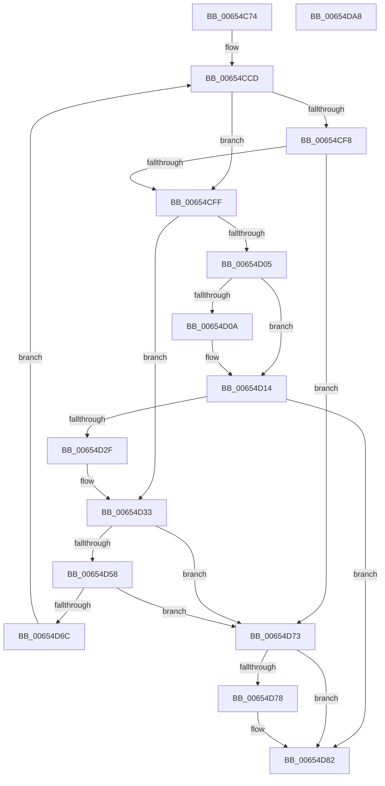

# BapdpProcessEtwEvents

- RVA: `0x00654C74`–`0x00654DA9` (길이 `309` bytes)
- VA: `0x0000000140654C74`
- 실행 섹션: `.text`
- PDB 이름 있음: `예`; PDB Function 태그: `아니요`
- unwind 정보 RVA: `0x000D4838`
- 디코드: `84`개 명령, `309/309` bytes 표시
- 미해석 바이트: `0` (있으면 어셈블리에 `.byte`로 보존)

> 이 문서는 커널 이미지의 기계어와 PDB 기호를 분석해 생성했습니다. 4번과 5번은 함수 원형과 자료형을 바이너리 사용 방식에서 추정한 C 해석이며 원본 소스 복구 결과는 아닙니다.

## 1. Dependencies

- 직접 호출 지점: **7**; 고유 호출 대상: **5**
- 직접 호출자로 확인된 함수: **1**
- RIP 상대 이미지 참조: **1**

### Outgoing calls
- `0x00654CEA` → [BapdpQueryData](../../init/C5/BapdpQueryData_function_00C50340.md) (function, `0x00C50340`)
- `0x00654D0F` → [ExFreePoolWithTag](../../poolcode/B8/ExFreePoolWithTag_function_00B82870.md) (function, `0x00B82870`)
- `0x00654D22` → [ExAllocatePool2](../../poolcode/B8/ExAllocatePool2_function_00B820F0.md) (function, `0x00B820F0`)
- `0x00654D4F` → [BapdpQueryData](../../init/C5/BapdpQueryData_function_00C50340.md) (function, `0x00C50340`)
- `0x00654D63` → [BapdWriteEtwEvents](../4A/BapdWriteEtwEvents_function_004AE884.md) (function, `0x004AE884`)
- `0x00654D7D` → [ExFreePoolWithTag](../../poolcode/B8/ExFreePoolWithTag_function_00B82870.md) (function, `0x00B82870`)
- `0x00654D89` → [_security_check_cookie](../6A/_security_check_cookie_function_006AC640.md) (function, `0x006AC640`)

### Direct callers
- [BootApplicationPersistentDataProcess](../../init/BE/BootApplicationPersistentDataProcess_function_00BEEBD4.md) at `0x00BEEC4F`

### Static image references
- `0x00654C8F` → RVA `0x00E0A740` (`.data`; read)

## 2. Other-region calls and transfers

- 다른 실행 섹션으로 향하는 call: **5**
  - `0x00654CEA` → [BapdpQueryData](../../init/C5/BapdpQueryData_function_00C50340.md) (`.text` → `INIT`)
  - `0x00654D0F` → [ExFreePoolWithTag](../../poolcode/B8/ExFreePoolWithTag_function_00B82870.md) (`.text` → `POOLCODE`)
  - `0x00654D22` → [ExAllocatePool2](../../poolcode/B8/ExAllocatePool2_function_00B820F0.md) (`.text` → `POOLCODE`)
  - `0x00654D4F` → [BapdpQueryData](../../init/C5/BapdpQueryData_function_00C50340.md) (`.text` → `INIT`)
  - `0x00654D7D` → [ExFreePoolWithTag](../../poolcode/B8/ExFreePoolWithTag_function_00B82870.md) (`.text` → `POOLCODE`)
- 별도 외부 분기/꼬리 이동을 확인하지 못했습니다.

## 3. Assembly (complete function range)

```asm
00654C74  48 8B C4                        mov rax, rsp
00654C77  48 89 58 08                     mov qword ptr [rax + 8], rbx
00654C7B  48 89 70 10                     mov qword ptr [rax + 0x10], rsi
00654C7F  4C 89 70 18                     mov qword ptr [rax + 0x18], r14
00654C83  4C 89 78 20                     mov qword ptr [rax + 0x20], r15
00654C87  55                              push rbp
00654C88  48 8B EC                        mov rbp, rsp
00654C8B  48 83 EC 60                     sub rsp, 0x60
00654C8F  48 8B 05 AA 5A 7B 00            mov rax, qword ptr [rip + 0x7b5aaa]
00654C96  48 33 C4                        xor rax, rsp
00654C99  48 89 45 F8                     mov qword ptr [rbp - 8], rax
00654C9D  0F 57 C0                        xorps xmm0, xmm0
00654CA0  C7 45 D8 52 06 9A 9C            mov dword ptr [rbp - 0x28], 0x9c9a0652
00654CA7  45 33 F6                        xor r14d, r14d
00654CAA  C7 45 DC E7 6B D6 4A            mov dword ptr [rbp - 0x24], 0x4ad66be7
00654CB1  33 DB                           xor ebx, ebx
00654CB3  C7 45 E0 9D B7 50 EA            mov dword ptr [rbp - 0x20], 0xea50b79d
00654CBA  0F 11 45 E8                     movups xmmword ptr [rbp - 0x18], xmm0
00654CBE  33 F6                           xor esi, esi
00654CC0  C7 45 E4 D2 03 1E B4            mov dword ptr [rbp - 0x1c], 0xb41e03d2
00654CC7  41 BF 00 00 00 80               mov r15d, 0x80000000
00654CCD  48 83 64 24 28 00               and qword ptr [rsp + 0x28], 0
00654CD3  48 8D 45 D0                     lea rax, [rbp - 0x30]
00654CD7  83 65 D0 00                     and dword ptr [rbp - 0x30], 0
00654CDB  48 8D 55 D8                     lea rdx, [rbp - 0x28]
00654CDF  45 33 C9                        xor r9d, r9d
00654CE2  48 89 44 24 20                  mov qword ptr [rsp + 0x20], rax
00654CE7  44 8B C6                        mov r8d, esi
00654CEA  E8 51 B6 5F 00                  call 0x140c50340
00654CEF  42 8D 0C 38                     lea ecx, [rax + r15]
00654CF3  41 85 CF                        test r15d, ecx
00654CF6  75 07                           jne 0x140654cff
00654CF8  3D 23 00 00 C0                  cmp eax, 0xc0000023
00654CFD  75 74                           jne 0x140654d73
00654CFF  44 39 75 D0                     cmp dword ptr [rbp - 0x30], r14d
00654D03  76 2E                           jbe 0x140654d33
00654D05  48 85 DB                        test rbx, rbx
00654D08  74 0A                           je 0x140654d14
00654D0A  33 D2                           xor edx, edx
00654D0C  48 8B CB                        mov rcx, rbx
00654D0F  E8 5C DB 52 00                  call 0x140b82870
00654D14  8B 55 D0                        mov edx, dword ptr [rbp - 0x30]
00654D17  B9 40 00 00 00                  mov ecx, 0x40
00654D1C  41 B8 42 61 50 64               mov r8d, 0x64506142
00654D22  E8 C9 D3 52 00                  call 0x140b820f0
00654D27  48 8B D8                        mov rbx, rax
00654D2A  48 85 C0                        test rax, rax
00654D2D  74 53                           je 0x140654d82
00654D2F  44 8B 75 D0                     mov r14d, dword ptr [rbp - 0x30]
00654D33  48 8D 45 E8                     lea rax, [rbp - 0x18]
00654D37  4C 8B CB                        mov r9, rbx
00654D3A  48 89 44 24 28                  mov qword ptr [rsp + 0x28], rax
00654D3F  48 8D 55 D8                     lea rdx, [rbp - 0x28]
00654D43  48 8D 45 D0                     lea rax, [rbp - 0x30]
00654D47  44 8B C6                        mov r8d, esi
00654D4A  48 89 44 24 20                  mov qword ptr [rsp + 0x20], rax
00654D4F  E8 EC B5 5F 00                  call 0x140c50340
00654D54  85 C0                           test eax, eax
00654D56  78 1B                           js 0x140654d73
00654D58  44 8B 45 D0                     mov r8d, dword ptr [rbp - 0x30]
00654D5C  48 8D 4D E8                     lea rcx, [rbp - 0x18]
00654D60  48 8B D3                        mov rdx, rbx
00654D63  E8 1C 9B E5 FF                  call 0x1404ae884
00654D68  85 C0                           test eax, eax
00654D6A  78 07                           js 0x140654d73
00654D6C  FF C6                           inc esi
00654D6E  E9 5A FF FF FF                  jmp 0x140654ccd
00654D73  48 85 DB                        test rbx, rbx
00654D76  74 0A                           je 0x140654d82
00654D78  33 D2                           xor edx, edx
00654D7A  48 8B CB                        mov rcx, rbx
00654D7D  E8 EE DA 52 00                  call 0x140b82870
00654D82  48 8B 4D F8                     mov rcx, qword ptr [rbp - 8]
00654D86  48 33 CC                        xor rcx, rsp
00654D89  E8 B2 78 05 00                  call 0x1406ac640
00654D8E  4C 8D 5C 24 60                  lea r11, [rsp + 0x60]
00654D93  49 8B 5B 10                     mov rbx, qword ptr [r11 + 0x10]
00654D97  49 8B 73 18                     mov rsi, qword ptr [r11 + 0x18]
00654D9B  4D 8B 73 20                     mov r14, qword ptr [r11 + 0x20]
00654D9F  4D 8B 7B 28                     mov r15, qword ptr [r11 + 0x28]
00654DA3  49 8B E3                        mov rsp, r11
00654DA6  5D                              pop rbp
00654DA7  C3                              ret
00654DA8  CC                              int3
```

## 4. C-style interpretation (structured pseudocode)

```c
__int64 __fastcall BapdpProcessEtwEvents(__int64 a1, __int64 a2, __int64 a3, int a4)
{
    __int64 result;
    __int64 v_r14;
    __int64 v_rbx;
    __int64 v_rsi;
    __int64 v_rsp;
    unsigned __int64 v_stack_m10;
    unsigned __int64 v_stack_m20;
    unsigned int v_stack_m24;
    unsigned int v_stack_m28;
    unsigned int v_stack_m2C;
    unsigned int v_stack_m30;
    unsigned __int64 v_stack_m38;
    unsigned __int64 v_stack_m40;
    unsigned __int64 v_stack_m48;
    unsigned __int64 v_stack_m8;

    *(unsigned __int64 *)(v_rsp + 8) = v_rbx;
    *(unsigned __int64 *)(v_rsp + 16) = v_rsi;
    *(unsigned __int64 *)(v_rsp + 24) = v_r14;
    *(unsigned __int64 *)(v_rsp + 32) = v_r15;
    v_rsp = (v_rsp) - (96);
    result = (*(unsigned __int64 *)(v_rip + 8084138)) ^ (v_rsp);
    v_stack_m10 = result;
    v_stack_m30 = 0x9C9A0652ULL;
    v_r14 = 0;
    v_stack_m2C = 0x4AD66BE7ULL;
    v_rbx = 0;
    v_stack_m28 = 0xEA50B79DULL;
    v_stack_m20 = v_xmm0;
    v_rsi = 0;
    v_stack_m24 = 0xB41E03D2ULL;
loc_00654CCD:
    a4 = 0;
    v_stack_m48 = v_stack_m38;
    result = BapdpQueryData(a1, v_stack_m30, 0, a4);
    if ((((unsigned int)((unsigned int)(0x80000000ULL))) & ((unsigned int)(result + (unsigned int)(0x80000000ULL) * 1))) != 0) goto loc_00654CFF;
    if (((unsigned int)(result)) != 0xC0000023ULL) goto loc_00654D73;
loc_00654CFF:
    if (v_stack_m38 <= 0) goto loc_00654D33;
    if (0 != 0) {
        a2 = 0;
        a1 = 0;
        result = ExFreePoolWithTag(a1, a2, 0, a4);
    }
    result = ExAllocatePool2(64, (unsigned int)(v_stack_m38), (unsigned int)(0x64506142ULL), a4);
    if (result == 0) goto loc_00654D82;
loc_00654D33:
    v_stack_m40 = v_stack_m20;
    v_stack_m48 = v_stack_m38;
    result = BapdpQueryData(64, v_stack_m30, 0, result);
    if (sign_flag) goto loc_00654D73;
    result = BapdWriteEtwEvents(v_stack_m20, result, (unsigned int)(v_stack_m38), result);
    if (sign_flag) goto loc_00654D73;
    v_rsi = (unsigned int)((v_rsi) + 1);
    goto loc_00654CCD;
loc_00654D73:
    if (result != 0) {
        a2 = 0;
        a1 = result;
        result = ExFreePoolWithTag(a1, a2, (unsigned int)(v_stack_m38), result);
    }
    a1 = (v_stack_m10) ^ (v_rsp);
    result = _security_check_cookie(a1, a2, (unsigned int)(v_stack_m38), result);
    return result;
}
```

## 5. (Beta) C Style

```c
int64_t BapdpProcessEtwEvents(int64_t Arg1, int64_t Arg2, int64_t Arg3, int32_t Arg4)
{
    int64_t result;
    int64_t local_r14;
    int64_t local_rbx;
    int64_t local_rsi;
    int64_t local_rsp;
    uint64_t v_stack_m10;
    uint64_t v_stack_m20;
    uint32_t v_stack_m24;
    uint32_t v_stack_m28;
    uint32_t v_stack_m2C;
    uint32_t v_stack_m30;
    uint64_t v_stack_m38;
    uint64_t v_stack_m40;
    uint64_t v_stack_m48;
    uint64_t v_stack_m8;

    *(uint64_t *)(local_rsp + 0x8) = local_rbx;
    *(uint64_t *)(local_rsp + 0x10) = local_rsi;
    *(uint64_t *)(local_rsp + 0x18) = local_r14;
    *(uint64_t *)(local_rsp + 0x20) = local_r15;
    local_rsp = (local_rsp) - (96);
    result = (*(uint64_t *)(v_rip + 0x7B5AAA)) ^ (local_rsp);
    v_stack_m10 = result;
    v_stack_m30 = 0x9C9A0652ULL;
    local_r14 = 0;
    v_stack_m2C = 0x4AD66BE7ULL;
    local_rbx = 0;
    v_stack_m28 = 0xEA50B79DULL;
    v_stack_m20 = v_xmm0;
    local_rsi = 0;
    v_stack_m24 = 0xB41E03D2ULL;
loc_00654CCD:
    Arg4 = 0;
    v_stack_m48 = v_stack_m38;
    result = BapdpQueryData(Arg1, v_stack_m30, 0, Arg4);
    if ((((uint32_t)((uint32_t)(0x80000000ULL))) & ((uint32_t)(result + (uint32_t)(0x80000000ULL) * 1))) != 0) goto loc_00654CFF;
    if (((uint32_t)(result)) != 0xC0000023ULL) goto loc_00654D73;
loc_00654CFF:
    if (v_stack_m38 <= 0) goto loc_00654D33;
    if (0 != 0) {
        Arg2 = 0;
        Arg1 = 0;
        result = ExFreePoolWithTag(Arg1, Arg2, 0, Arg4);
    }
    result = ExAllocatePool2(64, (uint32_t)(v_stack_m38), (uint32_t)(0x64506142ULL), Arg4);
    if (result == 0) goto loc_00654D82;
loc_00654D33:
    v_stack_m40 = v_stack_m20;
    v_stack_m48 = v_stack_m38;
    result = BapdpQueryData(64, v_stack_m30, 0, result);
    if (sign_flag) goto loc_00654D73;
    result = BapdWriteEtwEvents(v_stack_m20, result, (uint32_t)(v_stack_m38), result);
    if (sign_flag) goto loc_00654D73;
    local_rsi = (uint32_t)((local_rsi) + 1);
    goto loc_00654CCD;
loc_00654D73:
    if (result != 0) {
        Arg2 = 0;
        Arg1 = result;
        result = ExFreePoolWithTag(Arg1, Arg2, (uint32_t)(v_stack_m38), result);
    }
    Arg1 = (v_stack_m10) ^ (local_rsp);
    result = _security_check_cookie(Arg1, Arg2, (uint32_t)(v_stack_m38), result);
    return result;
}
```

## 6. Execution-region graph

[열기: 2D/3D 그래프와 함수 탐색 컨트롤 패널](../../../control-panel.html?section=text&rva=0x00654C74&view=graph)

- 2D 그래프는 위에서 아래로 흐르고, 3D 그래프는 빈 공간을 드래그해 회전합니다. Shift+드래그는 이동, 휠은 확대·축소, 함수 노드 선택은 대상 보고서 이동입니다.

### Static fallback


