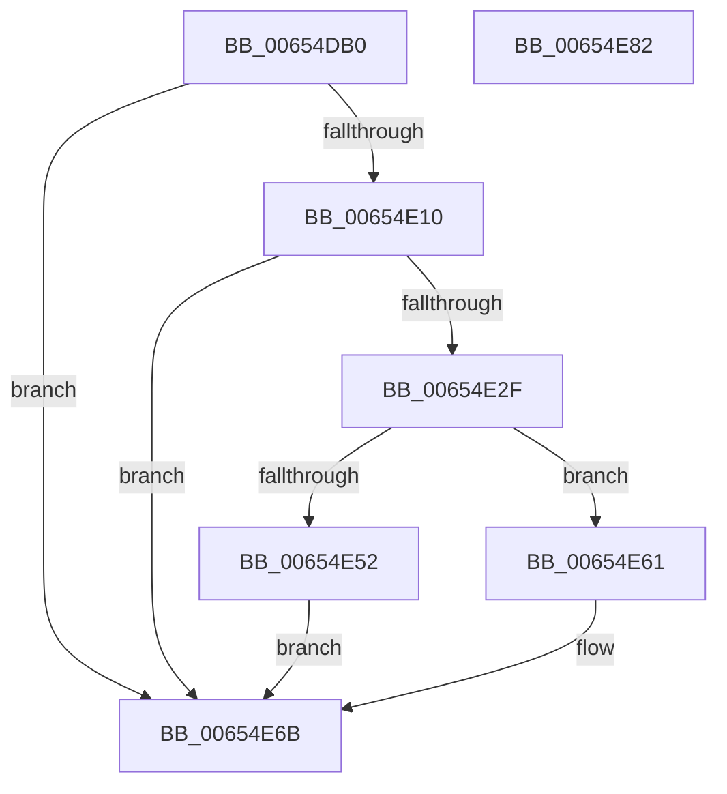

# BapdpProcessSpacesBootInformation

- RVA: `0x00654DB0`–`0x00654E83` (길이 `211` bytes)
- VA: `0x0000000140654DB0`
- 실행 섹션: `.text`
- PDB 이름 있음: `예`; PDB Function 태그: `아니요`
- unwind 정보 RVA: `0x000D47B0`
- 디코드: `53`개 명령, `211/211` bytes 표시
- 미해석 바이트: `0` (있으면 어셈블리에 `.byte`로 보존)

> 이 문서는 커널 이미지의 기계어와 PDB 기호를 분석해 생성했습니다. 4번과 5번은 함수 원형과 자료형을 바이너리 사용 방식에서 추정한 C 해석이며 원본 소스 복구 결과는 아닙니다.

## 1. Dependencies

- 직접 호출 지점: **5**; 고유 호출 대상: **4**
- 직접 호출자로 확인된 함수: **1**
- RIP 상대 이미지 참조: **2**

### Outgoing calls
- `0x00654E04` → [BapdpQueryData](../../init/C5/BapdpQueryData_function_00C50340.md) (function, `0x00C50340`)
- `0x00654E22` → [ExAllocatePool2](../../poolcode/B8/ExAllocatePool2_function_00B820F0.md) (function, `0x00B820F0`)
- `0x00654E49` → [BapdpQueryData](../../init/C5/BapdpQueryData_function_00C50340.md) (function, `0x00C50340`)
- `0x00654E66` → [ExFreePoolWithTag](../../poolcode/B8/ExFreePoolWithTag_function_00B82870.md) (function, `0x00B82870`)
- `0x00654E72` → [_security_check_cookie](../6A/_security_check_cookie_function_006AC640.md) (function, `0x006AC640`)

### Direct callers
- [BootApplicationPersistentDataProcess](../../init/BE/BootApplicationPersistentDataProcess_function_00BEEBD4.md) at `0x00BEEC45`

### Static image references
- `0x00654DBD` → RVA `0x00E0A740` (`.data`; read)
- `0x00654E58` → RVA `0x00EFF020` (`.data`; write)

## 2. Other-region calls and transfers

- 다른 실행 섹션으로 향하는 call: **4**
  - `0x00654E04` → [BapdpQueryData](../../init/C5/BapdpQueryData_function_00C50340.md) (`.text` → `INIT`)
  - `0x00654E22` → [ExAllocatePool2](../../poolcode/B8/ExAllocatePool2_function_00B820F0.md) (`.text` → `POOLCODE`)
  - `0x00654E49` → [BapdpQueryData](../../init/C5/BapdpQueryData_function_00C50340.md) (`.text` → `INIT`)
  - `0x00654E66` → [ExFreePoolWithTag](../../poolcode/B8/ExFreePoolWithTag_function_00B82870.md) (`.text` → `POOLCODE`)
- 별도 외부 분기/꼬리 이동을 확인하지 못했습니다.

## 3. Assembly (complete function range)

```asm
00654DB0  48 89 5C 24 08                  mov qword ptr [rsp + 8], rbx
00654DB5  55                              push rbp
00654DB6  48 8B EC                        mov rbp, rsp
00654DB9  48 83 EC 50                     sub rsp, 0x50
00654DBD  48 8B 05 7C 59 7B 00            mov rax, qword ptr [rip + 0x7b597c]
00654DC4  48 33 C4                        xor rax, rsp
00654DC7  48 89 45 F8                     mov qword ptr [rbp - 8], rax
00654DCB  48 83 64 24 28 00               and qword ptr [rsp + 0x28], 0
00654DD1  48 8D 45 E0                     lea rax, [rbp - 0x20]
00654DD5  83 65 E0 00                     and dword ptr [rbp - 0x20], 0
00654DD9  48 8D 55 E8                     lea rdx, [rbp - 0x18]
00654DDD  45 33 C9                        xor r9d, r9d
00654DE0  48 89 44 24 20                  mov qword ptr [rsp + 0x20], rax
00654DE5  45 33 C0                        xor r8d, r8d
00654DE8  C7 45 E8 B4 DC AD E7            mov dword ptr [rbp - 0x18], 0xe7addcb4
00654DEF  C7 45 EC 34 DC 39 45            mov dword ptr [rbp - 0x14], 0x4539dc34
00654DF6  C7 45 F0 9A 76 EB BD            mov dword ptr [rbp - 0x10], 0xbdeb769a
00654DFD  C7 45 F4 07 BE 6F 7E            mov dword ptr [rbp - 0xc], 0x7e6fbe07
00654E04  E8 37 B5 5F 00                  call 0x140c50340
00654E09  3D 23 00 00 C0                  cmp eax, 0xc0000023
00654E0E  75 5B                           jne 0x140654e6b
00654E10  8B 55 E0                        mov edx, dword ptr [rbp - 0x20]
00654E13  B9 00 01 00 00                  mov ecx, 0x100
00654E18  48 83 C2 08                     add rdx, 8
00654E1C  41 B8 42 61 50 64               mov r8d, 0x64506142
00654E22  E8 C9 D2 52 00                  call 0x140b820f0
00654E27  48 8B D8                        mov rbx, rax
00654E2A  48 85 C0                        test rax, rax
00654E2D  74 3C                           je 0x140654e6b
00654E2F  48 83 64 24 28 00               and qword ptr [rsp + 0x28], 0
00654E35  4C 8D 48 08                     lea r9, [rax + 8]
00654E39  48 8D 45 E0                     lea rax, [rbp - 0x20]
00654E3D  45 33 C0                        xor r8d, r8d
00654E40  48 8D 55 E8                     lea rdx, [rbp - 0x18]
00654E44  48 89 44 24 20                  mov qword ptr [rsp + 0x20], rax
00654E49  E8 F2 B4 5F 00                  call 0x140c50340
00654E4E  85 C0                           test eax, eax
00654E50  78 0F                           js 0x140654e61
00654E52  8B 45 E0                        mov eax, dword ptr [rbp - 0x20]
00654E55  48 89 03                        mov qword ptr [rbx], rax
00654E58  48 89 1D C1 A1 8A 00            mov qword ptr [rip + 0x8aa1c1], rbx
00654E5F  EB 0A                           jmp 0x140654e6b
00654E61  33 D2                           xor edx, edx
00654E63  48 8B CB                        mov rcx, rbx
00654E66  E8 05 DA 52 00                  call 0x140b82870
00654E6B  48 8B 4D F8                     mov rcx, qword ptr [rbp - 8]
00654E6F  48 33 CC                        xor rcx, rsp
00654E72  E8 C9 77 05 00                  call 0x1406ac640
00654E77  48 8B 5C 24 60                  mov rbx, qword ptr [rsp + 0x60]
00654E7C  48 83 C4 50                     add rsp, 0x50
00654E80  5D                              pop rbp
00654E81  C3                              ret
00654E82  CC                              int3
```

## 4. C-style interpretation (structured pseudocode)

```c
__int64 __fastcall BapdpProcessSpacesBootInformation(__int64 a1, __int64 a2, int a3, int a4)
{
    __int64 result;
    __int64 v_rsp;
    unsigned __int64 v_stack_m10;
    unsigned int v_stack_m14;
    unsigned int v_stack_m18;
    unsigned int v_stack_m1C;
    unsigned __int64 v_stack_m20;
    unsigned __int64 v_stack_m28;
    unsigned __int64 v_stack_m30;
    unsigned __int64 v_stack_m38;
    unsigned __int64 v_stack_p8;

    v_stack_p8 = v_rbx;
    v_rsp = (v_rsp) - (80);
    result = (*(unsigned __int64 *)(v_rip + 8083836)) ^ (v_rsp);
    v_stack_m10 = result;
    a4 = 0;
    v_stack_m38 = v_stack_m28;
    a3 = 0;
    v_stack_m20 = 0xE7ADDCB4ULL;
    v_stack_m1C = 0x4539DC34ULL;
    v_stack_m18 = 0xBDEB769AULL;
    v_stack_m14 = 0x7E6FBE07ULL;
    result = BapdpQueryData(a1, v_stack_m20, a3, a4);
    if (((unsigned int)(result)) != 0xC0000023ULL) goto loc_00654E6B;
    a2 = ((unsigned int)(v_stack_m28)) + (8);
    result = ExAllocatePool2(256, a2, (unsigned int)(0x64506142ULL), a4);
    if (result == 0) goto loc_00654E6B;
    a3 = 0;
    v_stack_m38 = v_stack_m28;
    result = BapdpQueryData(256, v_stack_m20, a3, result + 8);
    if (sign_flag) goto loc_00654E61;
    *(unsigned __int64 *)(result) = (unsigned int)(v_stack_m28);
    *(unsigned __int64 *)(v_rip + 9085377) = result;
    goto loc_00654E6B;
loc_00654E61:
    a2 = 0;
    result = ExFreePoolWithTag(result, a2, a3, result + 8);
loc_00654E6B:
    a1 = (v_stack_m10) ^ (v_rsp);
    result = _security_check_cookie(a1, a2, a3, result + 8);
    v_rsp = (v_rsp) + (80);
    return result;
}
```

## 5. (Beta) C Style

```c
int64_t BapdpProcessSpacesBootInformation(int64_t Arg1, int64_t Arg2, int32_t Arg3, int32_t Arg4)
{
    int64_t result;
    int64_t local_rsp;
    uint64_t v_stack_m10;
    uint32_t v_stack_m14;
    uint32_t v_stack_m18;
    uint32_t v_stack_m1C;
    uint64_t v_stack_m20;
    uint64_t v_stack_m28;
    uint64_t v_stack_m30;
    uint64_t v_stack_m38;
    uint64_t v_stack_p8;

    v_stack_p8 = local_rbx;
    local_rsp = (local_rsp) - (80);
    result = (*(uint64_t *)(v_rip + 0x7B597C)) ^ (local_rsp);
    v_stack_m10 = result;
    Arg4 = 0;
    v_stack_m38 = v_stack_m28;
    Arg3 = 0;
    v_stack_m20 = 0xE7ADDCB4ULL;
    v_stack_m1C = 0x4539DC34ULL;
    v_stack_m18 = 0xBDEB769AULL;
    v_stack_m14 = 0x7E6FBE07ULL;
    result = BapdpQueryData(Arg1, v_stack_m20, Arg3, Arg4);
    if (((uint32_t)(result)) != 0xC0000023ULL) goto loc_00654E6B;
    Arg2 = ((uint32_t)(v_stack_m28)) + (8);
    result = ExAllocatePool2(256, Arg2, (uint32_t)(0x64506142ULL), Arg4);
    if (result == 0) goto loc_00654E6B;
    Arg3 = 0;
    v_stack_m38 = v_stack_m28;
    result = BapdpQueryData(256, v_stack_m20, Arg3, result + 8);
    if (sign_flag) goto loc_00654E61;
    *(uint64_t *)(result) = (uint32_t)(v_stack_m28);
    *(uint64_t *)(v_rip + 0x8AA1C1) = result;
    goto loc_00654E6B;
loc_00654E61:
    Arg2 = 0;
    result = ExFreePoolWithTag(result, Arg2, Arg3, result + 8);
loc_00654E6B:
    Arg1 = (v_stack_m10) ^ (local_rsp);
    result = _security_check_cookie(Arg1, Arg2, Arg3, result + 8);
    local_rsp = (local_rsp) + (80);
    return result;
}
```

## 6. Execution-region graph

[열기: 2D/3D 그래프와 함수 탐색 컨트롤 패널](../../../control-panel.html?section=text&rva=0x00654DB0&view=graph)

- 2D 그래프는 위에서 아래로 흐르고, 3D 그래프는 빈 공간을 드래그해 회전합니다. Shift+드래그는 이동, 휠은 확대·축소, 함수 노드 선택은 대상 보고서 이동입니다.

### Static fallback


