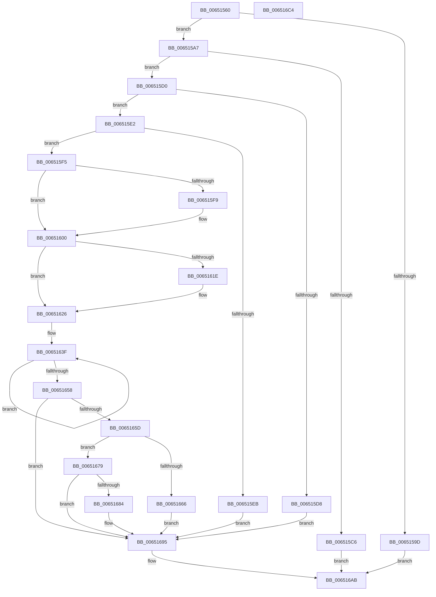

# EtwSendTraceBuffer

- RVA: `0x00651560`–`0x006516C5` (길이 `357` bytes)
- VA: `0x0000000140651560`
- 실행 섹션: `.text`
- PDB 이름 있음: `예`; PDB Function 태그: `아니요`
- unwind 정보 RVA: `0x0009F048`
- 디코드: `92`개 명령, `357/357` bytes 표시
- 미해석 바이트: `0` (있으면 어셈블리에 `.byte`로 보존)

> 이 문서는 커널 이미지의 기계어와 PDB 기호를 분석해 생성했습니다. 4번과 5번은 함수 원형과 자료형을 바이너리 사용 방식에서 추정한 C 해석이며 원본 소스 복구 결과는 아닙니다.

## 1. Dependencies

- 직접 호출 지점: **7**; 고유 호출 대상: **7**
- 직접 호출자로 확인된 함수: **0**
- RIP 상대 이미지 참조: **1**

### Outgoing calls
- `0x0065158B` → [PsGetCurrentServerSiloGlobals](../2F/PsGetCurrentServerSiloGlobals_function_002FE1F0.md) (function, `0x002FE1F0`)
- `0x006515B9` → [EtwpOpenLogger](../2F/EtwpOpenLogger_function_002F77F0.md) (function, `0x002F77F0`)
- `0x00651636` → [EtwpGetLoggerTimeStamp](../37/EtwpGetLoggerTimeStamp_function_0037E690.md) (function, `0x0037E690`)
- `0x0065165D` → [KeGetEffectiveIrql](../2F/KeGetEffectiveIrql_function_002F8030.md) (function, `0x002F8030`)
- `0x00651672` → [KeSetEvent](../33/KeSetEvent_function_0033F310.md) (function, `0x0033F310`)
- `0x00651690` → [KeInsertQueueDpc](../20/KeInsertQueueDpc_function_00207C50.md) (function, `0x00207C50`)
- `0x006516A4` → [EtwpCloseLogger](../41/EtwpCloseLogger_function_00418060.md) (function, `0x00418060`)

### Direct callers
- 이 함수 시작 RVA로 연결되는 직접 call은 확인되지 않았습니다. 간접 호출은 완전히 역산할 수 없습니다.

### Static image references
- `0x006515A7` → RVA `0x00FC6AA8` (`ALMOSTRO`; read)

## 2. Other-region calls and transfers

- 다른 실행 섹션으로 향하는 call: **0**
- 별도 외부 분기/꼬리 이동을 확인하지 못했습니다.

## 3. Assembly (complete function range)

```asm
00651560  48 8B C4                        mov rax, rsp
00651563  48 89 58 10                     mov qword ptr [rax + 0x10], rbx
00651567  48 89 68 18                     mov qword ptr [rax + 0x18], rbp
0065156B  48 89 70 20                     mov qword ptr [rax + 0x20], rsi
0065156F  57                              push rdi
00651570  41 56                           push r14
00651572  41 57                           push r15
00651574  48 83 EC 30                     sub rsp, 0x30
00651578  33 F6                           xor esi, esi
0065157A  44 0F B7 F1                     movzx r14d, cx
0065157E  40 88 70 08                     mov byte ptr [rax + 8], sil
00651582  4D 8B F9                        mov r15, r9
00651585  41 8B E8                        mov ebp, r8d
00651588  48 8B FA                        mov rdi, rdx
0065158B  E8 60 CC CA FF                  call 0x1402fe1f0
00651590  4C 8B 90 40 03 00 00            mov r10, qword ptr [rax + 0x340]
00651597  45 3B 72 10                     cmp r14d, dword ptr [r10 + 0x10]
0065159B  72 0A                           jb 0x1406515a7
0065159D  B8 08 00 00 C0                  mov eax, 0xc0000008
006515A2  E9 04 01 00 00                  jmp 0x1406516ab
006515A7  48 8B 15 FA 54 97 00            mov rdx, qword ptr [rip + 0x9754fa]
006515AE  4C 8D 4C 24 50                  lea r9, [rsp + 0x50]
006515B3  45 33 C0                        xor r8d, r8d
006515B6  41 8B CE                        mov ecx, r14d
006515B9  E8 32 62 CA FF                  call 0x1402f77f0
006515BE  48 8B D8                        mov rbx, rax
006515C1  48 85 C0                        test rax, rax
006515C4  75 0A                           jne 0x1406515d0
006515C6  B8 96 02 00 C0                  mov eax, 0xc0000296
006515CB  E9 DB 00 00 00                  jmp 0x1406516ab
006515D0  39 B0 40 01 00 00               cmp dword ptr [rax + 0x140], esi
006515D6  75 0A                           jne 0x1406515e2
006515D8  BE 02 03 00 C0                  mov esi, 0xc0000302
006515DD  E9 B3 00 00 00                  jmp 0x140651695
006515E2  F7 40 0C 00 00 04 00            test dword ptr [rax + 0xc], 0x40000
006515E9  75 0A                           jne 0x1406515f5
006515EB  BE 08 00 00 C0                  mov esi, 0xc0000008
006515F0  E9 A0 00 00 00                  jmp 0x140651695
006515F5  85 ED                           test ebp, ebp
006515F7  74 07                           je 0x140651600
006515F9  F0 01 A8 F0 00 00 00            lock add dword ptr [rax + 0xf0], ebp
00651600  8B 4F 30                        mov ecx, dword ptr [rdi + 0x30]
00651603  89 4F 04                        mov dword ptr [rdi + 4], ecx
00651606  03 0F                           add ecx, dword ptr [rdi]
00651608  F6 47 34 20                     test byte ptr [rdi + 0x34], 0x20
0065160C  89 4F 08                        mov dword ptr [rdi + 8], ecx
0065160F  C7 47 2C 03 00 00 00            mov dword ptr [rdi + 0x2c], 3
00651616  66 C7 47 36 05 00               mov word ptr [rdi + 0x36], 5
0065161C  75 08                           jne 0x140651626
0065161E  0F B6 47 28                     movzx eax, byte ptr [rdi + 0x28]
00651622  66 89 47 28                     mov word ptr [rdi + 0x28], ax
00651626  48 8B 44 24 70                  mov rax, qword ptr [rsp + 0x70]
0065162B  48 8B CB                        mov rcx, rbx
0065162E  48 89 47 40                     mov qword ptr [rdi + 0x40], rax
00651632  4C 89 7F 38                     mov qword ptr [rdi + 0x38], r15
00651636  E8 55 D0 D2 FF                  call 0x14037e690
0065163B  48 89 47 10                     mov qword ptr [rdi + 0x10], rax
0065163F  48 8B 8B 80 00 00 00            mov rcx, qword ptr [rbx + 0x80]
00651646  48 89 4F 20                     mov qword ptr [rdi + 0x20], rcx
0065164A  48 8B C1                        mov rax, rcx
0065164D  F0 48 0F B1 BB 80 00 00 00      lock cmpxchg qword ptr [rbx + 0x80], rdi
00651656  75 E7                           jne 0x14065163f
00651658  48 85 C9                        test rcx, rcx
0065165B  75 38                           jne 0x140651695
0065165D  E8 CE 69 CA FF                  call 0x1402f8030
00651662  3C 02                           cmp al, 2
00651664  77 13                           ja 0x140651679
00651666  48 8D 8B E0 01 00 00            lea rcx, [rbx + 0x1e0]
0065166D  45 33 C0                        xor r8d, r8d
00651670  33 D2                           xor edx, edx
00651672  E8 99 DC CE FF                  call 0x14033f310
00651677  EB 1C                           jmp 0x140651695
00651679  F0 0F BA AB 38 03 00 00 08      lock bts dword ptr [rbx + 0x338], 8
00651682  72 11                           jb 0x140651695
00651684  48 8D 8B 38 02 00 00            lea rcx, [rbx + 0x238]
0065168B  45 33 C0                        xor r8d, r8d
0065168E  33 D2                           xor edx, edx
00651690  E8 BB 65 BB FF                  call 0x140207c50
00651695  44 8A 44 24 50                  mov r8b, byte ptr [rsp + 0x50]
0065169A  41 8B CE                        mov ecx, r14d
0065169D  48 8B 15 04 54 97 00            mov rdx, qword ptr [rip + 0x975404]
006516A4  E8 B7 69 DC FF                  call 0x140418060
006516A9  8B C6                           mov eax, esi
006516AB  48 8B 5C 24 58                  mov rbx, qword ptr [rsp + 0x58]
006516B0  48 8B 6C 24 60                  mov rbp, qword ptr [rsp + 0x60]
006516B5  48 8B 74 24 68                  mov rsi, qword ptr [rsp + 0x68]
006516BA  48 83 C4 30                     add rsp, 0x30
006516BE  41 5F                           pop r15
006516C0  41 5E                           pop r14
006516C2  5F                              pop rdi
006516C3  C3                              ret
006516C4  CC                              int3
```

## 4. C-style interpretation (structured pseudocode)

```c
__int64 __fastcall EtwSendTraceBuffer(unsigned __int16 a1, __int64 a2, int a3, __int64 a4, __int64 a5)
{
    __int64 result;
    __int64 v_rsi;
    __int64 v_rsp;
    unsigned __int64 v_stack_p10;
    unsigned __int64 v_stack_p18;
    unsigned __int64 v_stack_p20;
    unsigned __int64 v_stack_p8;

    *(unsigned __int64 *)(v_rsp + 16) = v_rbx;
    *(unsigned __int64 *)(v_rsp + 24) = v_rbp;
    *(unsigned __int64 *)(v_rsp + 32) = v_rsi;
    v_rsp = (v_rsp) - (48);
    v_rsi = 0;
    *(unsigned __int8 *)(v_rsp + 8) = 0;
    result = PsGetCurrentServerSiloGlobals(a1, a2, a3, a4);
    if (a1 < (*(unsigned int *)(*(unsigned __int64 *)(result + 832) + 16))) goto loc_006515A7;
    goto loc_006516AB;
loc_006515A7:
    a3 = 0;
    result = EtwpOpenLogger((unsigned int)(a1), *(unsigned __int64 *)(v_rip + 9917690), a3, v_stack_p8);
    if (result != 0) goto loc_006515D0;
    goto loc_006516AB;
loc_006515D0:
    if ((*(unsigned int *)((unsigned int)(0xC0000296ULL) + 320)) != 0) goto loc_006515E2;
    goto loc_00651695;
loc_006515E2:
    if (((*(unsigned int *)((unsigned int)(0xC0000296ULL) + 12)) & (0x40000ULL)) != 0) goto loc_006515F5;
    goto loc_00651695;
loc_006515F5:
    if ((unsigned int)((unsigned int)(a3)) != 0) {
    }
    *(unsigned int *)(a2 + 4) = (unsigned int)((unsigned int)(*(unsigned int *)(a2 + 48)));
    a1 = (unsigned int)(((unsigned int)(*(unsigned int *)(a2 + 48))) + (*(unsigned int *)(a2)));
    *(unsigned int *)(a2 + 8) = a1;
    *(unsigned int *)(a2 + 44) = 3;
    *(unsigned __int16 *)(a2 + 54) = 5;
    result = (unsigned int)(0xC0000296ULL);
    if (((*(unsigned __int8 *)(a2 + 52)) & (32)) == 0) {
        result = *(unsigned __int8 *)(a2 + 40);
        *(unsigned __int16 *)(a2 + 40) = (unsigned __int16)(result);
    }
    *(unsigned __int64 *)(a2 + 64) = a5;
    *(unsigned __int64 *)(a2 + 56) = a4;
    result = EtwpGetLoggerTimeStamp(result, *(unsigned __int64 *)(v_rip + 9917690), a3, v_stack_p8);
    *(unsigned __int64 *)(a2 + 16) = result;
loc_0065163F:
    *(unsigned __int64 *)(a2 + 32) = *(unsigned __int64 *)(result + 128);
    if (((*(unsigned __int8 *)(a2 + 52)) & (32)) != 0) goto loc_0065163F;
    if (*(unsigned __int64 *)(result + 128) != 0) goto loc_00651695;
    result = KeGetEffectiveIrql(*(unsigned __int64 *)(result + 128), *(unsigned __int64 *)(v_rip + 9917690), a3, v_stack_p8);
    if (((unsigned __int8)(result)) > 2) goto loc_00651679;
    a3 = 0;
    a2 = 0;
    result = KeSetEvent(result + 480, a2, a3, v_stack_p8);
    goto loc_00651695;
loc_00651679:
    if (!(condition_is_below)) {
        a1 = result + 568;
        a3 = 0;
        a2 = 0;
        result = KeInsertQueueDpc(a1, a2, a3, v_stack_p8);
    }
    result = EtwpCloseLogger((unsigned int)(a1), *(unsigned __int64 *)(v_rip + 9917444), v_stack_p8, v_stack_p8);
loc_006516AB:
    v_rsp = (v_rsp) + (48);
    return (unsigned int)((unsigned int)((unsigned int)(0xC0000008ULL)));
}
```

## 5. (Beta) C Style

```c
int64_t EtwSendTraceBuffer(uint16_t Arg1, void *Arg2, int32_t Arg3, int64_t Arg4, int64_t Arg5)
{
    uint8_t *arg2 = (uint8_t *)Arg2;

    int64_t result;
    int64_t local_rsi;
    int64_t local_rsp;
    uint64_t v_stack_p10;
    uint64_t v_stack_p18;
    uint64_t v_stack_p20;
    uint64_t v_stack_p8;

    *(uint64_t *)(local_rsp + 0x10) = local_rbx;
    *(uint64_t *)(local_rsp + 0x18) = local_rbp;
    *(uint64_t *)(local_rsp + 0x20) = local_rsi;
    local_rsp = (local_rsp) - (48);
    local_rsi = 0;
    *(uint8_t *)(local_rsp + 0x8) = 0;
    result = PsGetCurrentServerSiloGlobals(Arg1, Arg2, Arg3, Arg4);
    if (Arg1 < (*(uint32_t *)(*(uint64_t *)(result + 0x340) + 0x10))) goto loc_006515A7;
    goto loc_006516AB;
loc_006515A7:
    Arg3 = 0;
    result = EtwpOpenLogger((uint32_t)(Arg1), *(uint64_t *)(v_rip + 0x9754FA), Arg3, v_stack_p8);
    if (result != 0) goto loc_006515D0;
    goto loc_006516AB;
loc_006515D0:
    if ((*(uint32_t *)((uint32_t)(0xC0000296ULL) + 0x140)) != 0) goto loc_006515E2;
    goto loc_00651695;
loc_006515E2:
    if (((*(uint32_t *)((uint32_t)(0xC0000296ULL) + 0xC)) & (0x40000ULL)) != 0) goto loc_006515F5;
    goto loc_00651695;
loc_006515F5:
    if ((uint32_t)((uint32_t)(Arg3)) != 0) {
    }
    *(uint32_t *)(arg2 + 0x4) = (uint32_t)((uint32_t)(*(uint32_t *)(arg2 + 0x30)));
    Arg1 = (uint32_t)(((uint32_t)(*(uint32_t *)(arg2 + 0x30))) + (*(uint32_t *)(arg2)));
    *(uint32_t *)(arg2 + 0x8) = Arg1;
    *(uint32_t *)(arg2 + 0x2C) = 3;
    *(uint16_t *)(arg2 + 0x36) = 5;
    result = (uint32_t)(0xC0000296ULL);
    if (((*(uint8_t *)(arg2 + 0x34)) & (32)) == 0) {
        result = *(uint8_t *)(arg2 + 0x28);
        *(uint16_t *)(arg2 + 0x28) = (uint16_t)(result);
    }
    *(uint64_t *)(arg2 + 0x40) = Arg5;
    *(uint64_t *)(arg2 + 0x38) = Arg4;
    result = EtwpGetLoggerTimeStamp(result, *(uint64_t *)(v_rip + 0x9754FA), Arg3, v_stack_p8);
    *(uint64_t *)(arg2 + 0x10) = result;
loc_0065163F:
    *(uint64_t *)(arg2 + 0x20) = *(uint64_t *)(result + 0x80);
    if (((*(uint8_t *)(arg2 + 0x34)) & (32)) != 0) goto loc_0065163F;
    if (*(uint64_t *)(result + 0x80) != 0) goto loc_00651695;
    result = KeGetEffectiveIrql(*(uint64_t *)(result + 0x80), *(uint64_t *)(v_rip + 0x9754FA), Arg3, v_stack_p8);
    if (((uint8_t)(result)) > 2) goto loc_00651679;
    Arg3 = 0;
    Arg2 = 0;
    result = KeSetEvent(result + 480, Arg2, Arg3, v_stack_p8);
    goto loc_00651695;
loc_00651679:
    if (!(condition_is_below)) {
        Arg1 = result + 568;
        Arg3 = 0;
        Arg2 = 0;
        result = KeInsertQueueDpc(Arg1, Arg2, Arg3, v_stack_p8);
    }
    result = EtwpCloseLogger((uint32_t)(Arg1), *(uint64_t *)(v_rip + 0x975404), v_stack_p8, v_stack_p8);
loc_006516AB:
    local_rsp = (local_rsp) + (48);
    return (uint32_t)((uint32_t)((uint32_t)(0xC0000008ULL)));
}
```

### 관측된 메모리 오프셋

구조체 형식이 확인되지 않은 접근은 인자 기준의 오프셋으로만 기록했습니다.

| 기준 인자 | 오프셋 표현 | 폭 (bit) | 접근 |
|---|---:|---:|---|
| `Arg2` | `+ 0x0` | `32` | `R` |
| `Arg2` | `+ 0x4` | `32` | `W` |
| `Arg2` | `+ 0x8` | `32` | `W` |
| `Arg2` | `+ 0x10` | `64` | `W` |
| `Arg2` | `+ 0x20` | `64` | `W` |
| `Arg2` | `+ 0x28` | `8` | `R` |
| `Arg2` | `+ 0x28` | `16` | `W` |
| `Arg2` | `+ 0x2C` | `32` | `W` |
| `Arg2` | `+ 0x30` | `32` | `R` |
| `Arg2` | `+ 0x34` | `8` | `R` |
| `Arg2` | `+ 0x36` | `16` | `W` |
| `Arg2` | `+ 0x38` | `64` | `W` |
| `Arg2` | `+ 0x40` | `64` | `W` |

## 6. Execution-region graph

[열기: 2D/3D 그래프와 함수 탐색 컨트롤 패널](../../../control-panel.html?section=text&rva=0x00651560&view=graph)

- 2D 그래프는 위에서 아래로 흐르고, 3D 그래프는 빈 공간을 드래그해 회전합니다. Shift+드래그는 이동, 휠은 확대·축소, 함수 노드 선택은 대상 보고서 이동입니다.

### Static fallback


